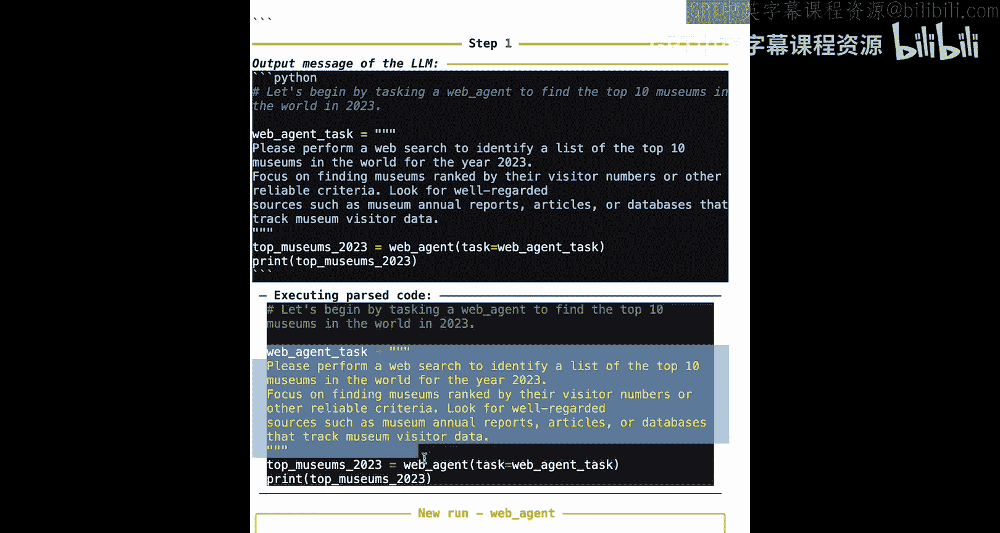
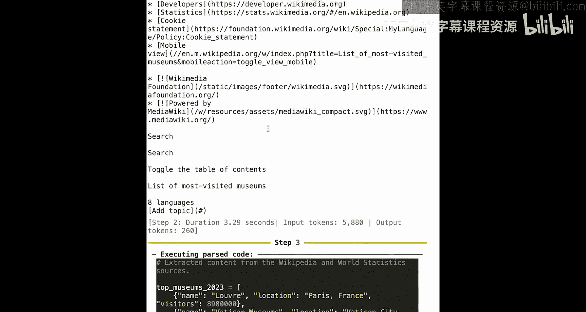
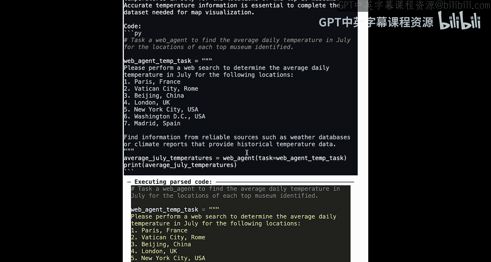
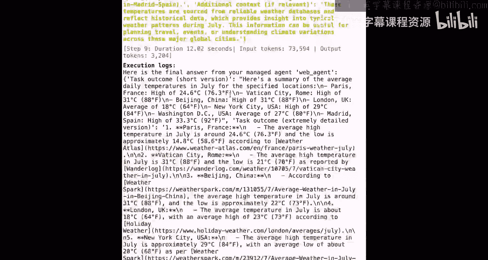
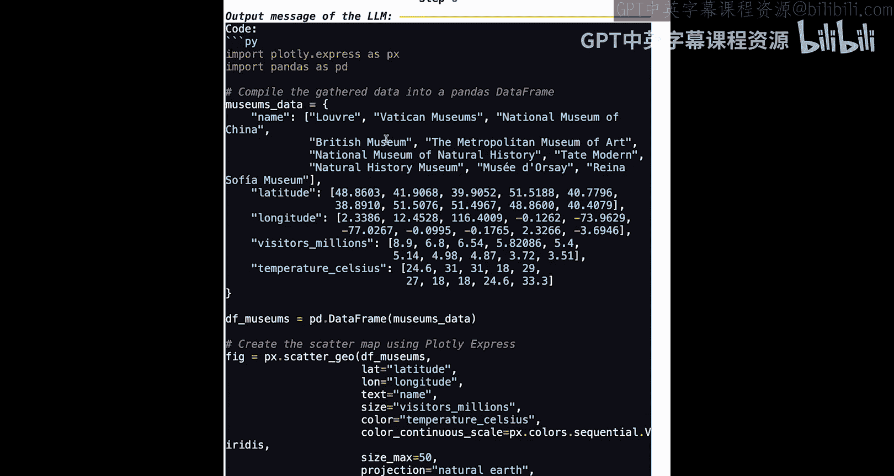
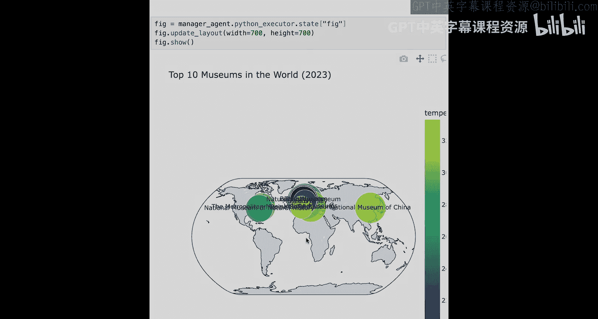

# 吴恩达《使用smolagents构建代码智能体｜Building Code Agents with Hugging Face smolagents》 - P6：6.build-a-deep-research-agent.zh_en - GPT中英字幕课程资源 - BV1twLZzwE6o

You have learned how codeag work and explored many facets of their operation Nowadays time to have them face our final tests。

 the task that we have is the following since you love museums。

 you've decided to open ice cream trucks in front of the biggest museums in the world。

 but you must make sure the average temperature there doesn't get too hot or your ice cream will melt too quickly。

 you want to find the top 10 museums in the world by visitor count and the temperatures at their locations in this lesson。

 you will build a deep research agent that can find this information and organize it into an interactive report。

 let's dive right in。 So we start by creating a search tool leveraging the excellent search library heavily and another tool to visit web pages here the code is using the two different tool constructs from small agents。

 The tool decorator that you can just apply to a function and the class definition。

 you can check the online documentation from the library to learn how these two work and we。

Also test the search tool with a basic request to get to know more about the melting temperature of ice cream。

 So then let's move on to setting up your agents。Instead set up the model。Using GT 40 from Open AI。

 then we start with creating a baseline simple agent that can browse the web or will give it this request。

Could you give me a so list of the top 10 museums in the world in 2023。

 along with their visitor count and the approximate daily temperature in July？To define the codeags。

We simply make sure to pass it the two tools that we've defined above。

 then we can run it with our request。As you can see。

 sometimes agents produce errors while trying to execute actions。

 so here it is an incorrect snippets that no code could be paused from。

 but this is the nature of agent systems that then this error gets appended into their memory and they can iterate upon that to correct their own mistake。

 recover from it and still end up producing proper results。 The agent is still running。

Let's give it a bit more time。 Okay now。We have the final reports。Let's display it。So。As you can see。

 it seems there are mistakes in this report。 First， the temperature being whole numbers。

 It seems like the agent didn't reallyche the exact number。 Also。

 we asked for 10 museums and we only get four here。

 So probably we need to set up more scaffolding to improve the results。 So what we will do is first。

 we will set a planning interval， meaning that our agents will be able to regularly plan forward。

 And also since web browsing is particularly important here， we will need to use。

A multiagent structure to assign a dedicated agent to the information search parts Multiagent structures are a perfect fit for the above task they to separate memories between different subtasks with two great benefits so first you can specialize each agent so for instance by the tools or the mo that you choose you can specialize it on its core task thus making it more per and also separating memories reduces the count of input tokens age step thus reducing latency and costs so let's create a team with a dedicated web search agent manage by another agent with starts by defining the web search agents it is quite similar to the other one that we define above with this exception that it will have a specific name and description which can then be used by the manager agent to understand what this agent does and call it by its name。

Then the manager agent will need to do some mental heavy lifting， so as said above。

 will give it a good model to think， as well as the ability to periodically run a dedicated planning step through the planning interval argument。

Which will be5 here。 The manager agents should also have plotting capabilities because we want it to produce an interactive final report。

 So let us give it access to additional imports， including ply for spatial plotting。 And finally。

In this function， we will use a multimodal model running on the saved map image to ask it a list of questions。

 basically to make sure that the user given task was properly answered then depending on the output of this agents if it is a fail an exception is raised。

 meaning that the agent should keep running and needs to address the points raised in the review before proceeding on the opposites if the test passes the final answer can be returned to the user we also have a utility function to visualize more clearly what this team of agents looks like。

 as you can see we have the manager agent here with its authorized imports allowing it to do some plotting it only has access to the final answer tool but it can also call upon its manager agents here the web agents which has more tools at its disposal to browse the web Now everything is set up so we can just give the manager agent its task and send it running。

Will take some time to run， but I will walk you through the process as the agent makes progress。

 So first since we set up a specific planning interval。

 the agent starts by laying out its plan where it breaks our larger overarching task into smaller easier to solve subtasks then it proceeds to solving them and the very first thing it does is create a request for search that it will send to its webag when the webag receives it it starts running to solve this request and it will produce its own report to return to the manager agent This is quite verbose because the agent is going through many web pages but actually this exactly why we did a specialized agents we want this agent to handle all the stuff that's in the web pages so that the manager agent doesn't have to bother with filling its contact length with us and in the end the webag ends up producing a very clear and concise report that it will send back to the manager。

AgentsAnd based on this， the manager agent can now proceed。

It says I now have the top 10 museums in the world， along with their visitor count。

 now I need to find the average daily temperature and it proceeds to finding it by asking the Web agent again to produce a reports。

This time on this new topic of the temperatures， and in turn。

 it produces a new report with all this lists of temperatures to return to the manager agents。

The manager agents now asks for the less parts， the last reports that he wants from the Webag。

 which is about the geographical coordinates for the museums that it has found。

Now the manager agent has received all the relevant information。To give its final answer。

 But remember that this answer should be an interactive map， not merely a pandas data frame。

 So the manager agent proceeds to plotting the figure before trying to return it。

 So this is what the figure looks like。 If we zoom in a bit because it's a bit cluttered。

 You can see that every museum is plotted on a different point。

 And it has all the required information。 Now， remember that we had a check in place to verify that the map was correct。

 This is the analysis from the multimodal model。 And the final decision is a pass。

So now the final answer will be returned to the user， and now we get this final reports。

 we can even access the interpreter states to get this map if we want。Here is how to access it。

 Then we can display it again after zooming in a bit to make it clearer， O。

Now you have everything you want， you can proceed to opening an ice cream truck at each of these locations。

