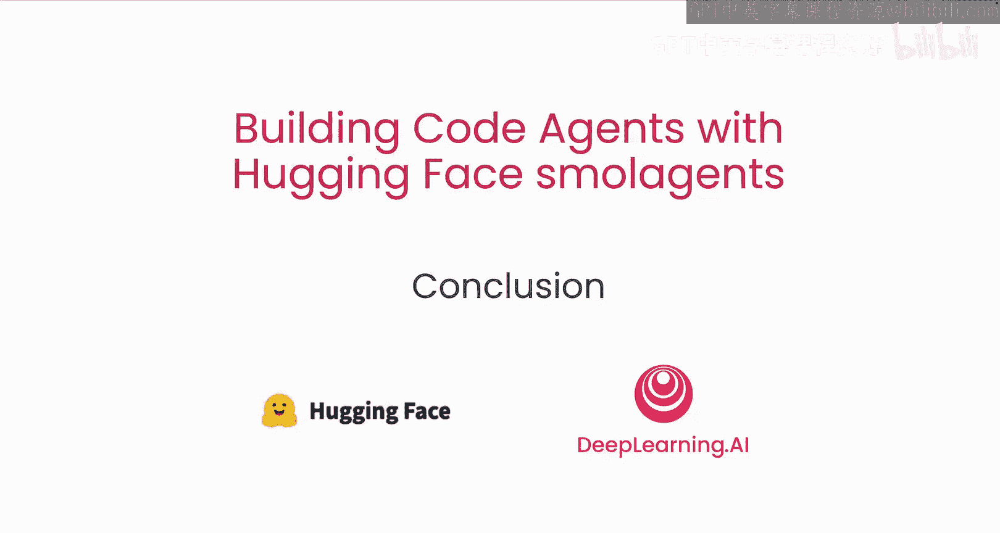

# 吴恩达《使用smolagents构建代码智能体｜Building Code Agents with Hugging Face smolagents》 - P7：7.conclusion.zh_en - GPT中英字幕课程资源 - BV1twLZzwE6o

Congratulations on completing the course In this course。

 you learned about how to build powerful code agents using hugging face small agents。 In particular。

 you now know how to securely run LLM generated code。

 how to monitor and evaluate agents and how to build powerful multiag systems。

 Small agents is an open source library。 Please come and join us making it even better。

 See on Gitthub。😊。

