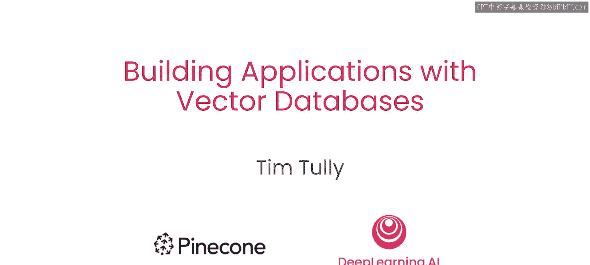
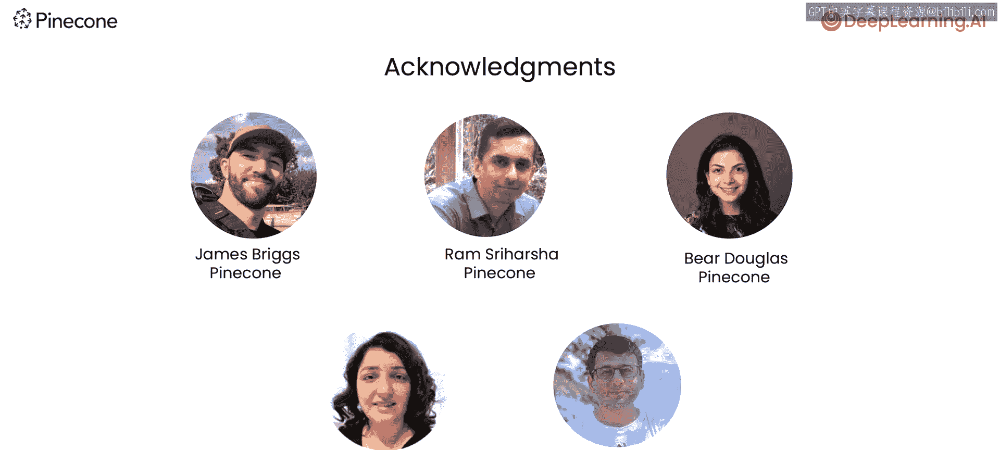

# 吴恩达《使用向量数据库构建应用程序｜Building Applications with Vector Databases》中英字幕 - P1：1.Introduction.zh - GPT中英字幕课程资源 - BV1QH4y1e7kM

Welcome to this short courseBuilding applications with vector databases built in partnership with PCO vector databases have become a key part of the infrastructure stack for building applications with large language models。

 specifically rag or retrieval augmented generation。

 but it turns out that they're useful for even more applications than is widely appreciated。

In this course， you learn how to use vector DBs to quickly build applications in text similarity search。

 RaG， image similarity search， anomaly detection， recommended systems and hybrid search refers to using simultaneously sparse and dense vectors。

I know that's a lot of stuff， but that's why I hope you find this course useful will cover a huge space of applications that you be able to build using vector DBs。

 I'm thrilled that the instructor for this course is Tim Tali。

 a board member at Pinecone For over a decade， Tim had led teams of thousands of engineers as Spunks CTO and then Yahoo's vice president of engineering。

😊，Tim had also developed a Pinecomb vector databases commandline interface and I look forward to him sharing with us what he's been seeing from working with many people building on top of Pinecom's vector T。

 Next Andrew， I'm excited to be here I know I gave a long list of applications just now。

 but let me unpack briefly some of the key topics。😊，Vor DB is lets you input a collection of vectors。

 say embeddings the documents if you're implementing RAG， and then send queries to it。

 such as an embedding of a new text query to retrieve documents relevant to your query。

That's what made vector DB is a key component of RAG where you fetch additional context for an LM to generate this response。

But it turns out that disability to fetch similar vectors makes it very useful for many other applications as well。

 For example， in image similarity search， you can compute embeddings of images and then use a vector DB to quickly find similar images or you can carry out anomaly detection by checking of a new item has anything similar to it and if it doesn't then maybe as an anomaly。

 there are lot of details to how to implement these effectively and Tim will dive into the specific mental frameworks at tips for building these applications。

😊。

Yes， as Andrew said， there are a lot of potential applications for vector databases。

 you learn about six of them in this course。 First。

 you'll start by building a basic semantic search for text documents。

Then you'll move into building a rag app。In the next step， you'll build a recommender system。Next。

 you will implement a hybrid search app for product recommendation。

Then you will build a child parentent image similarity app。

 and finally you will work on an anomaly detection app based on a dataset set of server logs。

Through these examples， you'll learn how to use a vector database to store and help you manipulate lots of different datas。

 we'll draw some examples from Wikipedia text， pictures of faces， Qo text。

 structured data in the form of network logs， and a fashion data with paired images and text。

One of the cool techniques that you'll learn about as well is hybrid search in which you can use a vector database to manipulate vectors with both a sparse and a dense component。

For example， in the product recommendation setting。

 you will see how to use a dense embedding of images of clothing alongside a sparse embedding of a text description and how to dial a knob controlling the relative weighting between the sparse and dense parts of the vector。

By learning the foundations of vector databases and working on the applications you'll learn in this course。

 I'm sure you'll find even more possibilities to explore Many people have worked to create this course I'd like to thank on the Pine cone side James Bgg Ra Shihasha and Bear Douglas from Deeplening。

 AI Dila Eadin and Eshma Gagari have also contributed to this course In the first lesson you will explore the essentials of semantic search。

 which will be used throughout the other lessons in this course。

That sounds great and a lot of materials in this one short course。

 so let's go add a new dimension to what we can do using vector DPs Let's go to the next video and get started。

😊。