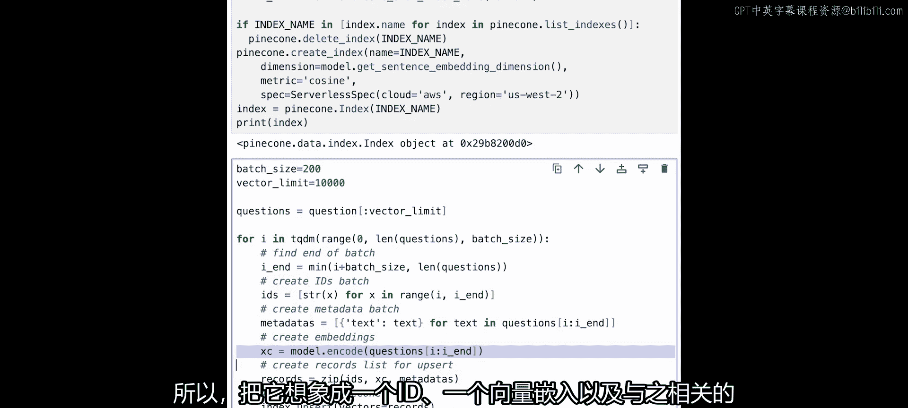
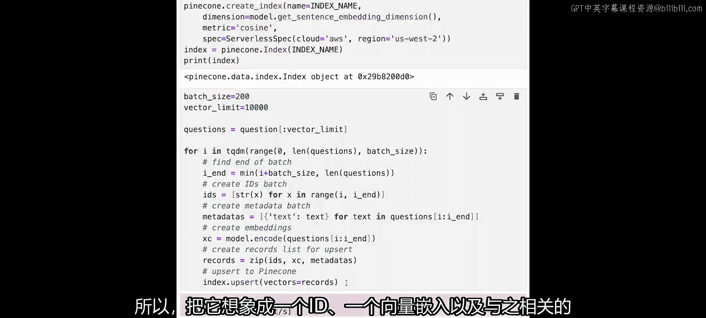
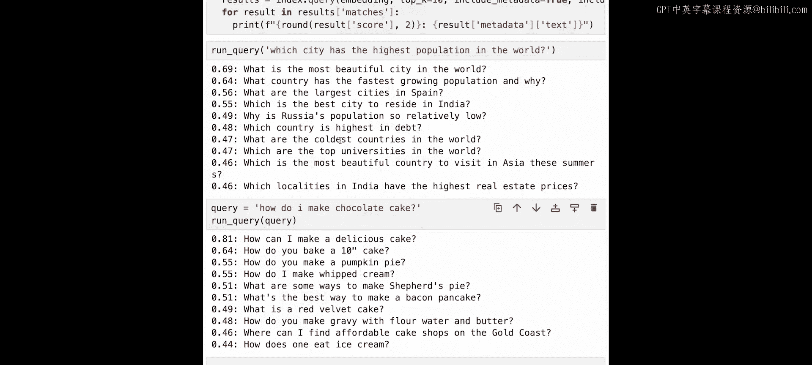

# 吴恩达《使用向量数据库构建应用程序｜Building Applications with Vector Databases》中英字幕 - P2：2.Semantic Search.zh - GPT中英字幕课程资源 - BV1QH4y1e7kM

Semantic search is a type of search that focuses on the meaning of the content being searched as opposed to lexical search。

 which looks for literal or pattern matches to strings。

 This is an extremely powerful construct that is underlyinglined most of what we see from text oring to generative AI applications。

In this lesson， you will be introduced to the essentials of vector databases and semantic search。

 which will be used throughout the next lessons in this course。 Let's dive in。

So we're going to build a very simple semantic search application using PCO。

What we're going to do is start here on the left hand side with the user and download a core data set and turn it into a series of vector embeddings and store it in Pancom。

Then we're going to build a simple question answer response system and we'll ask what country has the highest population。

 and this will be a generic enough application that you can ask multiple questions against it as well。

 and so you'll see how that works in the example let we show in just a moment。

So let's start off building the application So what we'll first do is pull in import warnings so that we don't get warnings when we run the application。

And then pull in the rest of what we need and what we'll rely on here。

So we're going to use sentence transformers。 There's a small helper utility that we created called deep learning AI U that handle some P cone and open AI key management for us Okay that works great。

 and then we'll use TQDM to see the progress of a lot of this work that we're doing So let's download the Qra data set。

And you'll see that we're taking here a subset of the data between row 240，000， 290。

000 because it's so large。And we want to make it manageable。

And what we can do now is take a look at the data and see what we have。

So you can see here we looked at five rows of the data and we can see there's questions there's identifiers for the questions all looks really great and usable so let's start to prepare the data to ask questions so what we'll do is get all of our questions。

So we'll iterate over all of the questions。And add it to。

Essentialized array that has all of them in it。 and we'll use extend here。

It has multiple elements in it。And then we'll build a list out of it。

And then join it with the control。The new lion character。So that we can look at it。

And see where we have。This is just a small delimiter here， this can be really as long as you like。

 but this makes it easier to see this is going to put a hyphen across 50 times。

And then let's look at the data。Ced。Have a small list of cone there。All right。

So those are all the questions that we have and then we'll prepare。 You'll see that we have 100。

000 questions prepared。 So now let's get ready to turn this into embeddings before we send it into Plancom so。

Depending on the device you have at home。You may or may not have Kuda available for you。

And if you do， some of this will go a lot faster for you， if not。

 it's not a big deal because the data set' not that large， you'll remember we took a subset。Of it。嗯。

Oops。😔，And now we will use sentence transformer。To transform this data into embeddings。All right。

 no kuda， that's okay， we'll move forward that it is not that large。

 but we have our model ready to go。And so now what we'll do is actually create a sample question and turn that。

Into an embedding。And then we'll look at the embedding， and we'll see， hopefully。

That's 384 elements wide。 so now that we have an embedding， we have our data， we have our questions。

 we're going to start to use Ponee a bit and so we have a small utility that we've prepared for you called DLI Us and we'll instantiate it here and then we'll get our API key for P cone to use and that's all you'll really need use to use Pine cone。

Okay。So now we're going to connect the P cone and what you'll see here is the syntax is slightly different now there's a what we call a singleton object in Pcone and it just takes the API key。

 this is because it's connecting to what's called Pcone version 3。

 which is a so- calledled serverless version of P cone。

So what we'll do now here is use that Us package that we talked about earlier。

 the deep learning AI Us and create an index name out of that。

 and we'll get our index name and then we will start to connect to PCO。But before we do that。

 we're going to do a little bit of house cleaning and delete old indexes in case you're doing lessons out of order。

 And so what this so do is look for the index name that we just declare it and see if it already exists in the P cone index will'll actually just delete it。

 Then we will create our index and。Let's just keep it clean here。

This is saying we're going to use I happen to know the answer to this dimension parameter is 384 and we saw that earlier。

 we're going to use cosine distance as the metrics to find similarity。

 and then there's a new object in P cone called the serverless spec。

And the server of spec simply just specifies what public cloud that your index runs on。 in this case。

 it's AW and US West2 and now we will finally。Get a pointer to our P cone index。

 So say index equals pine cone。Index and we used。What is the index name that we created just a moment ago and if we say index。

 okay， great。If I say print index， we should get back a P cone index object。

It's going to take a little bit to run。Alright， there's our index object。 Finally。

 after we've created our P cone index， we can upload some data， so we will upload data。Using。

That size of。200。And a maximum of。10 k。Ss。And so， now， we will。Get a subset。

 we said we're just going to use 10 k， right？And then what we're going to do is。Iterate through。

Or questions？Okay。Find the end of the batch that we're looking at。Generate IDs for each vector。

 each vector inside of Pcoe needs a unique identifier in this case we'll just use the index number。

We'll store inside the metadata feature of Pine cone the actual text from the question next to the vector embedding and then use the model that we created above to generate the vector embedding and store it all together so think of it as a tuple of an ID vector embedding in the metadata that goes with it and we'll actually zip up that tuple using zip and then up it into P cone and so if we run this。

You'll see TQDM kick in， and this will upload all of our embeddings into PanCO。

This will take a minute to upload there's a lot of data here that we're uploading as well as the model has to run。

 so there's some encoding for the model that has to happen。

 there's a round chip that has to happen in the P cone so we'll just wait here for a minute for that to happen。

Alright， so that finished。 And let's check to see what we've stored。 So there's a function called。

Describing ex stats。And we have 10，000 vectors just as we matches what we have here above inside a vector limit。

 so that worked great。So now we can finally get to the point where we can ask questions and so I've defined something very small that we'll use here that executesqueries for's called BQury and all this does is take the text version of the question that we want to ask。

 that's query， builds a vector em bending out of it that we'll need。

And then runs the query against P cone。 So the question is becoming embedding。

 We pass that embedding into P cone。 We ask for the top K。 in this case， we're asking for 10。

 You can feel free to change that to any number you like， you can get more results back。

 And then we ask for the metadata which actually have the question in it right It's useless for us to just look at the vector embedding。

 We actually want to see the text as well。 And so that's what's inside of the metadata。

 And we want to say include values equals false because what that does is it makes it so that we don't get the embeddings back because there's nothing to do with them。

 They're just being used to find similarity。 And then what we'll do is iterate through the results and then print them out。

 so now let's actually。Run a query。 So which city has the highest。Population in the world。Al right。

 we're great。 So we got back a bunch of similar questions was the most beautiful city in the world。

 which country has the fastest growing population。 All of that is， is relevant and works great。

 And we can come up with other sort of silly examples to see that our system works well and it's extensible。

 How do I make。😊，Chocolate cake is sort of a random question I came up with。

And then we just called Brenan queryrry again。All right how do I make a delicious cake。

 how do you make a 10 inch cake， these are all relevant questions as well so that's it for this lesson we built a semantic search system top to bottom using P cone we embedded the titles from the questions from Qra and we built something that will be extenible and that you can reuse over and overberg again In the next lesson we will build a RA system or rechirieval augmented generation using P cone and open AI。

