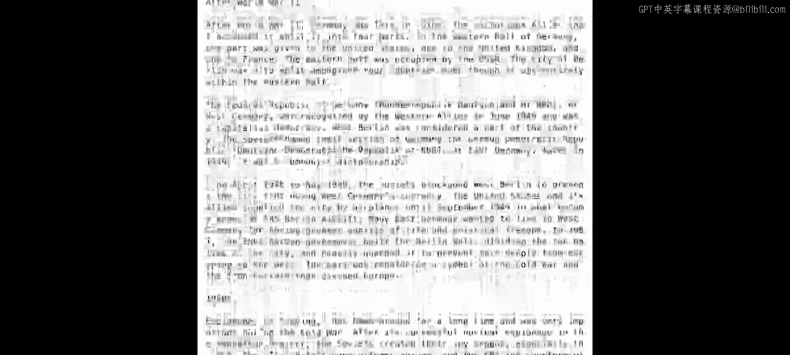
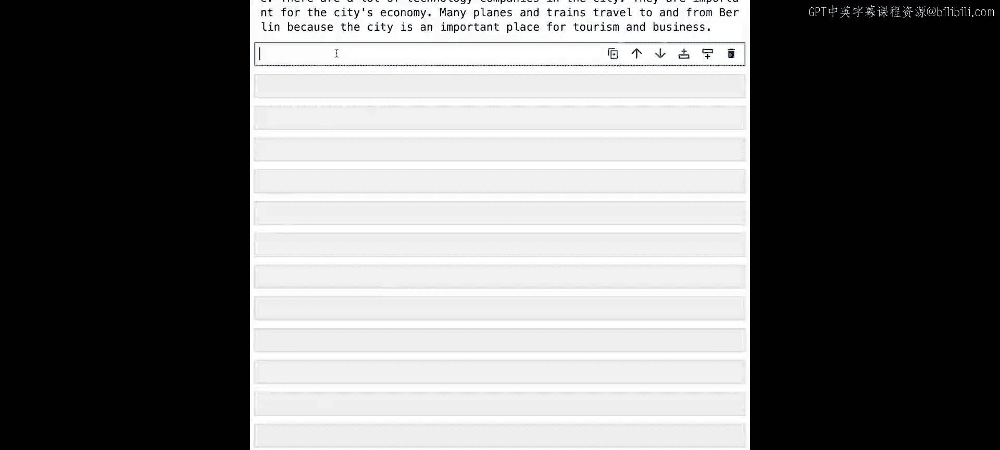
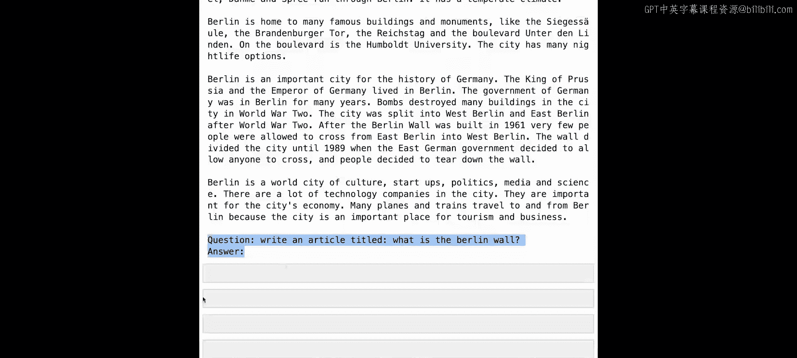
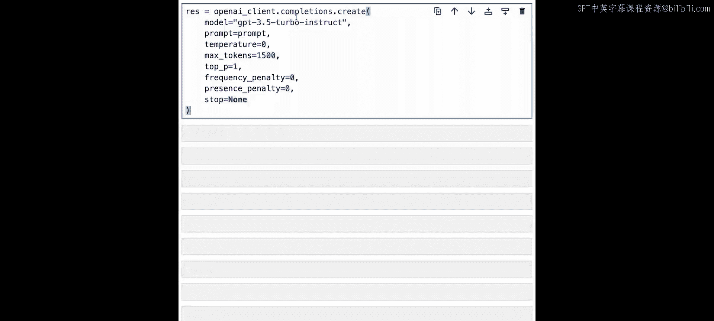
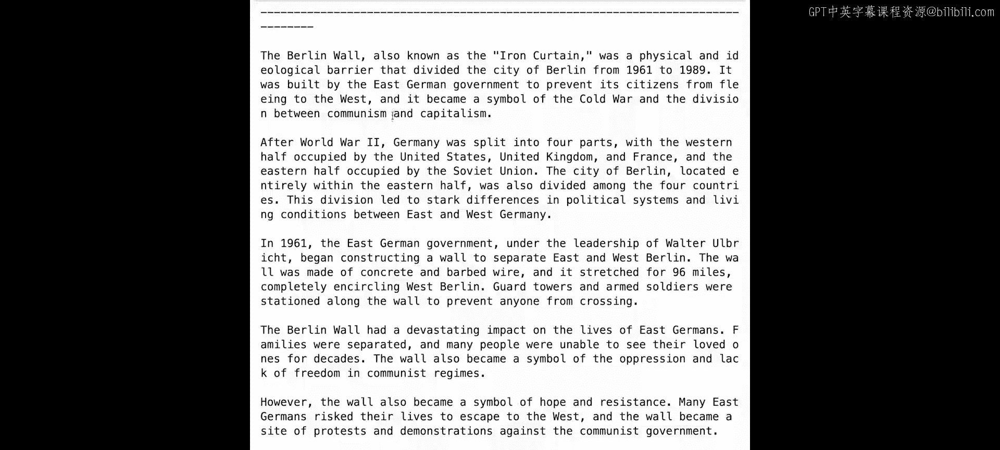
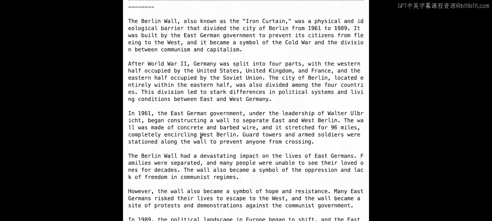

# 吴恩达《使用向量数据库构建应用程序｜Building Applications with Vector Databases》中英字幕 - P3：3.Retrieval Augmented Generation (RAG).zh - GPT中英字幕课程资源 - BV1QH4y1e7kM

In this lesson， you will build a ragG system or a retrieval augmented generation system using Pine cone。

 You will work with the sample data set of Wikipedia articles and build vector embeddings out of the articles。

Then you will look at what search results look like by doing a simple document retrieval from Pinecone。

 Then while working with Open AI， you will build a nicely summarized article out of these results。

All right， let's dive into the code。Now we're going to build a classic retrieval augmented generation or RaG system using Pinecone with open AI。

 and it's going to look something like this。 So we have our happyface user that we had in previous lessons here on the left and what he's going to do is ask a question against a dataset that we will have prepared and stored in Pinecone and in this case we'll ask what was the B Wall and similar to other lessons we got back long responses or documents from Pinecone。

 but it'd be really nice if we could take some of those long responses and get a summarized version of them and what we'll do is show how to build and do a little bit of prompt engineering out of the responses from Pinecone send those back into the prompt of open AI and get back a beautifully written response from Open AI and this is really just ragG in a nutshell and I definitely encourage you to try different versions of doing prompt engineering ours is just a fairly simple example to show you what it might look like。

So let's get started。So what we're going to do is first clear out warnings so we've seen this previously before where we import warnings and filter out the warnings and this is just to keep things clean for us So then we're going to pull in the packages that we rely on and again we have our deep learning AI U package that manages keys from open A and Pine cone for us and then we're going to set up Pine cone similar to how we have before So we're going to get the API key。

And so。Okay， now that we have our P cone API key， we are going to， as usual， connect to P cone。

 So first connect the P cone。Then， get the index name。Using our utilities package。

And then delete our index。If it already exists。And then create the index。And then finally。

 you get a pointer to the index that we just created。Let's look at our index name just for fun。

Alright， something long and unintelligible， but that's okay。 It works great。 nonetheless。

 So now we're going to download our data。 And we've prepared that ahead of time so that you don't have to watch us download data sort of like a cooking show in that sense。

 So it's just w get Myq for quiet and then output file will be called lesson2 wki do CSV do zip。

 And it's a file sitting on on Dropbox somewhere with a long long URL。

 And then after it gets downloaded， we unzip that file and you'll have a CSV file locally in your notebook。

 So once we do that。😊，Then we're gonna create a data frame out of it。

 And so this is a data frame using DFS shorthand for data frame。

 Then we're using pandas to read the CSV file。 So that's that's reads underscore CSv。

 and we're reading the file that we just unzipped。 And then let's just take a quick look at at the data that we have。

 Okay， so we data frame ahead to look at the data。 And so there's a few columns of interest。

 One is the unique identifier for the data。 There's the metadata that has the source of of the articles and the content。

 And then there's the vector embeddings themselves under values。

 And these are good examples of what a vector embedding looks like it's really just list of floating point numbers。

 And now we'll prepare the embeddings。And upload them into P cone。

 So we'll create an array called prepped。 that's going to save what we store into Pine cone。

 and then we will iterate through the data frame。 So we'll iterate through the data frame we'll use2 QVDM again to get a progress bar okay。

And then we will get the metadata from it。Because that's a string we're going to use literal eval from the AST package。

To get a dictionary back。And then we're going to append it to what we just created。

 And this is how you create a vector embedding in P cone is this long。

Dictionary of values that I cut and paste here because it's so long I'll explain it to you。

So what we have here is really a tuple again， you have an ID that's a unique identifier for the embedding。

 you have the values which is really the vector embedding itself。

And then you have metadata and we just took the met that we had from the line above and this is the article information Now what we're going to do is upload that data into P cone so。

What we want to do is do it in batches。So if the length of that prepared array is greater than 200。

 we're going to do it in batches with 200。Then we're going to insert it into bankbone。

Okay and then once it's inserted， we're going to clear that out so that we can do it all over again So again a pine cone embedding is really three things there's the ID that's unique identifier for it。

 there's the values that's the vector embedding and then there's metadata that goes with with the vector embedding in this case it's the article metadata okay。

And now what we're going to do is upload data in batches of 200 vectors at a time in the P cone。

 so we'll check to see if we've stored 200 elements into this prep array and if so。

 then we up the data and then we clear it out again and so we'll run that。

And so we'll see TK VM do its thing while we upload data into PanCO。

So we finished uploading our data into Pine cone and let's verify what was uploaded。Okay。

 so we will use index dot， describe index stats and look at it。All right， we had 10。

000 elements just as we had hoped。Okay， now we're going to use open AI。

 So what we're going to do is get our open AI。AI key。

And that is utilizing this package that we created that we keep mentioning called。DLAI utility。

 then we're going to get our API key。And we're going to get a pointer to the open AI。Cot。

And then I have a small helper routine I've defined to help you get back a vector embedding from opening I so this is called get embeddings and what this does is is basically take an array of text and it's gonna to use the Ada embedding model and return to you vector embeddings for the text in the array of articles and just basically just returns sort of blindly by the way you'll notice that we had that batch of 200 that I talked about earlier before feel free to try and play with that number and see what you can get I found that for me personally。

 it worked great at 200 Pine cone recommends that you do something between 100 and 500 but I personally found that 200 was the fastest for me but I'd love to hear from all of you out there taken a lesson what was fastest for you。

And now we're all set up， we have our data sitting in Pine cone。

 we've connected to open AI or we've prepared open AI， and we're ready to execute some queries。

 so let's talk about。The Berlin wall for just a moment。 And we will ask， what is the Berlin wall。

Okay。And then we will build an embedding out of that。Qurry。Okay。

And then we will run a query against P cone right and this is how we query pine cone again。

 it takes a pointer to the embedding that we just got above。

We're going to return the top three results again feel free to play with that。

 you can change it to five or10 or whatever you want to look at in this case I only want to see three for demo purposes and then we want the article data itself and that's going to be sitting in the metadata section and we want to have that settings set the choose that we get the metadata back。

Okay。And then what we'll do is parse the response out。

So we get back an object from Pine cone and we're going to extract out from the matches object。

 the text inside the metadata so that's what this comprehension does and then what we're going to do is look at it by joining it to the new line character。

Okay， now we are done this with the setup and we're going to query Pcoe and see the results come back。

And so here we go， we got three articles we asked for three because we set top K to three that have information about the Berlin wall So this is a lot of text and it's sort of its disconnected because we have three discrete articles。

 but it'd be really nice to get that summarizeizing something that's readable for folks in case we want to use it for or homework assignment or we're preparing a memo for work that's definitely what I would do and that's what we're going to do next and so we're going prepare do what's called prompt engineering we're going to build a small prompt out of those articles that we just saw in Pinecone and it's going to take the following format We're going to say write an article titled colon what is the Berlin wall we're basically instructing OpenaiI to write an article for us based on the Berlin wall。

And what we're going to do is again， get our embeddings using the get embeddings helper function that we just asked for Okay。

 we'll run this all over again we just did this， but that's okay， it's fast。

We're going to run the query and now we're actually going to build our prompt and this is going to be fairly sophisticated compared to just asking it a simple question so。

What we're going to do is iterate through the matches object that we just got back from Pinecone and get back that text and that's what we're going to store in the context array。

And then we're going to have a prompt start and a prompt end and prompt start is going to say。

Answer the question based on the context below， note that this has a slash in slash in at the end that's fairly important and then context and what's going to be inside the context is those three articles that we just cut back but before we do that we're going to define the end。

And then what we'll do is join the start to our context， to our end。

And our end is basically the question right that we have above here。

 and then we want to ask Open ad to give us back in answer。

And so what we're going to do is define a tuple。Called prompt。And prompt is going to have。

Prompt start。Plus， some key new line characters and dashes that's just helping open AI recognize that we're doing some prompt engineering here。

And then we have prompt in that we just declared above。

 so we have prompt start answer the question based on the context below， we have context。

 which is the results we got back from Pinecom and then we have the end which is question Col what the question we're asking in this case it's what's the Berlin wall and then we're asking it for an answer and that would be stored in the tuple named prompt。

And let's take a look at what we have。Al right， answer the question based on the context below the context。

 which is sort of the summary of each of our responses from Pine cone and then write an article titled What is the Bman Wall answer All right。

 now we're ready to send that to Open AI and so what we're going to do is talk to open AI in a very typical fashion we're going to use the completions API we're going to use GT3。

5 Trbo and we're going ask for 1500 tokens max and again this is you know all of this is things that you can tune in and play with yourself feel free to change Max tokens or temperature and then we're going to do one of my favorite things which is this little toy function。

To print out a delimit Earth， to keep everything clean。

 and then we're going to print out our response from open AI。All right。And there we have it。

 We have a nicely written article about the Blin wall， right。

 The Blin wall known as I Curtain was a physical and ideological barrier。 Okay， it's not so great。

 but the articles well written and it's using the information that we got back from Pine cone。

 So in this lesson， we looked that data that came back from Pine cone。

 We got three discrete documents back from it。 We took that built a prompt engineered query into open AI and got back a nicely summarized response from Open AI that's well written and probably usable for your homework assignment。

 even in the next lesson， we're going to build a basic recommendation system。

