# 吴恩达《使用向量数据库构建应用程序｜Building Applications with Vector Databases》中英字幕 - P4：4.Recommender Systems.zh - GPT中英字幕课程资源 - BV1QH4y1e7kM

In this lesson， you will build upon what you have learned in previous lessons。

 You will work with the sample dataset set of news articles and build vector embeddings out of the article titles。

 You will then build a recommender system that will search across all article titles and retrieve the tiles that are most relevant。

You'll then build upon that even further by building a recommender system based on the article content rather than the topic。

All right， let's go。

So we're going to build a simple recommender system and it's going to look like this。

 and we're going to do it in two parts。First， we're going to take a series of news articles and build vector embeddings out of them and put them in the P cone and then we'll ask it about Obama。

 a very simple query and we'll get back some results with three different articles。

 and this will be a title based search。 In other words。

 we're going to look for Obama in the title of the article。

 Then we're going to check to see if we can do it slightly differently。

 And so what we'll do is we'll take the data that we uploaded in the P cone。 well query Obama。

 But this time we'll do it against the article content itself rather than the title。

 So let's get started。 So what'll do we'll start off by。

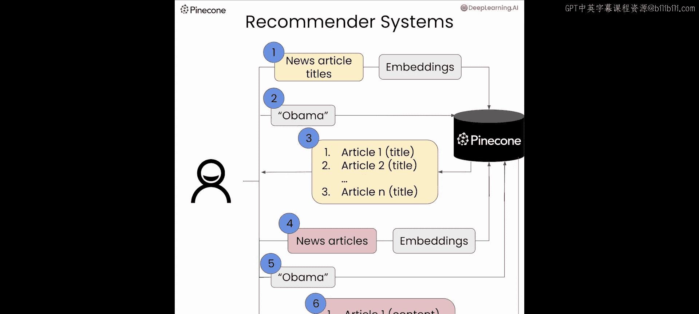

Cutting off the warnings as we have in other lessons and then importing the packages that we depend on we have our deep learning AI Etails package once again。

 So let's go ahead and run that。And when our imports。Okay， great。

 and then we will set up Pine cone as we have in other lessons。

 so we'll get a pointer to our deep learning AI Tis object， get our P cone in open AI API keys。

And then start to prepare the data。So once again， the data is not insignificant in size。

 we have a file called all thenews-3。zip that is being downloaded here using Wget and just again as a cooking show。

 we won't you do that or I won't force you to watch me download a series of data and I'll comment that out and then the same thing to unzip the data as well。

So now let's look at the data， so。This is rather straightforward。

 we'll say with open and then the name of the file that we want to look at。Right。

And we want to read it Okay， as F。 and then we will get the first line。 and as in any CSV file。

 the first line is the headers of the file。 And so we'll just look at。The header。Okay。

 so we have date year month day author， Minnesotaso of。

 we're interested in the title whom we're interested in article。

So to make it a little bit more convenient to work with， let's use a data frame。

 So we'll say data frame equals。The pandas package and we're going to read the CSv called all the news dash feeded do CSsv。

And let's just read 99 rows。Okay， and then look at the data， so we'll call head。系。

So we have the data， you can see the date， the year， the month the day， et cetera， again。

 we're interested in title and article。So let's prepare a P cone in the same way that we have previously。

 but to do that first we will get a pointer to open AI。

 we'll use that later on and we'll prepare our utilities package。

And then get our index name from the Us package。Okay。And then get a pointer to our pine cone object。

And then this is boilerplate at this point， so we'll just copy and paste this in。Again。

 we check to see if the index name already exists， if it does， we delete it。

And then we create it because we just deleted it。And then finally。

 we will get a pointer to our Pine cone index。And then run that。

You saw this function in an earlier lesson but we have something called get embeddings and this is just a wrapper function for openaiI to return embeddings from a list of text in this case that text array is called articles and so we'll declare that it's called get embeddings and then what we're going to do is prepare and insert the data so we'll iterate through the data frame we'll read it number of rows at a time build an embedding out of it and then upload it into Pco So this is a lot of code it's about say 12 to 15 lines of code so I'll copy and paste it in but walk you through So we're gonna read the CSv file called all the news dash3 This is the one that we've been working with earlier but we're gonna to read chunk size rows at a time to make it manageable and just make this a little bit easier to read by putting that there and we're gonna to read at most 20000 rows and what we're gonna to do is iterate through the chunks one at a time and remember a chunk size is 400 So we're gonna do is get the titles out of that data frame chunk a chunk is just a subset of the larger data frame。

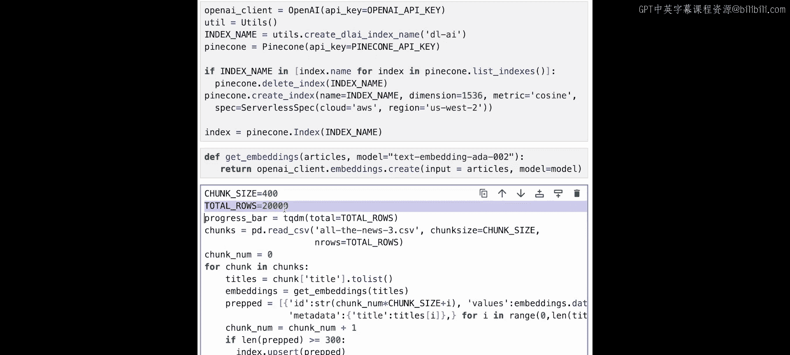

Then we're going to get the embeddings for all of the titles that was declared here and the prepare a pine cone。

Andbedding or an array of embeddings as we have before and this is just you know simple Python syntax right for I range through the number of titles。

 create an embedding for each one of them， right？Then we're going to increment chunk them because that's what helps us get a unique identifier for the embedding and then we're going to upload it 300 at a time so if we get to 300 or exceed 300 number of vector embeddings inside the preP array then we're just going up it into P cone and then delete or clear out that preP list and then update the progress bar for TQDM which we've declared up here so let's go ahead and run that This is going to take around three minutes on our machine as you can see here but we'll speed this up and post for you so that you don't have to sit here for three minutes and watch it。

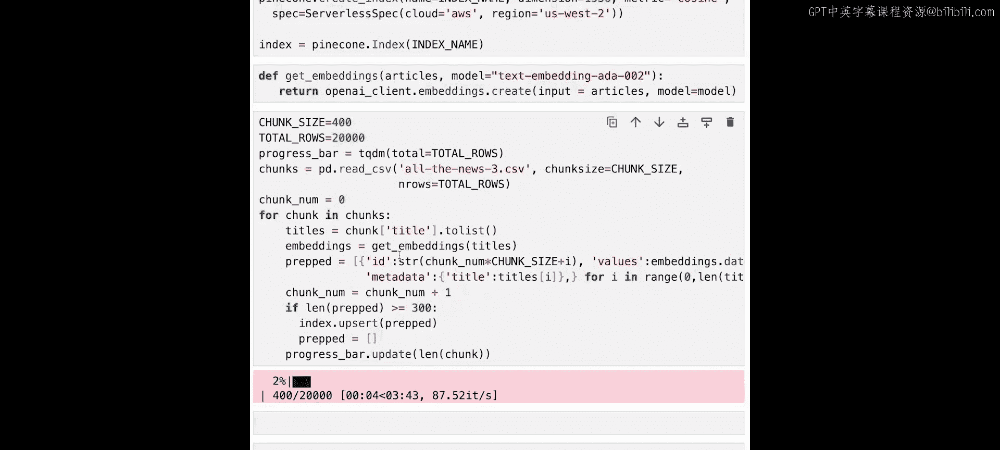

Okay， so that has completed。 We uped 20000 vector embeddings in the pine cone。

 And now we will look at what we uploaded。 So let's say index dot， describe index。

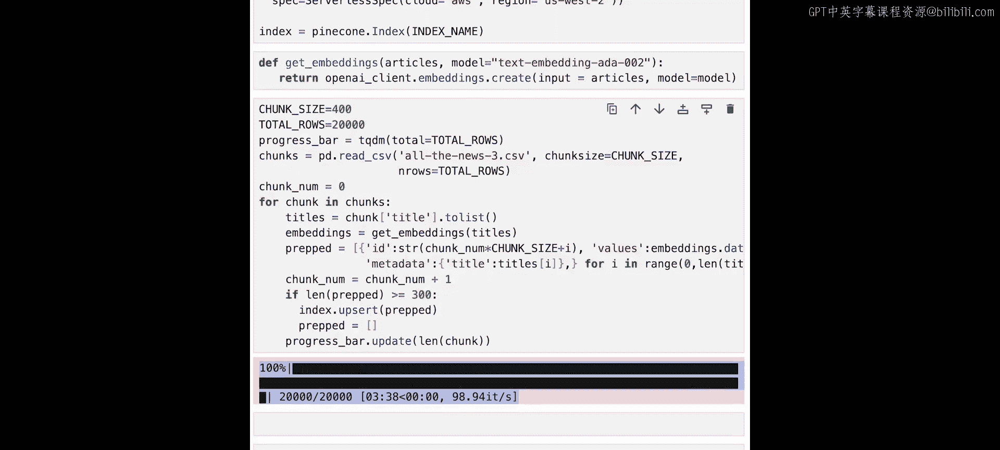

Stats。And yes， we had 20，000， so that's perfect。So。

Let's declare our function again that gets some beddings from Open8 AI we've seen that function before and let's actually get some recommendations so I will go ahead and paste in this helper function that we've created here called get recommendations and what it does is takes a pointer to P cone what you want to search for the number of elements that you want to return inside of top K in this case will default to 10。

Gets an embedding out of the search term that was passed in from that helper function declared above。

Executs and returns the results from a Pine cone query。

 and what we'll do here is look for data about Obama。

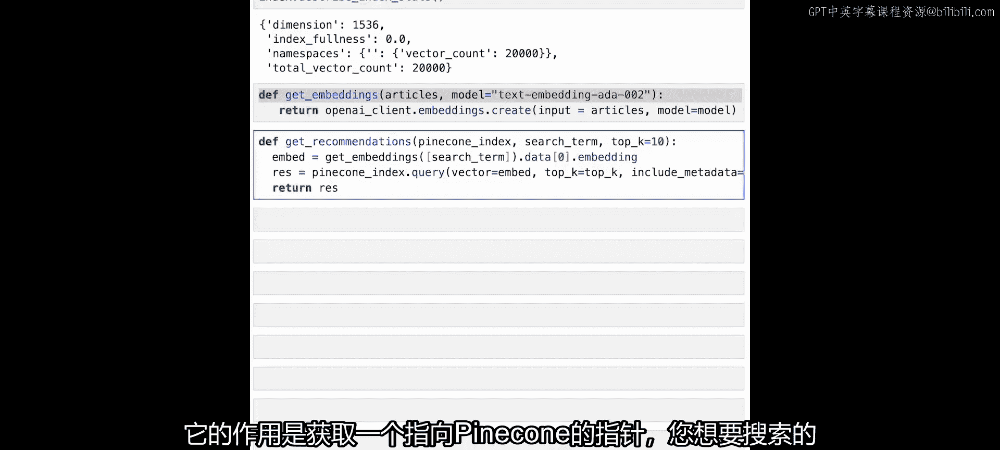

Okay， so we declared that function。 And so let's say recommendation equals get。

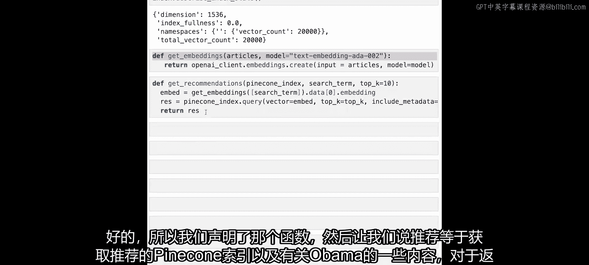

Recommendations。Our Pine cone index and something about Obama and for each result in the recommendations。

 which is returned inside of the matches。Element well say print。The score。

 which is the similarity score coming back from Pine cone。

And the metadata that we stored inside a pin cone next to that embedding。Okay。

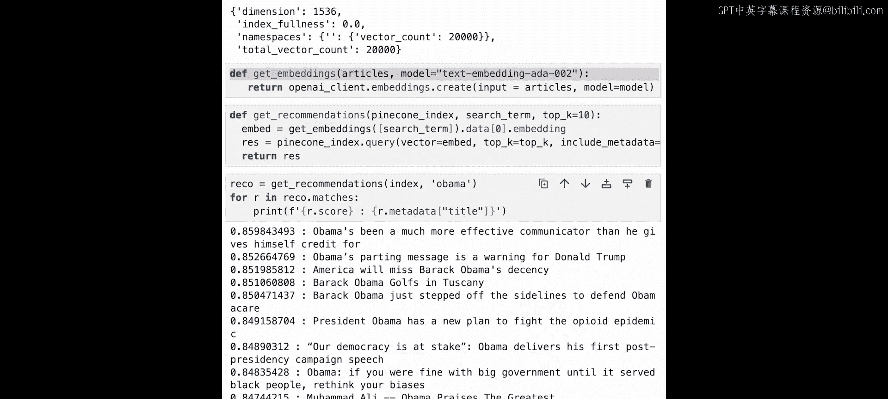

Alright， so we got back a bunch of information based on the titles of the articles about Obama。

 Obama' has been a much more effective communicator than he gives himself credit for。

 that sounds pretty interesting and a parting message is a warning for Donald Trump that sounds like something we want to read as well。

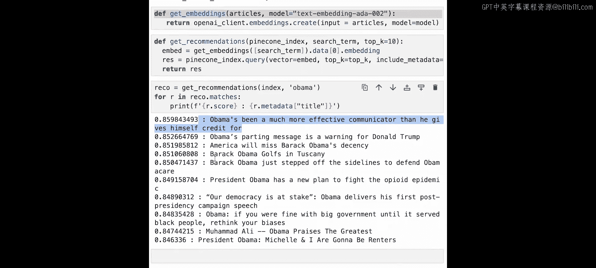

And so what we're going to do now is see if we can do it differently。 So you saw we just looked at。

 we searched for titles of the vector embedding。 Now we're going to look for elements that are vector embeddings where they're representing the actual article itself。

 And so what we'll do before that is。Delete our index first。

 So you saw this piece of code you're familiar with it at this point right， If the index is there。

 we're going to delete it， otherwise create it nothing different there。And so we're going to do is。

Somewhat involved， and I'm going to walk you through it。

So let's first declare a function called embed that takes an array of embeddings。

 a title an array that's going to store a results into。

 and then an counter called embed number and I'll walk you through how this works in just a moment。

 but before I do that。Let me paste in the code that actually uses it。So what we're going to do here。

 I'll jump down here to the bottom， we're going to iterate through all of the articles list from our data frame that's declared here。

 then we'll grab an article and we'll grab the title that goes with the article。

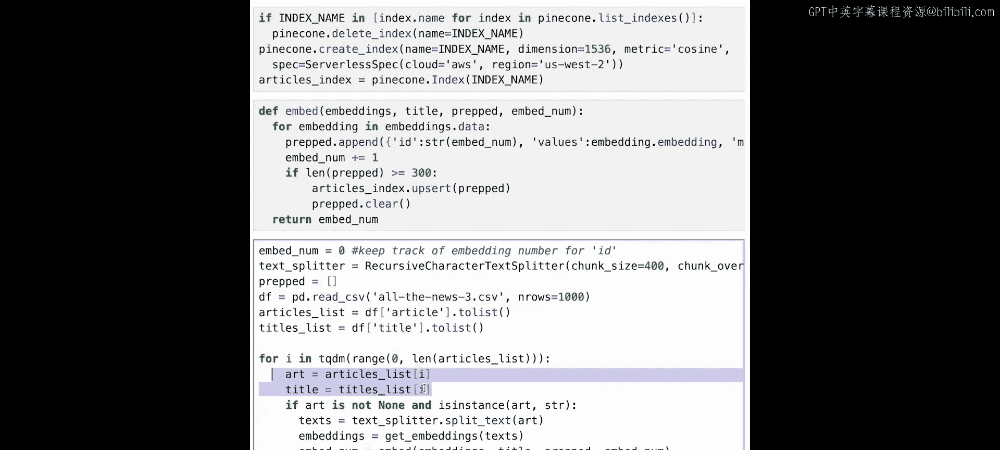

If the article is not none or null， what we're going to do is use the recursive character text splitter from L chain。

 and we're going to use that to effectively chunk up the article of interest into 400 characters at a time and。

An overlap of 20。 And then what we're going to do is call this embed function that we declare it up here。

 So let's store that okay。So as we split it up into smaller chunks。

 we're can to get the embeddings for each one of those chunks by calling get embeddings。

 which we declared above and then we're going to call embed and so what embed does is it walks through this array and stores the vector embedding for each one of the chunks into the prep element and if it hits and you're used to this pattern at this point。

 if it hits 300 or more elements inside of the prepto array。

 then we're going to go ahead and up that data into P cone and then clear it out so we can do it all over again。

Okay， so we ran this， I believe， and let's go ahead and run this code。

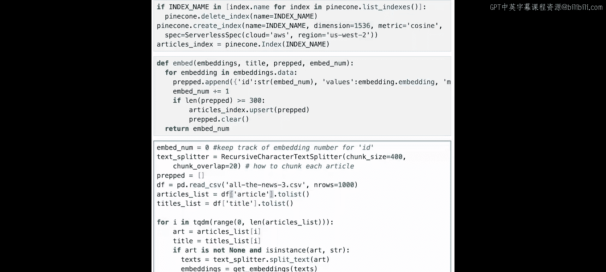

So this is going to run and take quite a bit of time， it's going to take around five minutes or so。

 and we've all fast forward that for you so you don't have to watch it upload and we be back in just a moment。

All right， so that finished uploading and now we're going to make sure that after we previously cleared out the index that our uploaded works。

So。All right， 10，500 vectors were uploaded， that's great。So what we'll do is。

Run the same exact code almost that we already ran。

 except the main differences that we're going to keep the small dictionary called scene and the reason that we're going to do that is because if you recall we actually split up the article and the chunk se L chain and what we want to do here is keep track of what we've already seen so that we don't get the same article being returned twice。

 that we're going to say a title not in scene， then we will actually print out the score of the search as well as what we got back。

Our search。And then we'll say like， hey， we've already。Seeing this article， Okay， it's very simple。

 just put a dot in there to keep track。And what we get back is， Alright。

 and we go back a different set of articles。 This was based on。The actual content inside the article。

 not the title of the article this time， and youll actually see the results are different this time。

 which is great。All right， that's it for this lesson in the next lesson we're going to build out something called hybrid search。

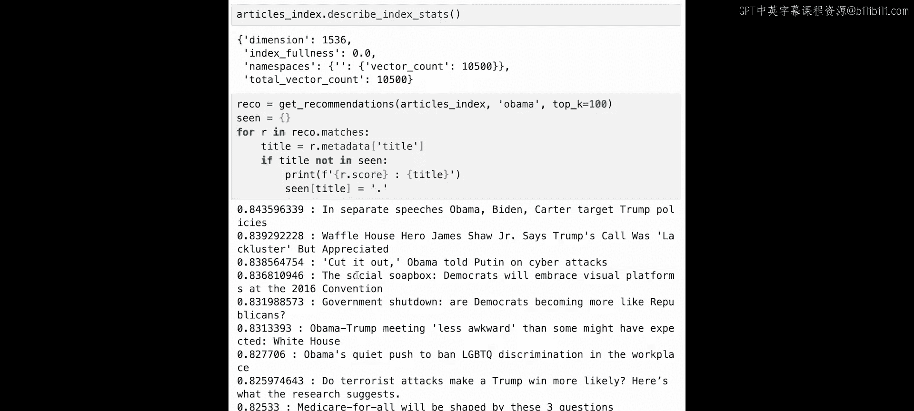