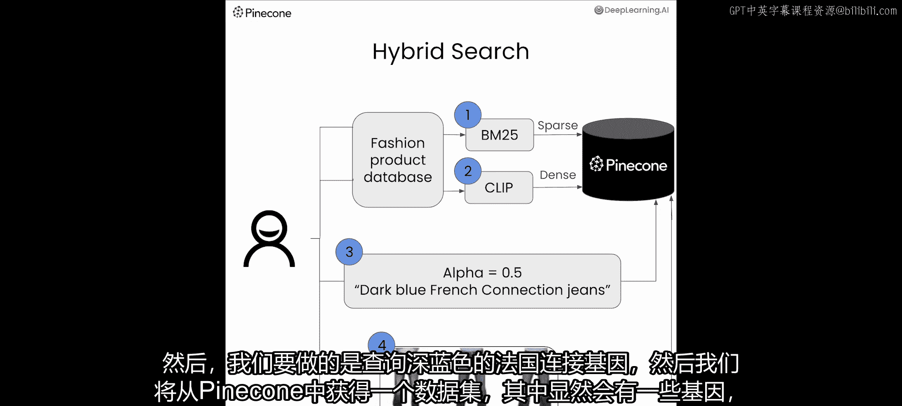
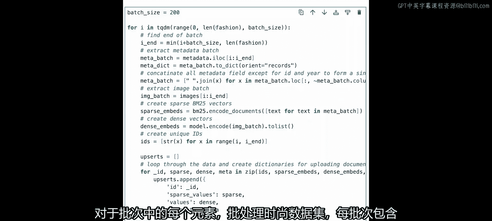
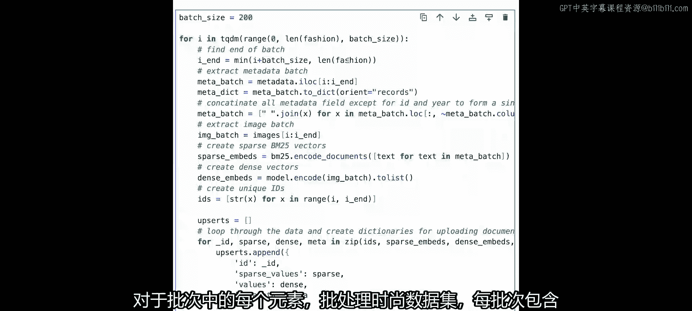
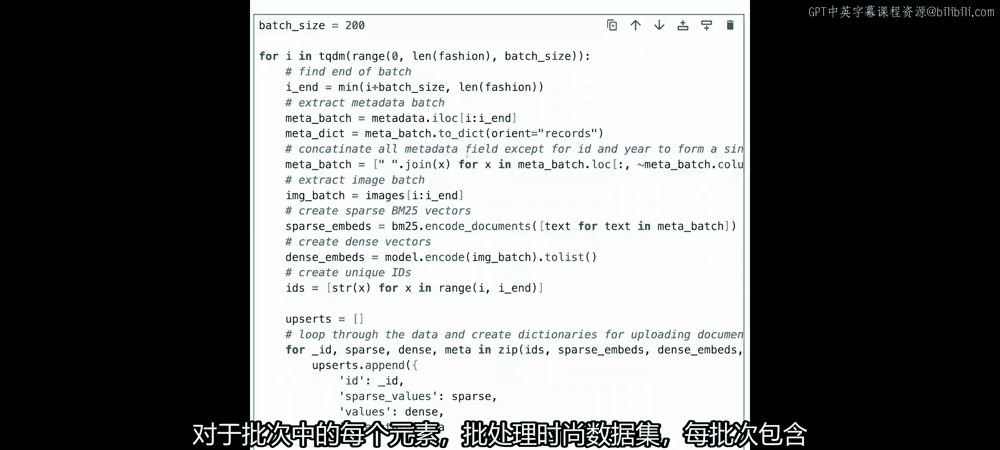
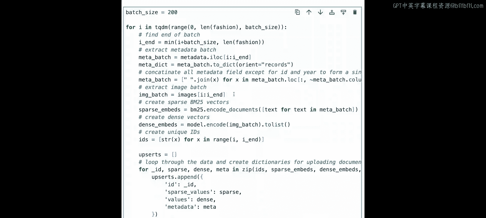
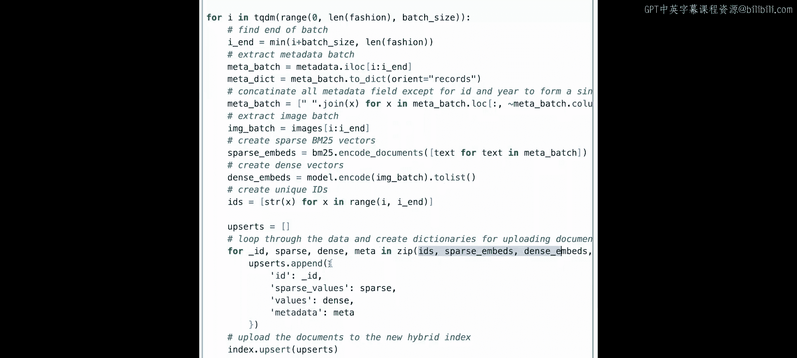
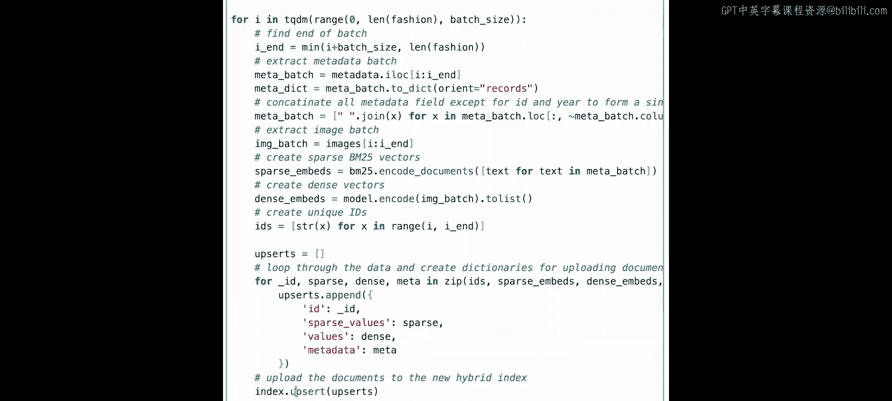
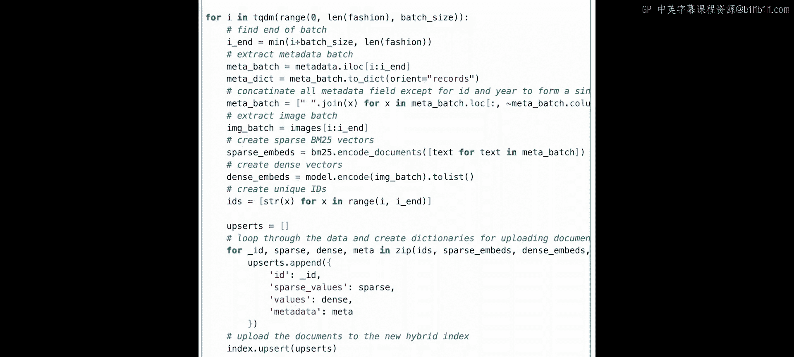
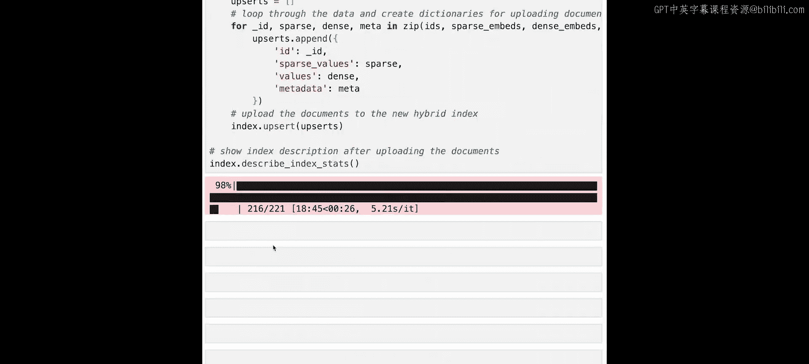
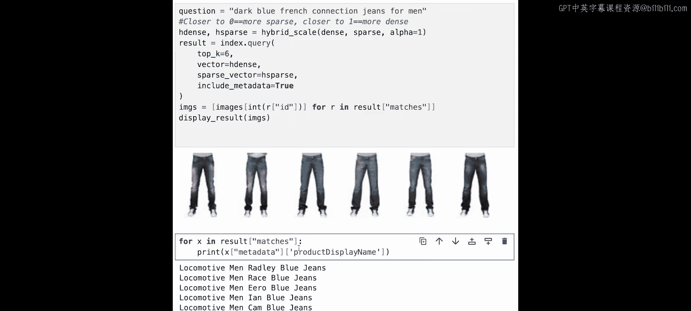

# 吴恩达《使用向量数据库构建应用程序｜Building Applications with Vector Databases》中英字幕 - P5：5.Hybrid Search.zh - GPT中英字幕课程资源 - BV1QH4y1e7kM

This lesson is all about hybrid search。 You will leverage a feature and pine cone that allows indexed entries to have both dense and sparse embeddings at the same time。

Of course， this means we can also search across sparse and dens at the same time as well。 To do this。

 we will leverage B M 25 and clip to generate embeddings from fashion products to search across both text and image product descriptions。

 At the same time， Let's get coding。😊。

We're going to build a hybrid search system using Pinecome。

 so Pinecome supports vectors with sparse and dense values。

 which allows you to perform hybrid search。In this lesson。

 we're going to teach you how to use hybrid search。

 which is the ability to combine vector and semantic search with traditional keyword text search against different modalities for the same entity。

 and this example will show you exactly what that means。

So we have our user here on the left hand side and we're going to take data from a fashion product database。

And we're going to encode it into two different types of vectors。

 The vectors that we've been using previously are what's called dense vectors and to do that we'll use something called clip and we'll get into what that is later on。

 But this time we're going generate what's called sparse vectors and to create that we'll use Bm25。

 which is a common encoding technique in information retrieval but we'll talk about what that is later the key point here is that for any given row in the index of P cone。

 you could store dense and sparse vectors at the same time with the metadata that goes with it into one row。

 Then what we're going to do is query for dark blue French connection genes and we'll get back a data set from P cone which we'll have some genes obviously and then we'll tune in what's called the alpha parameter inside of that query to change whether we weigh the results from the Bm25 encoding or the clip encoding more or less and we'll see how the results change So let's get started to get going we will go ahead and import in or warnings cut off mechanism here So import warnings。

Filter warnings and then we will pull in the packages that we've been depending on previously。

 nothing really different here except for the BM 25 encoder from Pine Coe underscore text。 Sprse。

Okay， so we'll go ahead and run that。Then we're going to continue doing what we've been doing previously。

 we'll use the deep learning AI U package to get our P cone API key okay。

And then we're going to do a little bit of setup so we've seen this as well。

 If you have kudto on your machine， that's great， if not no big deal。

 we'll just use your CPU and then we'll get a pointer again to our package we've already done it。

 but why not do it one more time and this time create our P cone index We'll at least get the name of the index here okay。

And then what we'll do is create an instance of a pine cone object。

And then do what we've done historically， but with a little bit of a change this time so。

If the index name is in the list of indexes that P cone has。

 then we'll delete it just to keep things clean。But this time。

 what we're going to do differently is change the metric that's used to calculate similarity inside of P cone。

 we're going to have it be dot product instead of cosine like it has been previously。

 and then we're going to get a pointer to our P cone。Object。Okay，And we'll go ahead and run that。

Everything's great， we have a CPU here because we're inside of Jupiter on a Mac。

 no GP for us to use here。So let's set up our data。First， we're going to set up our。

Fashion data set from Hugging face。And that comes from here。Has fashion product images small。

And we're going to use the training split。Okay。And then output what we have。Okay， all right。

 there's our our data set has ID gender master category， again， we've already downloaded it for you。

 so that's why it came back so quickly。So let's look at the data。

 We're going to go ahead and look at some of the images inside of the data set。

 So images equals fashion。Image， and then we will。Do a little bit of column removal just to keep things simple。

And then why not look at one of the pieces of data in the data。Alright。

 so that is the 900th element in that data set。 And now we're going to。Convert。

Into Pdas data format just a bit。And we'll get to the metada。And do that to pandas。

And then look at that data using head。All right， so you have ID， we have gender， category。

 sub category， article type， pretty extensive fashion data set。

 this is going to be fascinating to work with。So now what we're going to do is create our sparse vectors。

 so for creating and training sparse vectors， we're going to use the BM 25 function from the Pine cone text library。

BM25 is a popular technique for retrieving text， it uses term frequencies to determine the relative importance of the term to the query。

It's simple but effective and only requires knowing the number of documents in the data corpus and the frequency of terms across documents。

We're going to show you how to use BM 25 with P cone Sprse dense specors for use in hybrid search。

 clip， on the other hand， is a neural network devised and created by open AI built on millions of images and respective descriptions that can return the best caption for an image right So given an image we're going to get back a caption。

 So let's get started with that。 So we're going to create a VM 25。Encoder。

And we're going to fit our data to the metadata that we just looked at。Above。Okay。

And then we'll look at the product display name。Turtle check men， Navy Blue shirt， al right。

That's the product display name makes sense。 and now what we're going to do is。

Do two different things。First， encode queries of a park display name。And look at what we get back。

All right， so we've encoded queries， we've encoded documents and now we're ready to get going because we've completed our work with BM25。

 and we're going to cut back over to dense vectors next。

So we're going to come back to using sentence transformer， as we have in previous lessons。

 sentence transformer。Okay。U'llput what the model looks like and then do some dense vector encoding so。

See what we get here。All right， so 512 dimensions in that dense vector。

 which is exactly what we wanted to see。So now let's go back to our fashion data set。

We're gonna to see how many elements that we have。 We have 44072 And so this is gonna be the first time inside Pcone that you see us uploading sparse anddent vectors at the same time。

 the way that you do that's actually not too different from how you upload normal vectors is just that you're gonna add sparse and dense at the same time as you can imagine so a bit of code to do that I'll walk you through it I'm going to go ahead and paste that for you so you can see it so we're gonna to do it in batches of 200 like we have before for each one of the elements in the batch in the fashion data set in batches of 200 we're gonna get pointers to the beginning end of the batch that we're going use extract the metadata convert the metadata and and then build metadata fields that are ready for upload we're going take the batches of the images we're going encode our sparse vectors using the encode documents function。

 we're going get our dense vectors using the model encode function。

 convert that back into a list and then get our unique identifiers to each one of。

So if you remember， each pin cone vector embedding is a combination of an ID。

 the vectors that it represents and the metadata that goes with it， so this is the metadata here。

 this is the vector embeddings here， and this is the unique identifiers for the embeddings。

The only difference here is that we have denset and sparse at the same time。

 and you're going to see that we can upload them down here in the append function below。

 So what we're going to do is zip up all of that data that we just created above right and then we're going to append it inside of a dictionary object here and ups that append we're going keep on adding these through as we iterate through the for loop and then do an up into Panom。

And then we'll see what we got back after uploading all of that data。So let's go ahead and run that。

Allright so that upt in the P cone has completed and now we're going to get into the essence of actually doing a hybrid search。

Let's go down a bit and start to query。 So we'll save。

We're going to look for dark blue French connection jeans for men。K。But to do that。

We're going to create sparse and dense。Andcoings out of that query string。

And then we're going to run our pan cone inquiry。Right。

So in the same way that we did up slightly differently。

 we're going to do query slightly differently by specifying dense andpar vectorors at the same time and you can see that here in these two lines and we're going to return at most 14 items。

And we're going to take the result of that query and look at it。

 And the result of that query is going to be。The images。Inside the data， okay。

 we're going to look at the IDs right， so let's go ahead and run that。Right。

 so we get back basically cornerers to images， but we like to view that result。

 So we've created a little bit of of a helper function so that you can look at these images here。

 We don't want to see the， see the pill images。 We actually want to view the image itself proper。

 So let's go ahead and put in this。This small helper function is is a little bit neither here and nor there in terms of what it does。

 but it basically creates some HTML so that you can view the image and and pulls it out of of of the metadata。

 So let's go ahead and run that。 And we'll actually just call this display result with the result from our query。

Oh， there we go， perfectf。 Blueo Jane's exactly as we had hoped but now let's balance the search a bit right we talked about this alpha parameter before。

 let's declare another helper function to get to that right so it's possible to prioritize our search based on sparse and dense vector results and to do that to do so we scale the vectors。

 And so for this we're going create a function called hybrid scale。

 So let's go ahead and just paste that in because it's pretty large so what this does is take in a parameter called alpha and what that's going to do is control whether we rely on sparse or dense dense more I encourage you to look at this code when you're offline at home and look at it what you want to do is know that controlling alpha relies on sparse or dense more Let's go ahead and run that。

And run the query one more time， but with different amount of alphas so what we'll say is。

That's the question。We're going to put in dense and sparse。N we'll run our query one more time。嗯。

And then。View the images。Before running the code we're going to set alpha to one and we're going to run that code and we get back our images。

 It's perfect and what we're going to do now is check to see whether we got back more men's genes and so we'll do is go ahead and copy and paste this in。

And execute that query and yep， we got exactly back what we had hoped。Okay。

 so let's actually execute the hybrid scale function here and look at the results that we got。 Now。

 remember our alpha parameter。 it's actually a continuous variable on the range of 0 to 1。

 And I challenge you or encourage you actually to play with what different results you get from changing it you can change it from 0。

2。 you can make it 0。5， it's really up to you But for illustrative purposes。

 we're gonna make it 0 and1 just to make the example fairly obvious。

 So let's go ahead and run this and make it more sparse this time。 So we'll run that。

 seeing our results we got back women's genes， which is it's perhaps not exactly what we want。

 Were looking for men's genes up here。 And let's confirm that by looking at the titles。 Yeah。

 we got back women's genes。And just again， for illstrative purposes。

 let's set the alpha parameter way on the other end of scale towards more dense and make it one and look at how that changes it。

 Yeah we got back all men's genes， which is a little bit better and just to confirm yep it's men's genes indeed so that's perfect。

So let's hybrid search the ability to merge sparse and dense vectors into the same row inside of P cone and you saw how we did it with fashion data in the next lesson we're going to run through facial similarity search。

