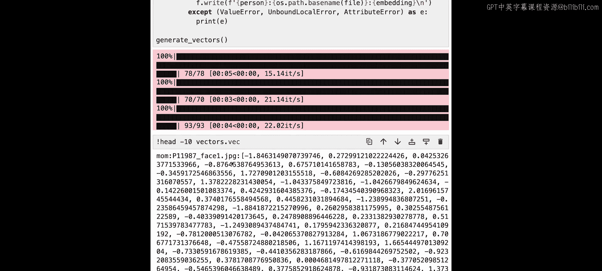
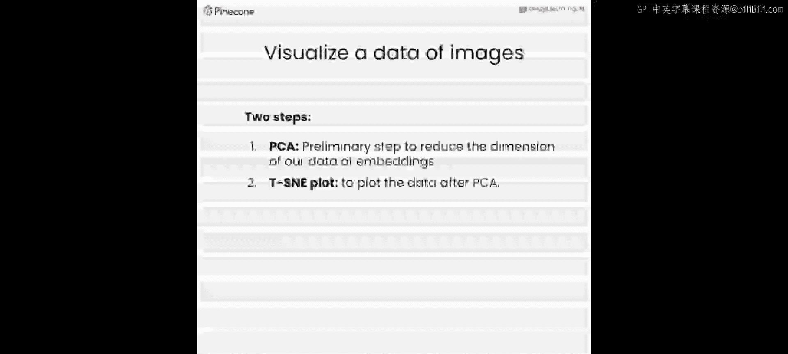
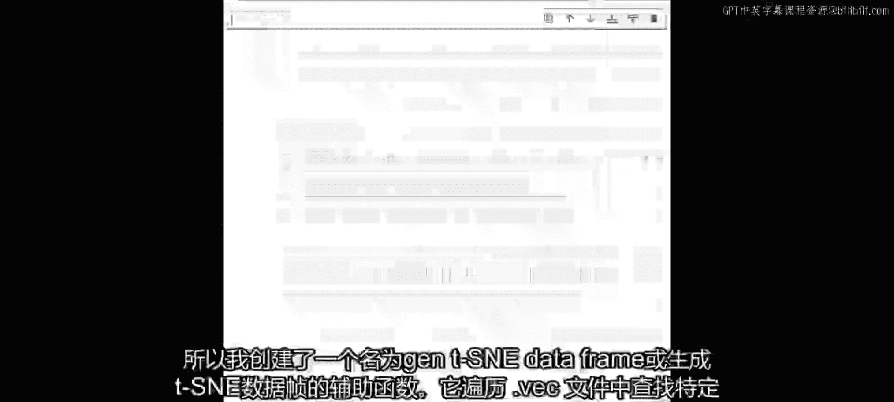
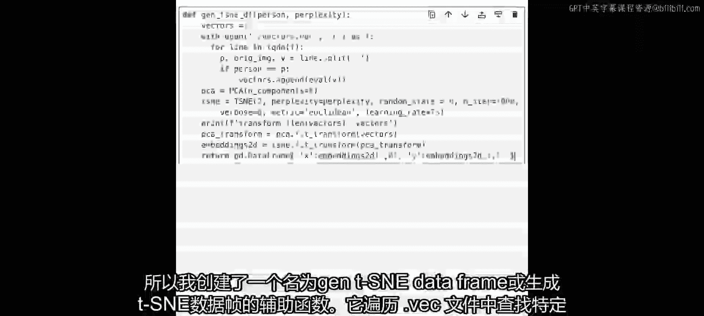
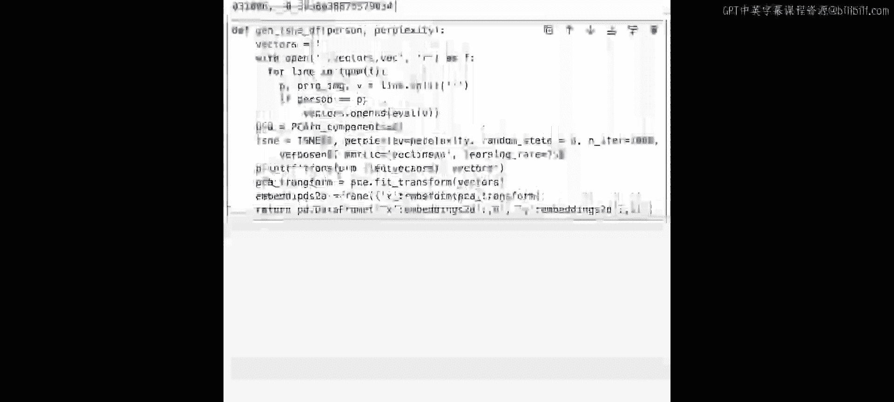
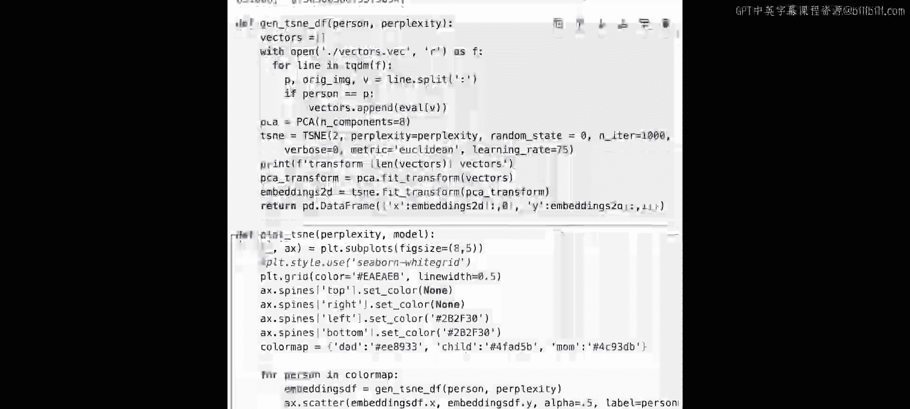
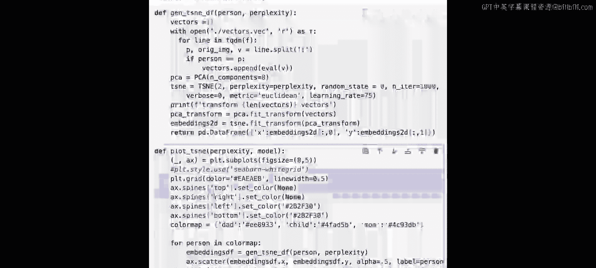
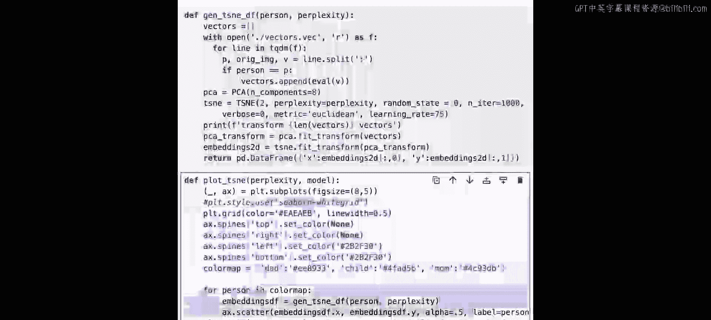
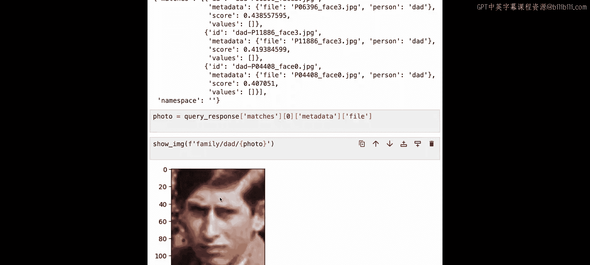

# 吴恩达《使用向量数据库构建应用程序｜Building Applications with Vector Databases》中英字幕 - P6：6.Facial Similarity Search.zh - GPT中英字幕课程资源 - BV1QH4y1e7kM

In this lesson， you will have fun with an age old question of to which parent the child looks the most similar。

To do this， you'll answer the question by using vectorbeddings。

Youll use a freely available image data set， in particular。

 one of the British royal family and use science to determine if Prince William looks more like King Charles or Princess Diana。

It's simple and extensible enough for you to try on your own family pictures。 Let's have some fun。

We're going to build a facial similarity search system to compute which parent looks most like their child。

 so we'll take a father， we'll take a mother and we'll take one child and see whether the child looks more like their father or more like their mother。

The person that looks the closest will be based upon the highest average score between each parent and child。

We're going to use the Deepface open source library with a facenet model inside of it that's 128 dimensions wide。

 and the data that we're going to use came from the families in the wild dataset set。

 which I'll have a link to in the lesson here。 So the way that it's going to work is the user is going to run images of King Charles。

 Princess Diana and Prince William through the deepface model that we're going to use。

 and we're going to store those vector embeddings in Pone。

 The way that we're going to calculate similarity is we're going to run images of King Charles and Princess Diana and Prince William through the deepface model that we're going to use and store those values in Pcon。

 Then we'll calculate similarity scores for the mother and the child and the father and the child and see based on an average who looks more like each other。

Okay， let's get started。 So to begin with， we'll do our standard of importing our warnings to stop the warnings from showing up。

 as well as a slightly longer list of imports into the notebook。

And then we will get our P cone API key。Now I've prepared a data set for you ahead of time。

And as usual， I will not make you sit there and watch me download the data。

 but similar parameters to W get， make it quiet， show the progress。

 I'll put the file name as family_ photoss。 zipip and pull it off of the location that I've specified here。

And you run that， and then we will unzip the photos as well。Okay， perfect。

 make sure that you run the query like this。It'd be uncommented right。

 but for this lesson we'll keep it calm the doubt so that I don't accidentally run that for you。

The data that has been already downloaded for your your notebook。

 this is how I ran it when I was at home before we prepared it。

 but you already have it local on your disk and a family photo zip file has a structure of family as a top levell directory with subdirecties of dad。

 mom and child each。So let's actually look at some of the pictures I've created a small helper function to help you see the photos called show underscore image and we're going to resize the photos slightly here and actually show the images locally。

 so we're going to look at one random photo I thought that was particularly interesting family s dad s P06260 underscore face5。

 JPg。And see what we get， so that's an image of King Charles， let's do the same thing。

Or Princess Diana。Right。And same thing for Prince William。All right。

 so those are the folks that we're going to run thequeries for。And now we're going to set up planone。

Same as before。Okay。We're going to。Create our index name using the deep learning AI Uilities package。

 get a pointer to our P cone instance and run that。

And now we're going to create our vector embeddings inside of P cone I'm going to go ahead and paste this in for you since it's a bit of code。

 but I'll walk you through it So we're going to actually store a file called vectors dotbe and we're going to use that and keep it around because we're going to iterate through the data multiple times and we're going to suppress warnings in case you know the file doesn't exist and we're going to remove the file just to keep things clean。

So what we're going to do is open up the file， we're going to glob all of the images of each of the people separately and then we're going to create embeddings out of each person's face and write it to disk and then with that we're going to write it to disk inside of that vectors。

ve file is person call the image name and then the embedding value itself。

 and then we'll go ahead and call generate vectors and store that。All right。

 that happened pretty quickly， thankfully， and now let's actually look at that file and see what it looks like。

So we'll just use head to look at the data and you can see it has the file format that we talked about earlier。

 the person's name， in this case it's the mom， one of the images， have P11， ettera， et cea。

 Jpeg and then the vector embedding for that specific image okay so we'll scroll down since we have five lines of that file。

嗯。And now we're ready to calculate some scores and upload data into Pone。

Before we upload the data into Pcom， we're going produce a TN scatter plot based on PCA reduction that's going to give us a really pretty scatter plot of the data so we can visualize it principal component analysis or a PCA reduces the dimensionality of data in this case。

 embeddings and is often used to reduce the dimensionality of large data sets by transforming a large set of variables into a smaller one that still contains most of the information in the large set。

 a TN plot or t distributedbut stochastic neighbor embedding plot as a type of data visualization used primarily to represent highdial data into a two or three dimensional space this technique is particularly useful for understanding complex data sets by reviewing patterns clusters and relationships between data points that might not be apparent in higher dimensions。

PCA is often used as a preliminary step to reduce the dimensionality of the data This can be particularly important when working with very highdial data as it helps to mitigate the curse of dimensionality before applying TsN TSN can be computationally expensive and slow especially with large data sets and so by using PCA to reduce the data to a lower dimensional space first you get a significant speed up in the TE process for the TE algorithm perplexity is a very important hyperparameter that controls the number of neighbors that each point considers during dimensionality reduction and you'll see actually made it pluggable in the code below So let's go ahead and do that so I've created one helper function called Gen TsN data frame or generate TE data frame and what that does is it iterates through the vectors that V file looking for a specific person and depending in that to the vectors list and what we do is actually do a PCA reduction against a specific person so what we're doing here is a PCA reduction for specific person who's passed into to the function then we do a TN reduction。

as well against that and return that as a data frame to the next function。

 which we're going to call here called plot TN and I'm going to go ahead and plug that in So plot TE actually calls generate TN data frame and you can see it down here below and most of this code is just setting up mapplotlib。

And what we're going to do here and this is the meat of it is for each person that we've defined here in this dictionary dad。

 child and mom these are just the colors for the legend don't don't worry about that too much we're going to call it generate TN data frame and get back a data frame and plot it against our scatter plot and then actually show the plot so let's go ahead and do that so make sure that we ran that。

Make sure we run that。 And then let's actually call it。 So there's one last parameter。 sorry。

 one last function call of plot Tsney。 And this is the perplexity。 In this case。

 we're going to set it to 27。Yeah， so I did exactly what I predicted that it would do。So。If you guys。

Have ever done this before。 you have to run it a few times。

 So we're gonna to call plot Tney with a perplexity of 44。

 Defin I encourage you to play with that at home to see how it changes the scatter plot。

 you can see here that the images of each of the dad。

 the child and the mom do clustered together Well I would definitely discourage you from insinuating too much that the child。

 the mom are close together in the scatter plot is that doesn't actually show much really what you want to do is look at the fact that the images are clustering within each person on their own。

 So in other words， each one of these dots represents one images of a dad and they're all very closely clustered together。

 which is great because each of the pictures of the dad should look like the dad。

 same thing for the child and same thing for the mom。Okay， now that we've we've visualized the data。

 let's set up pine cones so that we can store these values。

 So what we're going to do is same thing that we've always done。

Delete the index if it's already there and then create the index again so we have a clean slate so we'll go ahead and run that now we're gonna to store the vectors and all we're going to do is run through that file that we created again one more time。

 so open up the file iterate through one line at a time， split it into the person and the file name。

 Eval， the vector that was actually stored in that file and then up it into binCO。

So let's go ahead and do that。Okay， let's see what we stored inside of pine cone。

 Let's do it a describe index stats。Okay， we have 241。Elements， and that that looks correct。

 We had 241 iterations from， from T Q DM before。 So now let's， let's compute the scores。

 and I'm going to。Pe of sand because it's fairly large， but we have a small routine called test。

 And what this is going to do is return the top K similar images。

Against the child so it's going to take in one of the parents this is either going to be mom or dad each time around and it's going to return the top K and what we're going to do is actually calculate the average score from the returned value from the query from P cone so for each vector inside pine cone we're going to get a score and we're we're going to take the average of the top K values that we got back。

So let's store that value。And then we're going to call it for each relationship that we want to look at so what we're going to call compute scores and so what we're going to do is call test for the dad in the child and we're going to call test for the mom and the child and to do that we're going to take a random vector a random image I should say。

 from the dad in the mom and use that to compute the score。So let's go ahead and do that。Alright。

 so the dad got an average score of 0。43 closeness to Prince William。

 who's a child and the mom got an average score of 0。

35 closeness to the child that is Prince William， and so what that means is that the dad is closer in similarity to Prince William。

Now what we can do is use the fact that we know the data is closer。

And find which image is the closest between them。 So what we're going to do is take。

One base image of the child， which choose this because it's probably the most representative of what he looks like。

 in my opinion。This is what he looks like as a mature adult。

 and what we're going to do is find a way to find which image in our data looks most like him from the dad。

So。We're going to take that image， we're going to build an embedding out of it。When we'll look at it。

 that's the embedding version of that image above。And we'll scroll down， and then we'll query。Okay。

 we'll take the top three results that match it from the De。Okay。And then let's look at the response。

This is a typical JOM blob that comes back from Pinecoe， you get the ID of the vector。

 you get the metadata， and you get the score okay？Now what we're going to do is look at the image in particular。

That matches。So this is the image that is most similar to Prince William。 So in this example。

 we built a facial similarity system that matches King Charles and Princess Diana to their offspring Prince William to figure out which of those two looks most like Prince William。

 The data showed that it's actually King Charles that looks the most like Prince William。

 And we at the end， we figured out which image in particular looks most like Prince William。

 And we saw that this image here at the end， looks most like Prince William。

 which I would agree like they very much look similar。

 I encourage you to play with this code with your own family members and see what results you get as well。

 In the next lesson， we're going to build an anomaly detection system again using Cisco Asa log files in Pinecom。

