# 吴恩达《使用向量数据库构建应用程序｜Building Applications with Vector Databases》中英字幕 - P7：7.Anomaly Detection.zh - GPT中英字幕课程资源 - BV1QH4y1e7kM

In this lesson， you will build another front system。 This time。

 you will build a small machine learning model to detect anomalous log entries in Cisco As A log files。

 You will train the model using supervised learning against the small dataset set we prepared in order to make the lesson more accessible and keep training times down。

 You will then use the model and feed it a sample input data set to find an anomalous log entries。

 Let's code and innovate。😊。

So we're going to build an anomaly detection system using Cisco ASA log files and the way that's going to work is I've prepared a very small training set called training textex。

 that's a label data so we can do a little bit of supervised learning and create a very small model that can detect anomalies against log files。

And then we're going to use a sample data set called sample log that I've also prepared that has one small anomaly inside of it。

 and we're going to try to see if we can find the anomaly。

We're going to run the sample that log file data through our model and store the embeddings as the output inside of P cone and use that to find the anomaly。

 so let's get started。So we'll start by importing our warnings as we always do。Okay。😊。

And then our package dependencies。Okay， and then we're going to。Get our P cone API key。

Using the deep learning AI U package here。Okay。And then we're going to create our end depth。

so same code as always get a pointer to the pine cone instance。

 and then we'll delete the index and then we'll create the index as well and then get a pointer to it at the end。

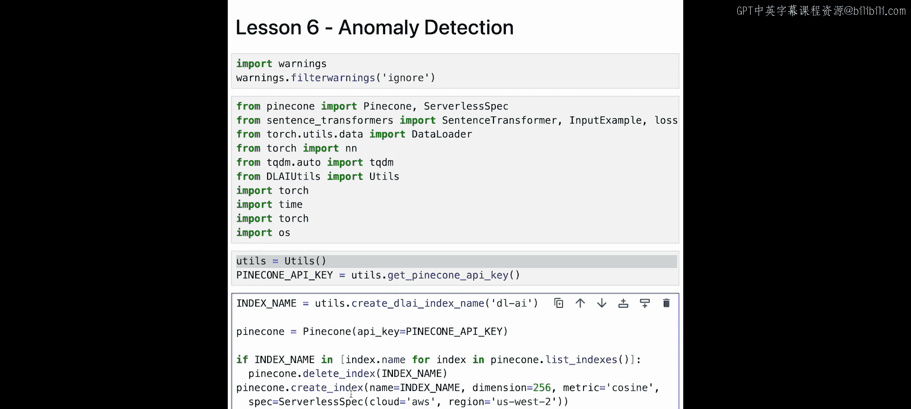

So that's going to go ahead and run。Now we've already download the data for you in a lesson。

 but if you happen to be running this offline， you'll need to run this by uncoming out this line。

 this w get line that pulls down this file called training。 tar。 zip。

 but we've already done it ahead of time， and we also want to。Anar。The data。Okay。And again。

 this has already been done at a time。 Now let's look at the data and see what's inside the sample log file。

So we're going to look at head minus5 so we can see the first five lines and so this is an AS Cisco ASA log file format。

 so we have the date， the time， log， sort of identifier， and then the actual log message。

Now what I've done is gone ahead and prepared a data set that has been labeled for you based on that log file above。

 and there's a slight difference。

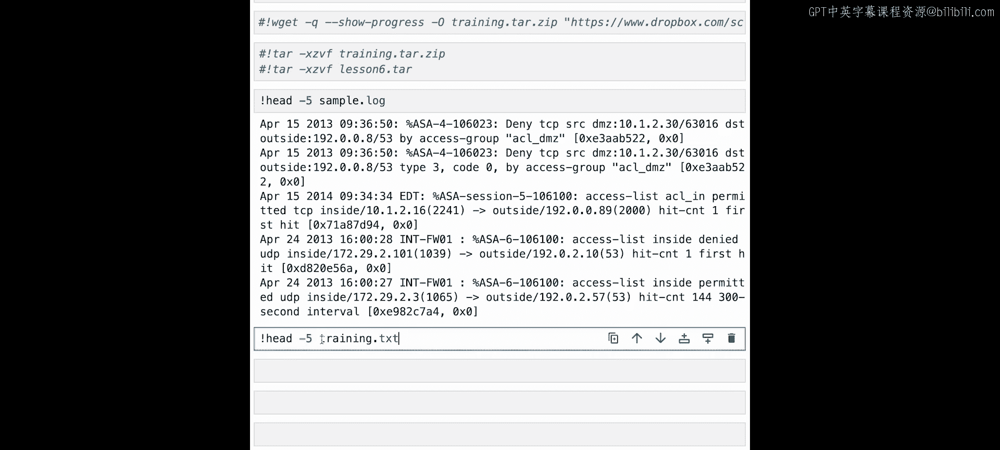

The format of this file is essentially a sample log file and then。

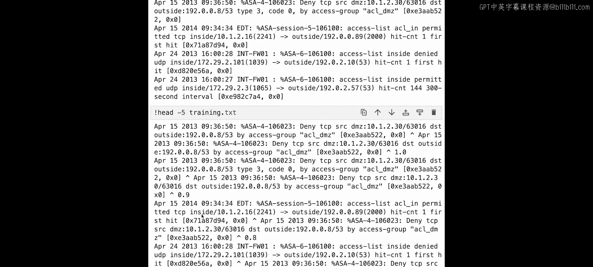

Hat or carrot。Another log file， and then the label similarity between the two at the end also dilimed by Carrot。

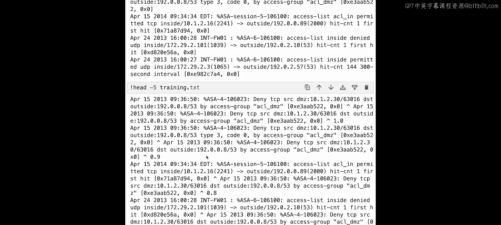

Okay， we are going to only look at the top five here。

 there's some that are labeled differently at the very bottom of the file。

 and I encourage you to look at the bottom of the file。

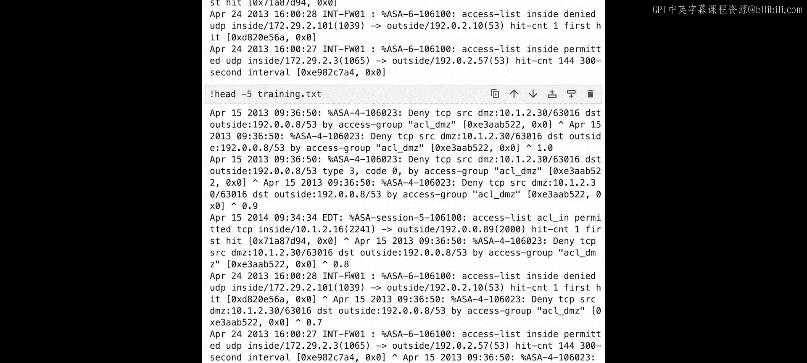

What this is going to say is that log part here highlighted here by my mouse is similar by a score of one and so on and so forth。

 this is similar by a score of 0。9 on a continuous variable range of0 to 1 okay。

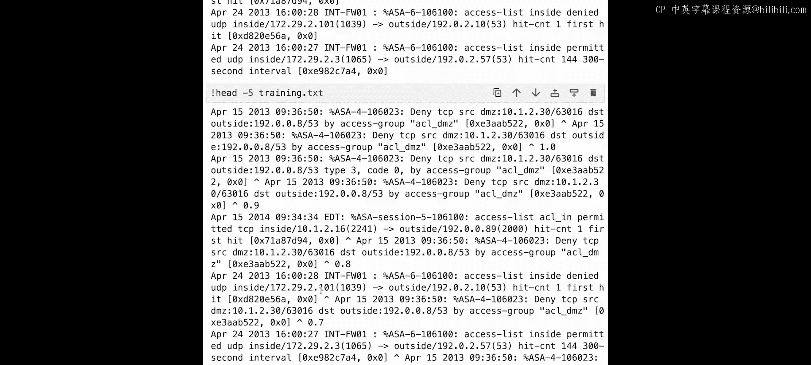

Now we're going to create our very， very small model based on sentence transformers。

 So I've gone ahead and pasted this in because it's a lot of code。

 but we're going to create a very simple model。 We're going to use the word embedding model。

 Okay first here， based ont based oncase， which is sort of the base uncase model。

 then we're going to have a small pooling layer and then a very small dense layer to get it down to 256 dimensions inside of our embedding。

Okay， then we're going to create our model and then we're going to output which device we have。

 again， I encourage you at home if you happen to be lucky enough to have a Ced device。

 you should try it。 It's a little bit faster， but we're going to be fine on the CPU here。

So we have our model object and we've seen that we're on a CPU。

So we're going to prepare to train our model。So here we have an array called Tra examples that's going to have the data that's going to get stored。

 we're going to open up the text file and read the lines。 And then for each one of the lines。

 we're going to strip off the white space characters and then split it。 if you recall。

 I said it's separated by a carrot or hat and then we're going to append the samples we call it A and B we had log one。

 we had logged even though the similarity score， which I'm calling here label and we're going to store that inside of the input example object and we're going to pass it the label because this is a supervised learning again。

We'll do 100 warm up steps， we'll prepare our data loader， and then we'll set up our loss function。

Okay， so let's go ahead and run that。 And now we're going to actually train the model。

 So we're going to call model that fit。 That's going to do the actual。Training。

 and then we're gonna prepare our sample data at the same time。 So theres really two parts。

 but I've clustered it into one cell。 So there's the model training here， model that fit。

 And then there's preparing the sample data that we're going to use to pass through the model later。

 So this is gonna to train。 And this will run for a little bit。

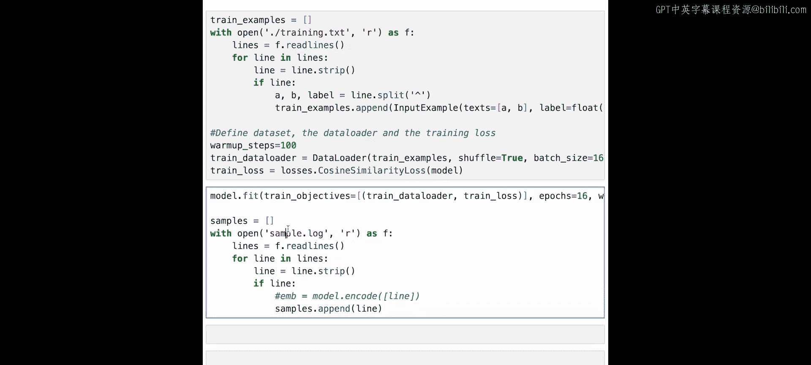

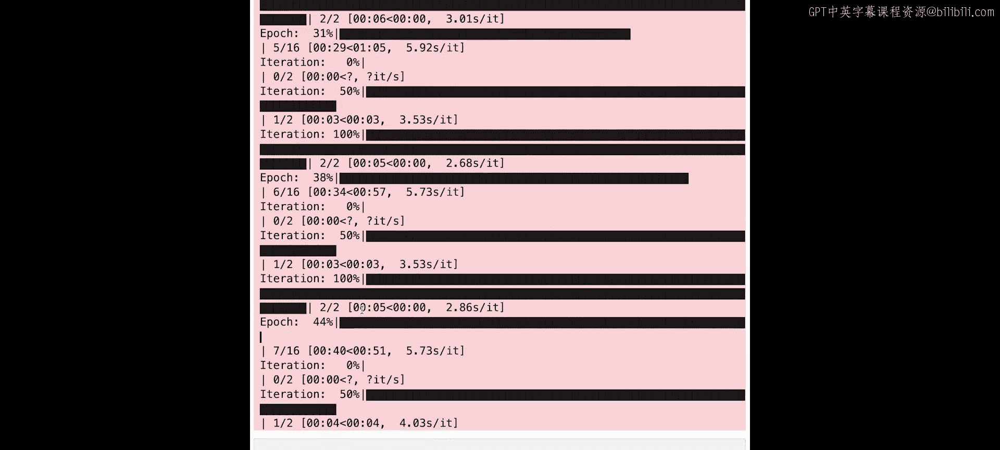

So this is going to run for a couple minutes and we're done so our model is trained and let's generate the embeddings from our from our model。

 So we remember we had that samples list survey array that we created earlier。

We're going to go ahead and store that in embed or EMB and now we're ready to test our output let's first store our data in P cone you've seen this pattern before we create an I'm going to array called prep。

 iterate through all of our embedded data that's stored inside of samples we create a vector embedding here and we store it inside of preP and we're going to up it into P cone so let's go ahead and insert in the P cone and that was quite fast。

So now what we're going to do is take a known good log line。

 so we're going to say a good log line equals sample zero， I happen to know that it's at the top。

Okay， and I can say。Good。Log。Okay， that's a good log line right I know that that's not a problem。

 Okay， so now let's take that good blog line and query it inside of P cone and we're going to get the top 100 okay。

That's going to come back and be stored andqueri。And we're going to get a pointer to the matched values inside of P cone to store that in results。

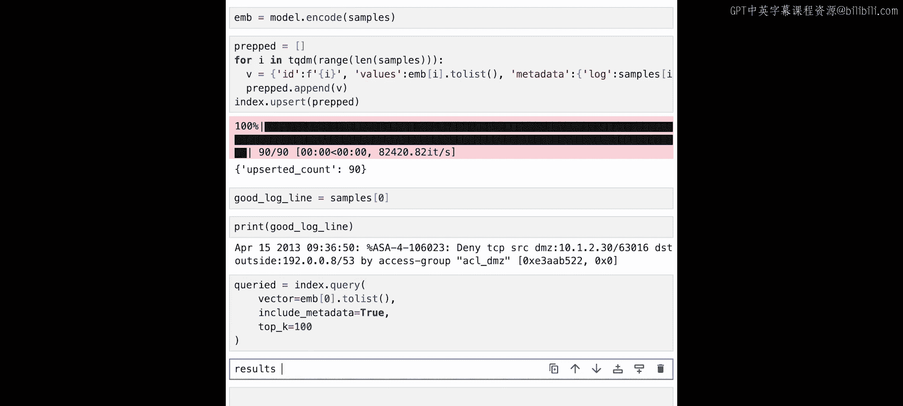

Now what we're going to do is look at the results and we're just going to have a small routine here to print that out。

 Okay， so iterate through look at the top。10， and these are the top 10 matches for。

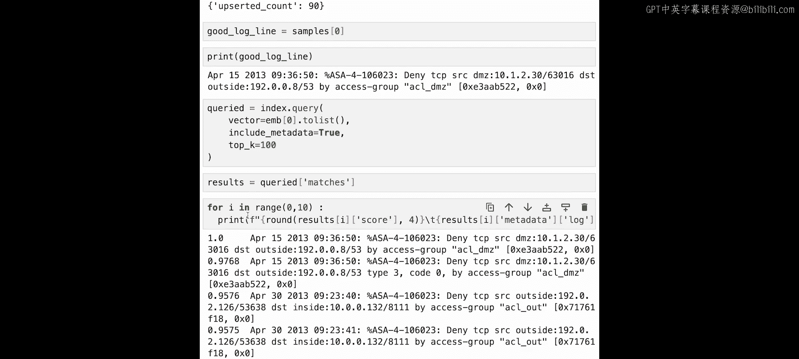

This line here， of course， this one matches and has a score of one because it's the same line and these ones look very similar as you can see。

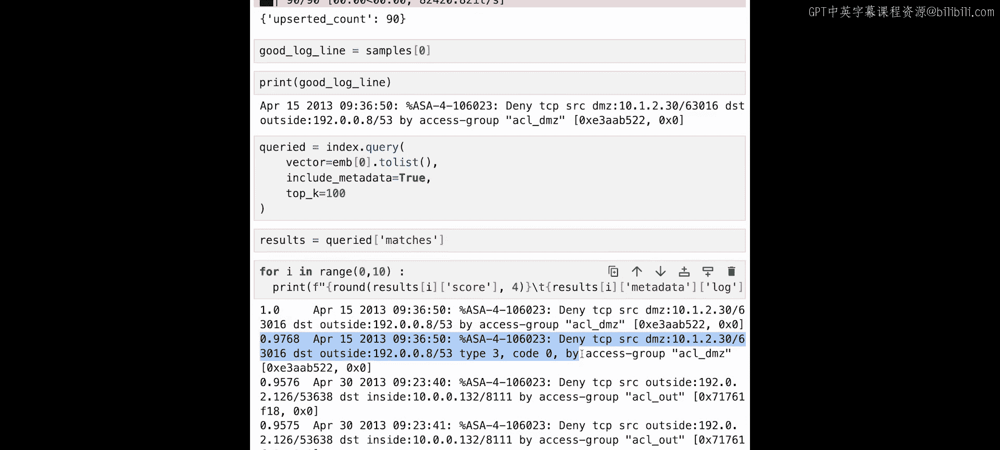

Okay， so that's the top 10。 Now what we're going to do is take the last element in there。Okay。

And print that one out and see how that compares。So last element。And that one is very different。

 and that you can see that it doesn't at all look like the other lines above this one's called sig fault detected in the matrix and the similarity score is 0。

32。 So above we query the top 100 and there's fewer than 100 here。

 So we're going to get less 100 results。 So what we're going do is actually look at the last result。

 which should be the worst performing score and expect that that's our anomaly And that's exactly where we're going get from this line here。

 we're going see that the worst performing score is 0。

32 and the log line looks sort of like a Cisco Asa log file except for this message that says sg fault detected in the matrix。

 And so this is our anomaly the worst performing score that came back from pine con when we searched for a very canonical looking line stored here。

 So that's a very simple way to build an anomaly detection system using pine cone versus Cisco Asa log file data。

 I encourage you to try it with other types of data using sentence transformers as well and see if you can find anomalies in data yourself。

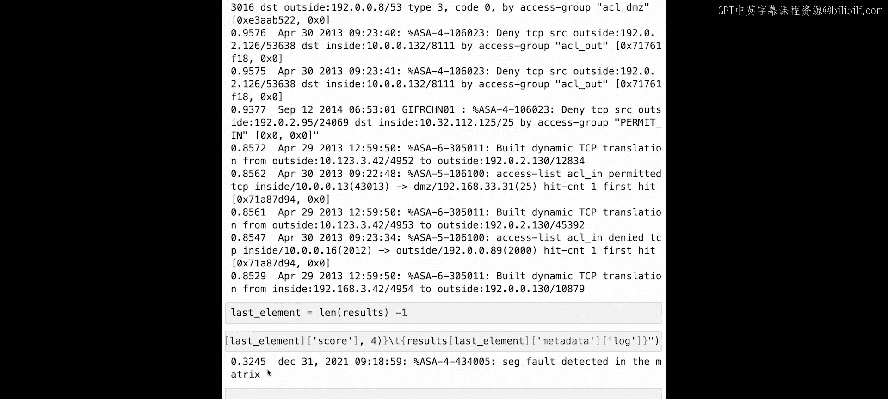

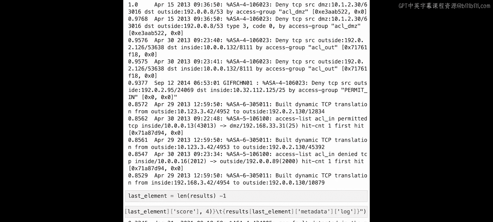

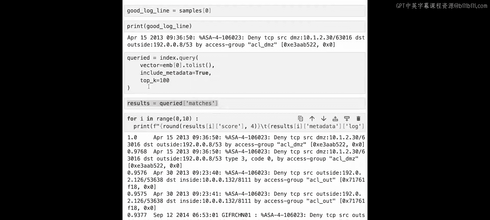

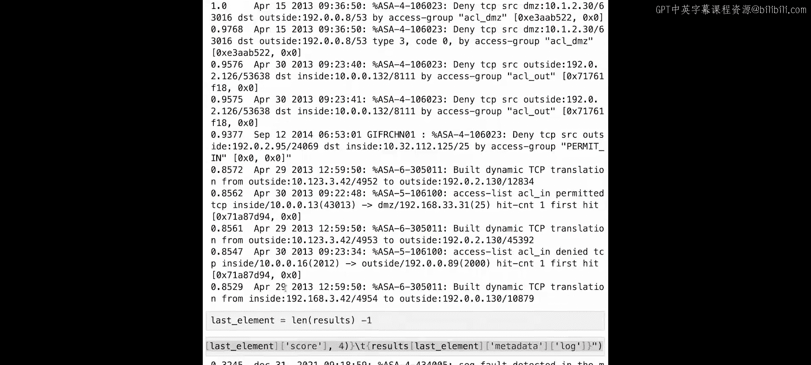

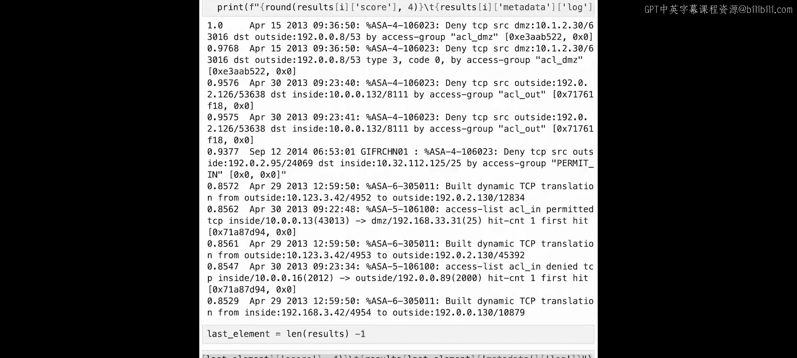

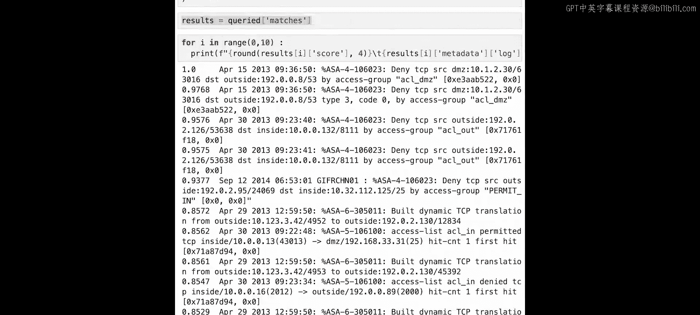

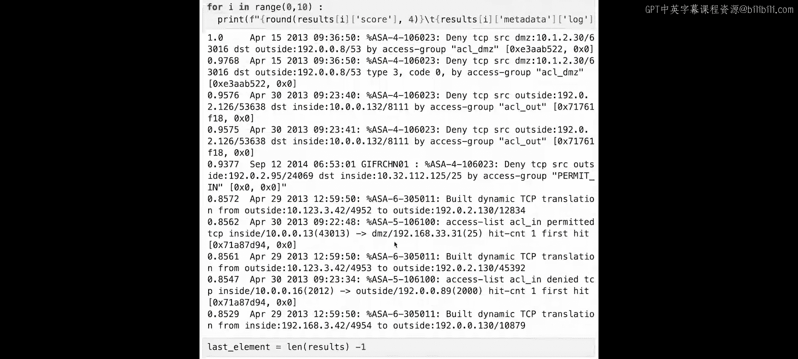

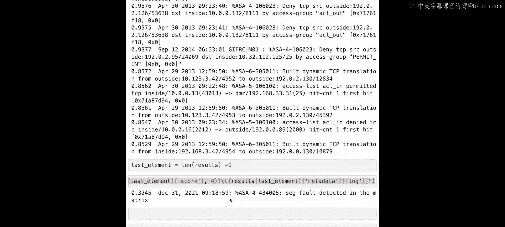

