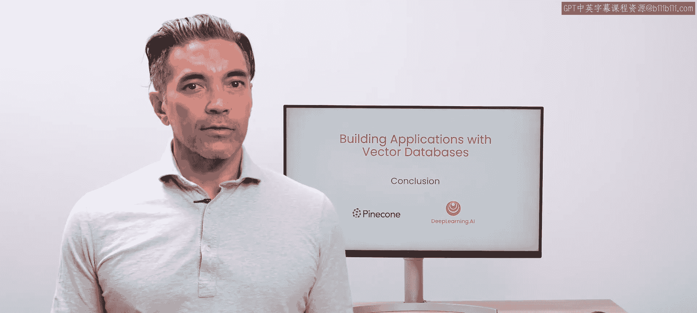

# 吴恩达《使用向量数据库构建应用程序｜Building Applications with Vector Databases》中英字幕 - P8：8.Conclusion.zh - GPT中英字幕课程资源 - BV1QH4y1e7kM

In this course， you learned about the essentials of building applications using vectorctor databases。

 You built simple search and recommendation systems， retrieval augmented generation or Ra。

 explored hybrid search， looked for facial similarities in the royal family and finally found anomalous log entries in Cisco A A log files。

😊。

We only scratched the surface of what's possible with vector databases。

 and I encourage you to explore far beyond the material we covered today。

I'm looking forward to seeing what you've built on your own。😊。

