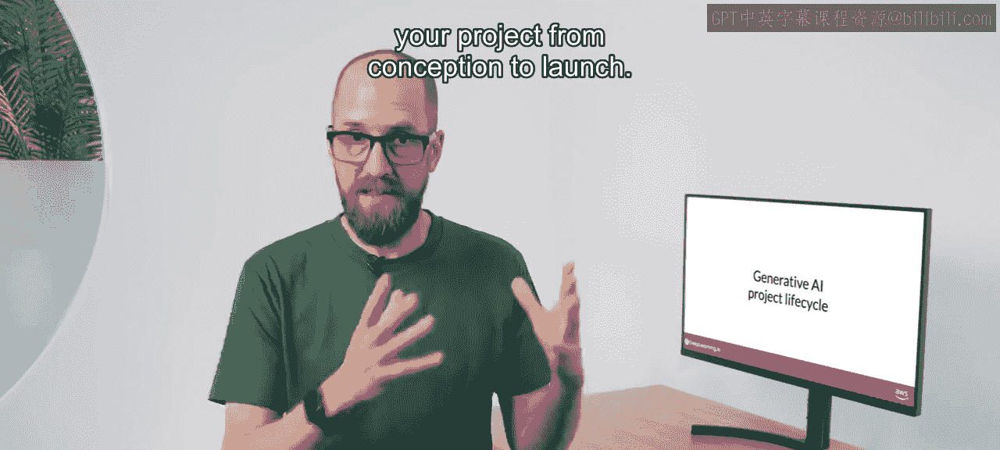
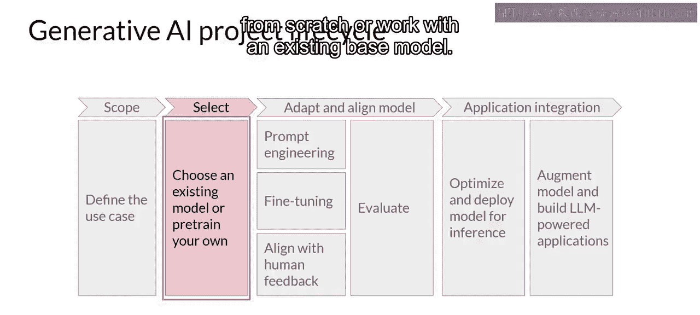
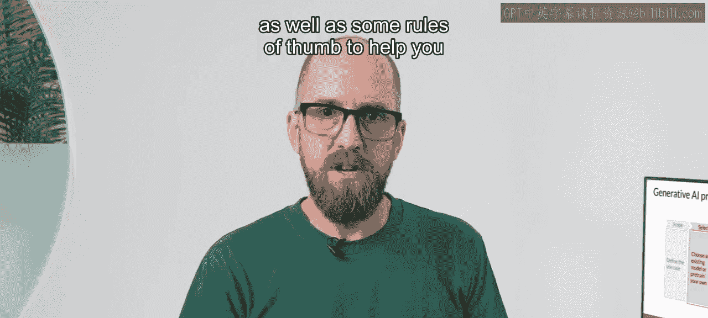
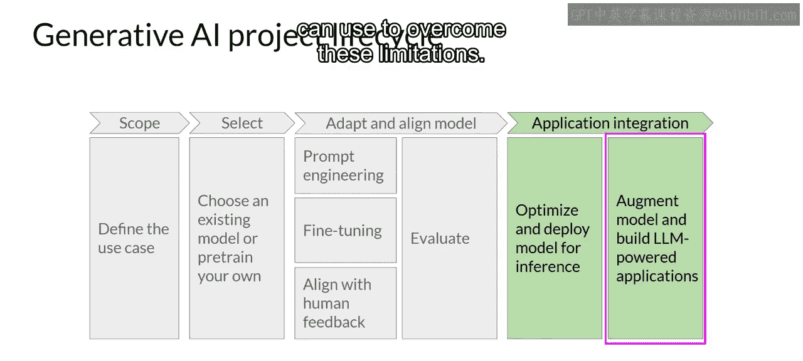

# 吴恩达《使用大型语言模型的生成式人工智能》Generative AI with Large Language Models - P10：9_生成AI项目生命周期.zh - GPT中英字幕课程资源 - BV1Cw411q7wm

Throughout the rest of this course， you're going to learn the techniques required to develop and deploy an LLM powered application In this video you'll walk through a generative AI project lifecycl that can help guide you through this work。

😊，This framework maps out the tasks required to take your project from conception to launch。

 and by the end of this course， you should have some good intuition about the important decisions that you'll have to make。

😊。

The potential difficulties you'll encounter and the infrastructure that you'll need to develop and deploy your application。

 Here is a diagram of the overall life cycle。 We're going to talk through it stage by stage。

 The most important step in any project is to define the scope as accurately and narrowly as you can。

As you've seen in this course so far， L L Ms are capable of carrying out many tasks。

 but their abilities depend strongly on the size and architecture of the model。

 You should think about what function the LLM will have in your specific application。

 Do you need the model to be able to carry out many different tasks。

 including longform text generation or with a high degree of capability。

 or is the task much more specific， like named entity recognition。

 so that your model only needs to be good at one thing， as you'll see in the rest of the course。

 Getting really specific about what you need your model to do， can save you time。

 and perhaps more importantly， compute cost。 once you're happy and you've scoped your model requirements enough to begin development。

 your first decision will be whether to train your own model from scratch or work with an existing base model。

😊。

In general， you'll start with an existing model， although there are some cases where you may find it necessary to train a model from scratch。

 you'll learn more about the considerations behind this decision later this week。

 as well as some rules of thumb to help you estimate the feasibility of training your own model with your model in hand。

 the next step is to assess its performance and carry out additional training。

 if needed for your application。

As you saw earlier this week， prompt engineering can sometimes be enough to get your model to perform well。

 so you'll likely start by trying in context learning。

 using examples suited to your task and use case。There are still cases， however。

 where the model may not perform as well as you need， even with one or few shot inference。

 And in that case， you can try fine tuning your model。

 This supervised learning process will be covered in detail in week 2。

And you'll get a chance to try fine tuning a model yourself in the week2 lab。

 As models become more capable， It's becoming increasingly important to ensure that they behave well and in a way that is aligned with human preferences in deployment。

 In week 3， you'll learn about an additional fine tuning technique called reinforcement learning with human feedback。

 which can help to make sure that your model behaves well。

 an important aspect of all of these techniques is a。 Next week。

 you'll explore some metrics and benchmarks that can be used to determine how well your model is performing or how well aligned it is to your preferences。

😊，Note that this adapt and align stage of app development can be highly iterative。😊。

You may start by trying prompt engineering and evaluating the outputs。

 then using fine tuning to improve performance and then revisiting and evaluating prompt engineering one more time to get the performance that you need。

😊，Finally， when you've got a model that is meeting your performance needs and is well aligned。

 you can deploy it into your infrastructure and integrate it with your application。😊，At this stage。

 an important step is to optimize your model for deployment。

 This can ensure that you are making the best use of your compute resources and providing the best possible experience for the users of your application。

 The last but very important step is to consider any additional infrastructure that your application will require to work well。

There are some fundamental limitations of LLMs that can be difficult to overcome through training alone。

 like their tendency to invent information when they don't know an answer or their limited ability to carry out complex reasoning and mathematics。

😊，In the last part of this course， you'll learn some powerful techniques that you can use to overcome these limitations。

😊。

I know there's a lot to think about here， but don't worry about taking it all in right now。

 you'll see this visual over and over again during the course as you explore the details of each stage。

😊。