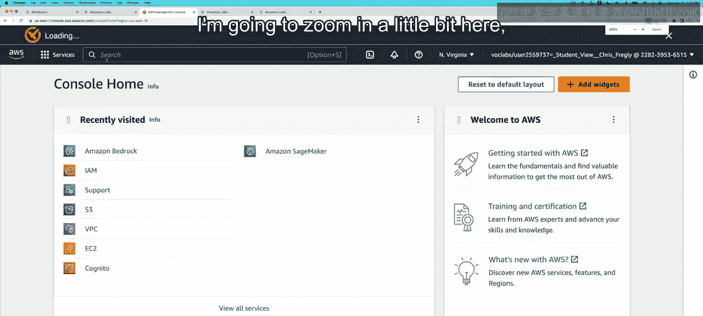
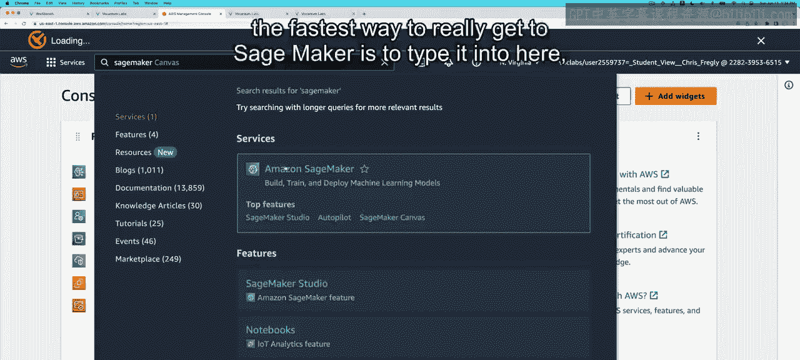
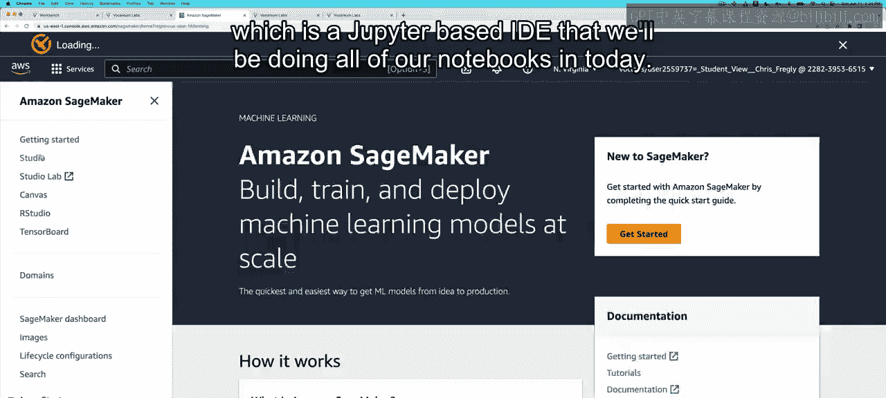
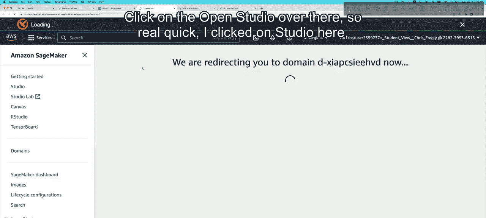
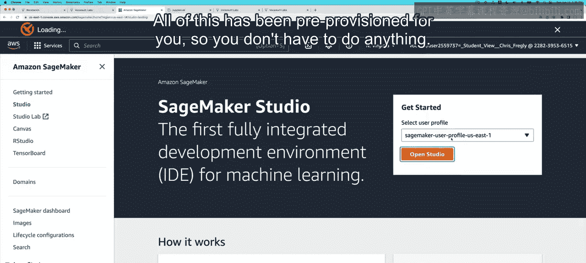
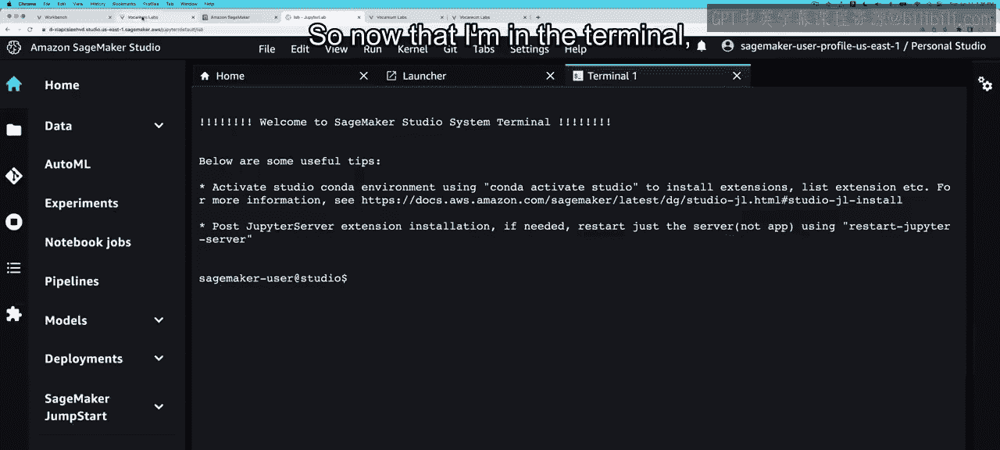
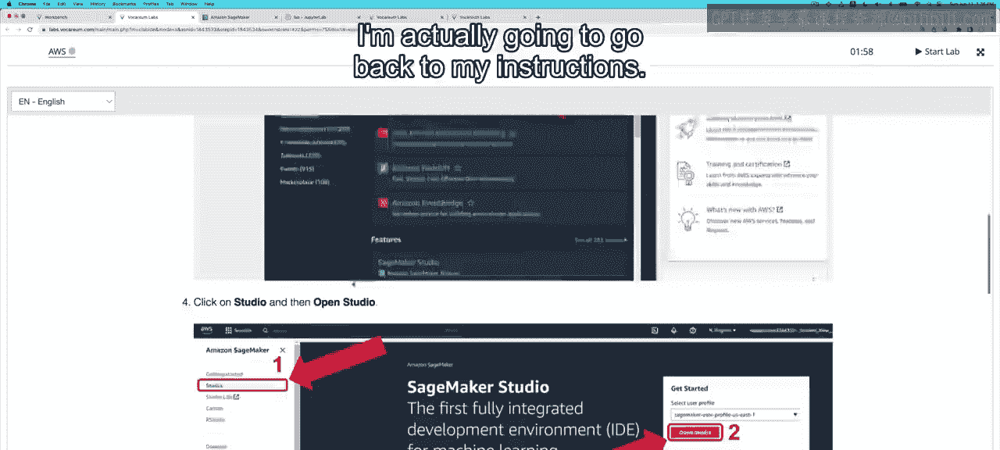
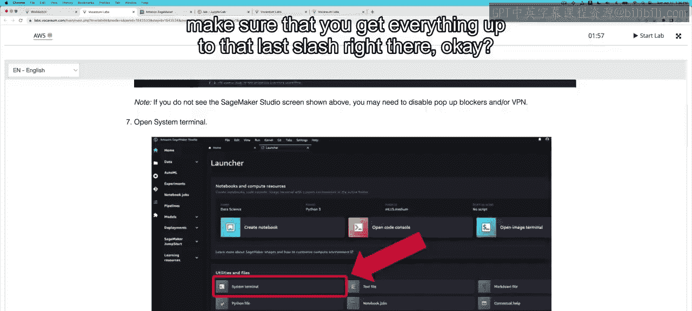
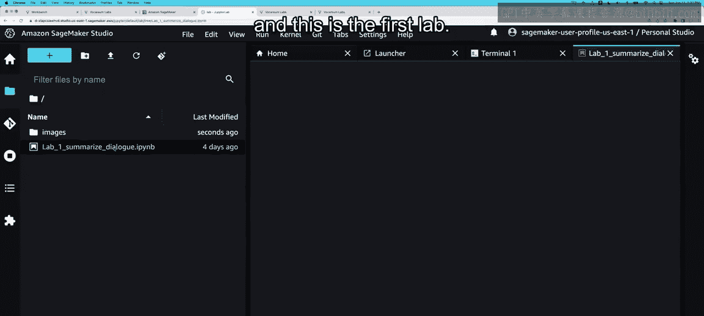
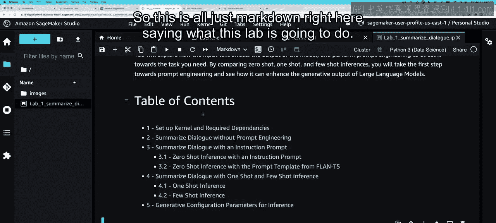

# 吴恩达《使用大型语言模型的生成式人工智能》Generative AI with Large Language Models - P11：10_AWS实验室介绍.zh - GPT中英字幕课程资源 - BV1Cw411q7wm

So you've seen a lot of material so far in the course。

 And the best way for you to solidify these concepts in your mind is to get hands on and try some code for yourself。

 As Andrew mentioned， at the start of this week， my colleague， Chris Frly。

 LED the development of the labs for this course。 Each week features a lab exercise that lets you try out the key concepts from the videos。

 Chris is going to help you get started by showing you the lab environment。

 then he'll walk you through the activity that you'll complete this week。 Hey， Chris。😊。

Hey， thanks， Mike， and now let's take a look at the lab environments and lab1。

Before actually getting into the lab， let me explain the system。

 the environment that we're going to be using here， which is called Vcaria。

 and so here we will actually launch your own AWS account that will give you access to Amazon SageMaker。

And therefore， you can run these notebooks without any cost to you， so some things to note。

When you get into the Vquaium lab environments， you want to click start Lab。

 that's the very first thing you'll see that up here in the upper left。

 you'll see the AWS goes from red to yellow to green， so green is good。

Green means we can click on this and then get into the lab。 So just a couple quick things here。

 you will have two hours to complete each lab。 You don't need to click any sort of end lab when you're done you just。

Close the browser and then move on to the next。Lab or video as you wish。

And there are some instructions here。But I'm going to actually walk through this with you right now。

So what we want to do is click on the AWS。That will actually launch into the like AWS console now if you are already logged into an AWS console。

 you will need to click log out and then click back here once again on that same green AWS button。

I'm going to zoom in a little bit here。

The fastest way to really get to SageMaker is to type it into here into the search field and then click on SageMaker what we're trying to do is get to the SageMaker Studio which is a Jupiter based IDE that we'll be doing all of our notebooks in today click on the Open Studio over there。

So real quick， I clicked on Studio here， then I clicked on open Studio here。

 all of this has been pre provisioned for you so you don't have to do anything。

That'll get you right into the Jupipyter notebook， let me zoom in， dark mode is enabled by default。

 you can switch off of dark mode onto light mode if you wish。

You can click theme and then switch to Jupiter Lab light mode by default。

 it's the SageMaker UI dark mode that is a form of black here that we see。

Now the first step is to click open launchuner。We actually want to go to the system terminal because the first thing that we want to do is to copy the labs from our S3 bucket。

 so object storage that's in the cloud， this is a public bucket that contains all of the notebooks and all of the images and all of the data sets that are needed for this particular lab。

So now that I'm in the terminal I'm actually going to go back to my instruction。

 so we've done all of this step1， click Studio， step two， click the open Studio。

 there is another way to get into studio sometimes learners do stumble upon this if you do see this screen somehow if you're poking around just know that you can click on launch and you would click on studio and that'll open up studio notebooks in the same manner and then from that point all of these instructions are the same clicking open launchuner clicking system terminal now this is the code that I need to copy。

 make sure that you get everything up to that last slash right there。

I'm going to go back into Jupiter La and I'm just going to paste this right here。

Okay next step will be to click on the folder and we should see the notebook that was downloaded。

 so because I'm zoomed in so far here， I have to scroll this。Over here， and this is the first lab。

Now， so like I said， all of the compute has been provisioned for us。

 we should just be able to start running these labs now if you're not familiar with Jupyter notebooks。

 just know that you can do either shift enter to get from notebook from cell to cell or if you are feeling like maybe you're in a hurry you could do restart kernel and run all cells and that will actually run all of the cells with just one click for these labs I would encourage you to run step by step so do shift enter shift enter shift enter so this is all just markdown right here saying what this lab is going to do。

