# 吴恩达《使用大型语言模型的生成式人工智能》Generative AI with Large Language Models - P13：12_预训练大型语言模型.zh - GPT中英字幕课程资源 - BV1Cw411q7wm

In the previous video you were introduced to the generative AI Project Lifecycle as you saw there are a few steps to take before you can get to the fun part。

 launching your generative AI app once you have scoped out your use case and determined how you need the LLM to work within your application your next step is to select a model to work with。

Your first choice will be to either work with an existing model or train your own from scratch。

There are specific circumstances where training your own model from scratch might be advantageous。

 and you'll learn about those later in this lesson in general， however。

 you'll begin the process of developing your application， using an existing foundation model。

 many open source models are available for members of the EI community like you to use in your application。

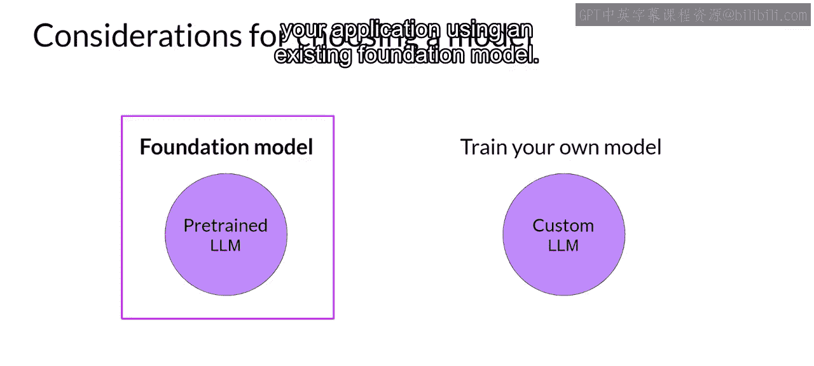

The developers of some of the major frameworks for building generative AI applications like Huging phase and Pytorch have created hubs where you can browse these models。

 a really useful feature of these hubs is the inclusion of model cards。

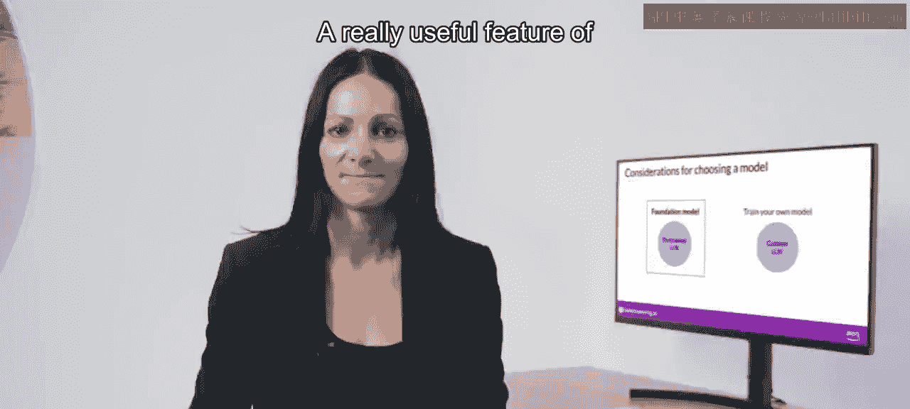

They describe important details， including the best use cases for each model， how it was trained。

 and known limitations。You'll find some links to these model hubs in the reading at the end of the week the exact model that you choose will depend on the details of the task you need to carry out variants of the transformer model architecture are suited to different language tasks。

 largely because of differences in how the models are trained to help you better understand these differences and to develop intuition about which kind of model to use for a particular task。

 let's take a closer look at how large language models are trained。

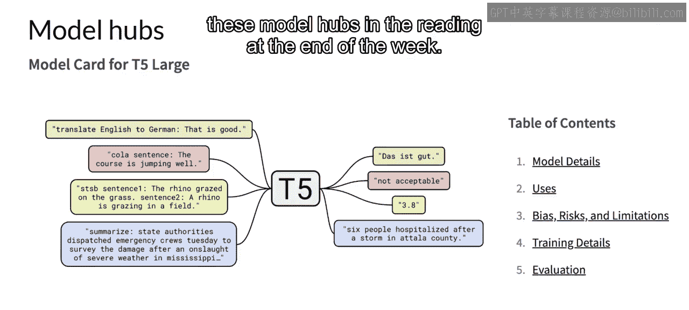

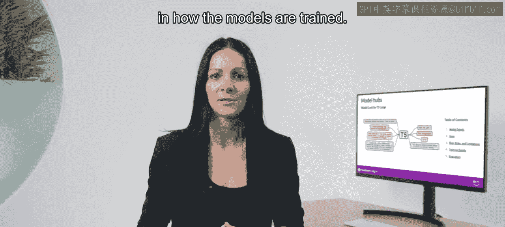

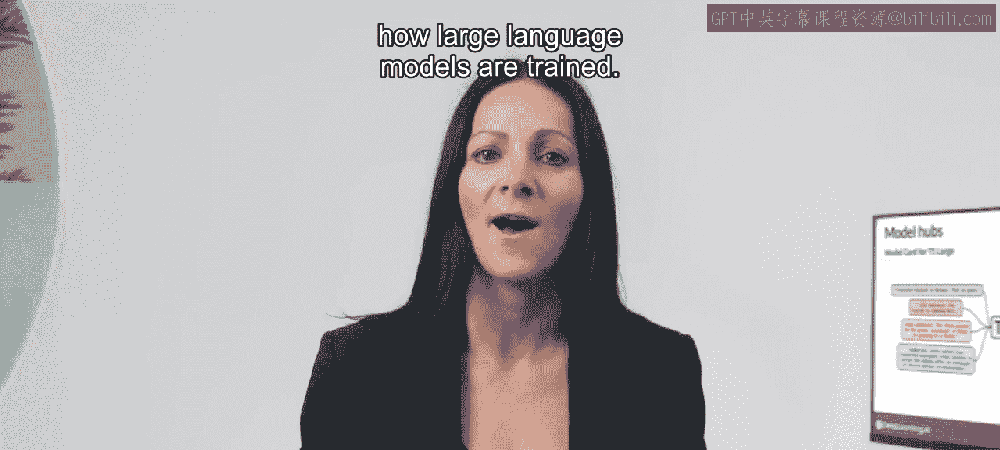

With this knowledge in hand， you'll find it easier to navigate the model hubs and find the best model for your use case To begin。

 let's take a high level look at the initial training process for LLms。

 This phase is often referred to as pretraining As you saw in lesson1。

 LLms encode a deep statistical representation of language。

 This understanding is developed during the models pretraining phase。

 When the model learns from vast amounts of unstructured textual data。 This can be gigabytes。

 terabytes and even petabytes of text。 This data is pulled from many sources including scrapes of the internet and corpora of text that have been assembled specifically for training language models In this selfsupvised learning step。

 The model internalizes the patterns and structures present in the language This patterns then enable the model to complete its training objective。

 which depends on the architecture of the model。

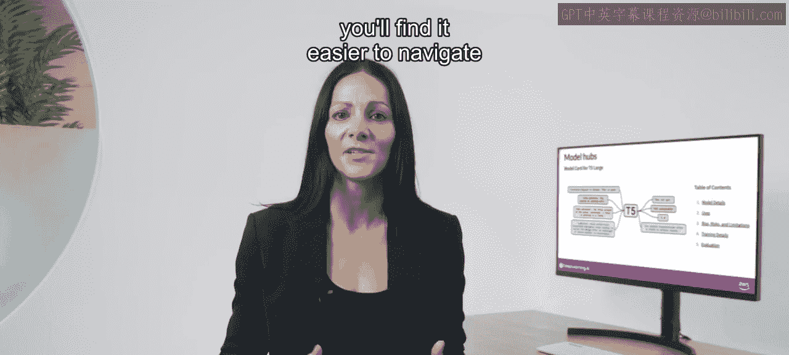

As you'll see shortly。During pre training， the model weights get updated to minimize the loss of the training objective。

The encoder generates an embedding or vector representation for each token pretraining also requires a large amount of compute in the use of GPUs Note when you scrape training data from public sites such as the internet。

 you often need to process the data to increase quality。

 address bias and remove other harmful content as a result of this data quality curation。

 often only one to3% of tokens are used for pretraining you should consider this when you estimate how much data you need to collect if you decide to pretrain your own model。

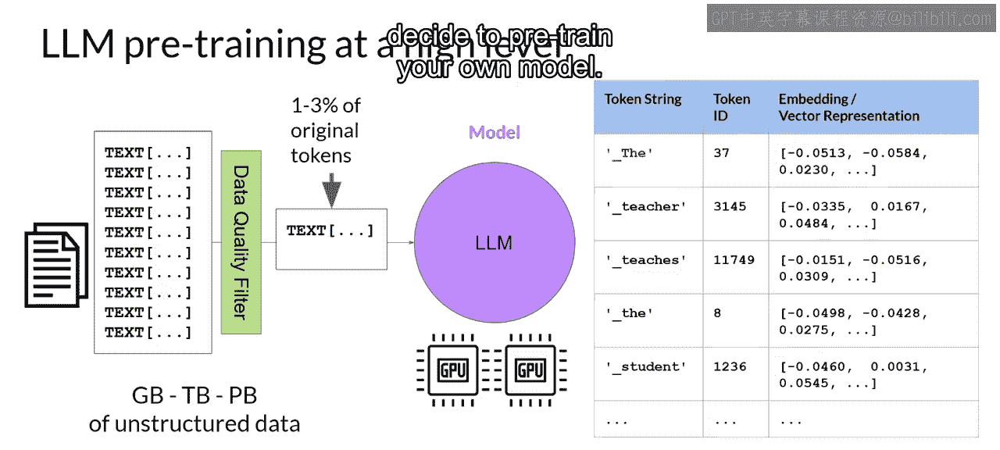

Earlier this week， you saw that there were three variants off the transformer model。

 encodecoder only encoder decoder models and decoder only Each of these is trained on a different objective and so learns how to carry out different tasks encodecor only models are also known as autoencoding models。

 and they are pre-trained using mass language modeling here。

 tokens in the input sequence are randomly masked and the training objective is to predict the mass tokens in order to reconstruct the original sentence。

 This is also called a denoicing objective。Auto encoding models build bidirectional representations of the input sequence。

Meaning that the model has an understanding of the full context of a token and not just of the words that come before。

Encota only models are ideally suited to tasks that benefit from the bidirectional context。

 you can use them to carry out sentence classification tasks， for example， sentiment analysis。

 or token level tasks like named entity recognition or word classification。

Some well known examples of an autoencor model are Bd and Roberta。

Now let's take a look at decoder only or autoaggressive models。

 which are pretrained using causal language modeling here the training objective is to predict the next token based on the previous sequence of tokens predicting the next token is sometimes called full language modeling by researcherses decoder based autoaggressive models mask the input sequence and can only see the input tokens leading up to the token in question。

The model has no knowledge of the end of the sentence The model then iterates over the input sequence one by one to predict the following token In contrast to the encoder architecture。

 this means that the context is unidirectional by learning to predict the next token from a vast number of examples。

 the model builds up a statistical representation of language Model of this type make use of the decoder component of the original architecture without the encoder。

Decoder only models are often used for text generation。

 although larger decoder only models show strong zero or shot inferenceferibilities and can often perform a range of tasks well。

 wellknow examples of decoder- based autoaggressive model are GBBT and B。

 the final variation of the transformer model is the sequence to sequence model that uses both the encoder and decoder parts of the original transformer architecture。

 the exact details of the pre-training objective vary from model to model。

A popular sequence to sequence model T5 pretrains the encoder using spanm corruption。

 which masks random sequences of input tokens。 Those mass sequences are then replaced with the unique sententinel token shown here as X Sentinel tokens are special tokens added to the vocabulary。

 but do not correspond to any actual word from the input text。

 The decoder is then tasked with reconstructing the mass token sequences auto aggressively。

 The output is the sententinel token followed by the predicted tokens。

You can use sequence to sequence models for translation， summarization， and question answering。

They are generally useful in cases where you have a body of text as both input and output besides T5。

 which you'll use in the labs in this course， another well knownn encoded decoder model is Spd。

 not Bt。So to summarize， here's a quick comparison of the different model architectures and the targets of the pretraining objectives auto encoding models are pretrained using masked language modeling。

 they correspond to the encoder part of the original transformer architecture and are often used for sentence classification or token classification。

Auttterregressive models are pre traineded using causal language modeling models of this type make use of the decota component of the original transformer architecture and are often used to a text generation。

Sequence to sequence models use both the encodeder and decota part off the original transformer architecture。

The exact details of the pretrain objective vary from model to model the T5 model is pretrained using spam corruption sequence to sequence models are often used for translation。

 summarization， and question answering。

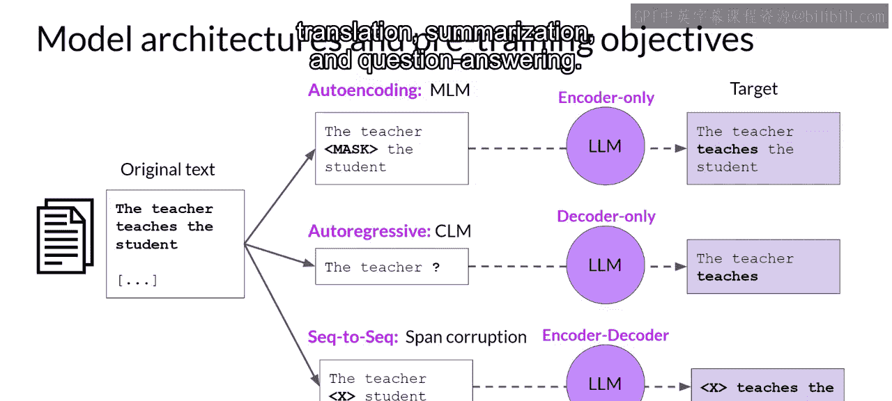

Now that you have seen how these different model architectures are trained and the specific tasks they are well suited to。

 you can select the type of model that is best suited to your use case。

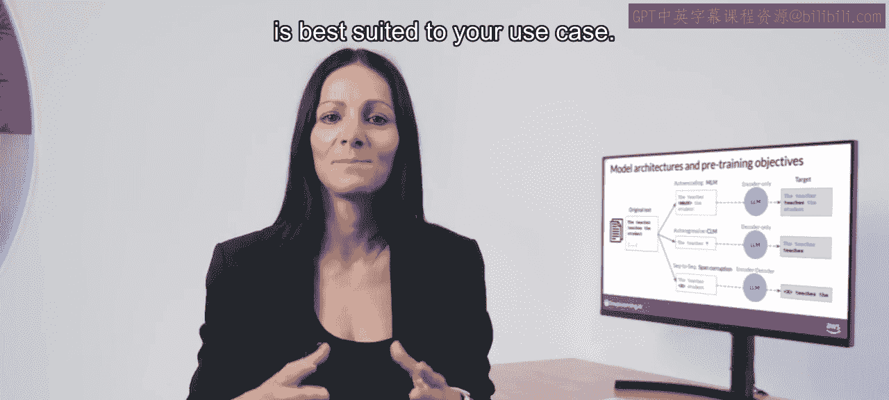

One additional thing to keep in mind is that larger models of any architecture are typically more capable of carrying out their tasks well。

Researchers have found that the larger a model， the more likely it is to work as you need to without additional in context learning or further training。

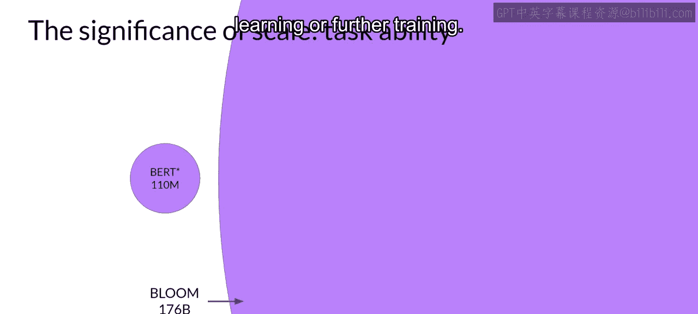

This observed trend of increased model capability with size has driven the development of larger and larger models in recent years。

This growth has been fueled by inflection points in research。

 such as the introduction of the highly scalable transformer architecture。

 access to massive amounts of data for training and the development of more powerful compute resources。

 This steady increase in model size actually let some researches to hypothesize the existence of a new Moores law for LLMs like them。

 you may be asking， can we just keep adding parameters to increase performance and make models smarter。

 where could this model growth lead。

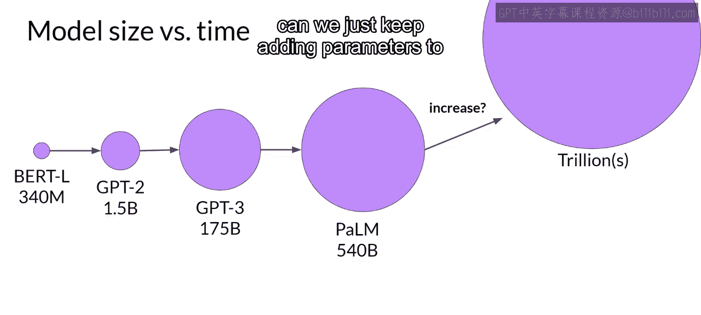

While this may sound great， it turns out that training these enormous models is difficult and very expensive。

So much so that it may be infeasible to continuously train larger and larger models。

Let's take a closer look at some of the challenges associated with training large models in the next video。

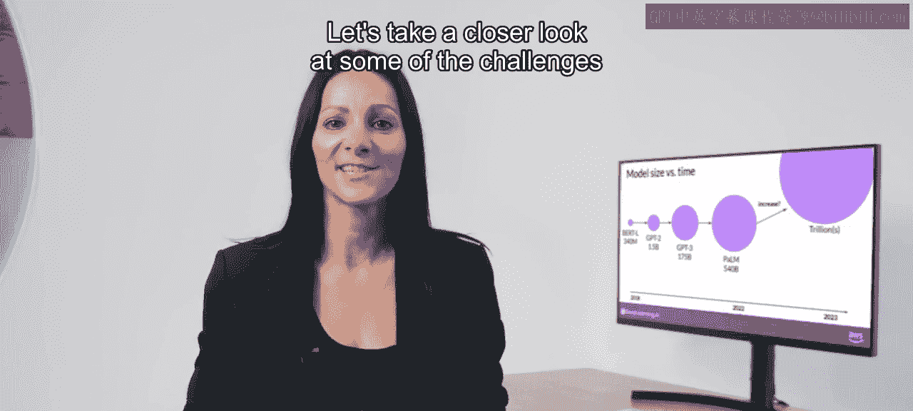