# 吴恩达《使用大型语言模型的生成式人工智能》Generative AI with Large Language Models - P14：13_训练大型语言模型的计算挑战.zh - GPT中英字幕课程资源 - BV1Cw411q7wm

One of the most common issues you'll encounter when you try to train large language models is running out of memory。

If you've ever tried training or even just loading your model on NviDdia GPUs。

 this error message might look familiar。Kuda， short for Comp unified device architecture。

 is a collection of libraries and tools developed for NVDdia GPUs。

Libraries such as Pytorch and TensorFlow use KUuda to boost performance on metrics multiplication and other operations common to deep learning。

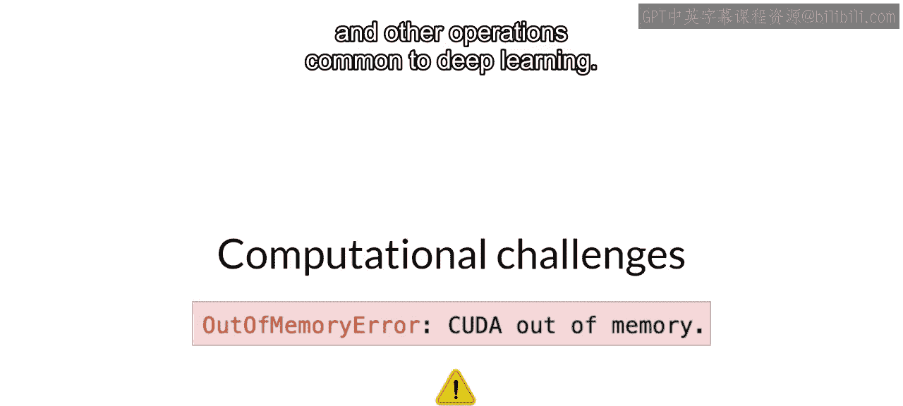

You'll encounter these out of memory issues because most LLNs are huge and require a ton of memory to store and train all of their parameters。

Let's do some quick math to develop intuition about the scale of the problem。

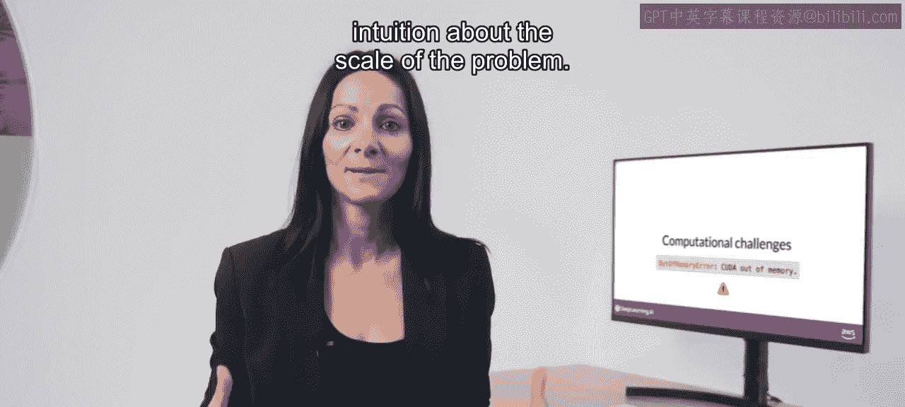

A single parameter is typically represented by a 32 bit float。

Which is the way computers represent real numbers。 You'll see more details about how numbers get stored in this format shortly。

A 32 B float takes up 4 by of memory， so to store 1 billion parameters。

 you'll need 4 bys times 1 billion parameters or 4 gig of GPU Ram at 32 B full precision。

 This is a lot of memory。And note you've only accounted for the memory to store the model weight so far if you want to train the model。

 you'll have to plan for additional components that use GPU memory during training These include two atom optimizeal states。

Grads， activations。And temporary variables needed by your functions。

This can easily lead to 20 extrates of memory per model parameter， in fact。

 to account for all of this overhead during training。

 you'll actually require approximately 20 times the amount of GPU Ram that the model weights a alone takeup to train a 1 billion parameter model at 32 B full precision you'll need approximately 80 gigte of GPU Ram this is definitely too large for consumer hardware and even challenging for hardware used in data centers if you want to train with a single processor 80 gigte is the memory capacity off a single NVDdia a100 GPU a common processor used for machine learning tasks in the cloud。

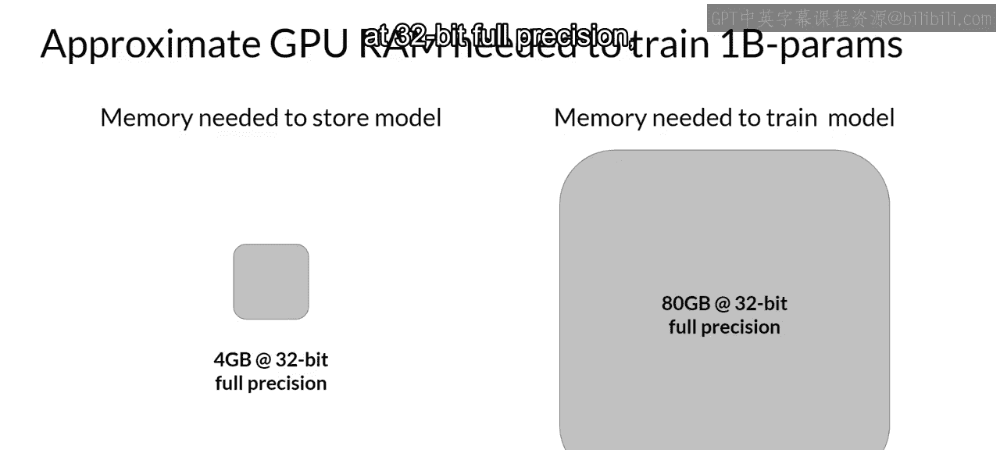

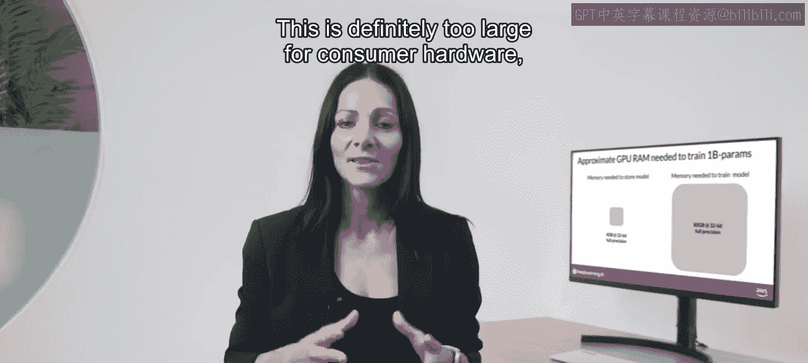

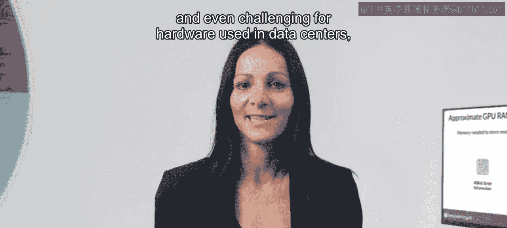

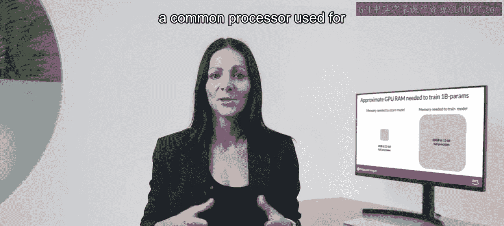

So what options do you have to reduce the memory required for training？

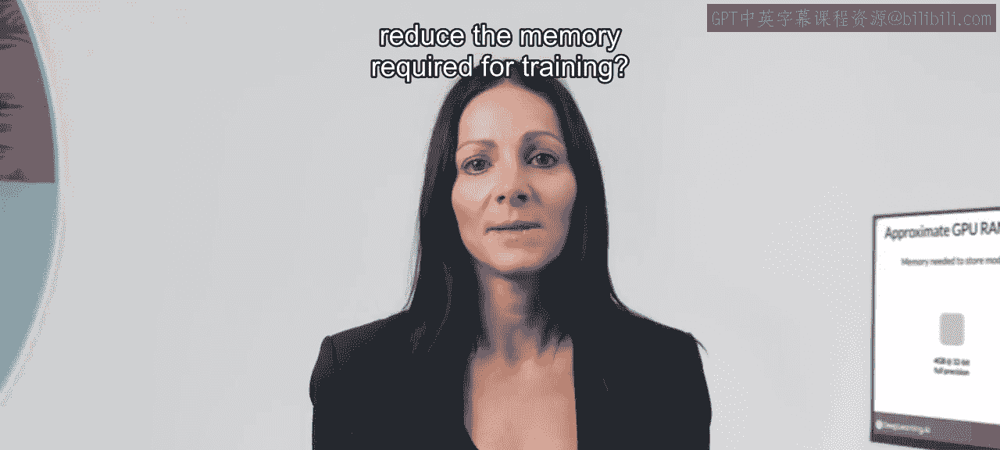

One technique that you can use to reduce the memory is called quantization。

The main idea here is that you reduce the memory required to store the weights of your model by reducing their position from 32 bit floating point numbers to 16 bit floating point numbers or 8 bit integer numbers。

The corresponding data types used in deep learning frameworks and libraries are FP32 for 32 bit full precision。

FP16 or B float 16 for 16 bit half precision and end aid for 8 bit integers。

The range of numbers you can represent with FP32 goes from approximately3 times 10 to the power negative 38 to 3 times 10 to the power of 38 by default。

 model weights， activations and other model parameters are stored in FP32。

Quantization statistically project the original 32 B floating point numbers into a lower precision space using scaling factors calculated based on the range of the original 32 B floating point numbers。

 Let's look at an example。 supposeose you want to store pi to six decimal places in different precision。

 floating point numbers are stored as a series of bits  zeros and once。

 the 32 Bs to store numbers in full precision with Fp32 consists of one bit for the sign where0 indicates a positive number and one a negative number。

 then 8 bits for the exponent of the number and 23 bits representing the fraction of the number。

 The fraction is also referred to as menisa or significant。

 It represents the precision bits of the number。 If you convert the 32 bit floating point value back to a decimal value。

 You notice the slight loss in precision。 for reference。

Here's the real value of pi to 19 decimal places Now let's see what happens if you project this FP32 representation of pi into the FP1616 bit lower position space。

 the 16 bits consists of one bit for the sign as you solve for FP32。

 but now FP16 only assigns 5 bits to represent the exponent and 10 bits to represent the fraction therefore the range of numbers you can represent with FP16 is vastly smaller from negative 65。

504 to positive 65504。The original FP32 value gets projected to 3。

140625 in the 16 B space noticeice that you lose some precision with this projection there are only six places after the decimal point now you'll find that this loss in precision is acceptable in most cases because you're trying to optimize for memory footprint。

Sttoring a value in FP32 requires four bytes of memory。In contrast。

 storing a value on FP 16 requires only two bytes of memory。

So with quantization you have reduced the memory requirement by half the AI research community has explored ways to optimize 60bit quantization one data type in particular BFlo 16 has recently become a popular alternative to FP16 BFat 16 short for Bra floatinglo point format developed at Google Brain has become a popular choice in deep learning Many LLMs including Fanty5 have been pretrained with Bflow 16 BFloat 16 or BF16 is a hybrid between half precision FP16 and full precision FP32。

BF16 significantly helps with training stability and is supported by newer GPUs such as N BDS A100 Bflow 16 is often described as a truncated 32 B float as it captures the full dynamic range of the full 32 B flow yet uses only 16 bits BF 16 uses the full 8 bits to represent the exponent but truncates the fraction to just 7 Bs。

 This not only saves memory but also increases model performance by speeding up calculations The downside is that Bf16 is not well suited for integer calculations。

 but these are relatively rare and deep learning。For completeness。

 let's have a look at what happens if you quantize pi from the 32 B into the even lower precision 8 bit space If you use one bit for the sign in the8 values are represented by the remaining seven bits This gives you a range to represent numbers from negative 128 to positive 127 and unsurprisingly pi gets projected two of3 in the8 bit lower precision space this brings the memory requirement down from originally four bytes to just one by。

 but obviously results in a pretty dramatic loss of precision Okay let's summarize what you've learned here and emphasize the key points you should take away from this discussion。

Remember that the goal of quantization is to reduce the memory required to store and train models by reducing the precision off the model weights quantantization statistically projects the original 32 bit floating point numbers into lower precision spaces using scaling factors calculated based on the range of the original 32 bit floats。

 modern deep learning frameworks and libraries support quantization where training which learns the quantization scaling factors during the training process。

The details of this process are beyond the scope of this course。

 but you've seen the key point here that you can use quantization to reduce the memory footprint of the model during training。

BL 16 has become a popular choice of precision in deep learning as it maintains the dynamic range of FP32。

 but reduces the memory footprint by half。Many LLMs， including Fanty5。

 have been pre traineded with BFat 16。

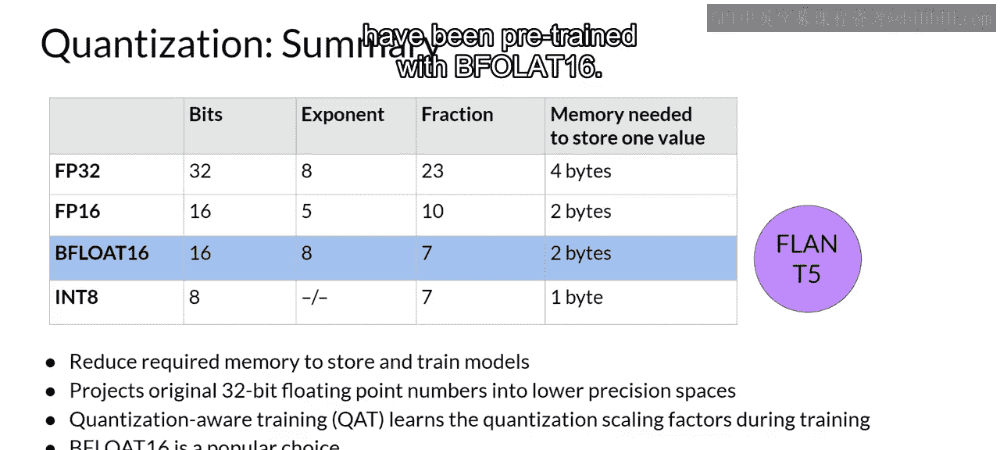

Look out for a mention of Pflow 16 in next week's lap。Now。

 let's return to the challenge of fitting models into GPU memory and take a look at the impact quantization can have。

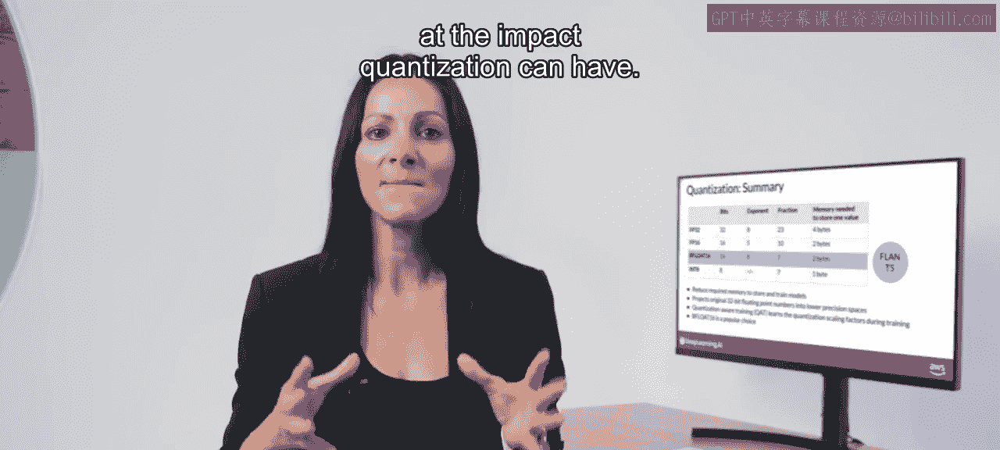

By applying quantization， you can reduce your memory consumption required to store the model parameters down to only 2 gigab using 16 B half precision。

 a 50% saving， and you could further reduce the memory footprint by another 50% by representing the model parameters as 8 bit integers。

 which requires only 1 gig of GPU REM， note that in all these cases you still have a model with 1 billion parameters。

As you can see， the circles representing the models are the same size。

Quantization will give you the same degree of savings when it comes to training as you heard earlier。

 you'll quickly hit the limit of a single NVDdia A100 GPU with 80 gigaby of memory when you try to train a 1 billion parameter model at 32 bit full position。

You'll need to consider using either 16 bit or 8 bit quantization if you want to train on a single GPU and remember。

 many models now have sizes in excess of 50 billion or even 100 billion parameters。

 meaning you need up to 500 times more memory capacity to train them， tens of thousands of gigabytes。

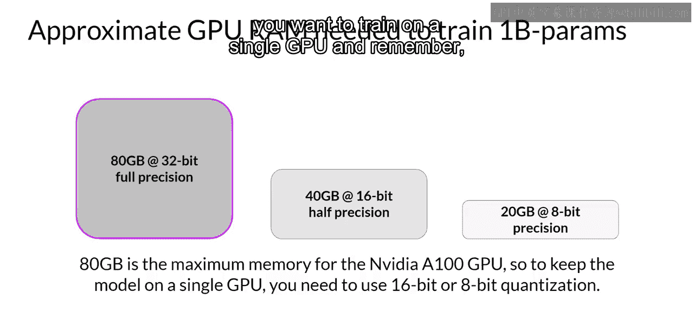

These enormous models dwarf the 1 billion parameter model we've been considering shown here to scale on the left。

As models scale beyond a few billion parameters， it becomes impossible to train them on a single GPU。

Instead， you'll need to turn to distributed computing techniques where you train your model across multiple GPUs。

 this could require access to hundreds of GPUs， which is very expensive。

 another reason why you won't pretrain your own model from scratch most of the time。

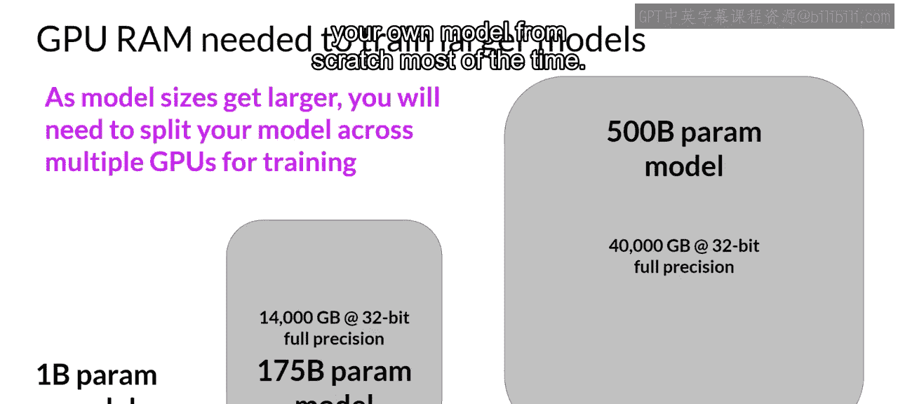

However， an additional training process called Find tuning。

 which you'll learn about next week also requires storing all training parameters in memory。

 and it's very likely you'll want to find tuning model at some point。

To help you understand more about the technical aspects of training across GPUs。

 we've prepared an optional video for you。It's very detailed but it will help you understand some of the options that exist for developers like you to train larger models。

You should feel free to skip this video， but if you're interested in learning more。

 I hope you'll check it out。

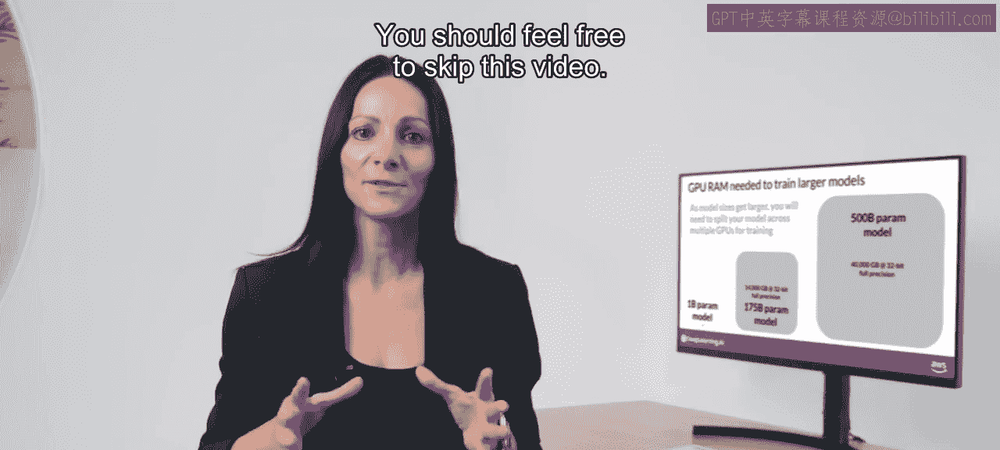

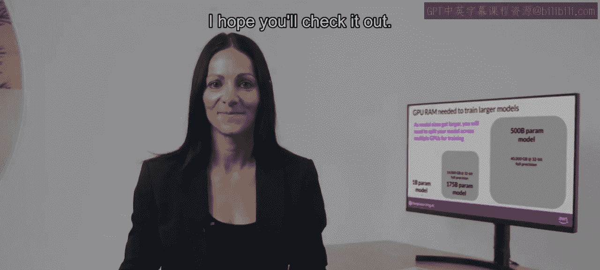