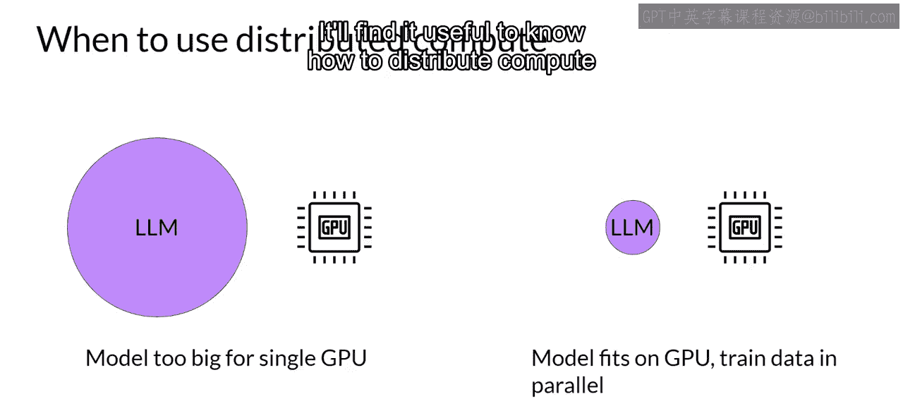
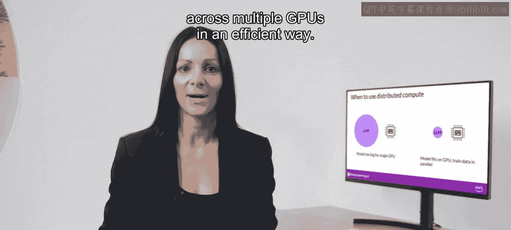
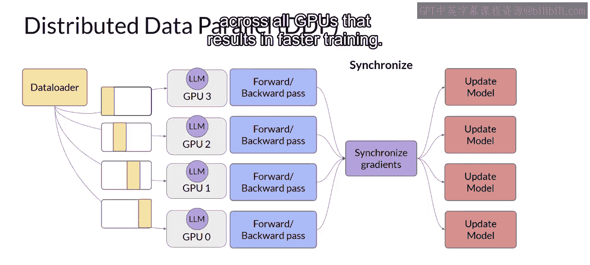
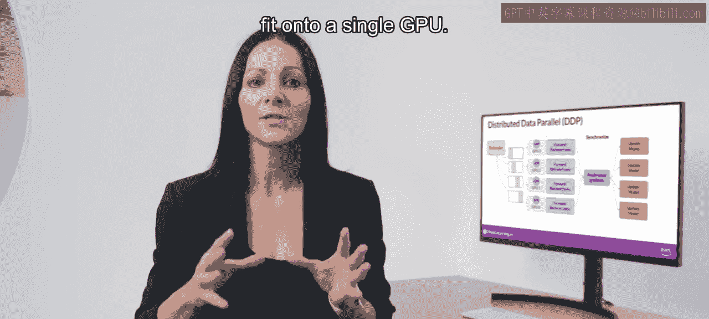
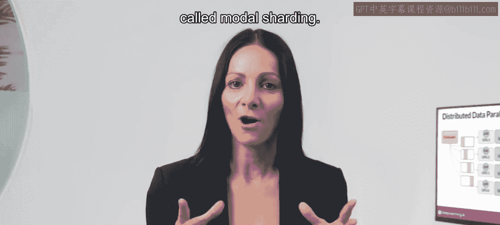
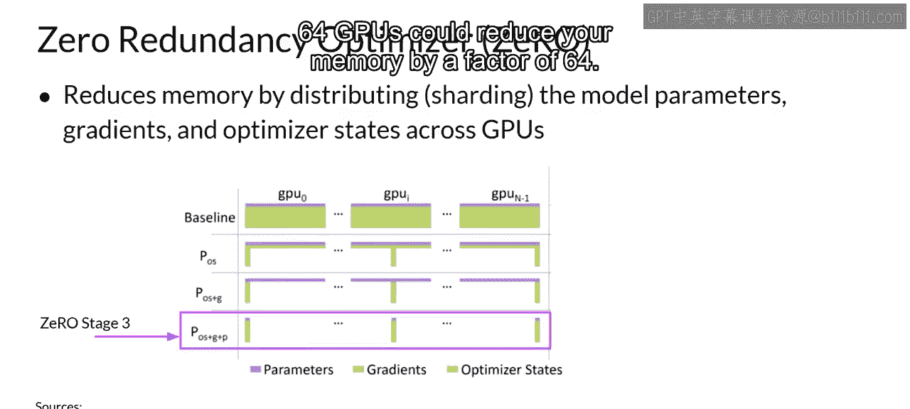
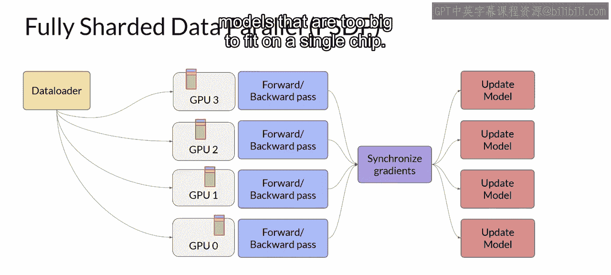
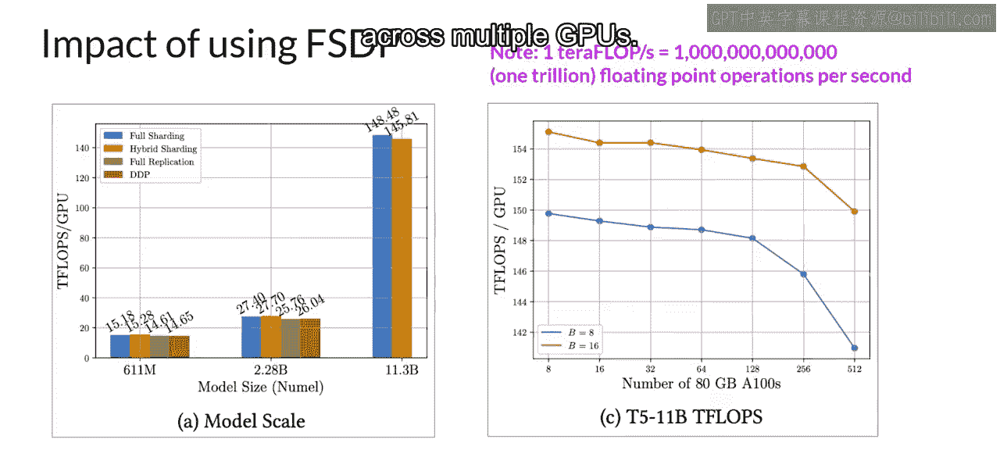
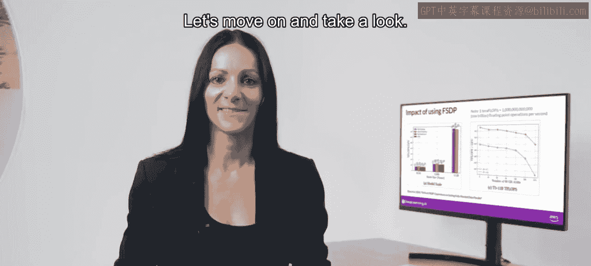

# 吴恩达《使用大型语言模型的生成式人工智能》Generative AI with Large Language Models - P15：14_可选视频- 高效的多GPU计算策略.zh - GPT中英字幕课程资源 - BV1Cw411q7wm

It's very likely that at some point you will need to scale your model training efforts beyond a single GPU I emphasized in the last video that you'll need to use multi GPU compute strategies when your model becomes too big to fit in a single GPU。

 but even if your model does fit onto a single GPU。

 there are benefits to using multiple GPUs to speed up your training。

So it'll find it useful to know how to distribute compute across GPUs。

 even when you're working with a small model， Let's discuss how you can carry out the scaling across multiple GPUs in an efficient way。

You'll begin by considering the case where your model still fits on a single GPU。

The first step in scaling model training is to distribute large data sets across multiple GPUs and process these batches of data in parallel。

 a popular implementation of this model replication technique is Pytor's distributed data parallel or DP for short。

DDP copies your model onto each GPU and sends batches of data to each of the GPUs in parallel。

Each data is processed in parallel and then a synchronization step combines the results of each GPU。

 which in turn updates the model on each GPU， which is always identical across chips This implementation allows parallel computations across all GPUs that results in faster training。

Note that DP requires that your model weights and all of the additional parameters。

 gradients and optimize those states that are needed for training fit onto a single GPU If your model is too for this。

 you should look into another technique called model sharding。

A popular implementation of model sharding is Pytorrchchess fully sharded data parallel or FSDP for short FSDP is motivated by a paper published by researchers at Microsoft in 2019 that proposed a technique called zero zero stands for zero redundancy optimizer and the goal of zero is to optimize memory by distributing or sharding model states across GPus with zero data overlap This allows you to scale model training across GP use when your model doesn't fit in the memory of a single chip。

Let's take a quick look at how zero works before coming back to FSDP Earl this week。

 you looked at all of the memory components required for training LLMs。

 the largest memory requirement was for the optimizer states。

 which take up twice as much space as the weights， followed by weights themselves and the gradients。

Let's represent the parameters as this blue box， the gradients in yellow and the optimizer statess in green。

 One limitation of the model replication strategy that I showed before is that you need to keep a full model copy on each GPU。

 which leads to redundant memory consumption you're storing the same numbers on every GPU。Zero。

 on the other hand， eliminates this redundancy by distributing， also referred to as sharding。

 the model parameters， gradients， and optimizer states across GPs instead of replicating them at the same time。

 the communication overhead for syncing model states stays close to that of the previously discussed EP。

Zero offers three optimization stages， zero stage1 shots only optimizer states across GPs；

 This can reduce your memory footprint by up to a factor of4。

Z stage2 also charts the gradients across chips When applied together with stage1。

 this can reduce your memory footprint by up to eight times and finally0 stage 3 shs all components。

 including the model parameters across GPUs When applied together with stages1 and 2 memory reduction is linear with a number of GPUs For example。

 sharding across 64 GPUus could reduce your memory by a factor of 64。

 Let's supply this concept to the visualization of DP and replace the LLM by the memory representation of model parameters。

 gradients and optimizer states When you use FSDP， you distribute the data across multiple GPus as you saw happening in DP。

But with FSDP， you also distribute or shard the model parameters， gradients。

 and optimize the states across the GPU notes using one of the strategies specified in the zero paper Well this strategy you can now work with models that are too big to fit on a single chip。

In contrast to GDPP， where each GPU has all of the model states required for processing each batch of data available locally。

 FSDP requires you to collect this data from all of the GPUs before the forward and backward pass。

Each GPU requests data from the other GPUs on demand to materialize the sharded data into uncharardted data for the duration of the operation After the operation you release the uncharted nonlocal data back to the other GPUs as original shardted data。

You can also choose to keep it for future operations during backward Passs， for example。

 note this requires more GPU rim again。This is a typical performance versus memory trade off decision。

In the final step after the backward pass， FSDP synchronizes the gradients across the GPUs in the same way they were for DDP Model sharding as described with FSDP allows you to reduce your overall GPU memory utilization Opally you can specify that FSDP offloads part of the training computation to CPUUs to further reduce your GPU memory utilization。

To manage the tradeoff between performance and memory utilization。

 you can configure the level of sharding using FSDP's sharding factor。

 A sharding factor of one basically removes the sharding and replicates the full model similar to Dp。

 If you set the sharding factor to the maximum number of available GPUus， you turn on full sharding。

 This has the most memory savings but increases the communication volume between GPUus。

 Any sharding factor in between enables hybrid sharding。

 Let's take a look at how FSDP performs in comparison to Dp。 measured interoflops per GPU。

 These tests were performed using a maximum of 512 Nvidia a 100 GPUus。

 Each with 80 GB of memory Note1terofflop corresponds to 1 trillion floating point operations per second。

The first figure shows FSDP performance for different sized T5 models。

You can see the different performance numbers for FSDP， full sharding in blue。

 hyper sharding and orange， and full replication in green。For reference。

 DP performance is shown in red for the first 2 T5 models with 611 million parameters and 2。

28 billion parameters， the performance of FSDP and ADP is similar Now。

 if you choose a model size beyond 2。28 billion such as T5 with 11。3 billion parameters。

 DDP runs into the out of memory error FSDP on the other hand。

 can easily handle models this size and achieve much higherterof flops when lowering the model's position to 6 inbit。

The second figure shows a 7% decrease in per GPU tariff flops when increasing the number of GPUs from 8 to 512 for the 11 billion T5 model。

 plotted here using a batch size of 16 in orange and a batch size of8 in blue。

As the model grows in size and is distributed across more and more GPUs。

 the increase in communication volume between chips starts to impact the performance。

 slowing down the computation。In summary， this shows that you can use FSDP for both small and large models and seamlessly scale your model training across multiple GPUs。

I know this discussion has been highly technical， and I want to emphasize that you don't need to remember all of the details here。

😊，The most important thing is to have a sense of how the data， model parameters。

 and training computations are shared across processes when training LLMs。

Given the expense and technical complexity of training models across GPUs。

 some researchers have been exploring ways to achieve better performance with smaller models。

In the next video， you'll learn more about this research into compute Op models Let's move on and take a look。

