# 吴恩达《使用大型语言模型的生成式人工智能》Generative AI with Large Language Models - P16：15_缩放定律和计算优化模型.zh - GPT中英字幕课程资源 - BV1Cw411q7wm

In the last video， you explored some of the computational challenges of training large language models。

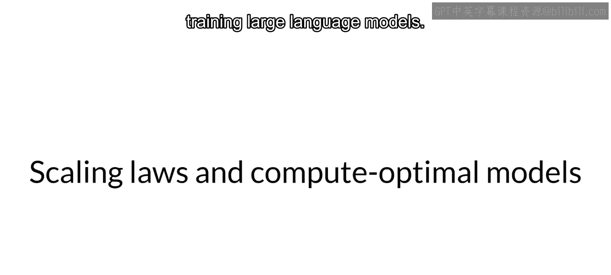

Here you'll learn about research that has explored the relationship between model size。

 training configuration and performance in an effort to determine just how big models need to be remember the goal during pretraining is to maximize the model's performance of its learning objective。

 which is minimizing the loss when predicting tokens。

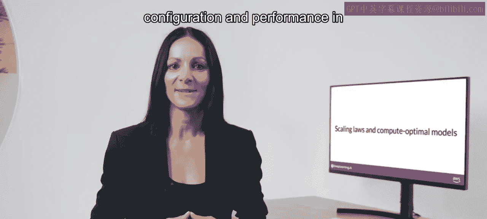

Two options you have to achieve better performance are increasing the size of the data you train your model on and increasing the number of parameters in your model in theory you could scale either of both of these quantities to improve performance。

😊，However， another issue to take into consideration is your compute budget。

 which includes factors like the number of GPUs you have access to and the time you have available for training models。

To help you understand some of the discussion ahead。

 let's first define a unit of compute that quantifies the required resources a paofflop per second day is a measurement of the number of floating point operations performed at a thirdput of one pa ofloop per second running for an entire day。

Note one Palop corresponds to one quadrillion floating point operations per second when specifically thinking about training transformers one paaflo per second day is approximately equivalent to 8 Nvidia V100 GPUus operating at full efficiency for one full day。

 And if you have a more powerful processor that can carry out more operations at once。

 then a padaflo per second day requires fewer chips。 For example。

2 NVDdia A100 GPUus give equivalent compute to the A V100 chips。

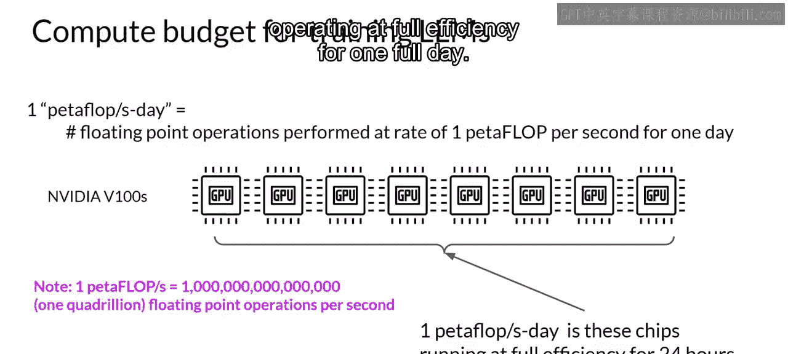

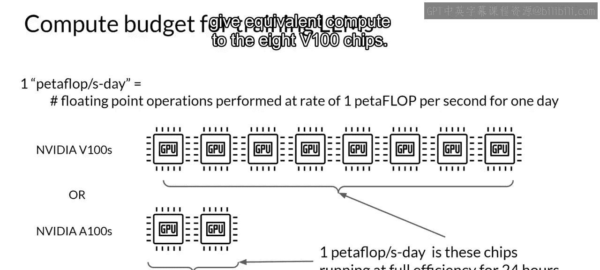

To give you an idea off the scale of these compute budgets。

 this chart shows a comparison off the Palo per second days required to pretrain different variants of B and Roberta。

 which are both encoder only models， T5 an encoder decoder model and G3。

 which is a decoder only model。The difference between the models in each family is the number of parameters that were trained。

 ranging from a few hundred million for bird base to 175 billion for the largest Gb3 variant。

 note that the Yx's here is loggarithmic so each increment vertically is the power of 10 here we see that t5 xl with 3 billion parameters required close to 100 petaflo per second days。

 while the larger Gb3， 175 billion parameter model required approximately 3700 palo per second days this chart makes it clear that a huge amount of computer is required to train the largest models。

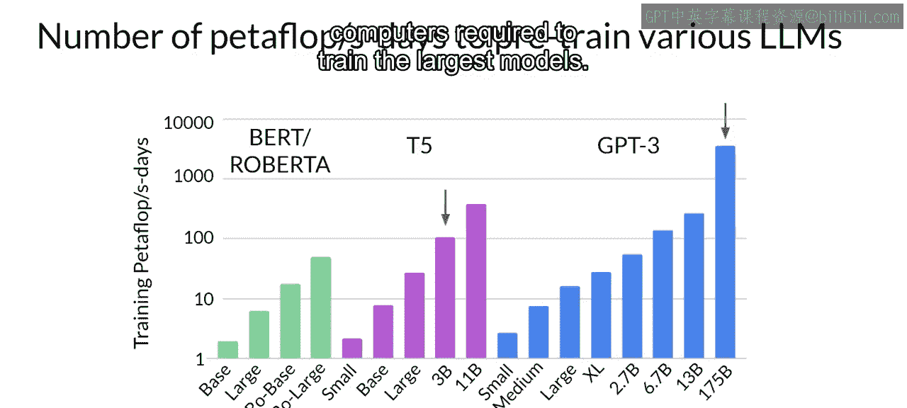

So you can see that bigger models take more compute resources to train and generally also require more data to achieve good performance。

It turns out that there are actually well defined relationships between these phase scaling choices Research have explored the trade offs between training data set size。

 model size， and compute budget。

Here's a figure from a paper by researchers at Open AI that explores the impact of compute budget on model performance。

The Y axis is the test loss， which you can consider as a proxy for model performance。

 where smaller values are better， the X axis is the compute budget in units of Palo per second days。

As you just saw， larger numbers can be achieved by either using more compute power or training for longer or both。

Each thin blue line here shows the model loss over a single training run。

Looking at where the loss starts to decline more slowly for each run reveals a clear relationship between the compute budget and the model's performance。

This can be approximated by a power law relationship shown by this pink line。

A power law is a mathematical relationship between two variables where one is proportional to the other raised to some power when plotted on a graph where both acts as are logarithmic power law relationships appear as straight lines the relationship here holds as long as model size and training dataset size don't inhibit the training process so taken at face value this would suggest that you can just increase your compute budget to achieve better model performance In practice。

 however， the compute resources you have available for training will generally be a hard constraint set by factors such as the hardware you have access to the time available for training and the financial budget of the project。

If you hold your compute budget fixed， the two levers you have to improve your model's performance are the size of the training dataset set and the number of parameters in your model。

The open AI researchers found that these two quantities also show a parallel law relationship with a test loss。

 in the case where the other two variables are held fixed。

This is another figure from the paper exploring the impact of training data size on model performance here。

 the compute budget and model size are held fixed and the size of the training dataset is varied。

 The graph shows that as the volume of training data increases。

 the performance of the model continues to improve。In the second graph。

 the compute budget and training dataset set size are held constant and models of varying numbers of parameters are trained as the model increases in size。

 the test loss decreases indicating better performance So at this point you might be asking what's the ideal balance between these three quantities Well it turns out a lot of people are interested in this question both research and industry communities have published a lot of empirical data for pretraining compute optimal models。

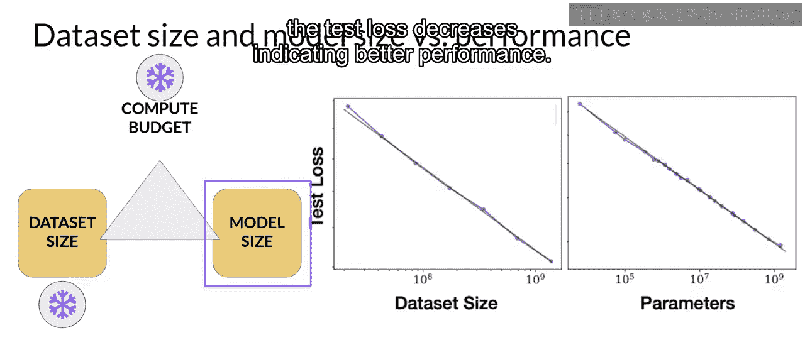

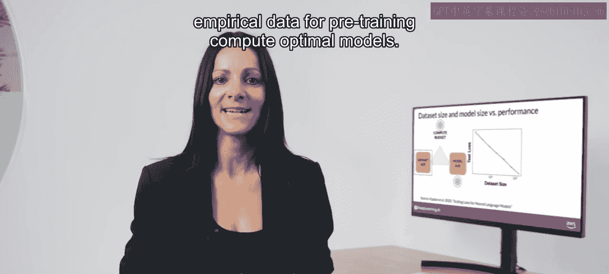

In a paper published in 2022， a group of researchers led by Jordan Hoffman。

 Sebastian Burgeux and Attoinch carried out a detailed study of the performance of language models of various sizes and quantities of training data Their goal was to find the optimal number of parameters and volume of training data for a given compute budget The authors name the resulting compute optimal model Chinchilla so this paper is often referred to as the Chinchilla paper Let's take a look at some of their findings The Chinchilla paper hints that many of the100 billion parameter large language models like Gb3 may actually be overparameterized。

 meaning they have more parameters than they need to achieve a good understanding of language。

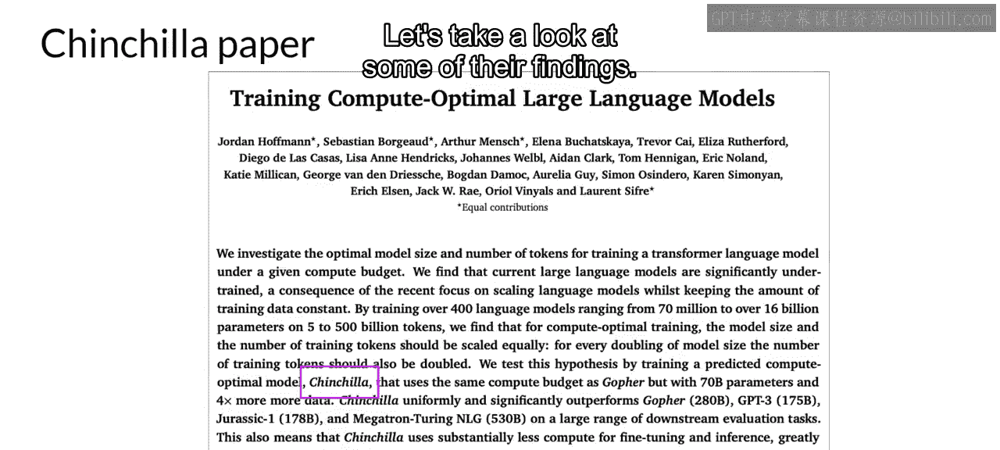

And undertrained so that they would benefit from seeing more training data。

The authors hypothesize that smaller models may be able to achieve the same performance as much larger ones。

If they are trained on larger data sets in this table。

 you can see a selection of models along with their size and information about the data they were trained on。

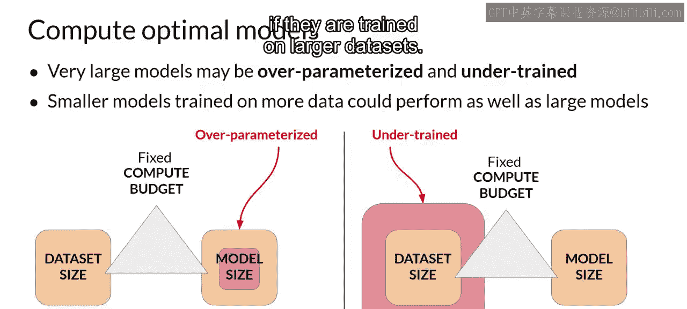

One important takeaway from the Chinchilla paper is that the optimal training dataset size for a given model is about 20 times larger than the number of parameters in the model Chinchilla was determined to be compute optimal。

 so for a 70 billion parameter model， the ideal training dataset contains 1。

4 trillion tokens or 20 times the number of parameters。

The last three models in the table were trained on data sets that are smaller than the geninchilla optimal size。

 so these models may actually be undertrained。In contrast。

 Lama was trained on a dataset set size of 1。4 trillion tokens。

 which is close to the Chinchilla recommended number。

 another important result from the paper is that the compute optimal Chinchilla model outperforms non-compute optimal models such as GT3 on a large range of downstream evaluation tasks。

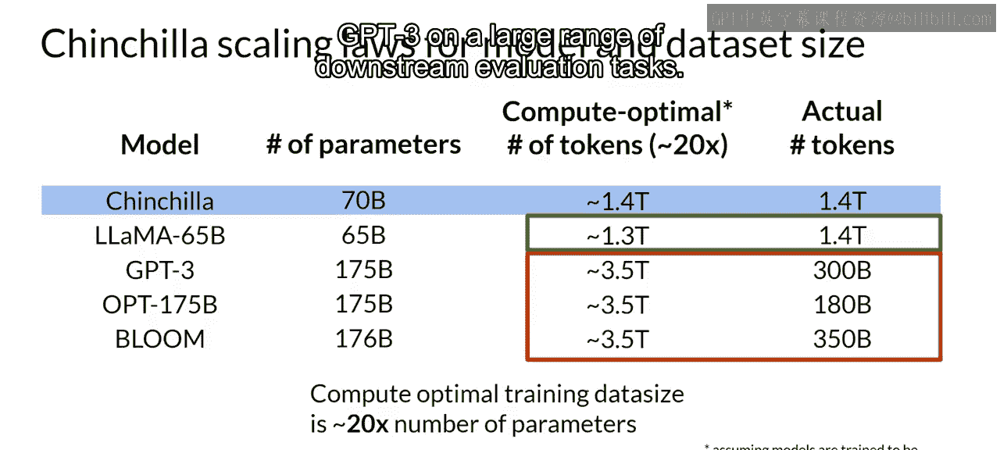

With the results of the Chchilla paper in hand， teams have recently started to develop smaller models that achieve similar。

 if not better results than larger models that were trained in a non optimal way。So moving forward。

 you can probably expect to see a deviation from the bigger always better trends of the last few years as more teams or developers like you start to optimize their model design。

The last model shown on this slide， Bloomberg GBT is a really interesting model。

 it was trained in a compute optimal way following the Chinchilla loss and so achieves good performance with a size of 50 billion parameters。

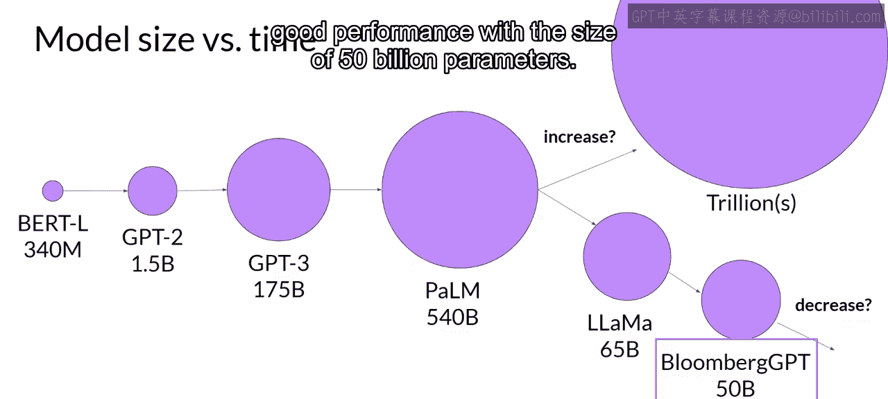

It's also an interesting example of a situation where pretraining a model from scratch was necessary to achieve good task performance。

Let's move on to the last video of this week to discuss why。

