# 吴恩达《使用大型语言模型的生成式人工智能》Generative AI with Large Language Models - P17：16_针对特定领域的预训练.zh - GPT中英字幕课程资源 - BV1Cw411q7wm

So far， I've emphasized that you'll generally work with an existing LLM as you develop your application。

This saves you a lot of time and can get you to a working prototype much faster。However。

 there is one situation where you may find it necessary to pretrain your own model from scratch。

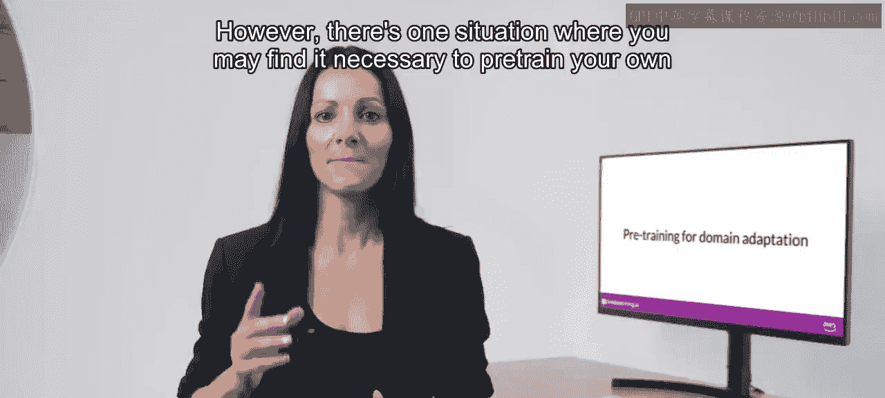

If your target domain uses vocabulary and language structures that are not commonly used in day to day language。

 you may need to perform domain adaptation to achieve good model performance For example。

 imagine you are a developer building an app to help lawyers and paralegals summarize legal briefs。

Legal writing makes use of very specific terms like Mensrea in the first example andre Judita in the second these words are rarely used outside of the legal world。

 which means that they are unlikely to have appeared widely in the training text of existing LLMs as a result。

 the models may have difficulty understanding these terms or using them correctly Another issue is that legal language sometimes uses everyday words in a different context like consideration in the third example。

 which has nothing to do with being nice but instead refers to the main element of a contract that makes the agreement enforcecable for similar reasons you may face challenges if you try to use an existing LLM in a medical application。

Medical language contains many uncommon words to describe medical conditions and procedures。

 and these may not appear frequently in training data sets consisting of web scraps and book texts。

 Some domains also use language in a highly idiosyncratic way this last example of medical language may just look like a string of random characters。

 but it's actually a shorthand used by doctors to write prescriptions。

This text has a very clear meaning to a pharmacist， take one tablet by mouth four times a day。

 after meals and at bedtime。

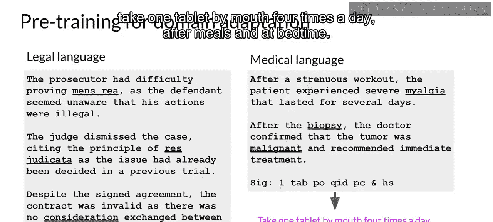

Because models learn their vocabulary and understanding of language。

 through the original pretraining task， pretraining a model from scratch will result in better models for highly specialized domains like law。

 medicine， finance， or science。

Now let's return to Bloomberg GT first announced in 2023 in a paper by X Qi Wu Stephen Luu and colleagues at Bloomberg。

 Bloomberg GbT is an example of a large language model that has been pre-trained for a specific domain in this case finance the Bloomberg researchers chose to combine both finance data and general purpose text data to pretrain a model that achieves best in- class results on financial benchmarks while also maintaining competitive performance on general purpose LLM benchmarks。

As such， the researchers chose data consisting of 51% financial data and 49% public data。

In their paper， the Bloomberg researchers described the model architecture in more detail。

They also discussed how they started with a tochilla scaling laws for guidance and where they had to make tradeoffs。

 These two graphs compare a number of LLMs， including Bloomberg GpiT to scaling laws that have been discussed by researchers On the left。

 the diagonal lines trace the optimal model size in billions of parameters for a range of compute budgets On the right。

 the lines trace the compute optimal training dataset size measured in number of tokens。

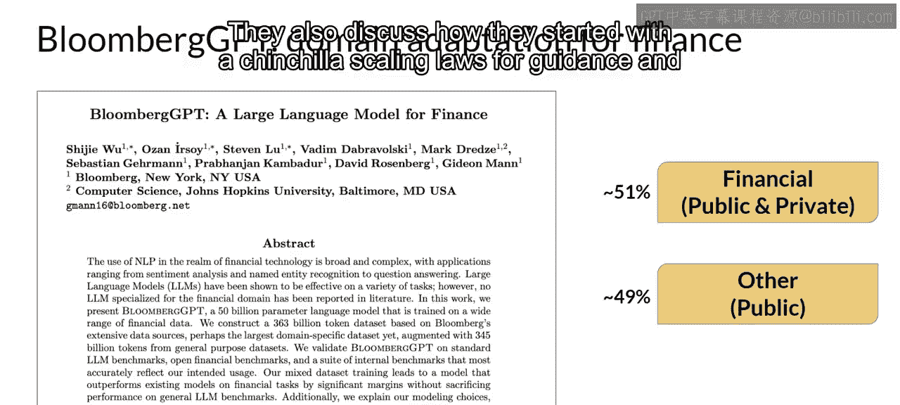

The dashed pink line on each graph indicates the compute budget that the Bloomberg team had available for training their new model。

The pink shaded regions correspond to the compute optimal scaling loss determined in the chininchina paper。

In terms of model size， you can see that Bloomberg GT roughly follows the Chinchilla approach for the given compute budget of 1。

3 million GPU hours or roughly 230 million paraaflops。

The model is only a little bit above the pink shaded region。

 suggesting the number of parameters is fairly close to optimal， however。

 the actual number of tokens used to pretrain Bloomberg GBT 569 billion is below the recommended chicha value for the available compute budget。

This smaller than optimal training data set is due to the limited availability of financial domain data。

 showing that real world constraints may force you to make tradeoffs when pretraining your own models。

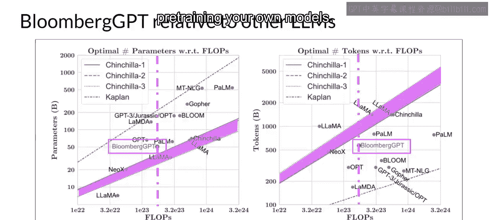

Congratulations on making it to the end of week one。

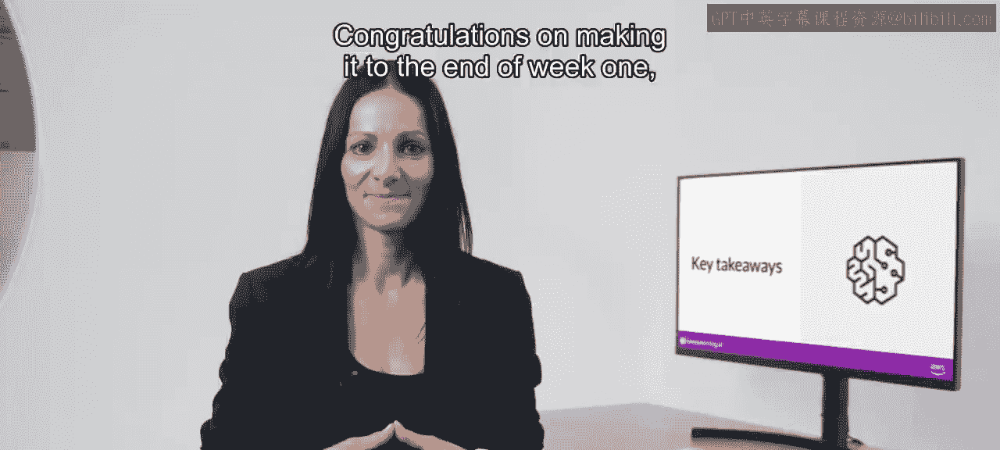

You've covered a lot of ground， so let's take a minute to recap what you've seen。

Mike walked you through some of the common use cases for LLMs， such as essay writing。

 dialogue summarization， and translation。

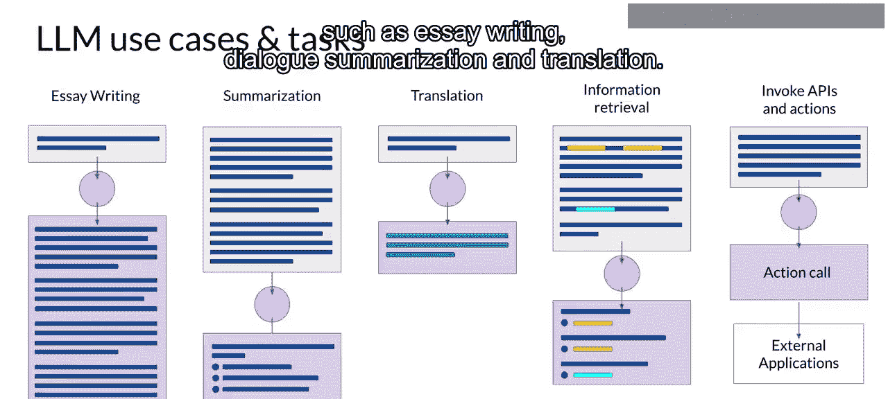

He then gave a detailed presentation of the transformer architecture that powers these models and discuss some of the parameters you can use at inference time to influence the model's output he wrecked up by introducing you to a generative VI project lifecycle that you can use to plan and guide your application development work Next。

 you saw how models are trained on vast amounts of text data during an initial training phase called pretraining。

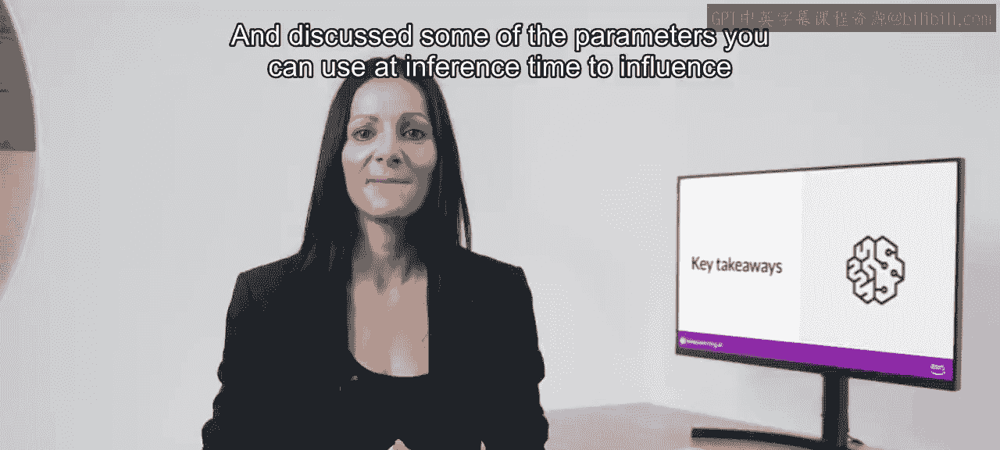

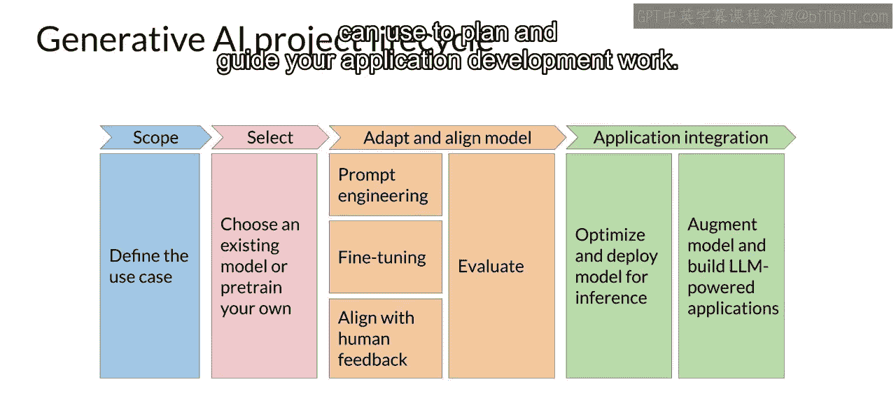

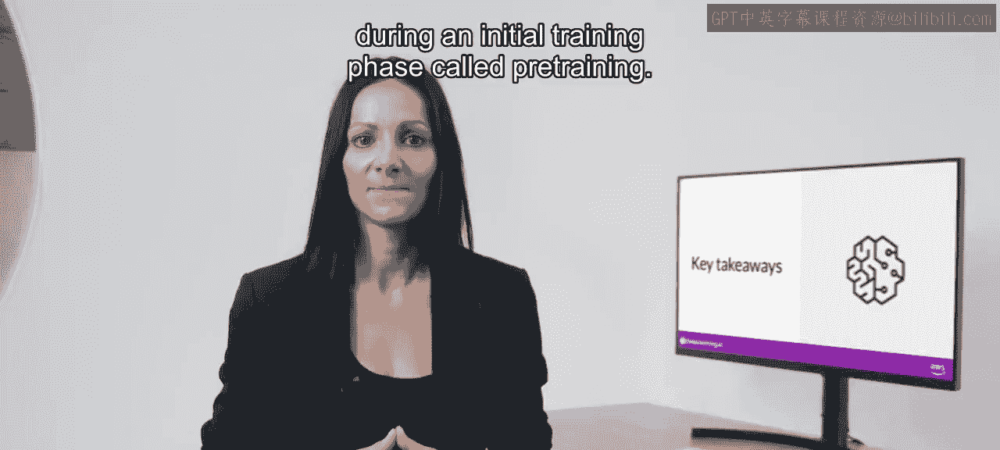

This is where models develop their understanding of language you explored some of the computational challenges of training these models。

 which are significant in practice because of GPU memory limitations。

 you will almost always use some form of quantization when training your models。

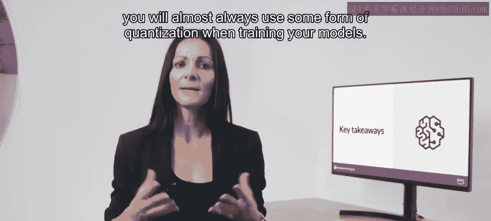

You'll finish the week with a discussion of scaling laws that have been discovered for LLMs and how they can be used to design compute optimal models If you'd like to read more of the details。

 be sure to check out this week's reading exercises。

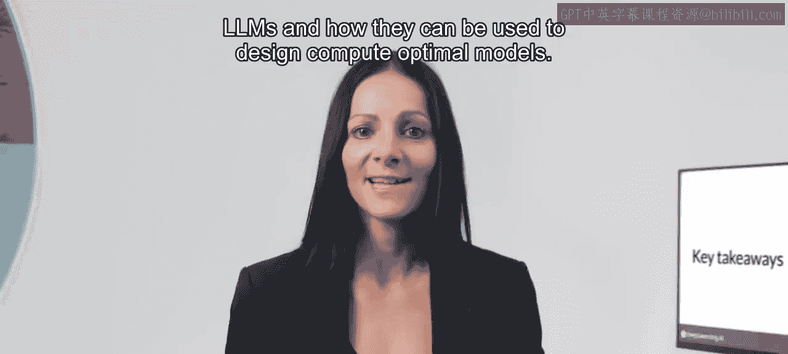

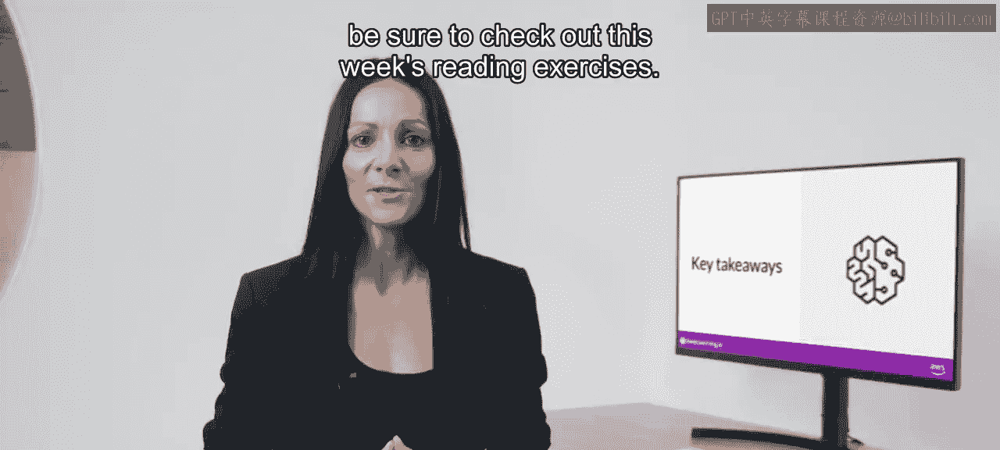