# 吴恩达《使用大型语言模型的生成式人工智能》Generative AI with Large Language Models - P19：18_指导式微调.zh - GPT中英字幕课程资源 - BV1Cw411q7wm

Last week， you were introduced to the generative AI project lifecycle。

 You explored example use cases for large language models and discussed the kinds of tasks that were capable of carrying out In this lesson。

 you'll learn about methods that you can use to improve the performance of an existing model for your specific use case。

😊。

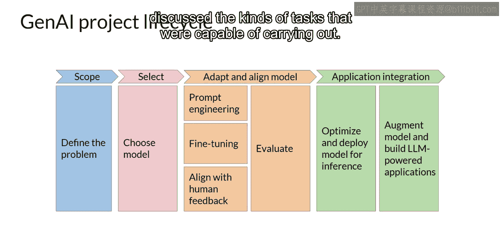

You'll also learn about important metrics that can be used to evaluate the performance of your fine tuned LLM and quantify its improvement over the base model you started with。

😊。

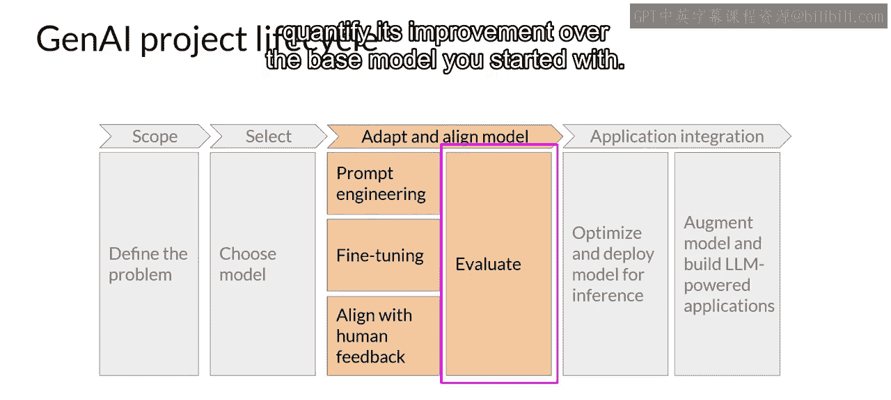

Let's start by discussing how to fine tune an L L M with instruction prompts Earl in the course。

 you saw that some models are capable of identifying instructions contained in a prompt and correctly carrying out zero short inference。

 While others， such as smaller L L Ms may fail to carry out the task like the example shown here。

 You also saw that including one or more examples of what you want the model to do known as one short or few short inference can be enough to help the model identify the task and generate a good completion。

😊。

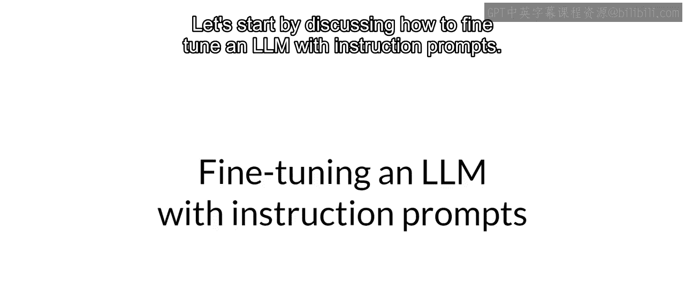

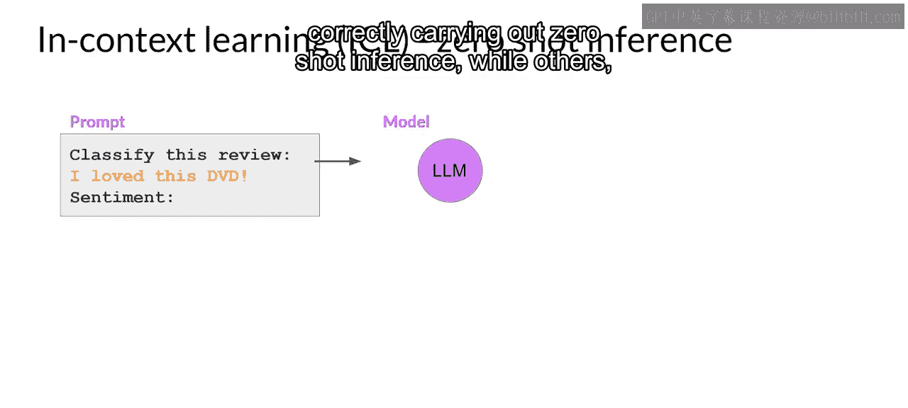

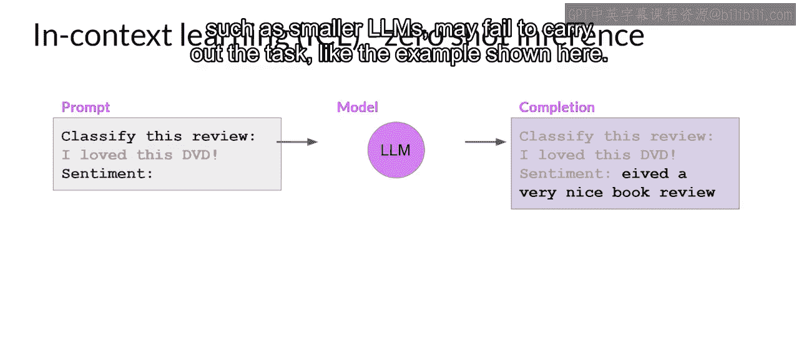

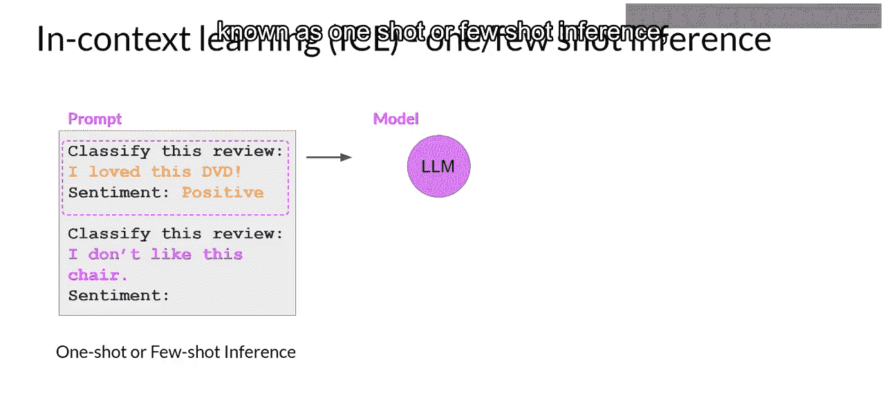

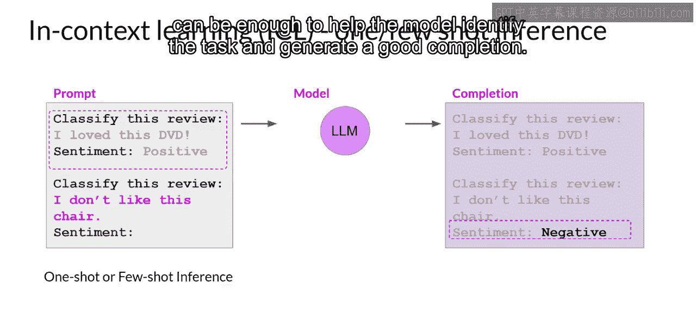

However， this strategy has a couple of drawbacks。 First， for smaller models， it doesn't always work。

 even when five or six examples are included。 Second。

 and the examples you include in your prompt take up valuable space in the context window。

 reducing the amount of room you have to include other useful information。 Luckily。

 another solution exists， you can take advantage of a process known as fine tuning to further train a base model。

😊。

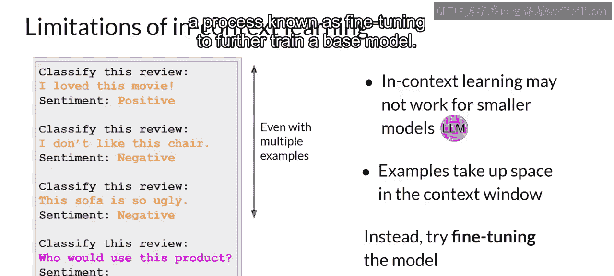

In contrast to pretrain， where you train the LLM using vast amounts of unstructured textual data via self supervised learning。

 fine tuning is a supervised learning process where you use a data set of labeled examples to update the weights of the LLM。

😊。

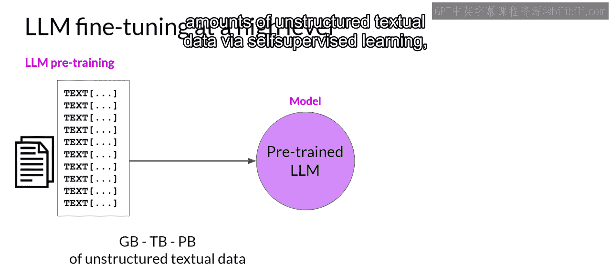

The labeled examples are prompt completion pairs。 The fine tuning process extends the training of the model to improve its ability to generate good completions for a specific task。

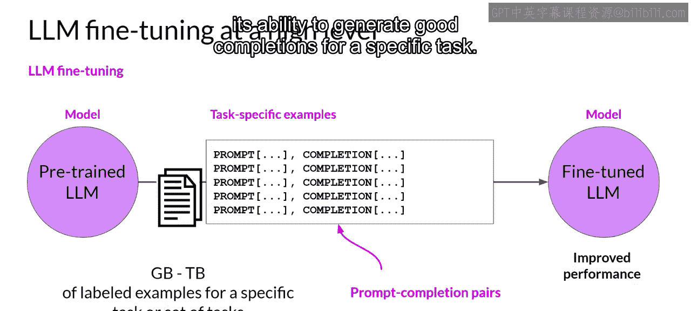

One strategy known as instruction fine tuning is particularly good at improving a model's performance on a variety of tasks。

😊，Let's take a closer look at how this works。Instruction fine tuning trains the model using examples that demonstrate how it should respond to a specific instruction。

Here are a couple of example prompts to demonstrate this idea。

The instruction in both examples is classify this review and the desired completion is a text string that starts with sentiment。

 followed by either positive。

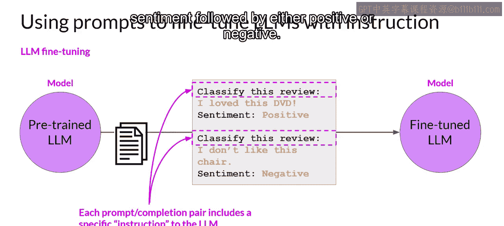

Or negative。The data you use for training includes many pairs of prompt completion examples for the task you're interested in。

 each of which includes an instruction。😊，For example。

 if you want to fine tune your model to improve its summarization ability。

 you'd build up a data set of examples that begin with the instruction。

 summarizemar the following text， or a similar phrase。😊。

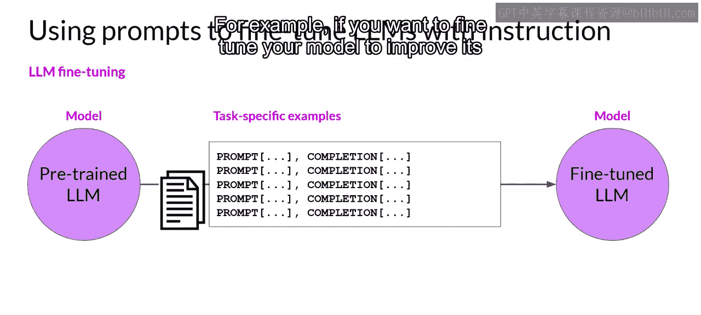

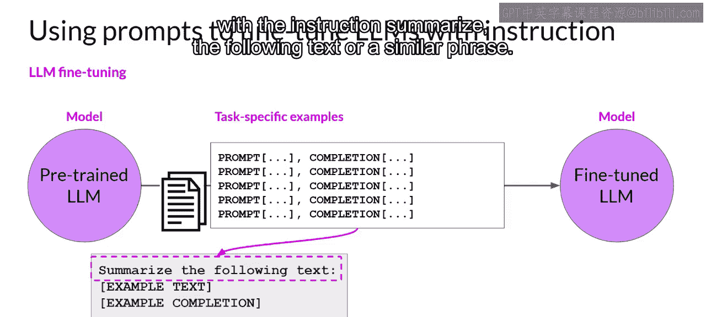

And if you are improving the model's translation skills。

 your examples would include instructions like translate this sentence。😊。

These prompt completion examples allow the model to learn to generate responses that follow the given instructions。

😊。

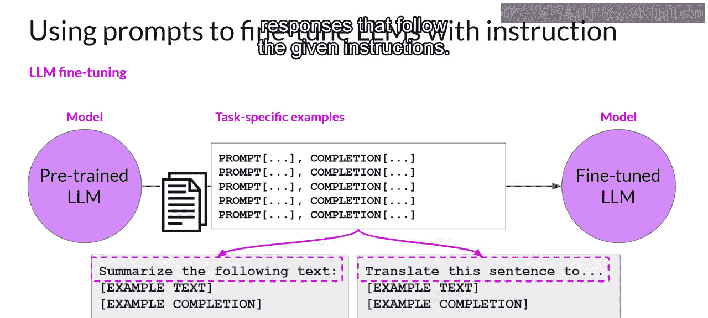

Instruction fine tuning， where all of the model's weights are updated is known as full fine tuning。😊。

The process results in a new version of the model with updated weights。

It is important to note that just like pretrain， full fine tuning requires enough memory and compute budget to store and process all the gradients。

 optimizes and other components that are being updated during training。

 so you can benefit from the memory optimization and parallel computing strategies that you learned about last week。

😊。

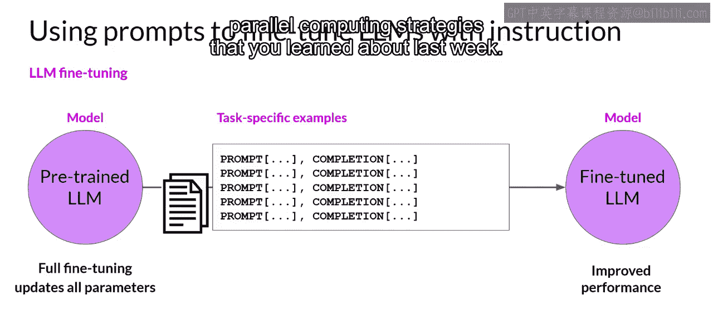

So how do you actually go about instruction， fine tuning and LLM？

The first step is to prepare your training data。There are many publicly available data sets that have been used to train earlier generations of language models。

 although most of them are not formatted as instructions。😊，Luckily。

 developers have assembled prompt template libraries that can be used to take existing data sets。

 for example， the large data set of Amazon product reviews and turn them into instruction prompt dataset sets for fine tuning。

😊，Prompt template libraries include many templates for different tasks and different data sets。

 Here are three prompts that are designed to work with the Amazon reviews data set。

 and that can be used to fine tune models for classification。

 text generation and text summarization tasks。 You can see that in each case。

 you pass the original review here called review body to the template where it gets inserted into the text that starts with an instruction like predict the associated rating。

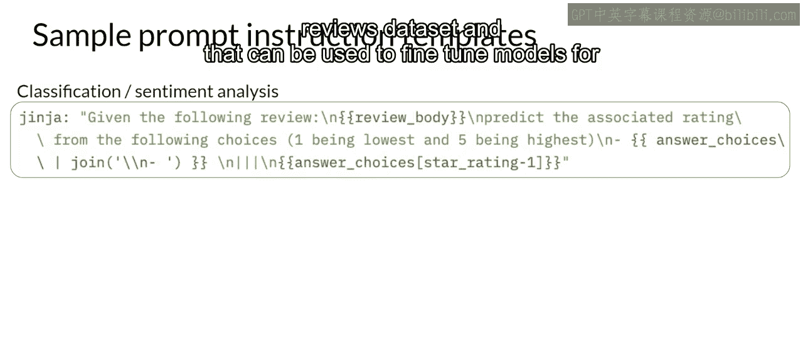

Generate a star review or give a short sentence describing the following product review。

The result is a prompt that now contains both an instruction and the example from the data set。

 Once you have your instruction data set ready， as with standard supervised learning。

 you divide the data into training， validation and test splits during fine tuning。

 you select prompts from your training data and pass them to the LLM。

 which then generates completions。 Next， you compare the LLM completion with the response specified in the training data。

 You can see here that the model didn't do a great job， it classified the review as neutral。

 which is a bit of an understatement。 The review is clearly very positive。

 Remember that the output of an LLM is a probability distribution across tokens。

 so you can compare the distribution of the completion and that of the training label and use the standard cross entropy function to calculate loss。

😊。

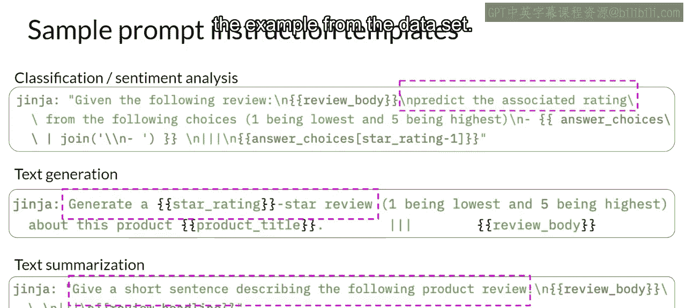

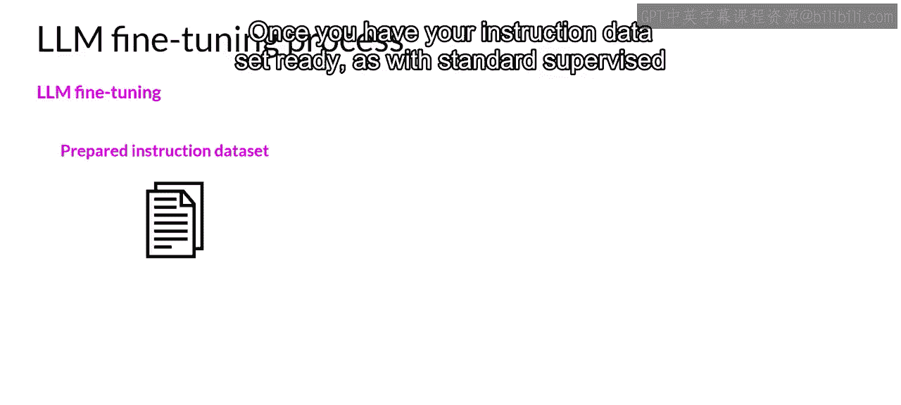

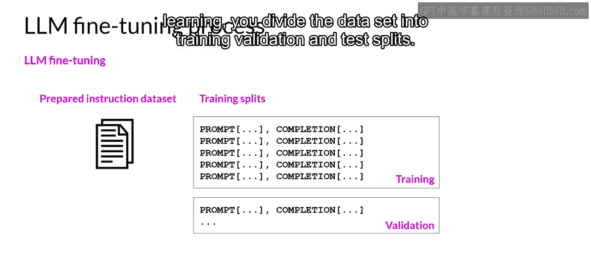

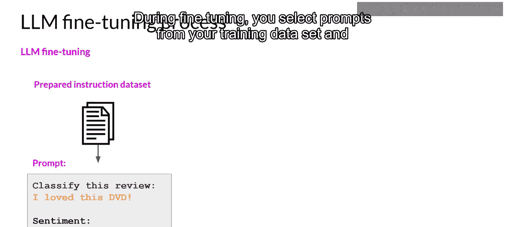

Between the two token distributions。 and then use the calculated loss to update your model weights in standard back propagation。

 You'll do this for many batches of prompt completion pairs。

 and over several epochs update the weights so that the model's performance on the task improves。

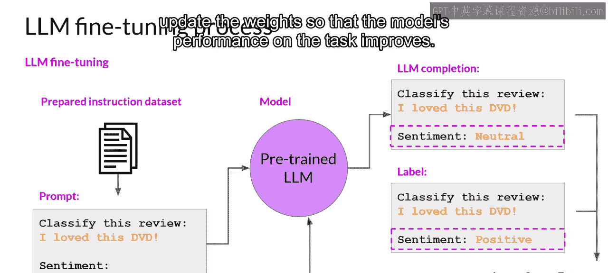

As in standard supervised learning， you can define separate evaluation steps to measure your LLM performance using the holdout validation data set。

 This will give you the validation accuracy。 And after you've completed your fine tuning。

 you can perform a final performance evaluation using the hold out test data set。

 This will give you the test accuracy。😊。

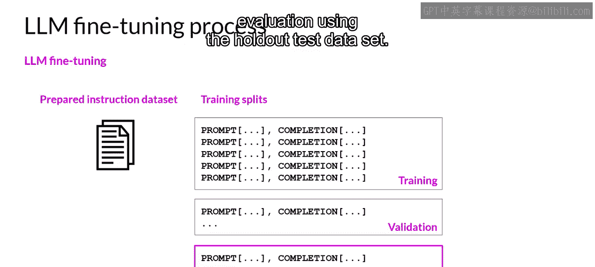

The fine tuning process results in a new version of the base model。

 often called an instruct model that is better at the tasks you are interested in。

 fine tuning with instruction prompts is the most common way to fine tune LLMs these days。

 from this point on， when you hear or see the term fine tuning。

 you can assume that it always means instruction fine tuning。😊。

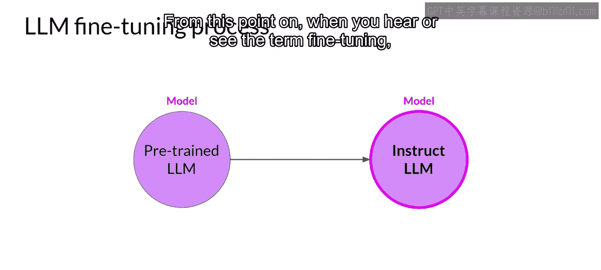

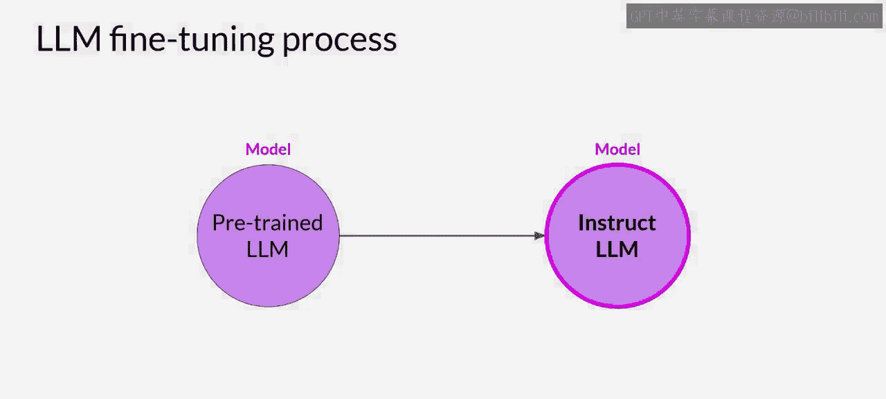