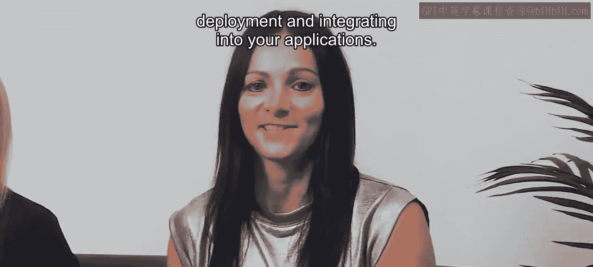
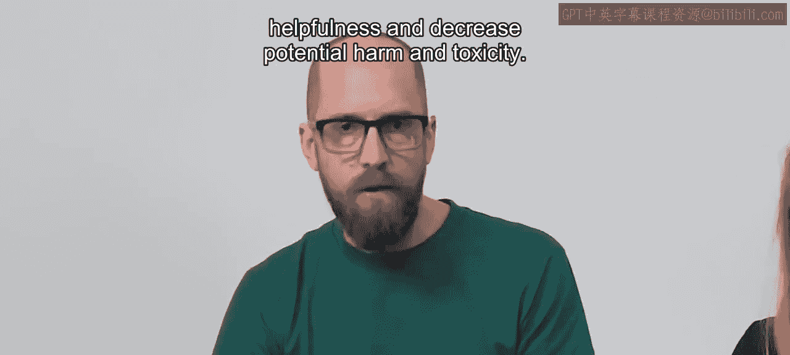
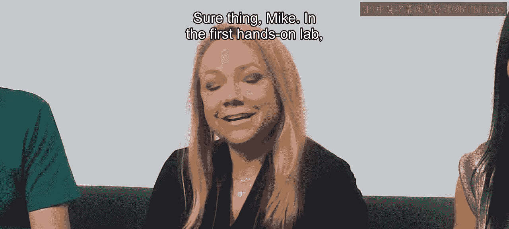
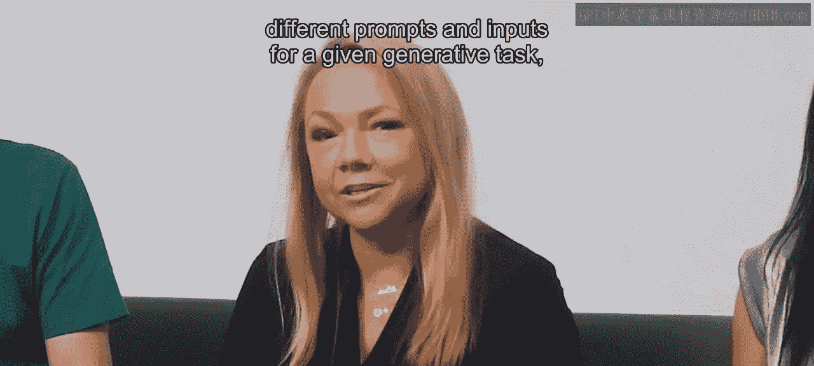

# 吴恩达《使用大型语言模型的生成式人工智能》Generative AI with Large Language Models - P1：0_课程介绍.zh - GPT中英字幕课程资源 - BV1Cw411q7wm

Welcome to this course on generative AI with large language models。

Large language models or LLMs are a very exciting technology。But despite all the buzz in hype。

 one of the things that's still underestimated by many people is their power as a developer too。

Specifically， there are many machine learning and AI applications that used to take me many months to build that you can now build in days or maybe even small numbers of weeks this course will take a deep dive with you into how LLM technology actually works。

 including going through many of the technical details like model training， instruction tuning。

 fine tuning the generative AI project lifecycle framework to help you plan and execute your projects and so on。

Gerentative AI and OM specifically are a general purpose technology。

 that means that similar to other general purpose technologies like deep learning and electricity。

It's useful not just for a single application， but for a lot of different applications that span many corners of the economy。

And so similar to the rise of deep learning that started maybe 15 years ago or so。

There's a lot of important work that lies ahead of us that needs to be done over many years。

By many people， I hope including you to identify use cases and build specific applications。

And because a lot of this technology is so new and so few people really know how to use them。

 many companies are also right now scrambling to try to find and hire people that actually know how to build applications with LOMs and I hope that this course will also help you if you wish better position yourself to get one of those jobs。

 I'm thrilled to bring to you this course， along with a group of fantastic instructors from the AWS team。

 Auntie Baf Mike Chambers， Shelby Eenbroke who are here with me today。

 as well as a fourth instructor Chris Frankly who'll be presenting So labbs。

Aia and Mike are both generative AI developer advocates and Shelby and Chris are both generative AI solutions architects。

 so all of them have a lot of experience helping many different companies built many。

 many creative applications using LLMs and I look forward to all of them sharing this rich handson experience in this course and they've developed the content for this course with input from many industry experts and applied scientists at Amazon AWS hooking phase and many top universities around the world Anie perhaps you can say a bit more about this course Sure thanks Andrew it's a pleasure to work with you again on this course in the exciting area of generative AI with this course on generative AI with large language models we've created a series of lessons meant for AI enthusiasts。

 engineers or data scientists looking to learn the technical foundations of how LLMs work as well as the best。

Practices behind training， tuning and deploying them in terms of prerequisites。

 we assume you are already familiar with Python programming and at least basic data science and machine learning concepts。

If you have some experience with either Pytorch or Tensorflow， that should be enough。In this course。

 you will explore in detail the steps that make up a typical generative AI project lifecycle from scoping the problem and selecting a language model to optimizing a model for deployment and integrating into your applications This course covers all of the topics not just at a shallow level。

 but will take the time to make sure you come away with a deep technical understanding of all of these technologies。

And be well positioned to really know what you're doing when you build your own generative AI projects Mike。

 why don't you tell us a little bit more details about what the learners will see in each week Absolutely Ana。

 thank you so in week one you will examine the transformer architecture that powers large language models explore how these models are trained and understand the compute resources required to develop these powerful LLMs。

You'll also learn about a technique calledIn contextext learning how to guide the model to output at inference time with prompt engineering and how to tune the most important generation parameters of LLMs for tuning your model output In week two you'll explore options for adapting pretrained models to specific tasks and datas via a process called instruction fine tuning then in week three you'll see how to align the output of language models with human values in order to increase helpfulness and decrease potential harm and toxicity but we don't stop at the theory each week includes a handson lab where you'll be able to try out these techniques for yourself in an AWS environment that includes all the resources you need for working with large models at no cost to you Shelby。

 can you tell us a little bit more about the handson labs。

Mike。

In the firsthand on lab， you'll construct to compare different prompts and inputs for a given generative task。

 in this case dialogue summarization， you'll also explore different inference parameters and sampling strategies to gain intuition on how to further improve the generative model responses。

In the second hands on lab， you'll fine tune an existing large language model from Huging Face。

 a popular open source model hub。You'll play with both full fine tuning and parameter efficient fine tuning or PEF for short。

 and you'll see how PEft lets you make your workflow much more efficient。

In the third lab you get handson with reinforcement learning from human feedback or RLHF you will build a reward model classifier to label model responses as either toxic or not toxic and don't worry if you don't understand all these terms and concepts just yet。

 you'll dive into each of these topics in much more detail throughout this course So I'm thrilled to have Aunta Mike Shelby。

 as was Chris presenting this course to you that takes a deep technical dive into LLMs。

You come away from this course having practice with many different concrete code examples for how to build or use LMs and I'm sure that many of the code snippets will end up being directly useful in your own work I hope you enjoy the course and use what you learn to build some really exciting applications so with that let's go on to the next video where we start diving into how LLMs are being used to build applications。

😊。