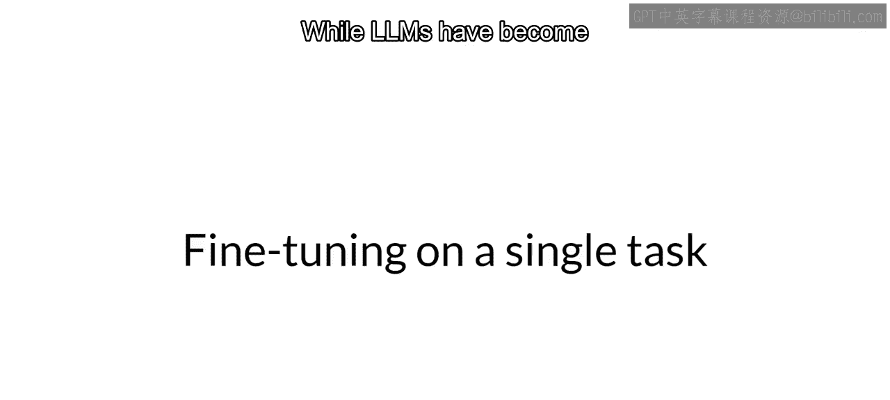
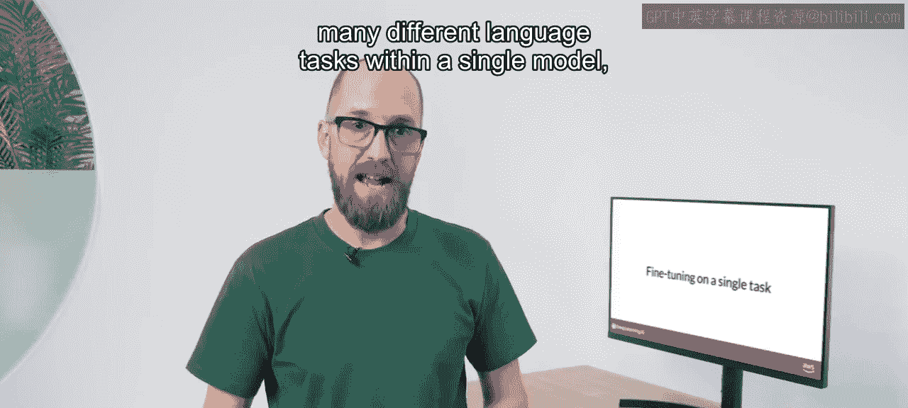
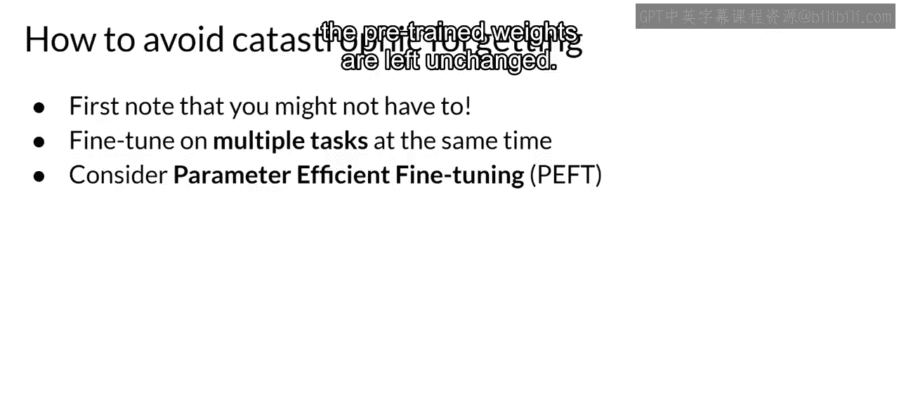

# 吴恩达《使用大型语言模型的生成式人工智能》Generative AI with Large Language Models - P20：19_单任务指导式微调.zh - GPT中英字幕课程资源 - BV1Cw411q7wm

While LLMs have become famous for their ability to perform many different language tasks within a single model。

 your application may only need to perform a single task In this case。

 you can fine tune a pre-trained model to improve performance on only the task that is of interest to you。

 for example， summarization using a data set of examples for that task。😊。

Interestingly， good results can be achieved with relatively few examples。

 Often just 500 to 1000 examples can result in good performance。

 In contrast to the billions of pieces of text that the model saw during pre training。😊，However。

 there is a potential downside to fine tuning on a single task。

 The process may lead to a phenomenon called catastrophic forgetting。

 catastrophic forgetting happens because the full fine tuning process modifies the weights of the original LLM。

While this leads to great performance on the single fine tuning task。

 it can degrade performance on other tasks。 For example。

 while fine tuning can improve the ability of a model to perform sentiment analysis on a review and result in a quality completion。

 the model may forget how to do other tasks。😊，This model knew how to carry out named entity recognition before fine tuning。

 correctly identifying Charlie as the name of the cat in the sentence。But after fine tuning。

 the model can no longer carry out this task， confusing both the entity it is supposed to identify and exhibiting behavior related to the new task。

😊，So what options do you have to avoid catastrophic forgetting？First of all。

 it's important to decide whether catastrophic forgetting actually impacts your use case。😊。

If all you need is reliable performance on the single task you find tuned on。

 it may not be an issue that the model can't generalize to other tasks。

If you do want or need the model to maintain its multitask generalized capabilities。

 you can perform fine tuning on multiple tasks at one time。😊。

Good multitask fine tuning may require 50 to 100，000 examples across many tasks。

 and so will require more data and compute to train We'll discuss this option in more detail shortly。

😊，A second option is to perform parameter efficient fine tuning or peft for short。

 instead of full fine tuning。Pef is a set of techniques that preserves the weights of the original LLM and trains only a small number of task specific adapter layers and parameters。

😊，Pefft shows greater robustness to catastrophic forgetting since most of the pre trained weights are left unchanged。

 Pft is an exciting and active area of research that we will cover later this week。 In the meantime。

 let's move on to the next video and take a closer look at multitask fine tuning。😊。

