# 吴恩达《使用大型语言模型的生成式人工智能》Generative AI with Large Language Models - P21：20_多任务指导式微调.zh - GPT中英字幕课程资源 - BV1Cw411q7wm

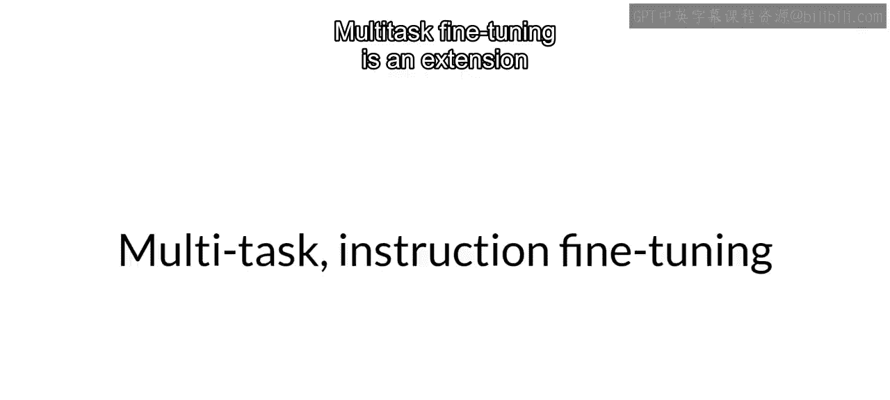

MultiTask fine tuning is an extension of single task fine tuning。

 where the training data is comprised of example inputs and outputs for multiple tasks。

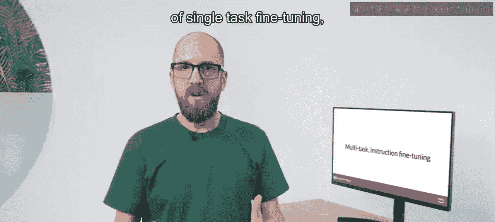

Here， the dataset contains examples that instruct the model to carry out a variety of tasks。

 including summarization， review rating， code translation and entity recognition。😊。

You train the model on this mixed data set so that you can improve the performance of the model on all the tasks simultaneously。

 thus avoiding the issue of catastrophic forgetting。😊，Over many epochs of training。

 the calculated losses across examples are used to update the weights of the model。

 resulting in an instruction tuned model that has learned how to be good at many different tasks simultaneously。

😊，One drawback to multitask fine tuning is that it requires a lot of data you may need as many as 50 to 100。

000 examples in your training set。😊，However， it can be really worth while and worth the effort to assemble this data。

 The resulting models are often very capable and suitable for use in situations where good performance at many tasks is desirable。

Let's take a look at one family of models that have been trained using multitask instruction。

 fine tuning。Instruct model variants differ based on the dataset sets and tasks used during fine tuning。

 One example is the flan family of models。Flan， which stands for fine tuned language Ne。

 is a specific set of instructions used to fine tune different models。

 And because the fl fine tuning is the last step of the training process。

 The authors of the original paper called it the metaphorical dessert to the main course of pre training。

 Quite a fitting name。😊，Flan T 5 is the flan instruct version of the T 5 Foundation model。

 While flan Palmm is the flan Instruct version of the Palm Foundation model。 You get the idea。

 F T 5 is a great general purpose， Instruct model。 In total。

 it's been fine tuned on 473 data sets across 146 task categories。

 Those data sets are chosen from other models and papers as shown here。😊。

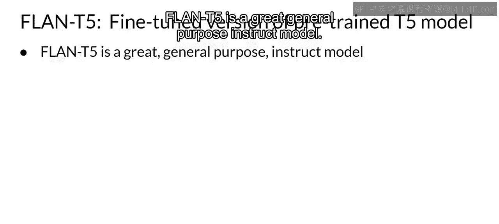

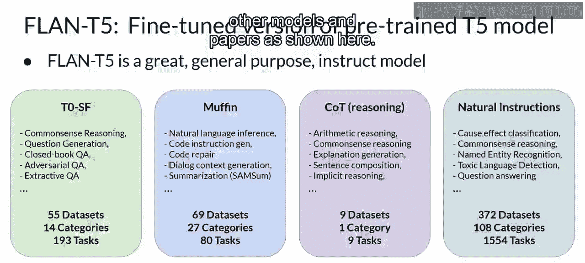

Don't worry about reading all the details right now。 If you're interested。

 you can access the original paper through a reading exercise after the video and take a closer look。

 One example of a prompt data sets used for summarization tasks in Fan T 5 is Samsung。

 It's part of the muffin collection of tasks and dataset sets and is used to train language models to summarize dialogue。

 Samsung is a data set with 16000 messenger like conversations with summaries。😊。

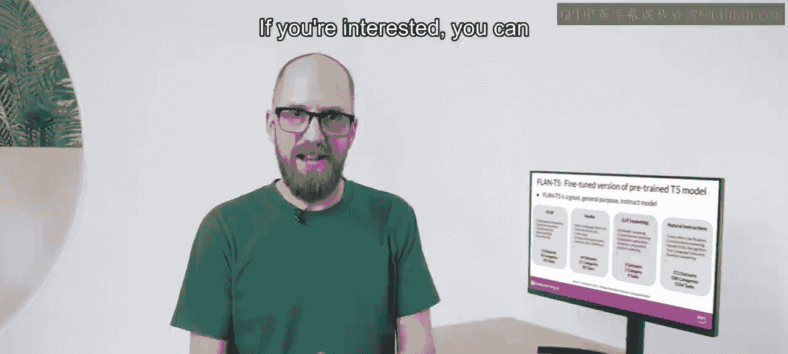

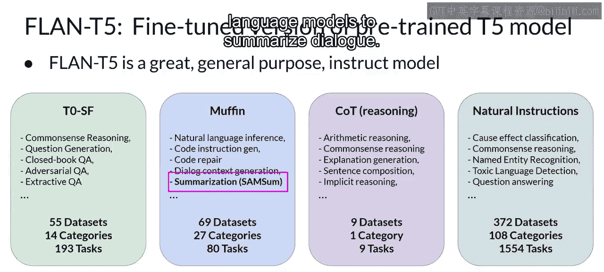

Three examples are shown here with the dialogue on the left and the summaries on the right。😊。

The dialogues and summaries were crafted by linguists for the express purpose of generating a high quality training dataset set for language models。

😊，The linguists were asked to create conversations similar to those that they would write on a daily basis。

 reflecting their proportion of topics of their real life messenger conversations。

 Other language experts then created short summaries of those conversations that included important pieces of information and names of the people in the dialogue。

Here is a prompt template designed to work with the Samsam dialogue summary data set。

 The template is actually comprised of several different instructions that all basically ask the model to do the same thing。

 Smarise a dialogue。For example， briefly summarize that dialogue。

What is a summary of this dialogue and what was going on in that conversation？

Including different ways of saying the same instruction helps the model generalize and perform better。

😊，Just like the prompt templates you saw earlier， you see that in each case。

 the dialogue from the Sansung data set is inserted into the template wherever the dialogueog field appears。

😊，The summary is used as the label。After applying this template to each row in the SAs data set。

 you can use it to finet a dialogue summarization task。😊。

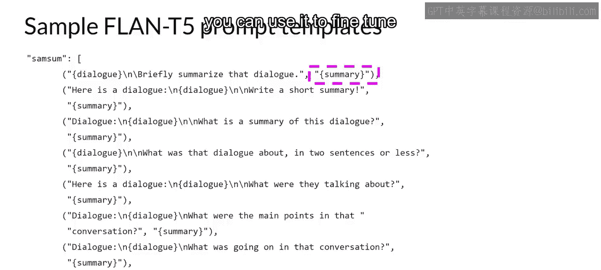

While Flan T5 is a great general use model that shows good capability in many tasks。

 you may still find that it has room for improvement on tasks for your specific use case。😊。

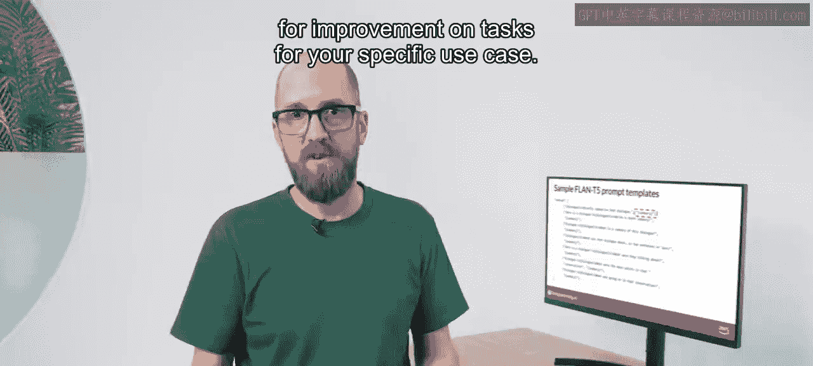

For example， imagine you're a data scientist building an app to support your customer service team process requests received through a chatbot。

 like the one shown here。😊，Your customer service team needs a summary of every dialogue to identify the key actions that the customer is requesting and to determine what action should be taken in response。

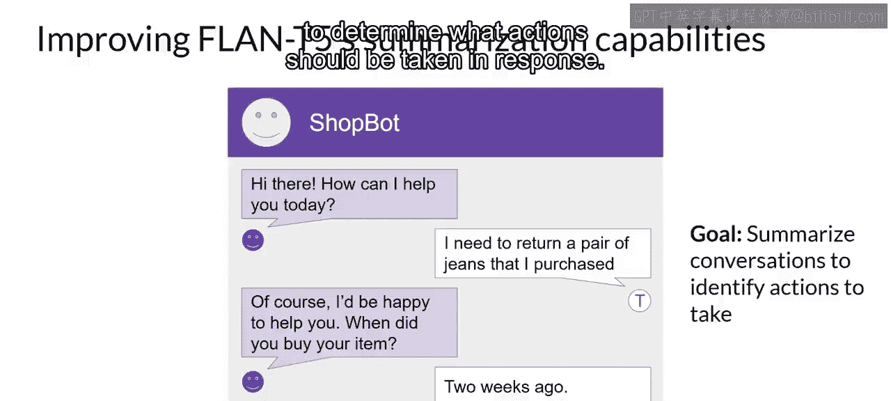

The Samsung dataset gives F T 5 some abilities to summarize conversations。 However。

 the examples in the data are mostly conversations between friends about day to day activities and don't overlap much with the language structure observed in customer service chats。

😊，You can perform additional fine tuning of the flan T5 model using a dialogueg dataset set that is much closer to the conversations that happened with yourbot。

 This is the exact scenario that you'll explore in the lab this week。

 You'll make use of an additional domainspec summarization data set called dialogueog sum to improve flan T5's ability to summarize support chat conversations。

😊。

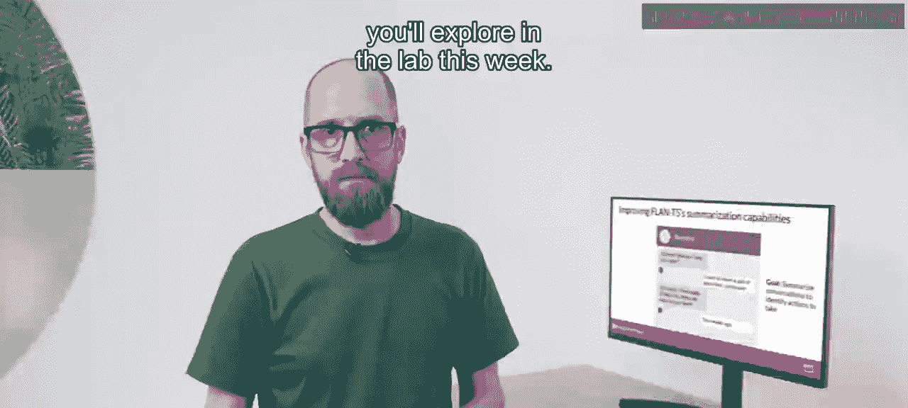

This data consists of over 13000 support chat dialogues and summaries。

The dialogueo sum data is not part of the flan T 5's training data。

 So the model has not seen these conversations before。 Let's take a look。

 And an example from dialogueo sum and discuss how a further round of fine tuning can improve the model。

 This is a support chat that is typical of the examples in the dialogue sum data set。

 The conversation is between a customer and a staff member at a hotel check in desk。

 The chat has had a template applied so that the instruction to summarize the conversation is included at the start of the text。

 Now， let's take a look at how flan T 5 responds to this prompt before doing any additional fine tuning。

😊。

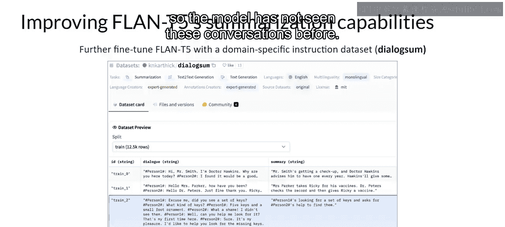

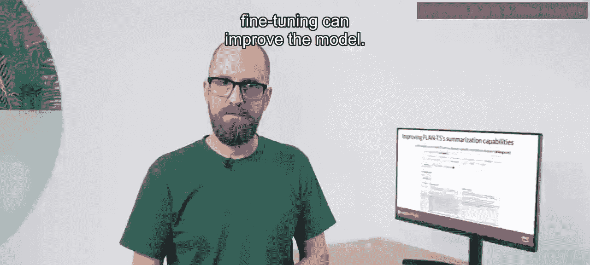

Note that the prompt is now condensed on the left to give you more room to examine the completion of the model。

 Here is the model's response to the instruction。 You can see that that model does O。

 as it's able to identify that the conversation was about a reservation for Tommy。However。

 it does not do as well as the human generated baseline summary。

 which includes important information， such as Mike asking for information to facilitate check in and the model's completion has also invented information that was not included in the original conversation。

 specifically the name of the hotel and the city it was located in。 Now。

 let's take a look at how the model does after fine tuning on the dialogue sum data set。😊，Hopefully。

 you'll agree that this is closer to the human produced summary。 There is no fabricated information。

 and the summary includes all of the important details。

 including the names of both people participating in the conversation。

 This example used the public dialogue sum data to demonstrate fine tuning on custom data。😊。

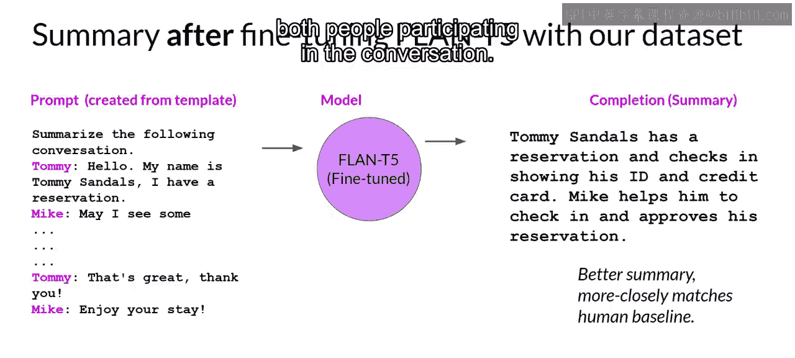

In practice， you'll get the most out of fine tuning by using your company's own internal data。

 For example， the support chat conversations from your customer support application。

 This will help the model learn the specifics of how your company likes to summarize conversations and what is most useful to your customer service colleagues。

😊。

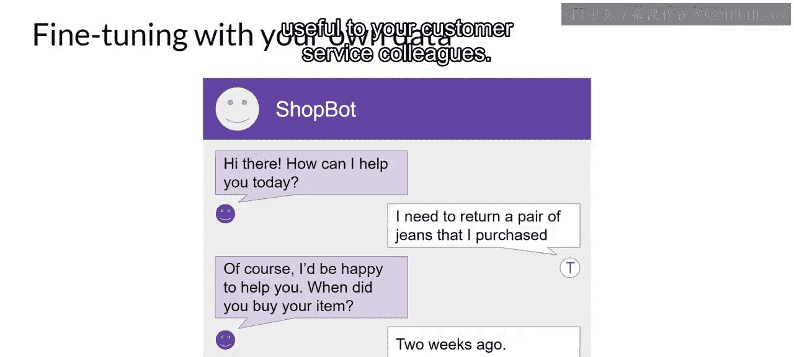

I know there's a lot to take in here， but don't worry。

 this example is going to be covered in the lab， so you'll get a chance to see this in action and try it out for yourself。

One thing you need to think about when fine tuning is how to evaluate the quality of your model's completions In the next video。

 you'll learn about several metrics and benchmarks that you can use to determine how well your model is performing and how much better your fine tuned version is than the original base model。

😊。

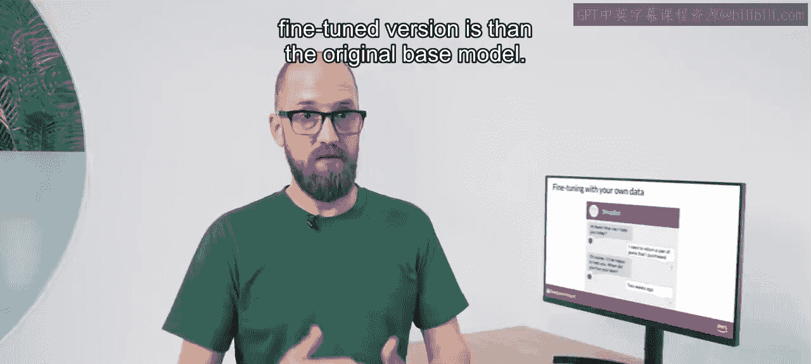