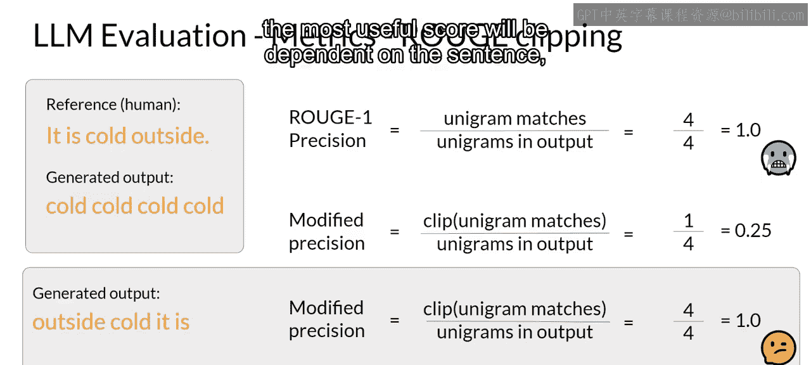
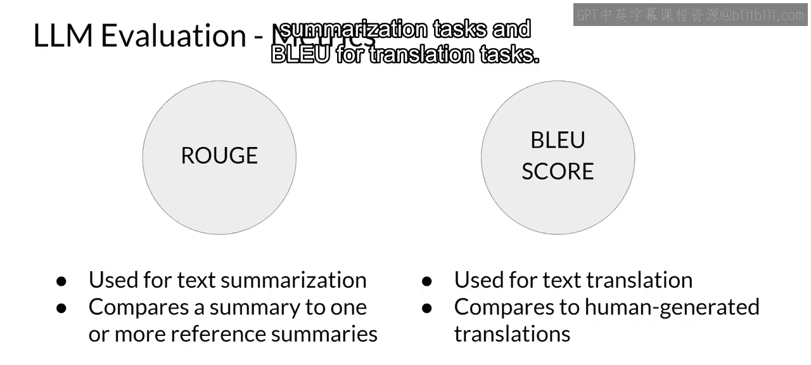

# 吴恩达《使用大型语言模型的生成式人工智能》Generative AI with Large Language Models - P22：21_模型评估.zh - GPT中英字幕课程资源 - BV1Cw411q7wm

Throughout this course， you've seen statements likeThe model demonstrated good performance on this task。

 or this fine tuned model showed a large improvement in performance over the base model。

What do statements like this mean， how can you formalize the improvement in performance of your fine tuned model over the pre traineded model you started with？

Let's explore several metrics that are used by developers of large language models that you can use to assess the performance of your own models and compare to other models out in the world。

😊，In traditional machine learning， you can assess how well a model is doing by looking at its performance on training and validation dataset sets where the output is already known。

😊，You're able to calculate simple metrics such as accuracy。

 which states the fraction of all predictions that are correct because the models are deterministic。

😊，But with large language models where the output is non deterministic and language based。

 evaluation is much more challenging。😊，Take， for example。

 the sentence Mike really loves drinking tea This is quite similar to Mike adores sipping tea。

 but how do you measure the similarity？😊，Let's look at these other two sentences。

 Mike does not drink coffee and Mike does drink coffee。😊。

There is only one word difference between these two sentences。 however。

 the meaning is completely different。😊，Now for humans like us with our squishy organic brains。

 we can see the similarities and differences， but when you train a model on millions of sentences。

 you need an automated， structured way to make measurements。😊。

Ruge and blur are two widely used evaluation metrics for different tasks。😊。

Ruge or recall oriented understudy for ging evaluation is primarily employed to assess the quality of automatically generated summaries by comparing them to human generated reference summaries。

 On the other hand， blur。 or bilingual evaluation understudy is an algorithm designed to evaluate their quality of machine translated text again。

 by comparing it to human generated translations。 Now， the word blur is French for blue。

 So you might hear people calling this blue。 But here， I'm going to stick with the original blur。

 before we start calculating metrics。 Let's review some terminology。😊，In the anatomy of language。

 a ungram is equivalent to a single word。😊，A bigram is two words。And N Gram is a group of N words。

 Pre straightforward stuff。First， let's look at the Rouge1 metric。 And to do so。

 let's look at a human generated reference sentence。 It is cold outside and a generated output。

 It is very cold outside。 You can perform simple metric calculations。

 similar to other machine learning tasks using recall， precision and F1。

The recall metric measures the number of words or unigrams that are matched between the reference and the generated output divided by the number of words or unigrams in the reference。

😊，In this case， that gets a perfect score of one as all the generated words match words in the reference。

😊，Precision measures the ungram matches is divided by the output size。

And the F1 score is the harmonic mean of both of these values。

These are very basic metrics that only focus on individual words。

 hence the one in the name and don't consider the ordering of the words。 so it can be deceptive。

 It's easily possible to generate sentences that score well， but would be subjectively poor。

Stop for a moment and imagine that their sentence generated by the model was different by just one word。

 Not。 So it is not cold outside。 The scores would be the same。

You can get a slightly better score by taking into account diagrams or collections of two words at a time from the reference and generated sentence。

😊，By working with pairs of words， you're acknowledging in a very simple way the ordering of the words in the sentence。

😊，By using diagramgrams， you're able to calculate Rouge 2。Now you can calculate the recall。

 precision and F1 score using bygram matches instead of individual words。😊。

You'll notice that the scores are lower than the Rouge1 scores。 and with longer sentences。

 the greater chance that bigrams don't match， and the scores may be even lower。

 Rather than continue on with Rouge numbers growing bigger to n grams of three or fours。

 Let's take a different approach。 Instead， you'll look for the longest common sub sequenceequence present in both the generated output and the reference output。

😊，In this case， the longest matching sub sequenceequences are it is and cold outside each with a length of two you can now use the LCS value to calculate the recall。

 precision and F1 score where the numerator in both the recall and the precision calculations is the length of the longest common subequence in this case2。

😊，Collectively， these three quantities are known as the Rouge L score。😊。

As with all of the Rouge scores， you need to take the values in context。

 you can only use the scores to compare the capabilities of models if the scores were determined for the same task。

 for example， summarization。Ruge scores for different tasks are not comparable to one another。😊。

As you've seen， a particular problem with simple Rouge scores is that it's possible for a bad completion to result in a good score。

 Take， for example， this generated output， cold， cold， cold， cold。

As this generated output contains one of the words from the reference sentence。

 it will score quite highly， even though the same word is repeated multiple times。😊。

The Rouge one precision score will be perfect。😊，One way you can counter this issue is by using a clipping function to limit the number of unigram matches to the maximum count for that unigram within the reference。

In this case， there is one appearance of cold in the reference。

 and so a modified precision with a clip on the unigram matches results in a dramatically reduced score。

😊，However， you'll still be challenged if the generated words are all present。

 but just in a different order。 For example， with this generated sentence outside cold， it is。

 this sentence was called perfectly， even on the modified precision with the clipping function。

 as all of the words in the generated output are present in the reference。

So whilst using a different Roe score can help， experimenting with an ngram size that will calculate the most useful score will be dependent on the sentence。

 the sentence size， and your use case。😊。

Note that many language model libraries， for example， Huging face。

 which you used in the first week's lab， include implementations of Rouge score that you can use to easily evaluate the output of your model。

😊，You'll get to try the Rouge score and use it to compare the model's performance before and after fine tuning in this week's lab。

The other score that can be useful in evaluating the performance of your model is the blur score。

 which stands for bilingual Eval undertudy， just to remind you the blur score is useful for evaluating the quality of machine translated text。

😊，The score itself is calculated using the average precision over multiple n gra sizes。

 So just like the Rouge1 score that we looked at before。

 but calculated for a range of n gra sizes and then averaged。😊。

Let's take a closer look at what this measures and how it's calculated。😊。

The blur score quantifies the quality of a translation by checking how many ngrams in the machine generated translation match those in the reference translation。

😊，To calculate the score， you average precision across a range of different Ngram sizes。😊。

If you were to calculate this by hand， you would carry out multiple calculations and then average all of the results to find the blur score。

 So for this example， let's take a look at a longer sentence so that you can get a better sense of the scores's value。

 The reference human provided sentence is I am very happy to say that I am drinking a warm cup of tea。

 Now， as you've seen these individual calculations in depth when you looked at Rouge。

 I will show you the results of blur using a standard library。

 Calalculating the blur score is easy with prewritten libraries from providers like hugging face。

 And I've done just that for each of our candidate sentences。

 The first candidate is I am very happy that I am drinking a cup of tea。 and the blur score is 0。495。

😊，And as we get closer and closer to the original sentence。

 we get a score that is closer and closer to one。 Both Rouge and blur are quite simple metrics and are relatively low cost to calculate。

 You can use them for simple reference as you iterate over your models。

 But you shouldn't use them alone to report the final evaluation of a large language model。

 Use Rouge for diagnostic evaluation of summarization tasks and blur for translation tasks。😊。

For overall evaluation of your model's performance， however。

 you'll need to look at one of the evaluation benchmarks that have been developed by researchers。

 Let's take a look at some of these in more detail in the next video。😊。

