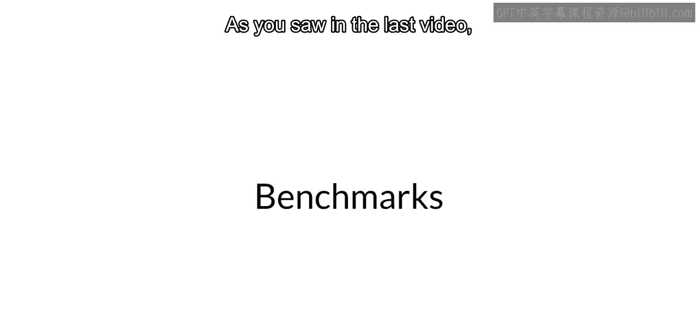
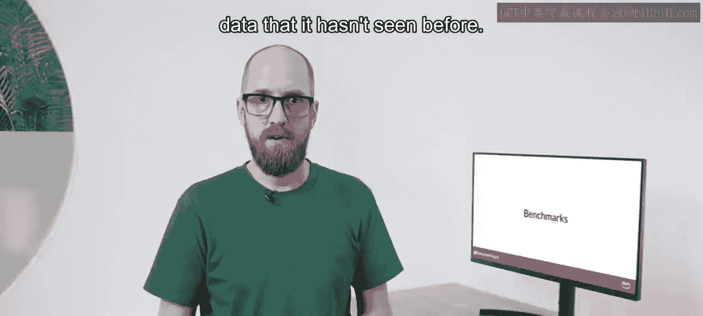
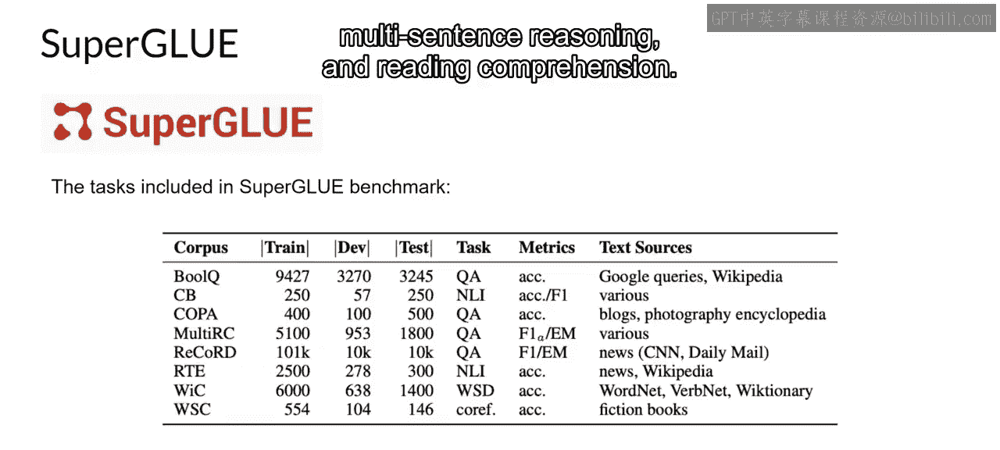
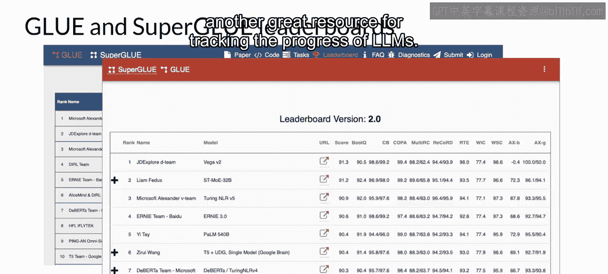
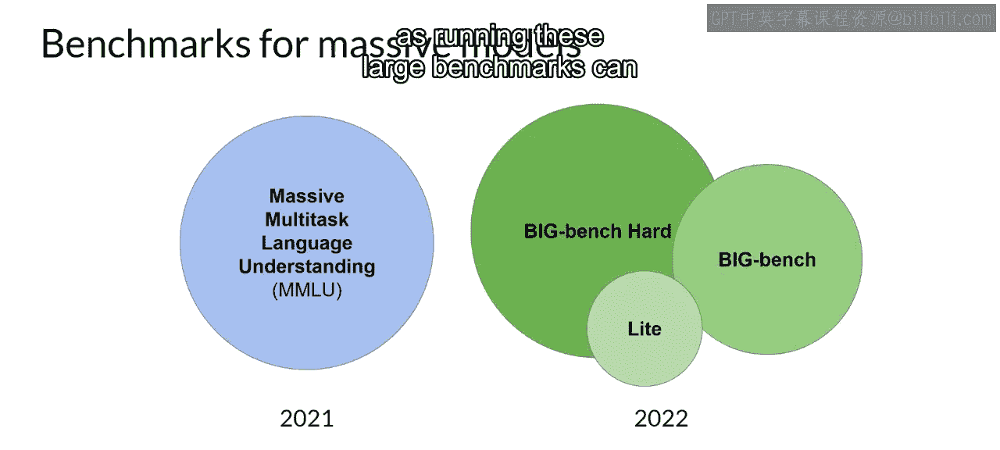
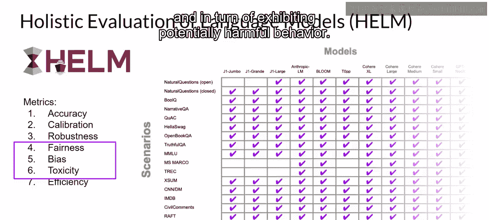
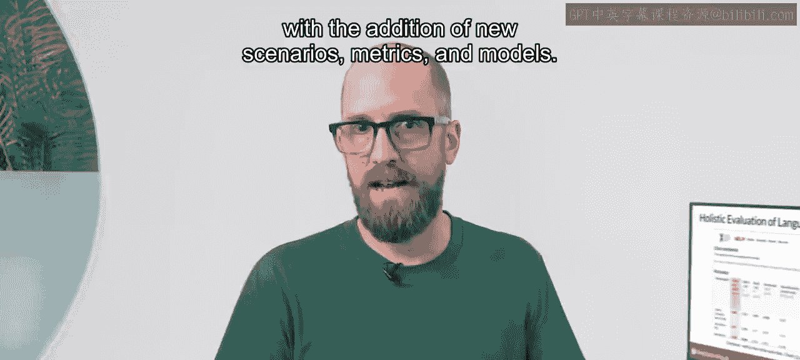

# 吴恩达《使用大型语言模型的生成式人工智能》Generative AI with Large Language Models - P23：22_基准测试.zh - GPT中英字幕课程资源 - BV1Cw411q7wm

As you saw in the last video， LLMs are complex and simple evaluation metrics like the Rouge and blur scores can only tell you so much about the capabilities of your model。

😊，In order to measure and compare LLMs more holistically。

 you can make use of preexisting data sets and associated benchmarks that have been established by LLM researchers specifically for this purpose。

😊，Selecting the right evaluation dataset set is vital so that you can accurately assess an LLM's performance and understand its true capabilities。

😊，You'll find it useful to select data sets that isolate specific model skills like reasoning or common sense knowledge and those that focus on potential risks such as disinformation or copyright infringement。

😊，An important issue that you should consider is whether the model has seen your evaluation data during training。

 You'll get a more accurate and useful sense of the model's capabilities by evaluating its performance on data that it hasn't seen before。

Benchmarks such as glue， Super gluelue or helm cover a wide range of tasks and scenarios。

 They do this by designing or collecting data sets that test specific aspects of an LLM。😊。

Glue or general language understanding evaluation was introduced in 2018。

Glue is a collection of natural language tasks， such as sentiment analysis and question answering。😊。

Glue was created to encourage the development of models that can generalize across multiple tasks。

 and you can use the benchmark to measure and compare model performance。😊，As a successor to gluee。

 Super gluelue was introduced in 2019 to address limitations in its predecessor。

 It consists of a series of tasks， some of which are not included in glue and some of which are more challenging versions of the same tasks。

😊，Super gluelue includes tasks such as multi sentence reasoning and reading comprehension。

Both the glue and super gluelue benchmarks have leaderboards that can be used to compare and contrast evaluated models。

The results page is another great resource for tracking the progress of LLms。😊。

As models get larger， their performance against benchmarks such as Superglue start to match human ability on specific tasks。

That's to say that models are able to perform as well as humans on the benchmarks tests。

 But subjectively， we can see that they're not performing at human level at tasks in general。😊。

So there is essentially an arms race between the emergent properties of LLMs and the benchmarks that aim to measure them。

Here are a couple of recent benchmarks that are pushing L LMs further。

Massive multitask language understanding， or MMmLU is designed specifically for modern LLMs。😊。

To perform well， models must possess extensive world knowledge and problem solving ability。😊。

Models are tested on elementary mathematics， US history， computer science， law and more。

 In other words， tasks that extend way beyond basic language understanding。

And Big bench currently consists of 204 tasks ranging through linguistics， childhood development。

 mathth， common sense reasoning， biology， physics， social bias， software development and more。

 Big bench comes in three different sizes。 And part of the reason for this is to keep costs achievable。

 as running these large benchmarks can incur large inference costs。😊。

A final benchmark you should know about is the holistic evaluation of language models or helm。

The helm framework aims to improve the transparency of models and to offer guidance on which models perform well for specific tasks。

😊，Helm takes a multimetric approach， measuring 7 metrics across 16 core scenarios。

 ensuring that trade offs between models and metrics are clearly exposed。

 One important feature of helm is that it assesses on metrics beyond basic accuracy measures like precision or the F1 score。

 The benchmark also includes metrics for fairness， bias and toxicity。

 which are becoming increasingly important to assess as L L Ms become more capable of human like language generation。

 And in turn of exhibiting potentially harmful behavior。😊。

Helm is a living benchmark that aims to continuously evolve with the addition of new scenarios。

 metrics and models。 You can take a look at the results page to browse the LLMs that have been evaluated and review scores that are pertinent to your project's needs。

😊。

