# 吴恩达《使用大型语言模型的生成式人工智能》Generative AI with Large Language Models - P25：24_参数高效微调技术1- LoRA.zh - GPT中英字幕课程资源 - BV1Cw411q7wm

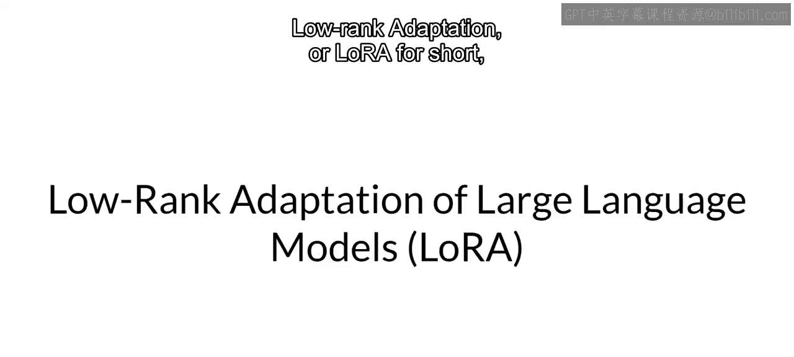

Low rank adaptation， or Lauraura， for short， is a parameter efficient fine tuning technique that falls into the reparameterization category。

 Let's take a look at how it works As a quick reminder。

 here is the diagram of the transformer architecture that you saw earlier in the course。

 The input prompt is turned into tokens， which are then converted to embedding vectors and passed into the encoder and or decoder parts of the transformer。

 In both of these components， there are two kinds of neural networks。

 Self attention and feed forward networks。 The weights of these networks are learned during pretrain After the embedding vectors are created。

 they're fed into the self attention layers where a series of weights are applied to calculate the attention scores。

 During full fine tuning。 Every parameter in these layers is updated。😊。

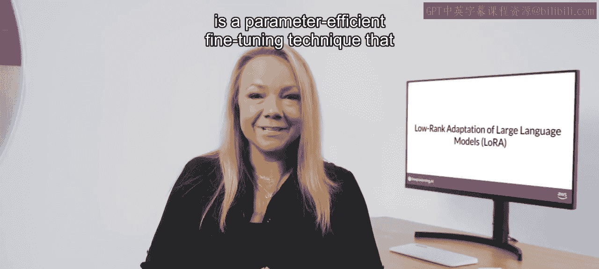

Laura is a strategy that reduces the number of parameters to be trained during fine tuning by freezing all of the original model parameters and then injecting a pair of rank decomposition matrices alongside the original weights。

 The dimensions of the smaller matrices are set so that their product is a matrix with the same dimensions as the weights they are modifying。

 You then keep the original weights of the L LM frozen and train these smaller matrices using the same supervised learning process you saw earlier this week for inference。

 the two low rank matrices are multiplied together to create a mat with the same dimensions as the frozen weights。

You then add this to the original weights and replace them in the model with these updated values。

 You now have a Lauraura fine tune model that can carry out your specific task because this model has the same number of parameters as the original。

 There is little to no impact on inference latency。

 Research have found that applying Laura to just the self attention layers of the model is often enough to fine tune for a task and achieve performance gains。

However， in principle， you can also use Lauraura on other components like the feed forward layers。

 But since most of the parameters of LLms are in the attention layers。

 you get the biggest savings in trainable parameters by applying Laura to these weights matrices。

 Let's look at a practical example using the transformer architecture described in the attention is all you need paper。

 the paper specifies that the transformer weights have dimensions of 512 by 64。

 This means that each weights matrix has 32000768 trainable parameters。

 If you use Laura as a fine tuning method with the rank equal to 8。

 you'll instead train  two small rank decomposition matrices。 whose small dimension is 8。

 This means that matrix A will have dimensions of 8 by 64， resulting in 512 total parameters。

 and matrix B will have dimensions of 512。By8 or 4096 trainable parameters。

 so by updating the weights of these new low rank matrices， instead of the original weights。

 you'll be training 4608 parameters instead of 32768。

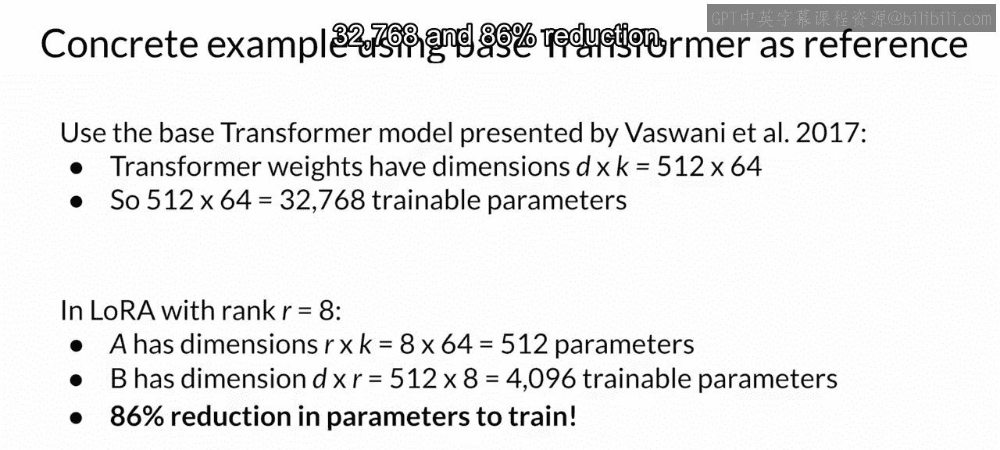

An 86% reduction。Because Lauraura allows you to significantly reduce the number of trainable parameters。

 You can often perform this method of parameter efficient fine tuning with a single GPU and avoid the need for a distributed cluster of GPus。

 Since the rank decomposition matrices are small。 you can fine tune a different set for each task and then switch them out at inference time by updating the weights。

 So suppose you train a pair of Laura matrices for a specific task。

 Let's call it task A to carry out inference on this task。

 You would multiply these matrices together。 and then add the resulting matrix to the original frozen weights。

 You then take this new summed weights matrix and replace the original weights where they appear in your model。

 you can then use this model to carry out inference on task A。

 If instead you want to carry out a different task。 say task B。

 you simply take the Laura matrices you train for this task。 calculate their product。😊。

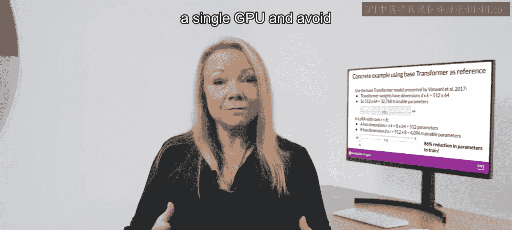

And then add this matrix to the original weights and update the model again。

 The memory required to store these Lauraura matrices is very small。 So in principle。

 you can use Laura to train for many tasks。 Switch out the weights when you need to use them。

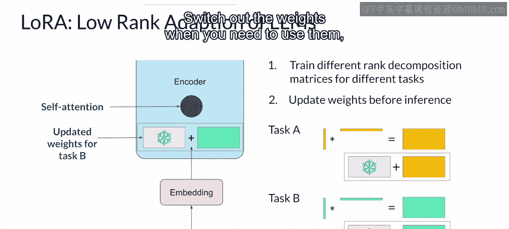

And avoid having to store multiple full size versions of the L LM。So how good are these models？

Let's use the Rouge metric you learned about earlier this week to compare the performance of aora fine tune model to both an original base model and a full fine tuned version。

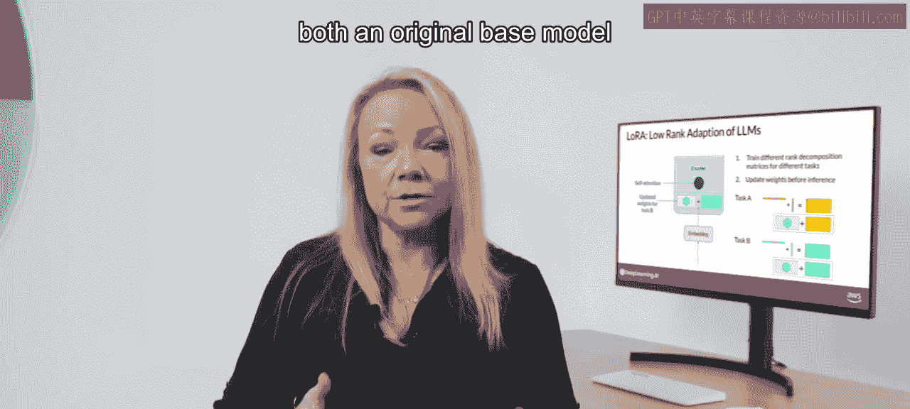

Let's focus on fine tuning the fln T5 for dialogue summarization。

 which you explored earlier in the week。 Just to remind you。

 the fln T 5 base model has had an initial set of full fine tuning carried out using a large instruction dataset。

 First， let's set a baseline score for the fln T 5 base model and the summarization data set we discussed earlier。

 here are the Rouge scores for the base model where a higher number indicates better performance。

 You should focus on the Rouge 1 score for this discussion。

 but you could use any of these scores for comparison。 As you can see， the scores are fairly low。

 Next， look at the scores for a model that has had additional full fine tuning on dialogue summarization。

 Remember， although fln T 5 is a capable model， it can still benefit from additional fine tuning on specific tasks。

 with full fine tuning， you update every weight in the model during supervised learning。

 You can see that this results in a much higher Rouge1 score。 increasing。😊。

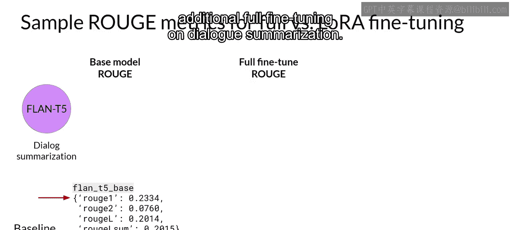

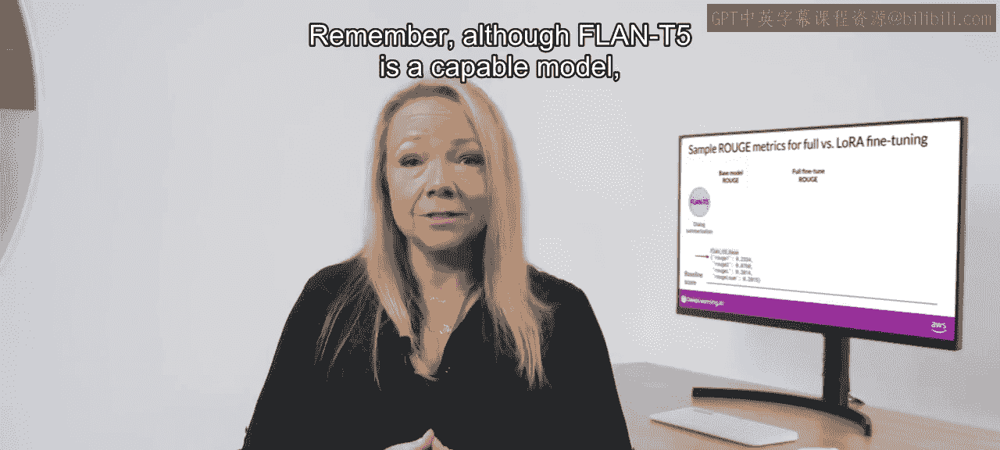

For the base vnt T 5 model by 0。19。 The additional round of fine tuning has greatly improved the performance of the model on the summarization task。

 Now， let's take a look at the scores for the Lauraura fine tune model。

 You can see that this process also resulted in a big boost in performance。

 The Rouge1 score has increased from the baseline by 。17。

 This is a little lower than full fine tuning， but not much。😊，However。

 using Laura for fine tuning trained a much smaller number of parameters than full fine tuning using significantly less compute。

 So this small trade off in performance may well be worth it。

 You might be wondering how to choose the rank of the Lauraura matrices。

 This is a good question and still an active area of research。 In principle， the smaller the rank。

 the smaller the number of trainable parameters in the bigger the savings on compute。 However。

 there are some issues related to model performance to consider in the paper that first proposed Laura。

 researchers at Microsoft explored how different choices of rank impacted the model performance on language generation tasks。

 You can see the summary of the results in the table here。

 The table shows the rank of the Laura matrices in the first column。

 The final loss value of the model and the scores for different metrics， including blue and Rouge。

 The bold values indicate the best scores that were achieved for each metric。😊。

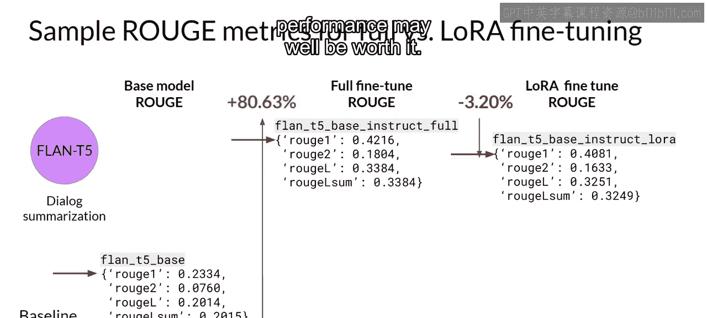

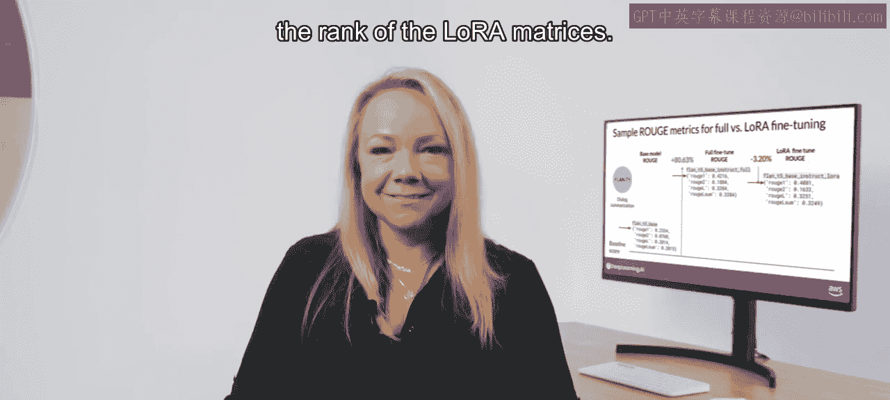

The authors found a plateau in the loss value for ranks greater than 16。In other words。

 using larger Laurara matrices didn't improve performance。

 The takeaway here is that ranks in the range of 4 to 32 can provide you with a good trade off between reducing trainable parameters and preserving performance。

 Opimizing the choice of rank is an ongoing area of research and best practices may evolve as more practitioners like you make use of Laura。

😊。

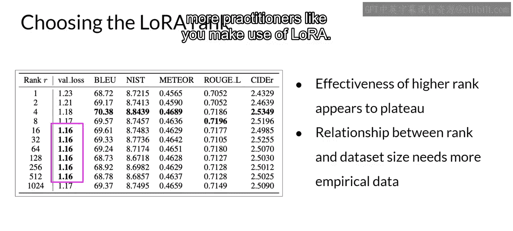

Laura is a powerful fine tuning method that achieves great performance。

 and the principles behind the method are useful not just for training LLMs。

 but for models in other domains。The final PEft method that you'll explore this week doesn't change the LLM at all。

 and instead focuses on training your input text。Join me in the next video to learn more。

