# 吴恩达《使用大型语言模型的生成式人工智能》Generative AI with Large Language Models - P26：25_参数高效微调技术2-软提示.zh - GPT中英字幕课程资源 - BV1Cw411q7wm

With Laura， the goal was to find an efficient way to update the weights of the model without having to train every single parameter again。

 There are also additive methods within Pft that aim to improve model performance without changing the weights at all。

 In this video， you'll explore a second parameter efficient fine tuning method called prompt tuning。

 Now， prompt tuning sounds a bit like prompt engineering。

 But they are quite different from each other。 with prompt engineering。

 You work on the language of your prompt to get the completion you want。😊。

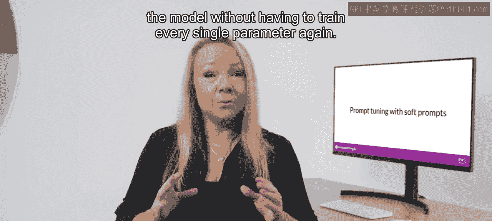

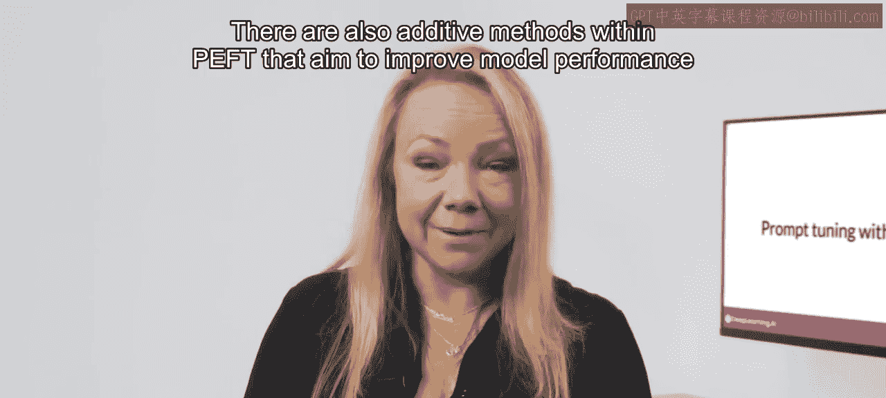

This could be as simple as trying different words or phrases or more complex。

 like including examples for one or few shot inference。

The goal is to help the model understand the nature of the task you're asking it to carry out and to generate a better completion。

 However， there are some limitations to prompt engineering。

 as it can require a lot of manual effort to write and try different prompts。

 You're also limited by the length of the context window。 And at the end of the day。

 you may still not achieve the performance you need for your task。 with prompt tuning。

 you add additional trainable tokens to your prompt and leave it up to the supervised learning process to determine their optimal values。

 The set of trainable tokens is called a soft prompt。

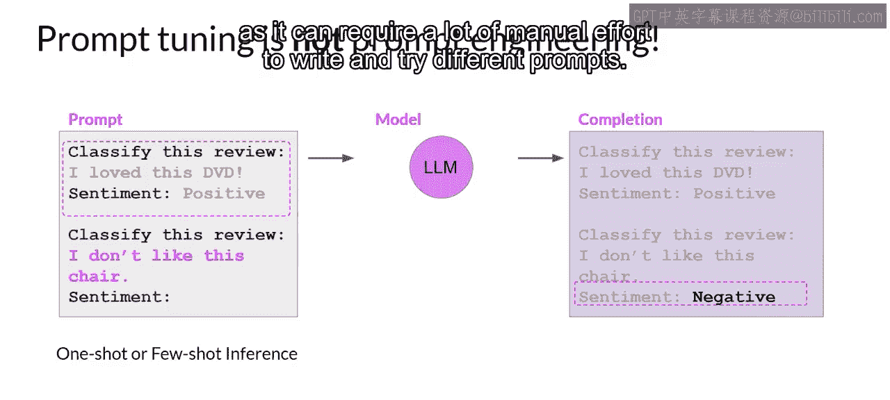

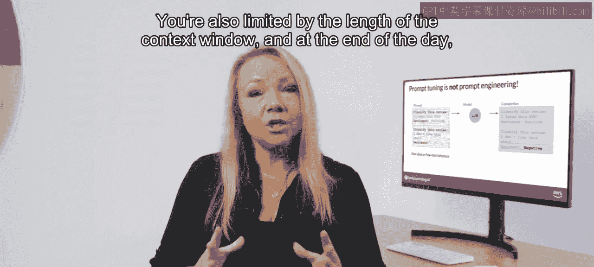

And it gets preended to embedding vectors that represent your input text。

 The soft prompt vectors have the same length as the embedding vectors of the language tokens。

 and including somewhere between 20 and 100 virtual tokens can be sufficient for good performance。

 The tokens that represent natural language are hard。

 In the sense that they each correspond to a fixed location in the embedding vector space。 However。

 the soft prompts are not fixed discrete words of natural language。 Instead。

 you can think of them as virtual tokens that can take on any value within the continuous multidimensional embedding space。

 and through supervised learning， the model learns the values for these virtual tokens that maximize performance for a given task。

 In full fine tuning， the training data set consists of input prompts and output completions or labels。

 The weights of the large language model are updated during supervised learning。

 In contrast with prompt tuning。😊。

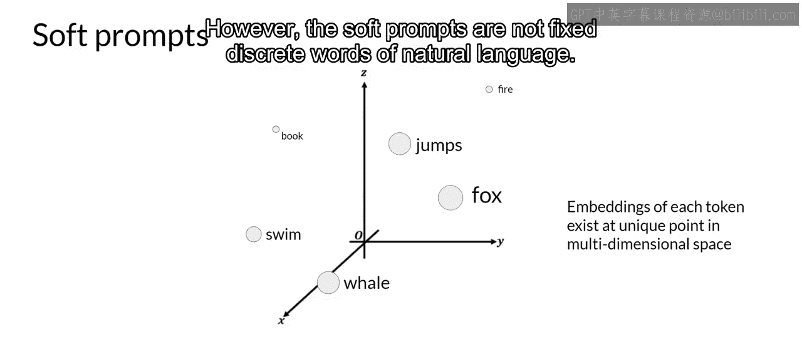

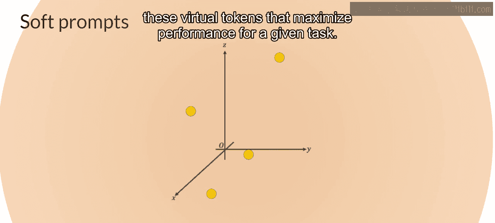

The weights of the large language model are frozen， and the underlying model does not get updated。

 Instead， the embedding vectors of the soft prompt gets updated over time to optimize the model's completion of the prompt。

 Promp tuning is a very parameter efficient strategy。

 because only a few parameters are being trained。In contrast with the millions to billions of parameters in full fine tuning。

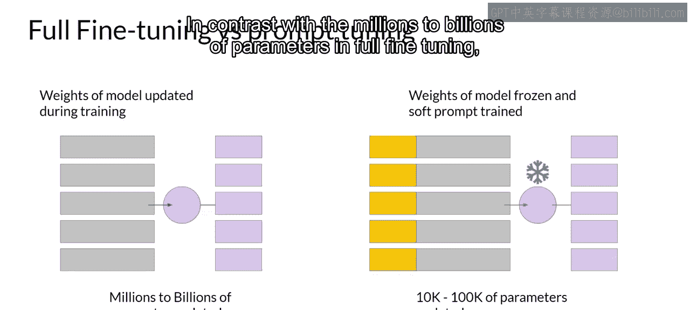

Similar to what you saw with Laura， you can train a different set of soft prompts for each task and then easily swap them out at inference time。

 You can train a set of soft prompts for one task and a different set for another to use them for inference。

 You prepend your input prompt with the learned tokens to switch to another task。

 you simply change the soft prompt。 Soft prompts are very small on disk。

 So this kind of fine tuning is extremely efficient and flexible You'll notice the same LL M is used for all tasks。

 All you have to do is switch out the soft prompts at inference time。

 So how well does prompt tuning perform in the original paper exploring the method by Brian Lester and collaborators at Google。

 The authors compared prompt tuning to several other methods for a range of model sizes。

 In this figure from the paper。 you can see the model size on the X axis。

 And the super gluelu score on the Y axis。 This is the evaluation benchmark you learned about earlier this week that。

😊。

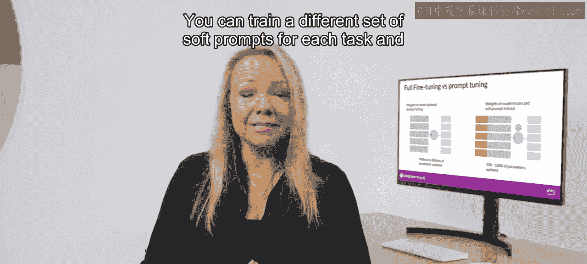

Model performance on a number of different language tasks。

 The red line shows the scores for models that were created through full fine tuning on a single task。

 While the orange line shows the score for models created using multitask fine tuning。

 The green line shows the performance of prompt tuning。 And finally。

 the blue line shows scores for prompt engineering only。😊，As you can see。

 prompt tuning doesn't perform as well as full fine tuning for smaller LLMs。 However。

 as the model size increases， so does the performance of prompt tuning。

 and once models have around 10 billion parameters。

 prompt tuning can be as effective as full fine tuning and offers a significant boost in performance over prompt engineering alone。

One potential issue to consider is the interpretability of learned virtual tokens。 Remember。

 because the soft prompt tokens can take any value within the continuous embedding vector space。

 The trained tokens don't correspond to any known token。

 word or phrase in the vocabulary of the L L M。However。

 an analysis of the nearest neighbor tokens to the soft prompt location shows that they form tight semantic clusters。

 In other words， the words closest to the soft prompt tokens have similar meanings。

The words identified usually have some meaning related to the task。

 suggesting that the prompts are learning word like representations。

 You explore two peft methods in this lesson。 Laura。

 which uses rank decomposition matrices to update the model parameters in an efficient way and prompt tuning where trainable tokens are added to your prompt。

 and the model weights are left untouched。

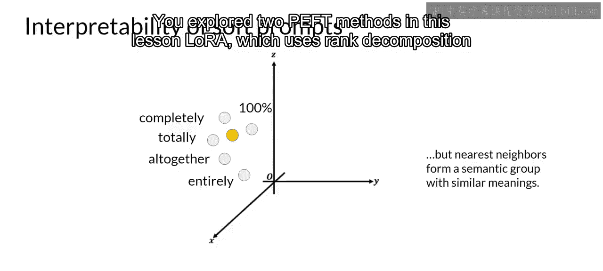

Both methods enable you to fine tune models with the potential for improved performance on your tasks while using much less compute than full fine tuning methods。

Laura is broadly used in practice because of the comparable performance to full fine tuning for many tasks and data sets。

 and you'll get to try it out for yourself in this week's lab。

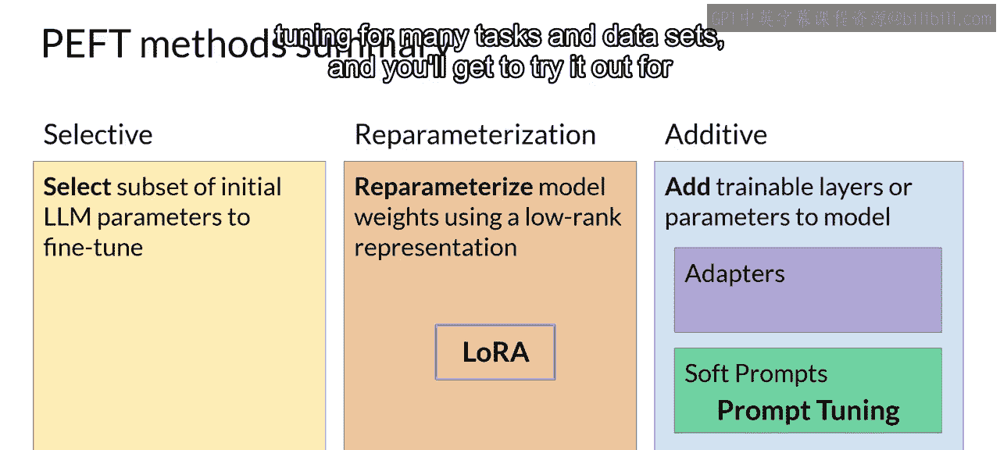

So congratulations on making it to the end of week two， let's recap what you've seen。

Earlier this week， Mike walked you through how to adapt a foundation model through a process called In fine tuning。

Along the way， you saw some of the prompt templates and data sets that were used to train the Fn T5 model。

You also saw how to use evaluation metrics and benchmarks such as Rouge and Helm to measure success during model fine tuning。

In practice， instruction fine tuning has proven very effective and useful across a wide range of natural language use cases and tasks。

With just a few hundred examples， you can finet a model to your specific task。

 which is truly amazing。

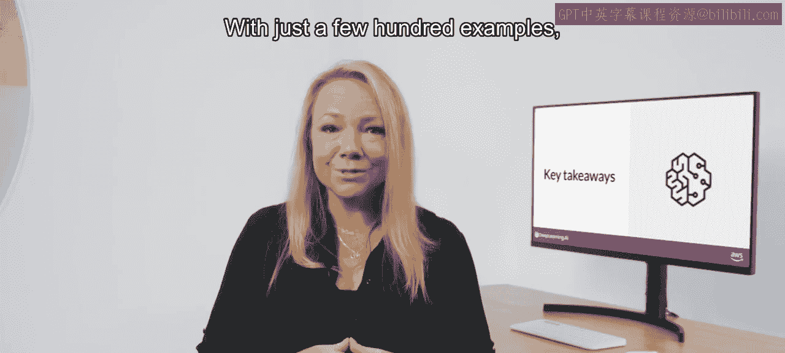

Next， you saw how parameter efficient fine tuning or PEft can reduce the amount of compute required to fine tune a model。

You learned about two methods you can use for this。 Laura impromp tuning。 By the way。

 you can also combine Laura with the quantization techniques you learned about in week1 to further reduce your memory footprint。

 This is known as Q Laura。

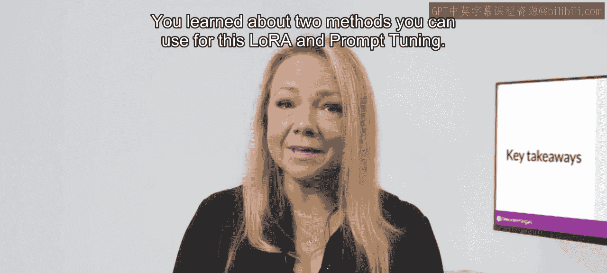

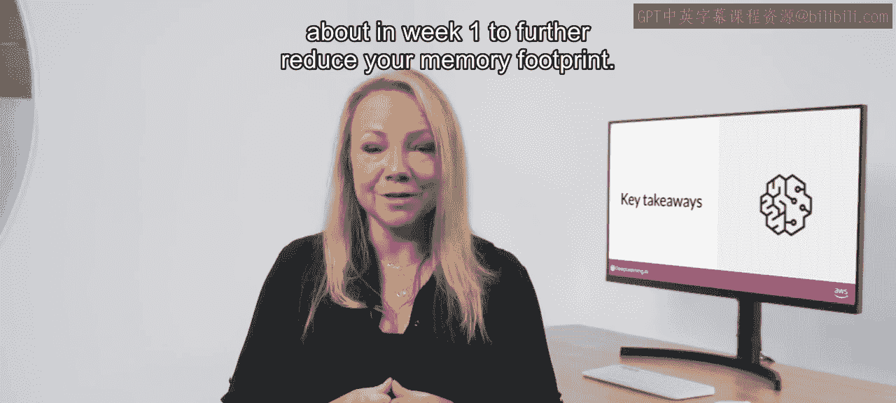

In practice， PEft is used heavily to minimize compute and memory resources and ultimately reducing the cost of fine tuning。

 allowing you to make the most of your compute budget and speed up your development process。

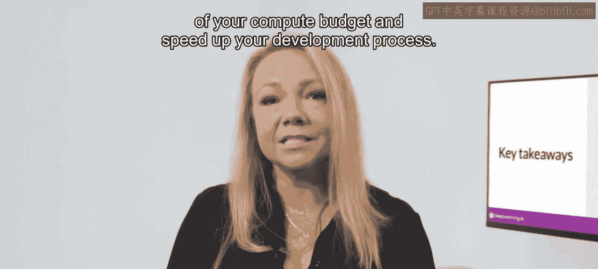