# 吴恩达《使用大型语言模型的生成式人工智能》Generative AI with Large Language Models - P27：26_实验室2演练.zh - GPT中英字幕课程资源 - BV1Cw411q7wm

This week's lab lets you try out fine tuning using PEft with Laura for yourself by improving the summarization ability of the Fn T5 model。

My colleague， Chris， is going to walk you through this week's notebook。 So I'll pass you over to him。

 Hey， thanks， Shelby。 And now let's take a look at La 2 in lab 2。

 you will get hands on with full fine tuning and parameter efficient fine tuning also called Pft with prompt instructions。

 You will tune the flan T 5 model further with your own specific prompts。😊。

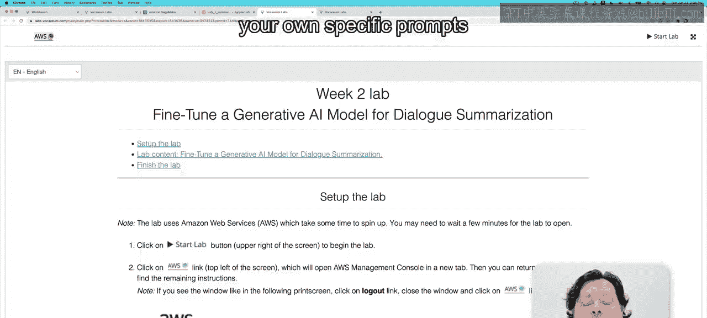

For your specific summarization task so let's jump right into the notebook So lab2。

 we are going to actually fine tune the model so lab1。

 we were doing the zero shot inference the in context learning Now we are actually going to modify the weights。

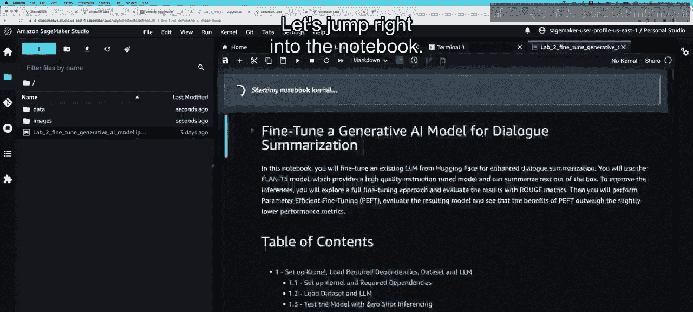

Of our language model， specific to our summarization task and specific to our data set。

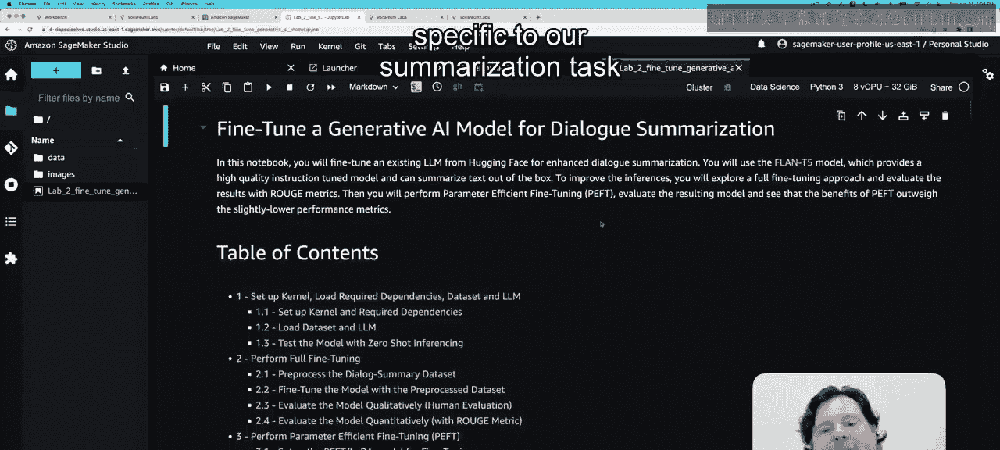

So real quick just double check that you have the 8 CPU 32 gigabyte That's the instance type here This is an AWS instance type from sageMaker Ml。

m5。2xl let's do these Pip installs while the Pip installs are happening let me explain torch and torch data the same as lab1 where we we are going to use Pytorrch then Pip installing the torch data library to help with the Ptorrch data loading there's also a library calledeval and this is what we're going to use with our Rouge score to calculate Rouge。

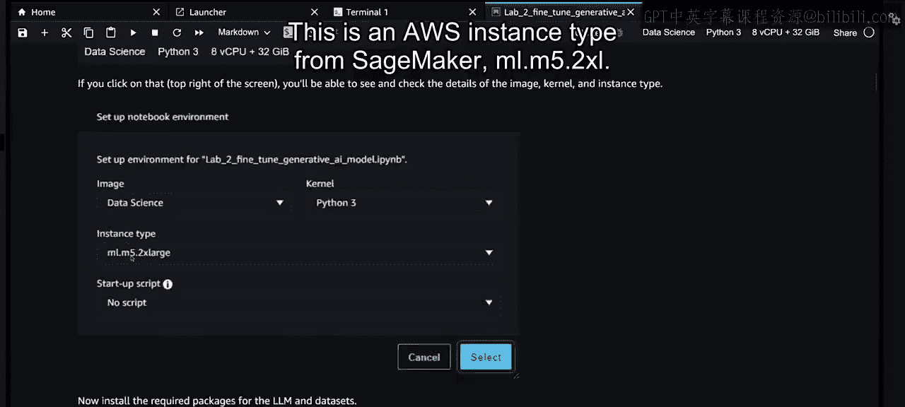

You learned about Rouge in the lessons as a way to measure。

How well does a summary encapsulate what was in the original conversation or the original text？Now。

 these two libraries， Laura and Pft， you heard about a bit in the lessons。

 this is what we will use to do the parameter efficient fine tuning。

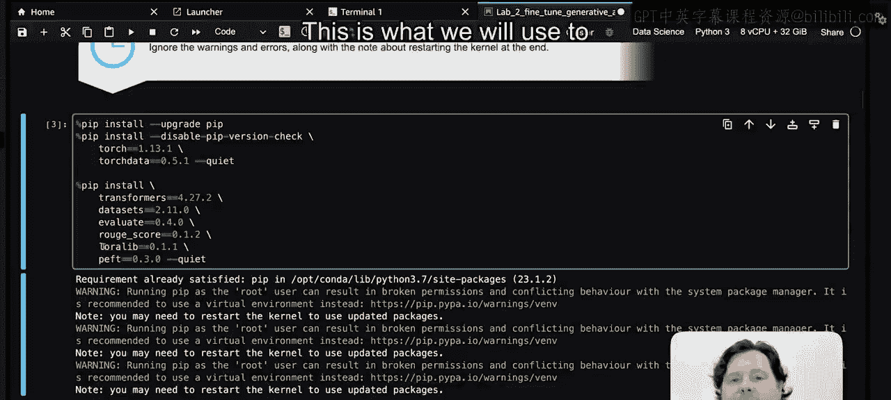

Now I'm going to do some imports here from those Pip installs。

If you do see this sometimes this clean data in minutes thing shows up here you don't need this for the lab so if you see it。

 I think this comes up whenever we import pandas just click the X and click don't show again because we're not using that part of sageMaker all right so once again we have the auto model for See tose this is what's going to give us access to flan T5 through the transformers Python library the tokenizer we use Gene config in the previous lab now we're going to see two new classes one called training arguments one called trainer these are all from transformformers these are always we can use that simplifies our code when we're trying to train our language model or fine tune our language model we see that we are going to import Pytorch and the evaluate and we will use I believe pandas and nuy later on。

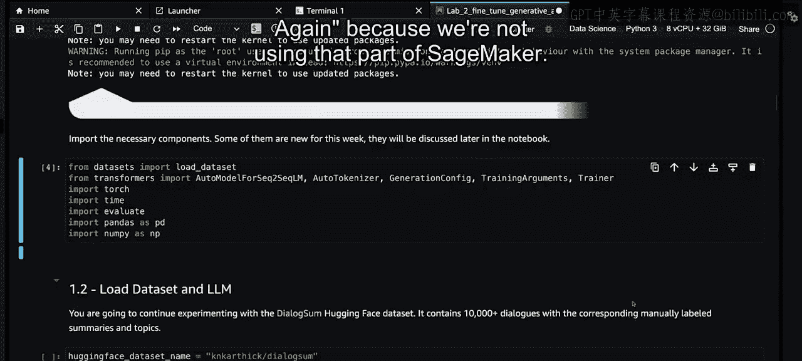

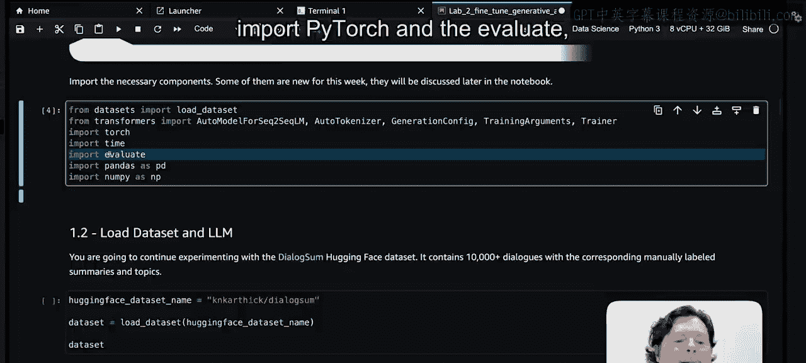

So let's load the data set just like we did in the first lab。And。

Let's load the model just like we did in the first lab and the tokenizer。 And so no。

 this is called the original model。And this will be useful later when we compare all the different fine tuning strategies to the original model that is not fine tuned。

Here is a convenience function that prints out all of the parameters that are in the model and specifically the trainable parameters。

 and this will become useful when we introduce the Pft version of the model。

 which does not train all of the parameters Here we see there are approximately what is this 250 million parameters。

Being trained when we do the full fine tuning， which is the first part of this lab where we full fine tunening。

 the second part of the lab will be where we do the parameter efficient fine tuning specifically with Laura where we will only train a very small number so keep that in mind。

 This is kind of a lot of messy code， but it's you pretty useful for the comparison okay and let's just do just like we did in the first lab。

 we're going to show a sample input。 we're going to show the human baseline。

 we're going to do the zero shot。 So this is not one shot， not few shot。

 we're kind of pass that that was lab1 here we are trying to get to the point where one simple call into our model can give us a decent summary without having to pass in the one shot and few shot examples。

 That's the goal。And the first way that we're going to do is we are going to do full fine tuning。

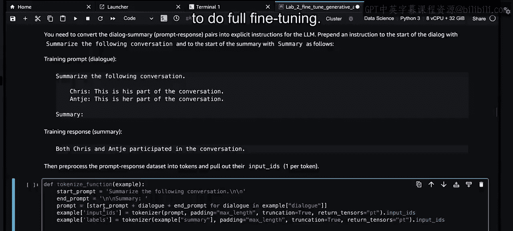

Here is a convenience function that can tokenize and wrap our data in a prompt and so as we saw in the first lab where we had a prompt that's summarized the following conversation and then we're actually going to give it the dialogue and then we're going to end the prompt with the summary colon and this function will let us map over all of the elements of our data and convert them into prompts with instruction and that's what we're going to do here which is full fine tuning with instruction prompts。

Okay so here we're just going to take a sample just to keep the resource requirements low for this particular lab。

 speed things up a little bit and let's take a look at the size so here we have about 125 training examples we're going to use five for validation we're going to use 15 to actually do our holdout test later on when we compare so we're going to fine tune with the training and we're going to validate with the validation and then when all of that's said done we're then going to use the 15 test examples to then compare the different strategies for fine tuning with instruction and so here we see training arguments and we see some defaults here for the learning rate。

 we see some pretty low values for the max steps and and the number of the epics that's because we do want to try to minimize the amount of compute that's needed for this lab if you have more time you can certainly change these values。

And bump them up to maybe five epics， maybe steps you know max steps 100 in a bit。

 I'll show you how we actually work around that we have trained offline a much larger model with much higher max steps and training Es and in a bit we will actually pull that in and then continue from there but this is what the code looks like here's the training data set there's the evaluation validation data set。

 here's where we call train so actually let me just do shift enter get this started this will take a few minutes。

 even with the low max steps and the low Es this still does take a few minutes to run。

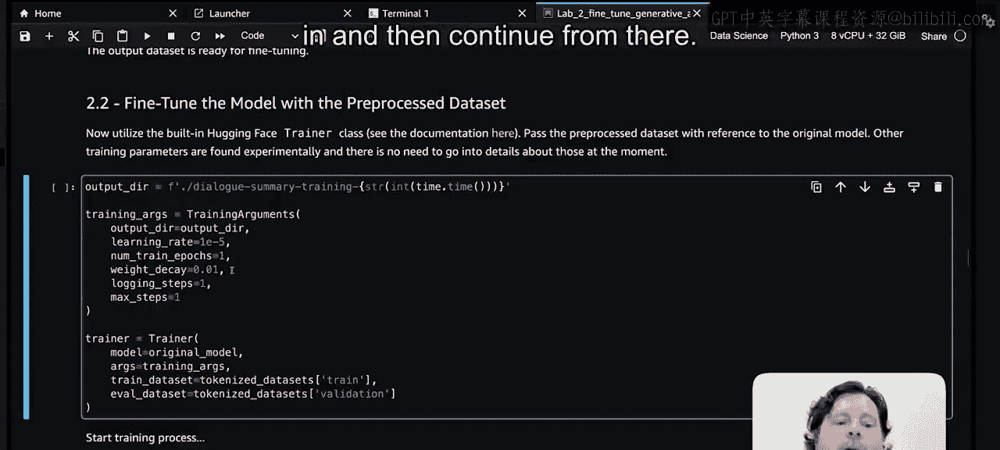

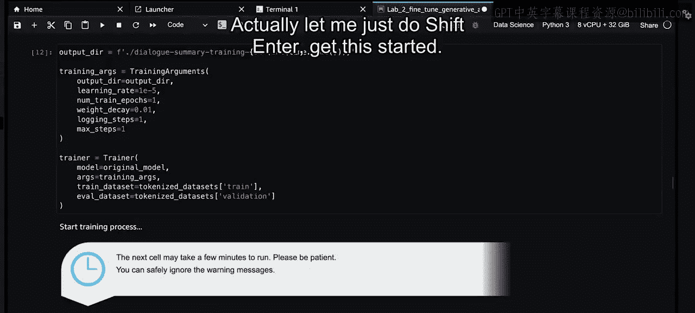

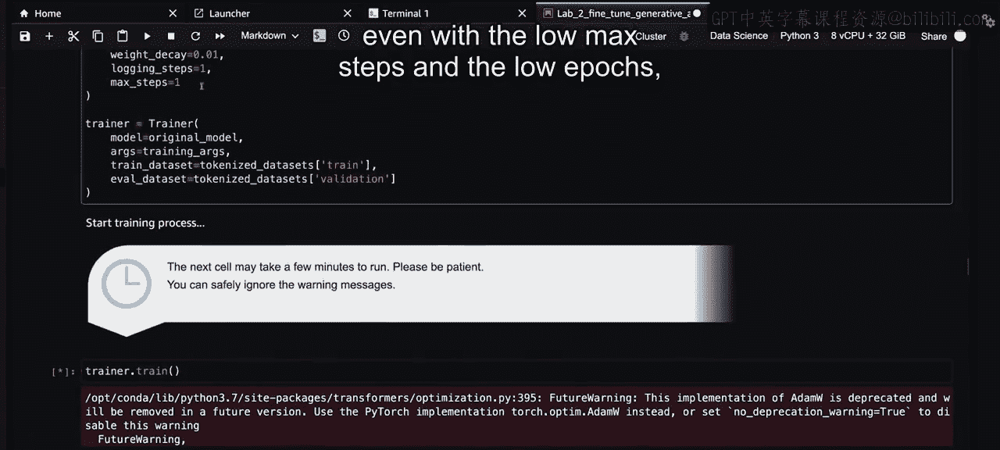

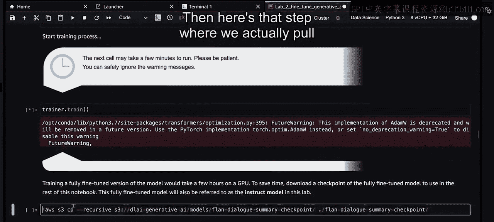

And then here's that step where we actually pull in from the cloud objectject storage。

 a model that we trained outside of this lab that is a little bit better。

 and so we'll actually start with that。Let's give the train a few minutes to complete。

What we're doing here is we are actually instruction fine tuning our fllan T5 language model with our specific data set on a very specific summarization task。

 and then later we'll see how the Rouge metric compare between the original model and the instruction fine tune model that we have here let's pull in that model from S3 object storage that we trained offline that's a little bit better accuracy and lower loss that we were able to train for longer outside of this specific lab and I do want to keep an eye on the size of this model。

 So this is a fully finetuned instruction model and you'll see it's close to one gig and that will come in handy later when we compare it to peft which is on the order of 10 mes So here we see 945 MBs So we pulled that model down into a directory here called。

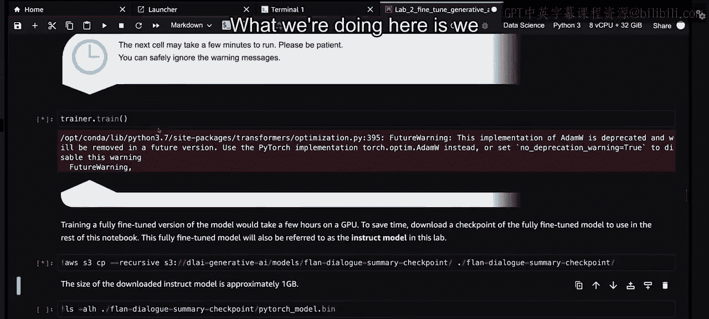

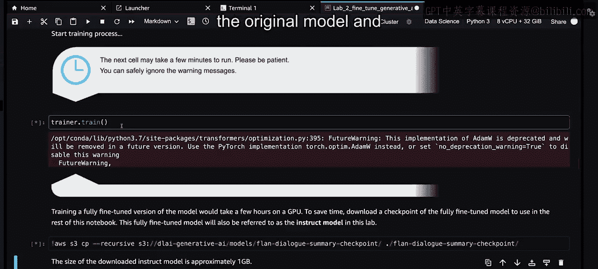

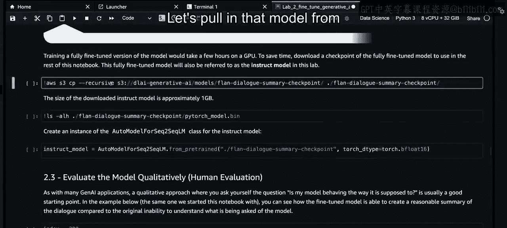

Dialogue summary checkpoint。Now we're going to load that instruction model。

 So now this becomes our new model that we are then going to use to compare here in a bit。

 So now that we've loaded what we're calling Instruct model。

 let's actually try from our test data set using the human eye let's qualitatively test and see how does this look。

 So the baseline summary， person one teaches person 2 how to upgrade in person2s system。

The original model without any instruction fine tuning just zero shot。

 this time it's giving us person one you'd like to upgrade your computer， person two。

 you'd like to upgrade your computer。

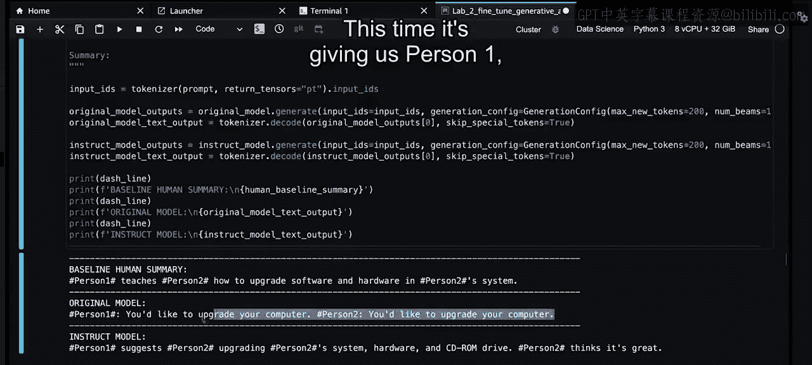

So not very good， the instruction fine tuned model that we just got done training。

Is person one suggest person2 should upgrade their system hardware and CDdroM personson 2 thinks it's a great idea。

 So that's qualitatively。 that's just sort of looking now we only took a look at you know one example but this is why we have quantitative techniques to do this comparison to do the evaluation specifically。

 let's load Rouge and we're going to take a look I think we're just going do maybe the first 10 here and let's compare them。

 Okay， so let's take the first 10 from our test data set。

 We will run them through these conversations through both the original fl T5 model as well as the instruction fine tuned model that we used up above that we trained up above here of course we're going to wrap it in a prompt similar to what we used to train and then let's see how it did。

 So these are so this is sort of qualitatively taking a look at them side by side。

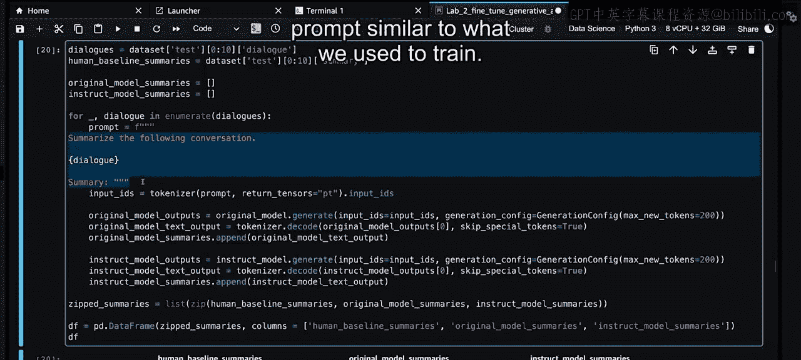

Okay， let's compare the Rouge metrics for both the original fl T5 and the instruction fine tune model that we tuned up above。

 Here we see that the instruction fine tune model scores much higher on the Rouge evaluation metric than the original fl T5 model。

 So this is showing that with a little bit of fine tuning using our data set and a specific prompt。

 we were actually able to improve on the Rouge metric。

 One other thing that we did offline was we did this much longer with a much larger test data set。

 So it wasn't just the 10 or the 15 examples。 This actually was the full data set and let's take a look。

 So that's with this file is the CSB file that came along in this data directory with this lab。

 So here we see with a much larger data， the scores are still pretty similar where we're getting close to double not quite double in some cases。

 but you pretty significant improvement upon the。Original fl T5 and here we see the percentage improvements specifically so if we actually do the calculation we see Rouge1 is 18% higher Rouge 2。

10% Roelle 13 Roelle sum 13。7 as well All right now let's get into parameter efficient fine tuning This is one of my favorite topics。

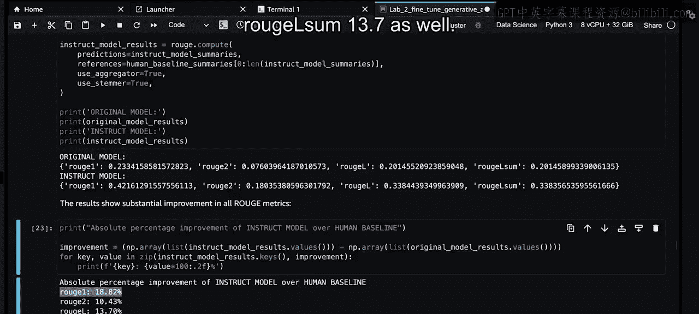

This makes such a big difference， especially when you're constrained by how much compute resources that you have。

 you can lower the footprint， both memory， disk， you know GPU， CPUU。

 all of the resources can be reduced just by introducing PEft into your fine tuning process in the lessons you learned about Laura。

 you learned about the rank here we're going to choose rank of 32 which is actually relatively high。

But we are just starting with that and here it's the tosQLM this is F T5 and so with just a few extra lines of code here to configure our Laura fine tuning then here we see we're only going to train 1。

4% of the trainable model parameters and so in a lot of cases you can finet very very large models on a single GPU and here's some more of those training arguments so this is really back to the original huggingface training and training arguments except instead of using just the regular model we are actually using the PEft model and here this is a convenience function offered by the PEft library and we give it the original model which is the fl T5 we give it the Laura configuration which we defined above with the rank 32 and we say get me a PEft version of that model and that's what comes out。

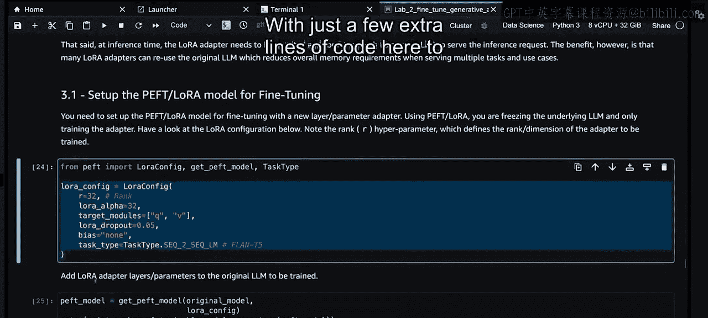

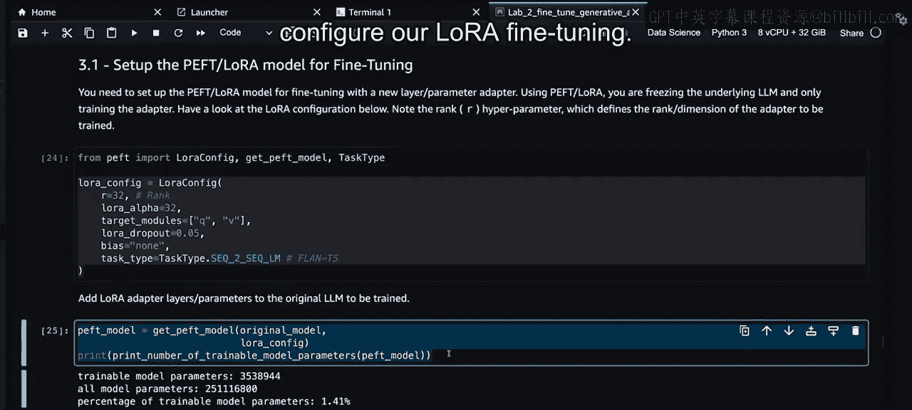

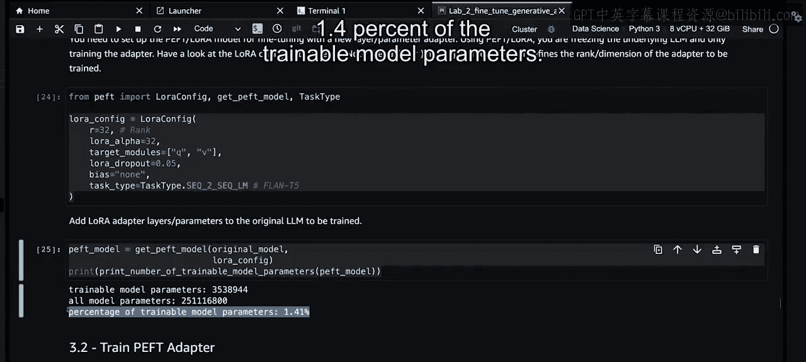

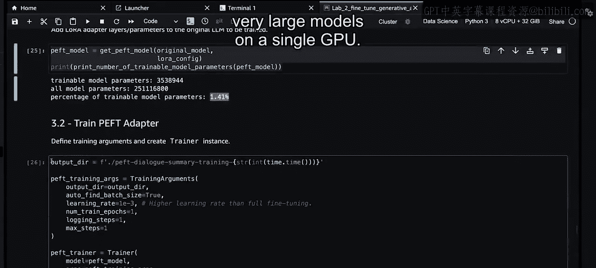

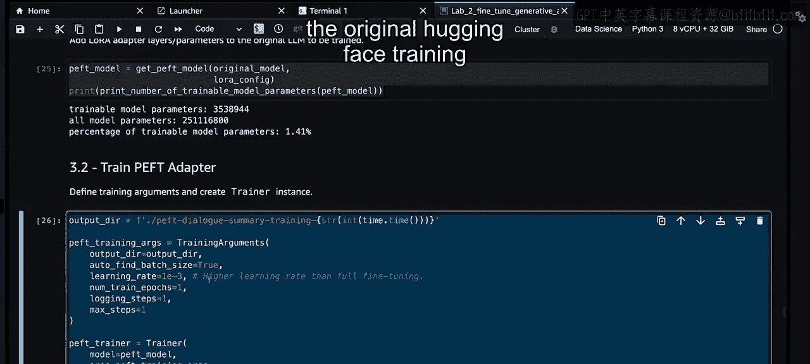

1。4% and so now we do the training arguments， you know again， small number of steps。

 small number of like epics here we do have a version that was trained offline that's a little bit better than the one that is in this lab specifically and that's what we're going download here in a sec so let's do that here's the other model that was stored in S3 cloud storage now we see this is only 14 megabytes so these are called the PEft adapters or Laurara adapters and these get merged or combined with the original LLM when you go to actually serve this model which we will hear in a bit you have to take the original LM and then merge in this Laura PEft adapter but these are much smaller and you could reuse the same base LLM and swap in different PEft adapters when needed Okay now that we have the PEft adapter copied down from S3 we're going to merge。

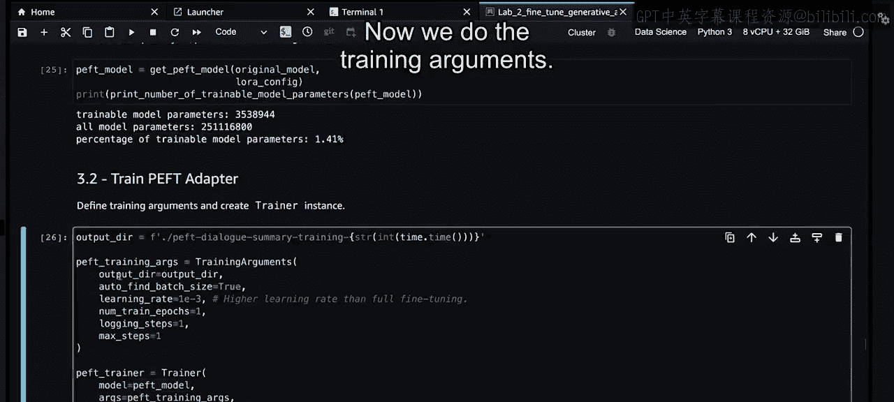

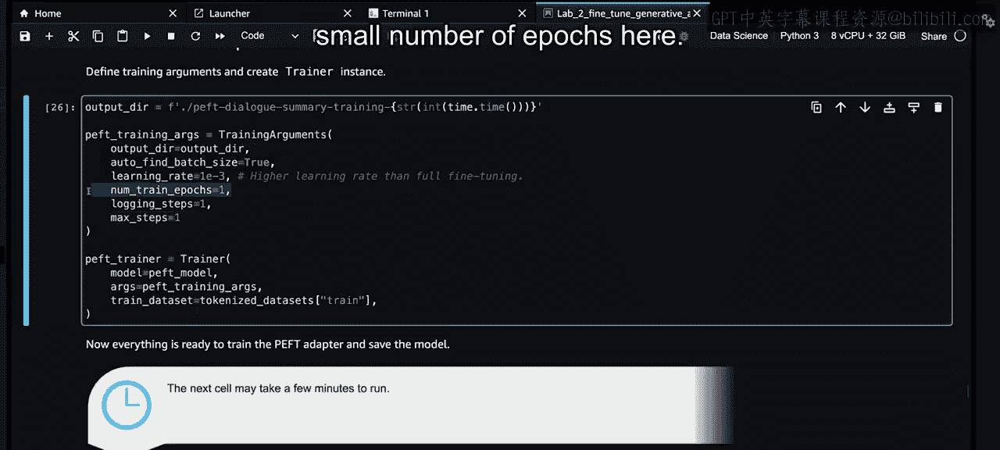

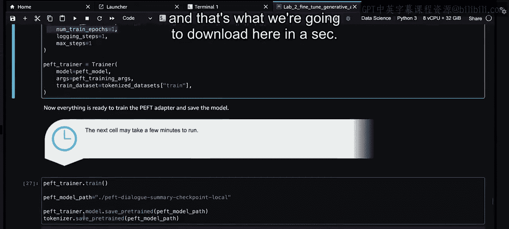

That with the original LLM， which is F T5 and use that to actually perform summarization Now one thing to call out that's not entirely obvious is that when we do this。

 I can actually set the is trainable flag to false by setting the is trainable flag to false we are telling Pytorch that we're not interested in training this model all we're interested in doing is the forward pass just to get the summaries and so this is significant because we can tell。

Pytorch to not load any of the update portions of these operators and to basically minimize the footprint needed to just perform the inference with this model and so this is a pretty neat flag this was actually just introduced recently into the PEft model at the time of this lab and I wanted to show it here because this is a pattern that you want to try to find when you're doing your own modeling when you know that you're ready to deploy the model for inference there are usually ways that you can hint to the framework such as Pytorch that you're not going to be training and this can then further reduce the resources needed to make these predictions。

 and so here just to sort of like emphasize that I do print out the number of trainable parameters。

And so keep in mind， at this point， we are only planning to do inference。And let's move on to that。

 So0% of these trainable parameters here we're going build some sample prompts from our test data set。

 We're just going to pick something you know randomly here。

 essentially index 200 and we're going to see the instruction model got it mostly right I think the peft model gets a little bit you know starts to find a little bit more nuance here。

 but really as we'll see qualitatively when we run the Rouge metrics。

 So here we're going to compare the human baseline to the original flt5 to the instruction full fine tuned and then to the PEft fine tuned For the most part。

 just kind of glancing here it looks like these are pretty similar but let's take a look at the rouge metrics and see what's going on。

 So here we see the instruction fine tuned was a pretty drastic improvement over the original flt5。

 We see that the peft model does suffer a little bit of a degradation from the full fine tuned。

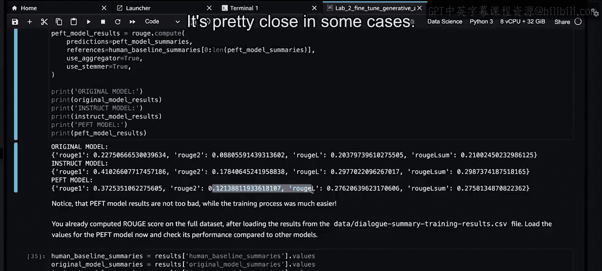

It's pretty close in some cases， so it's not too bad， but we use much。

 much much less resources during fine tuning than we would have if we did the full instruction and so you can imagine you know this is only just a few thousand samples but like you can imagine at scale how this really can save you you know tons of compute resources and time by using PEft by looking at the larger data set so up above I was just looking at maybe 1015 examples here we see larger looks like I think I have it here。

 Rouge1 Pft loses about one to maybe 1。7% across all four of these Rouge metrics and that's not bad relative to the you savings that you get when you use PEft。

