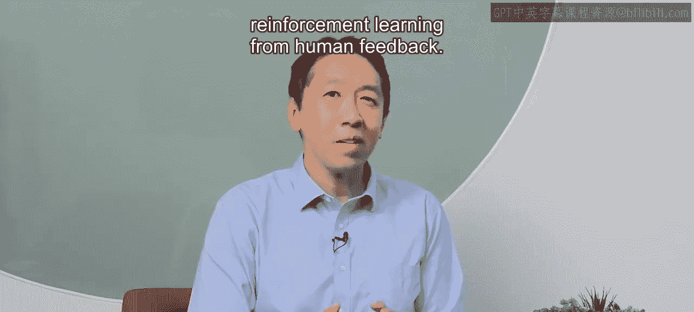

# 吴恩达《使用大型语言模型的生成式人工智能》Generative AI with Large Language Models - P28：27_第三周介绍.zh - GPT中英字幕课程资源 - BV1Cw411q7wm

Welcome back。 Last week， you learned about instruction tuning for large language models， as was PEft。

 This week will dive into RHF reinforcement learning from human feedback。

 One of those techniques that you may have heard about in the news。

 maybe but how does it actually work will take a deep dive into that as well as a second。

 I think very exciting topic on how to use LOMs as a reason engine and that it causes subroutines to create an agent it can take actions。

 So ROHF is really exciting it helps to align the model with human values。 So for example。

 LLMs might have a challenge in that is creating sometimes harmful content or like a toxic tone or voice and by aligning the model with human feedback and using reinforcement learning as an algorithm。

 you can help to align the model to reduce that and to align to words like less harmful content and much more helpful content as well。

 Sometimes people。😊。

Like oh I was trained on this horrible you know some horrible internet data See so dangerous I think many people underapp how powerful our HF is is so imperfect Lms do generate problematic outputs。

 but it feels like with the progress of technology researchers are consistently making them more I guess the three hs right on this helpful and harmless Yes。

 absolutely and I'm going to be joined this week by the way。

 by an applied scientist from Amazon who will explain a little bit behind the algorithms being used in reinforcement learning for this purpose I'm looking forward to that This is EK right this is E who's going join us Def we also invited Dr。

 Nashley Cs who's going to talk with us about responsible AI as well That's right Nley is going to join us and I will have a discussion with her around the topic of responsible AI which is very important as well and I'm really glad that you was spending so much time on this AI risk is something the lot of people。

Rightfully thinking about and I think the seriousness with which Sothhi all major AI teams that I know of are taking this and the resources is effort de of thought we're far from perfect but Sohi feels like the community is working very hard to get better practice this every year and then in addition to responsible AI and tuning the models using RHF the other technique that I'm excited about is using Oms as a reasoning engine and giving them the power to make their own routine calls to maybe do a web search or take other actions definitely and we'll get into that inside this lesson and we'll talk about some techniques that allow you to get around some of the limitations that we see with large language models by allowing them to reason take action through techniques like react will also talk about RaG which allows you to also access external sources of information so you can access domain specific information we see a lot of customers that。

Be able to incorporate information from proprietary data sources into their generative AI applications so we talk a little bit about some of those techniques and methods that allow you to do that You know one thing about the giant large language models is just so good at memorizing facts you learning facts off the internet sometimes people use them as a repository of facts to get answers to the questions but I think it does a different and maybe I think more helpful way to think of the Os which is it is a reasoning engine and you give it you know Apis to go get his own facts because is an okay but not the best database of facts but there's a very good reasoning engine and that I think is a real power of these models definitely definitely a lot more cost effective right use the database for that information and then your generative AI for that what it's meant for that's a great point and so with that finally because so much exciting stuff I am confident you enjoy it and so's。

Go on to the next video where An here will start to deep dive into ROHF。

