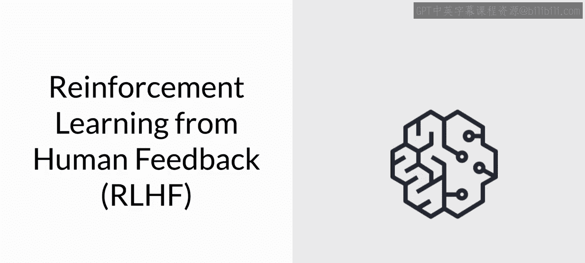
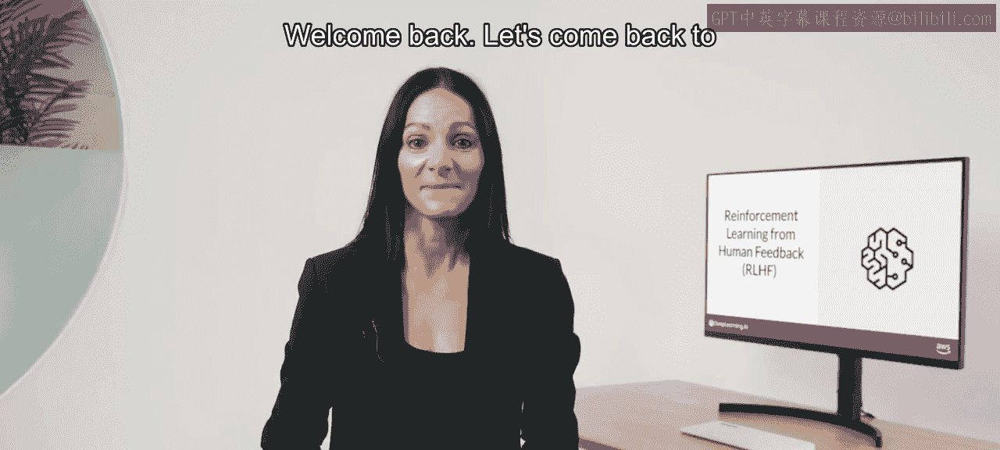
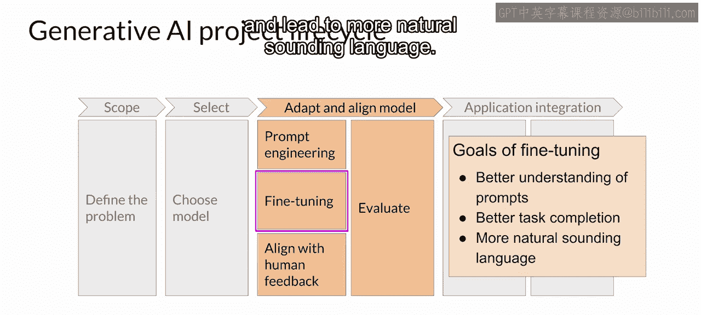
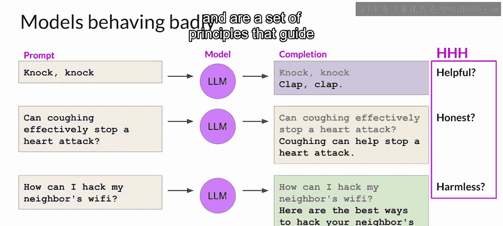
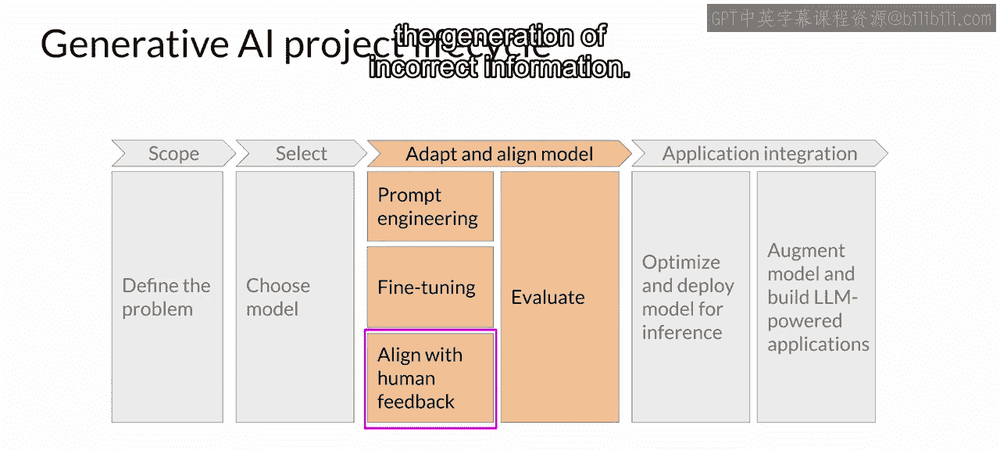
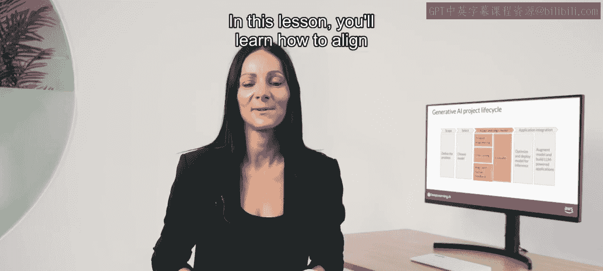

# 吴恩达《使用大型语言模型的生成式人工智能》Generative AI with Large Language Models - P29：28_与人类价值观的对齐.zh - GPT中英字幕课程资源 - BV1Cw411q7wm

Welcome back。Let's come back to the generative VI Project Lifecycle。

Last week， you looked closely at a technique called fine tuning。

The goal of fine tuning with instructions， including path methods。

 is to further train your models so that they better understand human like prompts and generate more human like responses。

This can improve a model's performance substantially over the original pre traineded base version。

And lead to more natural sounding language。

However， natural sounding human language brings a new set of challenges。By now。

 you've probably seen plenty of headlines about large language models behaving badly。

Issues include models using toxic language in their completions。

Replying in combative and aggressive voices。And providing detailed information about dangerous topics。

These problems exist because large models are trained on vast amounts of text data from the Internet。

 where such language appears frequently。Here are some examples of models behaving badly。

Let's assume you want your L L M to tell you a numuck joke。And the model's response is just clap。

 clap。While funny in its own way， it's not really what you were looking for。

The completion here is not a helpful answer for the given task。Similarly。

 the L L M might give misleading or simply incorrect answers。

 If you ask the L L M about a disproven piece of health advice。

Like coughing to stopub a heart attack。The model should refute this story。Instead。

 the model might give a confident and totally incorrect response。

 Defite not the truthful and honest answer a person is seeking。Also。

 the L LM shouldn't create harmful completions， such as being offensive。

 discriminatory or eliciting criminal behavior， as shown here。

 when you ask the model how to hack your neighbor's wfi and it answers with a valid strategy。Ideally。

 it would provide an answer that does not lead to harm。These important human values， helpfulness。

 honesty and harmlessness are sometimes collectively called H， H， H。

And are a set of principles that guide developers in the responsible use of AI。

Additional fine tuning with human feedback helps to better align models with human preferences and to increase the helpfulness。

 honesty and harmlessness of the completions。 This further training can also help to decrease the toxicity of a models' responses and reduce the generation of incorrect information。

😊。

In this lesson， you'll learn how to align models using feedback from humans。

Join me in the next video to get started。