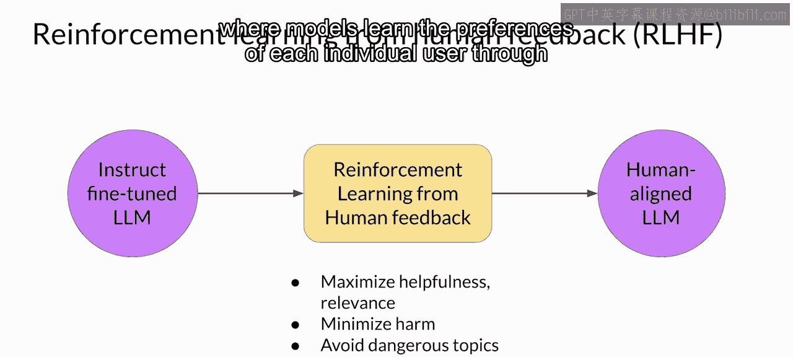
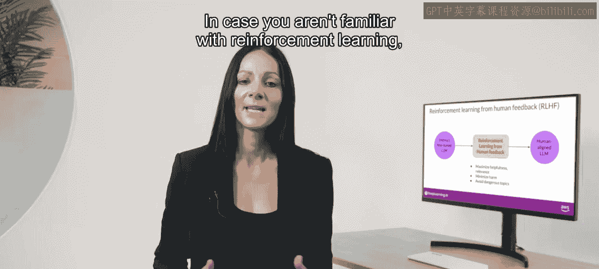
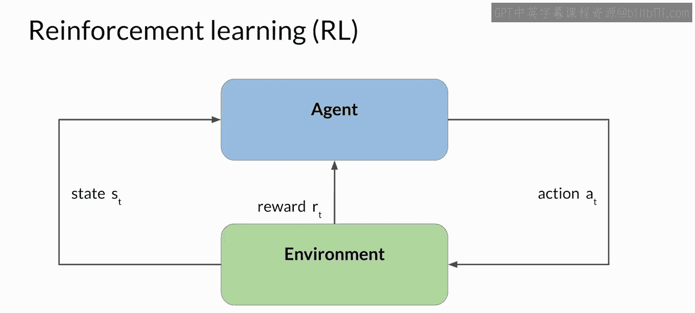
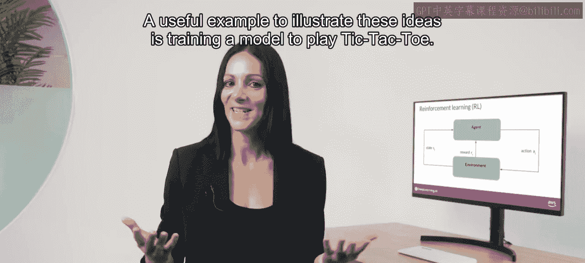
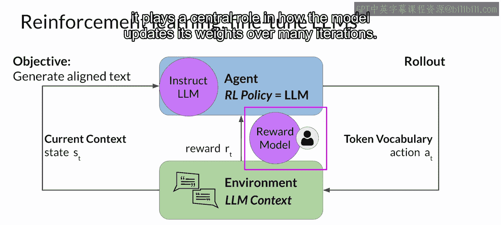

# 吴恩达《使用大型语言模型的生成式人工智能》Generative AI with Large Language Models - P30：29_从人类反馈的强化学习.zh - GPT中英字幕课程资源 - BV1Cw411q7wm

Let's consider the task of text summarization where you use a model to generate a short piece of text that captures the most important points in a longer article。

Your goal is to use fine tuning to improve the model's ability to summarize by showing it examples of human generated summaries。

In 2020， researchers at Open AI published a paper that explored the use of fine tuning with human feedback to train a model to write short summaries of text articles。

 Here you can see that a model fine tuneund on human feedback produced better responses than a pretrained model and instruct fine tune model and even the reference human baseline。

A popular technique to find you in large language models with human feedback is called reinforcement learning from human feedback or R HF。

 for short。As the name suggests， R HF uses reinforcement learning or R L for short to fine tune in the L LM with human feedback data。

Resulting in a model that is better aligned with human preferences。

You can use R HF to make sure that your model produces outputs that maximize usefulness and relevance to the input prompt。

Perhaps most importantly， R A can help minimize the potential for harm。

You can train your model to give caveats that acknowledge their limitations and to avoid toxic language and topics。

One potentially exciting application of RHF is the personalizations of LLMs。

 where models learn the preferences of each individual user through a continuous feedback process。

 This could lead to exciting new technologies like individualized learning plans or personalized AI assistance。

But in order to understand how these future applications might be made possible。

 let's start by taking a closer look at how RHF works。

In case you aren't familiar with reinforcement learning。

 here's a high level overview of the most important concepts。

Reinforcement learning is a type of machine learning in which an agent learns to make decisions related to a specific goal by taking actions in an environment with the objective of maximizing some notion of a cumulative reward。

In this framework， the agent continually learns from its experiences by taking actions。

 observing the resulting changes in the environment。

 and receiving rewards or penalties based on the outcomes of its actions。

By iterating through this process， the agentN readily refines its strategy or policy to make better decisions and increase its chances of success。

A useful example to illustrate these ideas is training a model to play Tiktk to。 Let's take a look。

In this example， the agent is a model or policy acting as atictke player。

Its objective is to win the game。The environment is the three by three game board and the state at any moment is the current configuration of the board。

The action space comprises all the possible positions a player can choose based on the current board state。

The agent makes decisions by following a strategy known as the RL policy。Now。

 as the agent takes actions， it collects rewards based on the actions' effectiveness in progressing towards a win。

 The goal of reinforcement learning is for the agent to learn the optimal policy for a given environment that maximizes their rewards。

 This learning process is iterative and involves trial and error。Initially。

 the agent takes a random action， which leads to a new state。From this state。

 the agent proceeds to explore subsequent states through further actions。

The series of actions and corresponding states form a play out， often called a rollout。

As the agent accumulates experience， it gradually uncovers actions that yield the highest long term rewards。

 ultimately leading to success in the game。 Now， let's take a look at how the Titktoe example can be extended to the case of fine tuning large language models with R HF。

😊，In this case， the agent's policy that guides the actions is the LLM。

And its objective is to generate tax that is perceived as being aligned with the human preferences。

This could mean that the text is， for example， helpful， accurate and nontoxic。

The environment is the context window of the model。

 the space in which text can be entered by our prompt。

The state that the model considers before taking an action is the current context。

 that means any text currently contained in the context window。

The action here is the act of generating text。This could be a single word， a sentence。

 or a longer form text depending on the task specified by the user。

The action space is the token vocabulary， meaning all the possible tokens that the model can choose from to generate the completion。

How an L M decides to generate the next token in a sequence depends on the statistical representation of language that it learned during its training。

At any given moment， the action that the model will take。

 meaning which token it will choose next depends on the prompt text in the context and the probability distribution over the vocabulary space。

Their reward is assigned based on how closely the completions align with human preferences。

Given the variation in human responses to language。

 determining the reward is more complicated than in the Titoe example。

One way you can do this is to have a human evaluate all of the completions of the model against some alignment metric。

 such as determining whether the generated text is toxic or non toxic。

This feedback can be represented as a scalar value， either a0 or a 1。

The LLM weights are then updated iteratively to maximize the reward obtained from the human classifier。

 enabling the model to generate nont completions。However。

 obtaining human feedback can be time consuming and expensive。

As a practical and scalable alternative， you can use an additional model known as the reward model to classify the outputs of the LLM and evaluate the degree of alignment with human preferences。

You'll start with a smaller number of human examples to train the secondary model by your traditional supervised learning methods。

Once trained， you'll use the reward model to assess the output of the LLM and assign a reward value。

Which in turn gets used to update the weights off the LLM and train a new human aligned version。

Exactly how the weights get updated as the model completions are assessed depends on the algorithm used to optimize the policy。

You'll explore these issues in more depth shortly。Lastly。

 note that in the context of language modeling， the sequence of actions in states is called a rollout instead of the term playout that's used in classic reinforcement learning。

The reward model is the central component of the reinforcement learning process。

 It encodes all of the preferences that have been learned from human feedback。

 and it plays a central role in how the model updates its weights over many iterations。😊。

In the next video， you'll see how this model is trained and how you use it to classify the model's outputs during the reinforcement learning process。

 Let's move on and take a look。😊。

