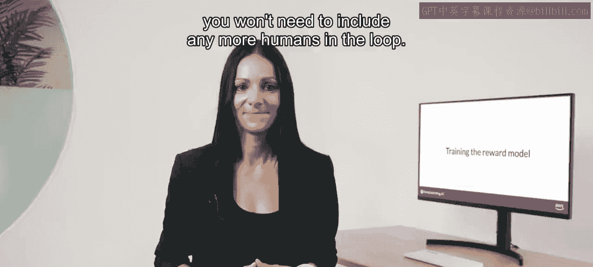
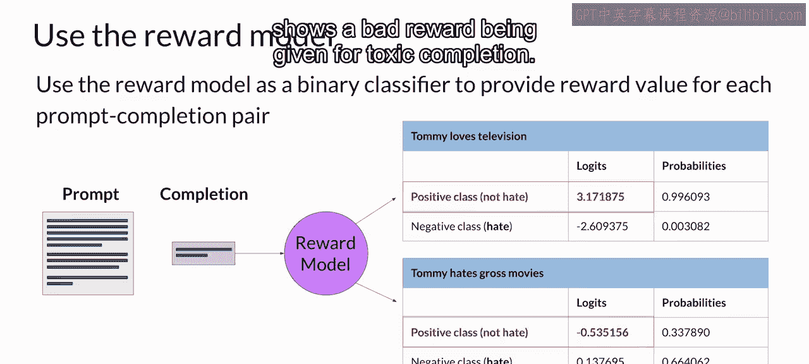

# 吴恩达《使用大型语言模型的生成式人工智能》Generative AI with Large Language Models - P32：31_奖励模型.zh - GPT中英字幕课程资源 - BV1Cw411q7wm

Okay， at this stage， you have everything you need to train the reward model。

While it has taken a fair amount of human effort to get to this point。

 by the time you are done training the reward model。

 you won't need to include any more humans in the loop。

Instead， the reward model will effectively take place off the human laborer and automatically choose the preferred completion during the RHF process。

This reward model is usually also a language model， for example。

 B that is trained using supervised learning methods on the pairwise comparison data that you prepared from the human laborers assessment of the prompts。

For a given prompt X， the reward model learns to f of the human preferred completion y sub J。

 while minimizing the loxigmoid off the reward difference， r sub J minus r sub K。

As you saw on the last slide， the human preferred option is always the first one labeled Y sub J。

Once the model has been trained on the human ranked prompt completion Paris。

 you can use the reward model as a binary classifier to provide a set of logics across the positive and negative classes。

Logs are the unnormalized model outputs before applying any activation function。

Let's say you want to detoxify your L L M， and the reward model needs to identify if the completion contains hate speech。

In this case， the two classes would be not hate， the positive class that you ultimately want to optimize for and hate the negative class you want to avoid。

The logic value of the positive class is what you use as the reward value in RHF。

And just to remind you， if you apply a soft mix function to the logics。

 you will get the probabilities。The example here shows a good reward for a nont completion。

And the second example shows a bad reward being given for toxic completion。

H， I know this lesson has covered a lot so far。But at this point。

 you have a powerful tool in this reward model for aligning your L L M。

The next step is to explore how the reward model gets used in the reinforcement learning process to train your human aligned L LM。

Join me in the next video to see how this works。