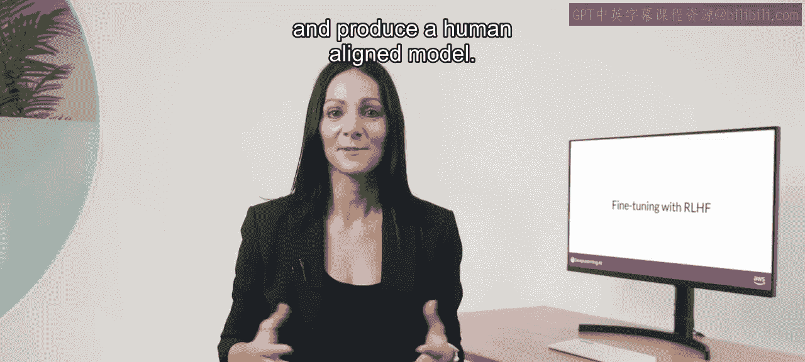
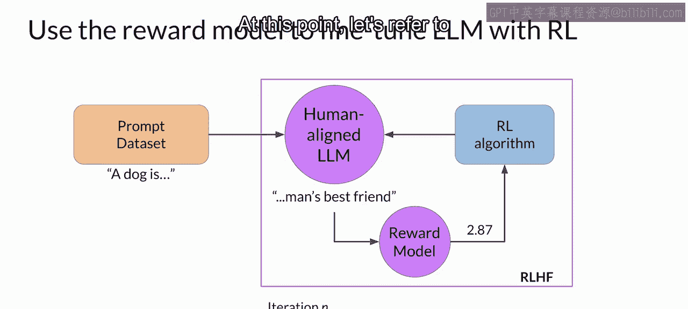
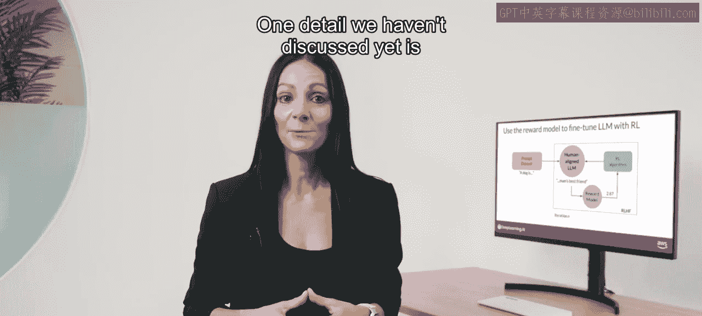
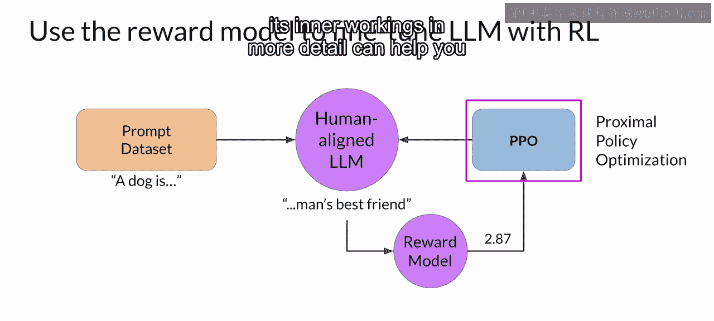
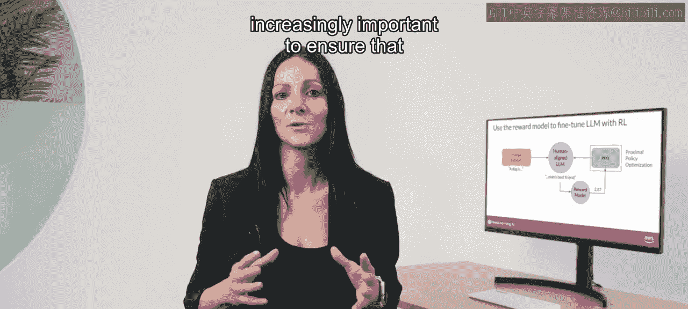

# 吴恩达《使用大型语言模型的生成式人工智能》Generative AI with Large Language Models - P33：32_强化学习微调.zh - GPT中英字幕课程资源 - BV1Cw411q7wm

Okay， let's bring everything together and look at how you will use the reward model in the reinforcement learning process to update the LLM weights and produce a human aligned model。

 Remember， you want to start with a model that already has good performance on your task of interest。

 so you'll work to align an instruction find tune and LLM。😊。

First， you'll pass a prompt from your prompt data set。 In this case， a dog is to the instruct LLM。

 which then generates a completion。 In this case， a furry animal。Next。

 you send this completion and the original prom to the reward model as the PRm completion pair。

The reward model evaluates the pair based on the human feedback it was trained on and returns a reward value。

A higher value such as 0。24 shown here， represents a more aligned response。

A less aligned response would receive a lower value， such as negative 0。53。

You'll then pass this reward value for the prom completion pair to the reinforcement learning algorithm to update the weights of the LLM and move it towards generating more aligned。

 higher reward responses。Let's call this intermediate version of the model the RL updatedated LLM。

This series off steps together forms a single iteration off the RHF process。

These iterations continue for a given number of epics， similar to other types of fine tuning。

Here you can see that the completion generated by the RL updated LLM receives a higher reward score。

 indicating that the updates to weights have resulted in a more aligned completion。

 if the process is working well， you'll see the reward improving after each iteration as the model produces text that is increasingly aligned with human preferences。

You will continue this iterative process until your model is aligned based on some evaluation criteria。

 for example， reaching a threshold value for the helpfulness you defined。

You can also define a maximum number of steps， for example，20000 as the stopping criteria。

At this point， let's refer to the fine unit model as the human aligned L LM。

One detail we haven't discussed yet is the exact nature of the reinforcement learning algorithm。

This is the algorithm that takes the output of the reward model and uses it to update the LLM model weights so that the reward score increases over time。

There are several different algorithms that you can use for this part of the RHF process。

A popular choice is proximal policy optimization， or PPO for short。P， P。

O is a pretty complicated algorithm， and you don't have to be familiar with all of the details to be able to make use of it。

However， it can be a tricky algorithm to implement。

 and understanding its inner workings in more detail can help you troubleshoot if you're having problems getting it to work To explain how the PP PO algorithm works in more detail。

 I invited my AWS colleague， Eke， to give you a deeper dive on the technical details。

This next video is optional， and you should feel free to skip it and move on to the reward hackging video。

😊，You won't need the information here to complete the quizzes or this week's lab。However。

 I encourage you to check out the details as R Jeff is becoming increasingly important to ensure that L LMs behave in a safe and aligned manner in deployment。

😊。

