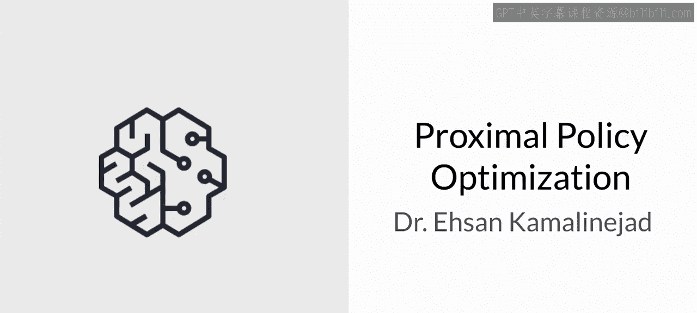
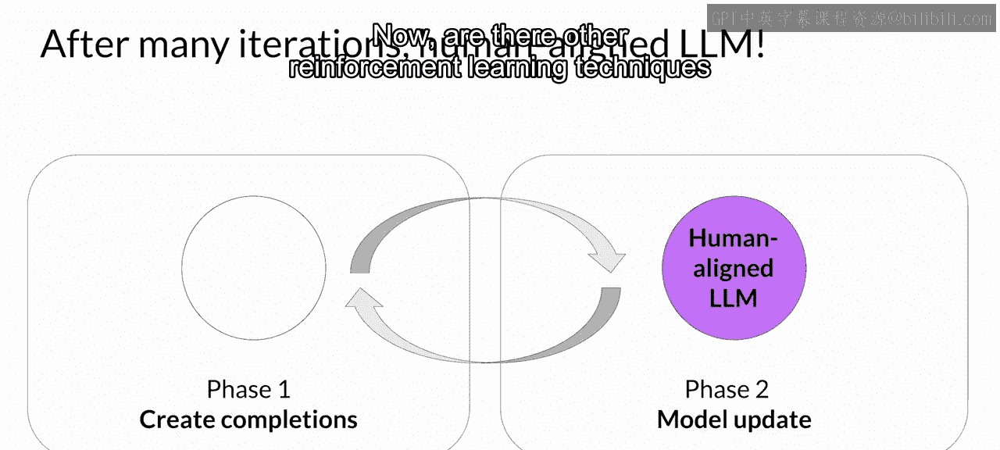

# 吴恩达《使用大型语言模型的生成式人工智能》Generative AI with Large Language Models - P34：33_可选视频-近端策略优化.zh - GPT中英字幕课程资源 - BV1Cw411q7wm

Dr。 Eson Kamalinnijad， who usually goes by EK， is a machine learning applied scientist。

He is currently a lead scientist working on MLLP developments at Amazon。Previousvily。

 he co founded Viual One， a Y combinator startup in computer vision。Before that。

 he was a tech lead machine learning engineer at Apple working on projects such as memories。

EK is also an associate professor of mathematics at California State University， East Bay。EK。

 thanks for joining me today to discuss the PPO reinforceforment learninging algorithm。

Thanks for having me。 So what does PPO stand for and what do those terms mean in the context of reinforcement learning。

PPOS stands for Proximal policy optimization， which is a powerful algorithm for solving reinforcement learning problems。

 as the name suggests PPO optimizes a policy， in this case the LLM to be more aligned with human preferences。

Over many iterations， PPO makes updates to the LLM。The updates are small and within a bounded region。

 resulting in an updated LLM that is close to the previous version。

 hence the name proximal policy optimization。Keeping the changes within this small region result in a more stable learning。

Okay， so the goal is to update the policy so that the reward is maximized。

Can you discuss how this works in the specific context of large language models？Yes。

 happy to you start PPO with your initial instructorstruct LL。

 then at a high level each cycle of PPO goes over two phrases。In phase1。

 the LLM is used to carry out a number of experiments completing the given prompts。

 These experiments allow you to update the LLM against the reward model in phase 2。

Remember that the reward model captures the human preferences， for example。

 the reward can define how helpful， harmless and honest the responses are。

The expected reward of a completion is an important quantity used in the PPO objective。

We estimate this quantity through a separate head of the LLM called the value function。

Let's have a closer look at the value function and the value loss。

Assume a number of prompts are given。First， you generate the LLM responses to the prompts。

Then you calculate the reward for the PRm completions using the reward model， for example。

 the first PRm completion shown here might receive a reward of 1。87。

The next one might receive a reward of negative1。24 and so on。

You have a set of prom completions and their corresponding rewards。

The value function estimates the expected total reward for a given state S。In other words。

 as the LLM generates each token of a completion， you want to estimate the total future reward based on the current sequence of tokens。

You can think of this as a baseline to evaluate the quality of completions against your alignment criteria。

Let's say that at this step of completion， the estimated future total reward is 0。34。

And with the next generated token， the estimated future total reward increases to 1。23。

The goal is to minimize the value loss， that is the difference between the actual future total reward in this example 1。

87 and its approximation through the value function in this example 1。23。

The value loss makes the estimates for future rewards more accurate。

The value function is then used in advantage estimation in phase2， which we will discuss in a bit。

 This is similar to when you start writing a passage and you have a rough idea of its final form even before you write it Okay Eke。

 so you mentioned that the losses and rewards determined in phase1 are used in phase2 to update the weights resulting in an updated LLM Can you explain this process in a little bit more detail Sure。

In phase two， you make small updates to the model and evaluate the impact of those updates on your alignment goal for the model。

The model weights updates are guided by the prompt completion， losses and rewards。

PPO also ensures to keep the model updates within a certain small region called the trust region。

This is where the proximal aspect of PPO comes into play。Ideally。

 this series of small updates will move the model towards higher rewards。

 The PPO policy objective is the main ingredient of this method。Remember。

 the objective is to find a policy whose expected reward is high。In other words。

 you're trying to make updates to the LLM weights that result in completions more aligned with human preferences and so receive a higher reward。

The policy loss is the main objective that the PPO algorithm tries to optimize during training。

I know the math looks complicated， but it's actually simpler than it appears。

 Let's break it down step by a step。First， focus on the most important expression and ignore the rest for now。

Pi of a sub T given S sub T in this context of an LLM。

Is the probability of the next token a sub T given the current prompt S sub T。

The action a sub T is the next token， and the state S sub T is the completed prompt up to the token T。

The denominator is the probability of the next token with the initial version of the LLM。

 which is frozen。The numerator is the probabilities of the next soken through the updated LLM。

 which we can change for a better reward。A hat sub T is called the estimated advantage term of a given choice of action。

The advantage term estimates how much better or worse the current action is compared to all possible actions at that state。

So we look at the expected future rewards of a completion following the new token。

 and we estimate how advantageous this completion is compared to the rest。

There is a recursive formula to estimate this quantity based on the value function that we discussed earlier here we focus on intuitive understanding。

Here is a visual representation of what I just described。

You have a prompt S and you have different paths to complete it。

 illustrated by different paths on the figure。The advantage term tells you how better or worse the current token a sub T is with respect to all the possible tokens in this visualization。

 the top path which goes higher is better completion receiving a higher reward。

 the bottom path goes down which is a worse completion。So I do have a question， EK。

 why does maximizing this term lead to higher rewards Let's consider the case where the advantage is positive for the suggested token。

A positive advantage means that the suggested token is better than the average。Therefore。

 increasing the probability of the current token seems like a good strategy that leads to higher rewards。

This translates to maximizing the expression we have here。

If the suggested token is worse than average。The advantage will be negative。Again。

 maximizing the expression will demote the token， which is the correct strategy。

 So the overall conclusion is that maximizing this expression results in a better aligned LLM。Okay。

 great。 so let's just maximize this expression then， right？

Directly maximizing the expression would lead into problems because our calculations are reliable under the assumption that our advantage estimations are valid。

The advantage estimates are valid only when the old and new policies are close to each other。

 This is where the rest of the terms come into play。

 So stepping back and looking at the whole equation again。

 what happens here is that you pick the smaller of the two terms。

The one we just discussed and this second modified version of it。

Notice that this second expression defines a region where two policies are near each other。

These extra terms are guardrails and simply define a region in proximity to the LLM where our estimates have a small errors。

 This is called the trust region。And these extra terms ensure that we are unlikely to leave the trust region。

In summary， optimizing the PPO policy objective results in a better LLM without overshooting to unreliable regions。

And are there any additional components？Yes， you also have the entropy loss。

While the policy loss moves the model towards alignment goal。

 entropy allows the model to maintain creativity。If you kept entropy low。

 you might end up always completing the prompt in the same way as shown here。😡。

Higher entropy guides the LLM towards more creativity。

This is similar to the temperature setting of L L M that you've seen in week 1。

The difference is that the temperature influences model creativity at the inference time while the entropy influences the model creativity during training。

 putting all terms together as a weightted sum， we get our PPU objective。

 which updates the model towards human preference in a stable manner。

This is the overall PPU objective。The C1 and C2 coefficients are hyperpara。

The PPO objective updates the model weights through back propagation over several steps。

 Once the model weights are updated， PPO starts a new cycle。For the next iteration。

 the LLM is replaced with the updated LLM and a new PPO cycle starts。After many iterations。

 you arrive at the human All LLM。Now， are there other reinforcement learning techniques that are used for R HF。

Yes， for example， Q learning is an alternate technique for fine tuning LLMs through RL。

 but PPO is currently the most popular method In my opinion。

 PPO is popular because it has the right balance of complexity and performance That being said。

 fine tuning LLMs through human or AI feedback is an active area of research。

 and we can expect many more developments in this area in their near future。 For example。

 just before we were recording this video， researchers at the Stanford published a paper describing a technique called direct preference optimization。

 which is a simpler alternate to RLHF。 new methods like this are still in active development and more work has to be done to better understand their benefits。

 but I think this is a very exciting area of research。Agree， Thanks so much， Eke。

 for sharing those insights into PP，O and reinforcement learning。 Thanks， Ana。

 and thanks for having me。😊。