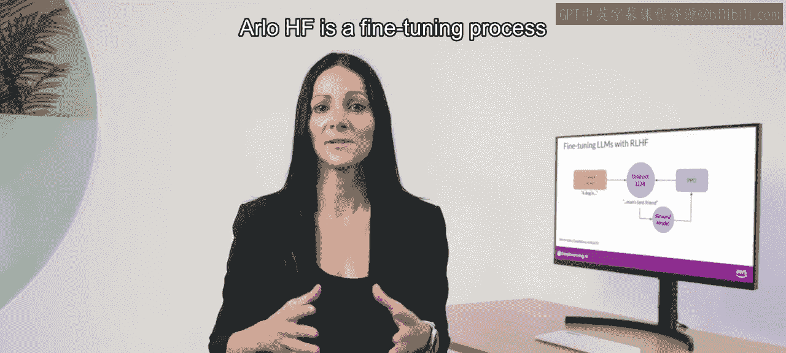
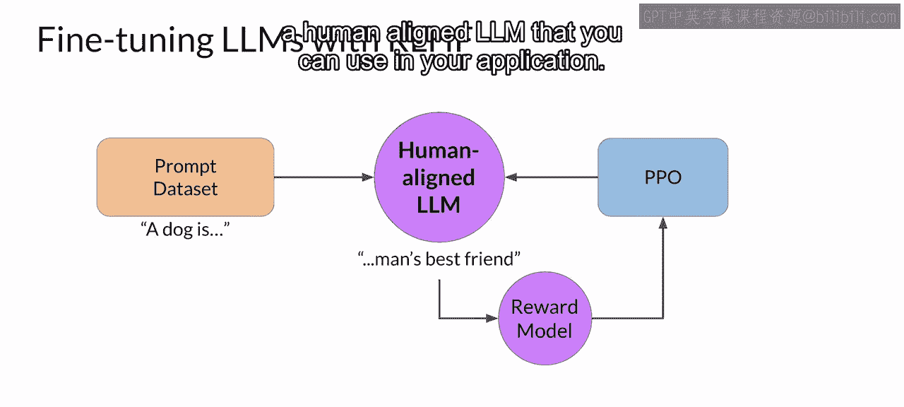
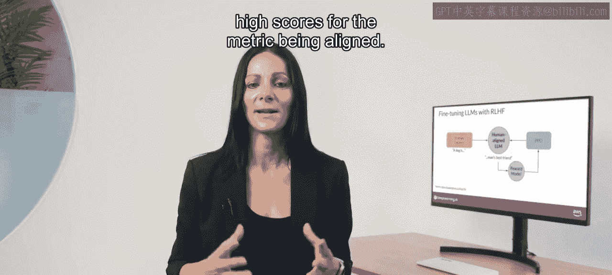
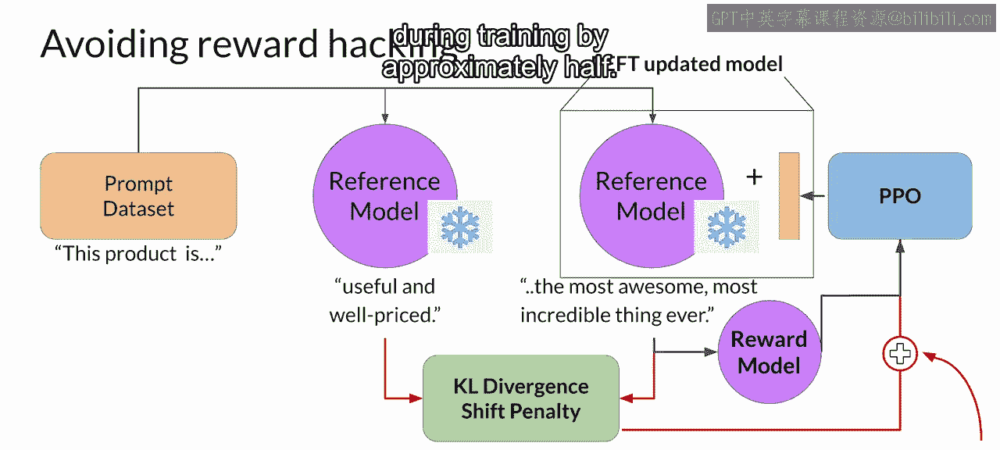
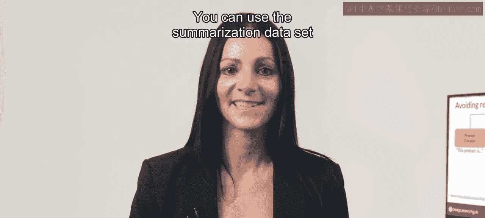
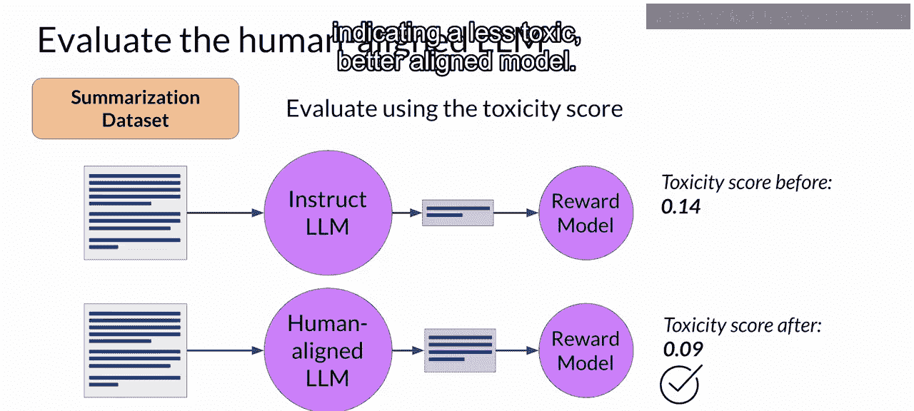

# 吴恩达《使用大型语言模型的生成式人工智能》Generative AI with Large Language Models - P35：34_奖励欺骗.zh - GPT中英字幕课程资源 - BV1Cw411q7wm

So let's recap what you've seen so far。RHF is a fine healing process that aligns LLMs with human preferences In this process。

 you make use of a reward model to assess an LLM's completions of a prompt data set against some human preference metric like helpful or not helpful。

 Next， you use a reinforcement learning algorithm。 In this case。

 PPO to update the weights of the LLM based on the reward assigned to the completions generated by the current version of the LLM。

You'll carry out this cycle over multi iterations using many different prompts and updates of the model weights until you obtain your desired degree of alignment。

Your end result is a human aligned LLM that you can use in your application。

An interesting problem that can emerge in reinforcement learning is known as reward hacking。

 where the agent learns to cheat the system by favoring actions that maximize the reward received。

 even if those actions don't align well with the original objective。In the context of LLMs。

 reward hacking can manifest as the addition of words or phrases to completions that result in high scores for the metric being aligned。

But that reduce the overall quality of the language。 For example。

 suppose you are using R HF to detoxify and instruct model。

You have somebody trained a reward model that can carry out sentiment analysis and classify model completions as toxic or nont。

 You select the prompt from the training data This product is and pass it to the Instruct N L M。

 which generates a completion。😊，This one， complete garbage， is not very nice。

 and you can expect it to get a high toxic rating。The completion is processed by the Tity reward model。

 which generates a score， and this is fed to the PPO algorithm。

 which uses it to update the model weights。As you iterate。

 RLHF will update the LLM to creating less toxic responses。However。

 as the policy tries to optimize the reward， it can diverge too much from the initial language model。

In this example， the model has started generating completions that it has learned will lead to very low toxicity scores by including phrases likeMost awesome。

 most incredible。This language sounds very exaggerated。

 The model could also start generating nonsensical。

 grammatically incorrect text that just happens to maximize reward in a similar way。

Outputs like this are definitely not very useful。To prevent your board hacking from happening。

 you can use the initial Instruct NLM as a performance reference。Let's call it the reference model。

The weights of the reference model are frozen and are not updated during iterations of R HF。This way。

 you always maintain a single reference model to compare to。During training。

 each prompt is passed to both models， generating a completion by the reference LLM and the intermediate RL updated model。

At this point， you can compare the two completions and calculate a value called the Colbec labblar divergence or kale divergence for short。

Kale divergence is a statistical measure of how different two probability distributions are。

You can use it to compare the completions of the two models and determine how much the updated model has diverged from the reference。

Don't worry too much about the details of how this works。

 The Kale Dirgence algorithm is included in many standard machine learning libraries。

 and you can use it without knowing all the math behind it。

You'll actually make use of kale divergence in this week's lap so you can see how this works for yourself。

😊，Calververrgence is calculated for each generated token across the whole vocabulary of the LLM。

This can easily be tens or hundreds of thousands of tokens。However， using a softm function。

 you reduce the number of probabilities to much less than the full vocabulary size。

Keep in mind that this is still a relatively compute， expensive process。

 So you will almost always benefit from using GPSus。

 Once you've calculated the k divergence between the two models。

 you add it as a term to the reward calculation。This will penalize the RL updated model if it shifts too far from the reference LLM and generates completions that are too different Note that you now need two full copies of the LLM to calculate the KLDrgins。

 the frozen reference LLM and the RL updated PPO LLM。By the way。

 you can benefit from combining R HF with Pft。In this case。

 you only update the weights of a path adapter， not the full weights of the N LM。

This means that you can reuse the same underlying LLM for both the reference model and the PPO model。

 which you update with the trained path parameters。This reduces the memory footprint during training。

 by approximately half。

I know that there is a lot to take in here， but don't worry。

 RHF with Pft is going to be covered in the lab。 so you'll get a chance to see this in action and try it out for yourself。

Once you have completed your RLHF alignment of the model。

 you will want to assess the model's performance。 You can use the summarization data set to quantify the reduction in toxicity。

 For example， the dialogue sum data set that you saw early in the course。

The number you'll use here is the toxicity score。 This is the probability of the negative class。

 In this case， a toxic or hateful response averaged across the completions。

If RJ has successfully reduced the toxicity of your LLM， this score should go down。First。

 you'll create a baseline toxicity score for the original Instruct LLM by evaluating its completions off the summarization dataset with a reward model that can assess toxic language。

 then you'll evaluate your newly human aligned model on the same data and compare the scores。

In this example， the toxicity score has indeed decreased after R HF， indicating a less toxic。

 better aligned model。 Again， you'll see all of this in this week's lab。

