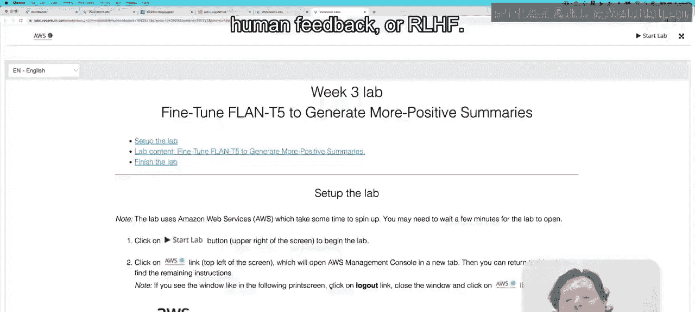
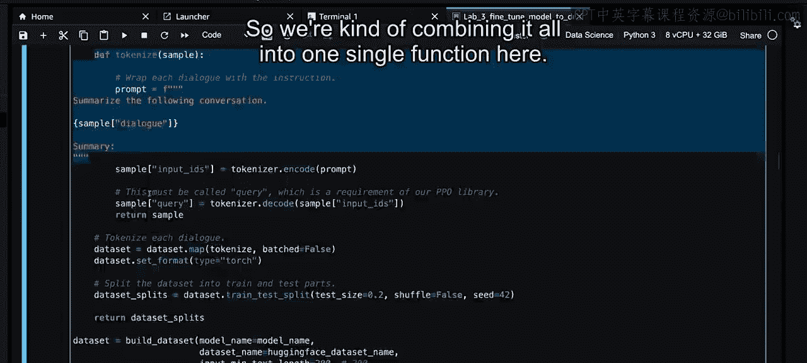
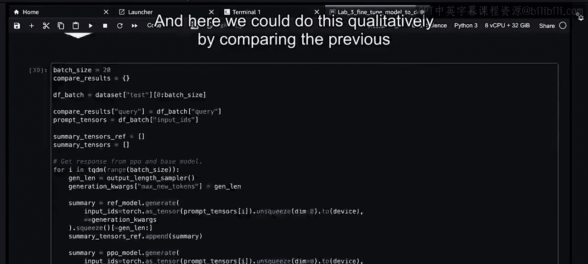

# 吴恩达《使用大型语言模型的生成式人工智能》Generative AI with Large Language Models - P37：36_实验室3演练.zh - GPT中英字幕课程资源 - BV1Cw411q7wm

This lesson on RLHF introduced a lot of new terms and concepts my colleague Chris has put together an exciting lab that implements what you explored in these videos。

So to get your hands dirty with RLHF， I'll hand it over to Chris to walk you through this week's notebook Hey。

 thanks Ana， and now it's time for Lab3。All right， welcome back everyone。

 we are going to talk about La3。Lab3 was one of my favorite to work on This is where we get handson with reinforcement learning and human feedback or RLHF The purpose of this lab is to lower the toxicity of our instruction fine tuneed model from La 2 that was the output of lab2 thatll be the input to lab3 here and we will lower the toxicity using a hate speech reward model where we want to optimize for not hate we'll be using PPO that you learned about in the lesson and we will wrap everything up with quantitative and then qualitative comparison of our detoxification process。

Okay let's install our Python libraries here we see that we're using Pytorch。

 We're also using the same transformers that we used in the previous labs。

 of course datas to get access to our public data evaluate so that we could run the Roe score Pft is the parameter efficient fine tuning library and here's a new library called TRl and this is what's going to give us access to PPO and a similar type of trainer and then training arguments。

 there's going to be PPO trainer and then training arguments following the huggingface convention of trainer and training arguments do a bunch of our imports up here familiar classes。

 the auto model for seek to seek note that there's a new one here which is auto model for sequence classification This is what we're going to use to load our Facebook binary classifier sequence classifier which when we give it a string of text or a sequence of text it'll tell us whether or not that text contains hate。

Spch or not with a particular distribution across not hate or hate and of course。

 in this lab will be optimizing for not hate Here we see our Pft and our Lauraura config which we saw in lab2 here we see the specific PPO trainer there's also this other class auto model for seek to seek language model with a value head This is what's required when we do the PPO training。

 which we'll see in a bit Also this length sampler this will give us the ability to filter or actually sample from our text various lengths so we don't actually have to pull in the entire sequence we can pull in just different samples and this comes in handy when we're trying to either sample from our full data set even though it's beyond the you know 512 context window we may want to sample up to 512 in some cases you would actually just throw away samples that are larger than 512 with length sampler for example we can just sample the first five。

12 or take samples within the sequence， maybe not starting from the beginning but maybe in the middle or towards the end and so length sampler is kind of nice and we see Pytor to evaluate if you haven't seen this before TQDM this is where typically when you see progress bars showing up in Jupiter notebooks or on your command line。

 they come from this TQDM library as before we're going to load our data set and then eventually our model here in a sec we have this build data set。

Python function that we've defined that can do the length sampling using that length sampler that was mentioned up above can also convert our text into those vectors also called tokenizing So here's where we start to see a little bit more complexity in our code the first couple labs we stayed pretty simple lab3 we start to do a little bit more pythonic type stuff。

 we have nested functions here to you know tokenize。

 we're starting to combine things into single functions and we're going to just say build the data set here。

 we're going to give it the model name we need the model name to know which tokenizer to use because again these models each have their own tokenizer if you try to mix and match tokenizers between different model types that's not good and you'll see some pretty bad results One other feature of this build data function is that we're going to wrap our data set into this instruction。

Prompt so this is something that we did in the first and second lab。

 So we're kind of combining it all into one single function here。

 Now this is the model that we trained in the second lab。 So I'm pulling it from cloud storage here。

 we pull it down and it should be in a folder here called PEft dial summary checkpoint to crack it open just to see here's the adapter model in again。

 that's the thing that's only 14 mebyte。 And here's our handy print number of trainable model parameters function that we'll use from time to time to get fancy and see when we're using Pft throughout this entire lab we will be using PEft。

 So for the most part， we'll be just training and fine tuning very small percentage of our model size。

 So here once again1。4%。 Now here's where we have to use this variant of the auto model for tose Lm which is with value head。

 So this is related to how PPO。

Actually performs。It's training And here， by the way， just to be clear。

 we do say is trainable equals true。 And that's on purpose because we are actually putting the model into fine tuning mode。

 And then later on when we go to make predictions and to generate summaries。

 we will set that to false。 So if you notice this number is a little bit higher than it was in lab2 and it's higher by exactly 769 parameters And so let me explain what's happening there。

768 of those parameters are from the value head。 actually all 769 come from the value head at's 768 which is the dimension of the value head plus our bias and bias is very important by the way。

 it's just because it it's always there people just tend to not included in their casual conversations。

 Now I skipped over this create reference model this actually comes from Trl we had imported this up above And what this is doing is as you learned about in the。

ssonWhen we do RLHF， you can specify a base model that's used with KL divergence to make sure that while the reward function is being optimized while we are optimizing to maximize the reward which in this case is not hate speech we don't want to just wildly hacked that reward and just generate things that are not hate but that are not relevant to the original so said differently when we go to train。

 we're going pass in two models， what's called a reference model。

 which is a model that is not going to be fine-ted at all， not even with PEft。

 it's just the original instruction fineted model that was the output of lab2 that's now the input for La3 and then KL divergence is used to compare what would the original model have generated versus what would the current PPO model have generated and then keeps things sort of in line that way。

And then minimizes the model's ability to perform the reward hacking。So we'll see it here in a bit。

 Here's where we're actually going to load what I'm calling the toxicity model。 Again。

 this comes from Facebook。 It was designed to detect hate speech。

 It's based on Bt Facebook has a variance of birdss called Roberta So this model is on the order of millions of parameters not in the billions and billions like the large language models that we have today。

 Now that that model is loaded。 So again， here's where we use the auto model for sequence classification。

 So this is a classifier in this case， there's only two labels and that's what is going to make this a binary classifier。

 It's not hate or it's hate and we'll see that in action here。 Here is a sample nontoxic text。

 I want to kiss you pretty friendly piece of text here。

 and we see different ways that this model can actually generate output for this text can actually classify this text。

 Just know that the first spot， the most important。

Important thing is the first slot that this model can generate the first class is not hate and that becomes very important H is in the second position or zero index it's the first index so zero index is not hate first index the one index is hate and we see that not hate is very high so these are the logits we can also of course perform a softm on those logits and we see that that the probability of this text being not toxic or not hate is essentially 100% probability that this model is or that this text is hate is very close to zero in our PPO training we will actually use the logit and it's very important to get the index right and I say this because if you accidentally optimize for the wrong index you can actually generate text that's more toxic which is。

Not what we're trying to do here today So I call this out and one thing that I did to actually make this more explicit is I call out the not hate index equals0 And the reason why this is confusing is in a lot of cases the sort of positive class is in the second position and the negative class in the zero with and so if you go and copy somebody else's code or you find an example online or have a friend help you you might accidentally mess up which index Here is an example of toxic text and now keep in mind I did have to use a bad word here to actually trigger this and so let's run it there and so here we see 97 almost 97 and a half percent probability that this is toxic or hate speech Now hate speech is extreme And so I do caution if you do try to play with these with this example that oftentimes you do have to be extreme to trigger the。

Hate flag so the good news is we're not optimizing for the hate flag。

 we're optimizing for the not hate flag。So let's keep going One thing we haven't shown much in these labs is what's called a huggingface inference pipeline and so this gets imported up above this was imported and here we're creating what's called a sentiment pipeline and the real value of these huggingface pipelines this is from the transformers library the real value is I can just say this is a sentiment analysis problem basically zero or sorry two classes and I give it the name of my model and then I can use this and I don't have to call all those low-level model generates and do the tokenizer and all that stuff this will actually do it all for us so again we did not use these in the first and second lab we are using it here just to reduce the complexity of this lab and really really focus on the RL part of it but I do want to show you that there are these things called the inference pipelines and they're very very handy。

You can mix and match as we're doing in this lab here sometimes you can use them sometimes you don't have to use them here we are setting up a toxicity evaluation mechanism and we're going to reuse the evaluate Python library which does have a firstclass knowledge of toxicity and so of course when we set this up we have to give it the toxicity model which in this case we're using Facebook Roberta hate speech model the other interesting thing is that we have to pass in the toxic label in this case the toxic label is hate and we will use this evaluator later on when we compare before and then after our PPO our reinforcement learning with human feedback here we see for the non-toxic text which we specified up above the I want to kiss you and the toxic text we see that these scores are consistent with what we're expecting。

Here is a convenience function where we pass in the model， pass in the data set。

 we can even tell it the number of samples to try and to calculate a mean toxicity score along with the standard deviation for a whole bunch of summaries that are generated。

 tell us what is the mean toxicity score， and so the goal is to reduce the mean toxicity score after we do PPO。

And so here we see what the mean and standard deviation toxicity is before。

We perform our detoxification。To reduce the toxicity of our generated summaries。

Here we're going to initialize the PPO trainer。 We have a PPO config as well too。

 These are really just sort of standard learning rates。

 We are doing a small number of the PPO epics again just to keep the time for this lab down to a reasonable number batch size here 16 not too bad and you can actually play with you know some of these values when you get into the lab here we see PPO trainer takes the reference model。

 So this we used up above when we called create reference model and that's essentially the original model that was the output of the lab too and that's what's going to be used for K divergence during PPO training Now we actually find tune in the model using RLHF This is the exciting part And so here we see Kale divergence which is something we want to minimize just like you learned in the lesson we don't want the k divergence to go too high。

 That means that the model is starting to。Haack the reward function and that's not good。

 It's just generating things to make the reward happy。

 It's not generating things that are actually similar to the original text that's being passed in for summarization and we're trying to maximize the mean return you know these are some of the PPO reinforcement learning concepts that you learned about in the slides maximize the advantage and this will run for about 20 minutes or so so go grab a cup of coffee and what's happening here is we're grabbing each of the samples that we provided from our dialogue data set and we're making a we're summarizing the text we're looking we're using the sentiment pipeline that we created up above that's going to classify both what's called the query which is the prompt and the response together so we're going zip those two together using the Python zip and we have query response We're going pass that pair in。

To the sentiment pipeline and ask the pipeline is this toxic is this hate or is this not hate that then gives us the logits for those query response pairs we're going to pull out the not hate score and we're going to pass all of this in to the PPO trainer so we're going to give it prompt we're going to give it the response or the summary and we're going to give it the score all of those three go in as lists as batches into our PPO trainer that's then going to perform a PPO step to minimize the loss function as you saw in the slides and this is where the actual gradients are being updated and now keep in mind that we're using PEft and so we're not actually modifying the base LLM parameters PEft we are just modifying the 1。

4% Lauraura PEft adapters that are being used during this fine tuning process。

We will run this for a bit， we see KL divergence is you know relatively stable around 27， 2829。

 it goes up， it comes down， that's PPO trying to keep things balanced and once this is done we will compare the model quantitatively as well as qualitatively。

After about 10 iterations we can compare the model that has been detoxified or has a reduced toxicity as compared to the original model and here we could do this qualitatively by comparing the previous response to the response after so here we see that the reward has actually gone up in a number of cases of these examples so query is the original text that we want to summarize the original conversation wrapped in that instruction prompt。

And we see the response before， we see the response after and we see that the model has determined that the reward model。

 the hate speech model has determined that the reward actually is more positive in a number of these if you were to train longer and had more time you would see this a you relatively significant difference the other thing to mention is because the reward model is so extreme that really to get the most benefit you would start with a relatively toxic data set。

 which this is not a relatively toxic data set and then you would see a much larger difference but here we see directionally by doing PPO and using the reward function that we're using the reward model for the hate speech that we can actually lower the overall toxicity of our model responses by a decent amount。

