# 吴恩达《使用大型语言模型的生成式人工智能》Generative AI with Large Language Models - P39：38_生成AI项目生命周期备忘单.zh - GPT中英字幕课程资源 - BV1Cw411q7wm

Everything you've seen so far in the course from selecting your model to fine tuning it and aligning it with human preferences will happen before you deploy your application。

To help you plan out these stages of the generative AI project lifecycle。

 this cheat sheet provides some indication of the time and effort required for each phase of work。

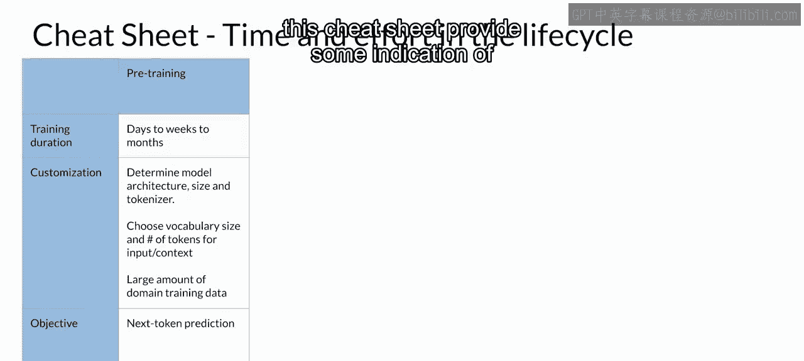

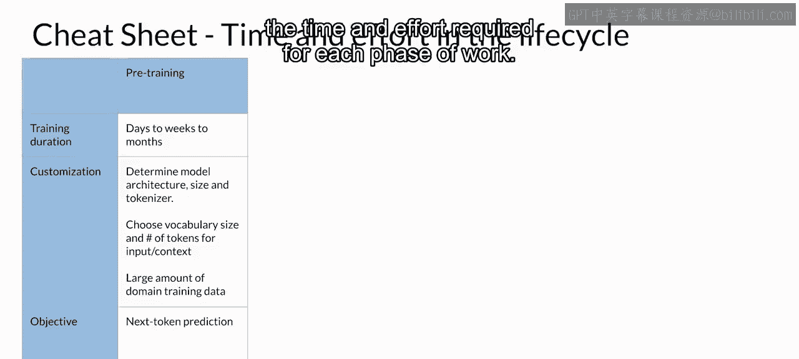

As you saw earlier， pre training a large language model can be a huge effort。

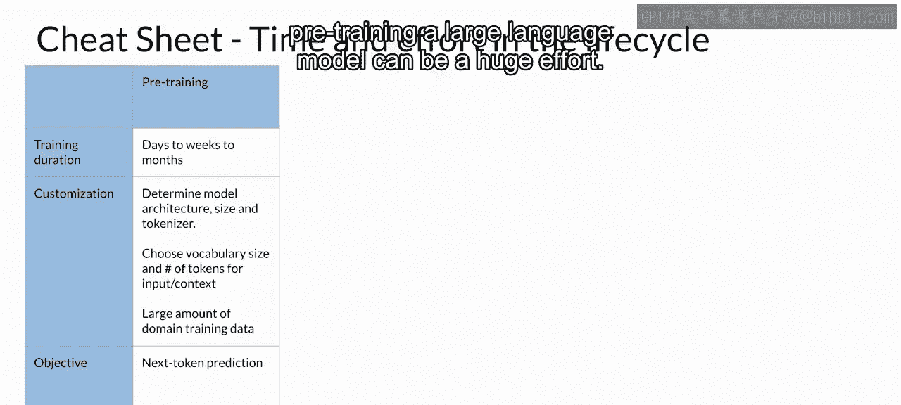

This stage is the most complex you'll face because of the model architecture decisions。

 the large amount of training data required， and the expertise needed。

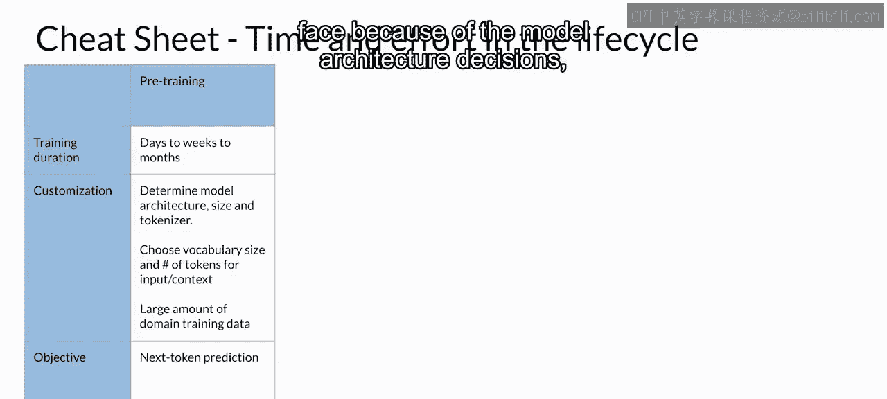

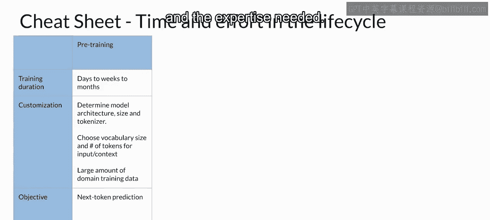

Remember， though， that in general， you'll start your development work with an existing foundation model。

 so you'll probably be able to skip this stage。

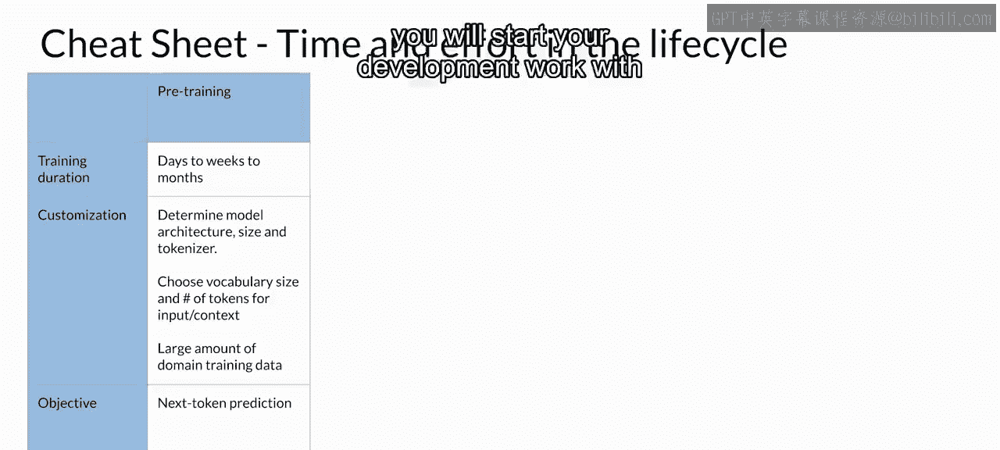

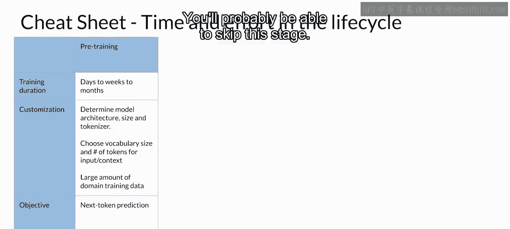

If you're working with a foundation model， you'll likely start to assess the model's performance through prompt engineering。

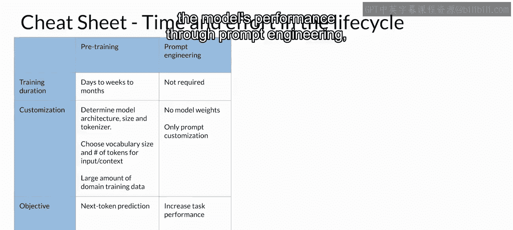

Which requires less technical expertise and no additional training of the model。

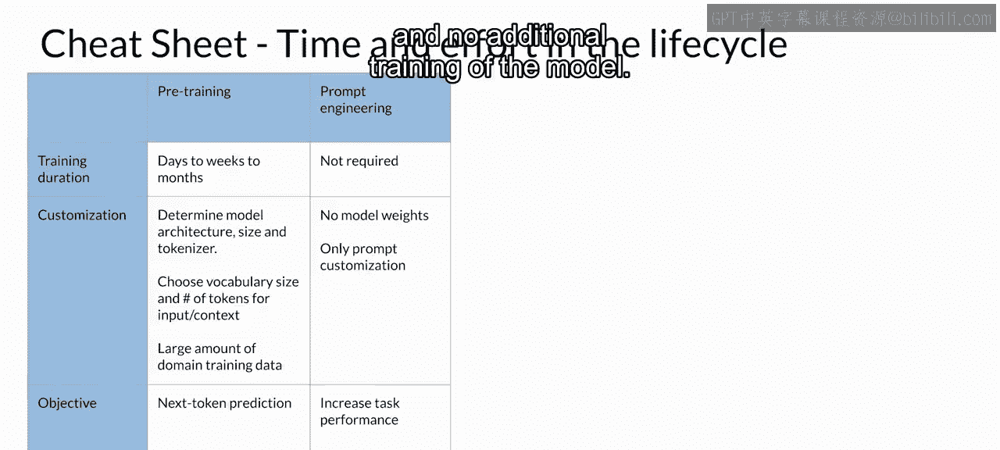

If your model isn't performing as you need， you'll next think about prompt tuning and fine tuning。

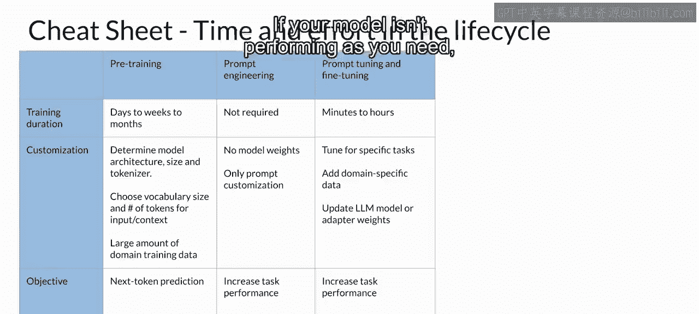

Depending on your use case， performance goals and compute budget。

 the methods you'll try could range from full fine tuning to parameter efficient fine tuning techniques like Laura or prompt tuning。

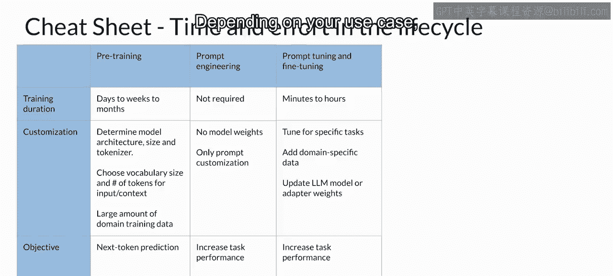

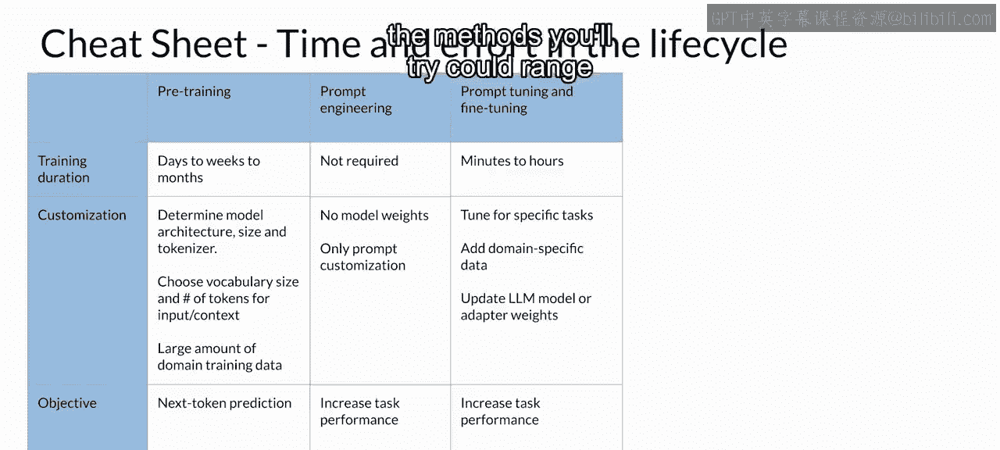

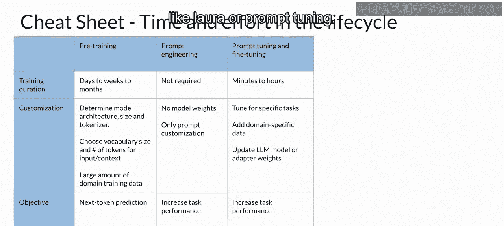

Some level of technical expertise is required for this work。

 but since fine tuning can be very successful with a relatively small training data set。

 this phase could potentially be completed in a single day。

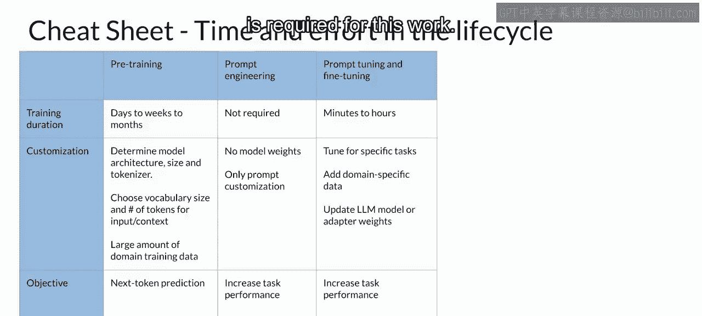

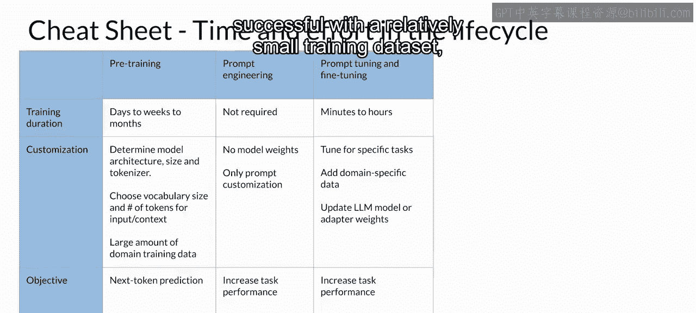

Aligning your model using reinforcement learning from human feedback can be done quickly once you have your trained reward model。

 So you'll likely see if you can use an existing reward model for this work。

 as you saw in this week's lab。 However， if you have to train a reward model from scratch。

 it could take a long time because of the effort involved to gather human feedback。

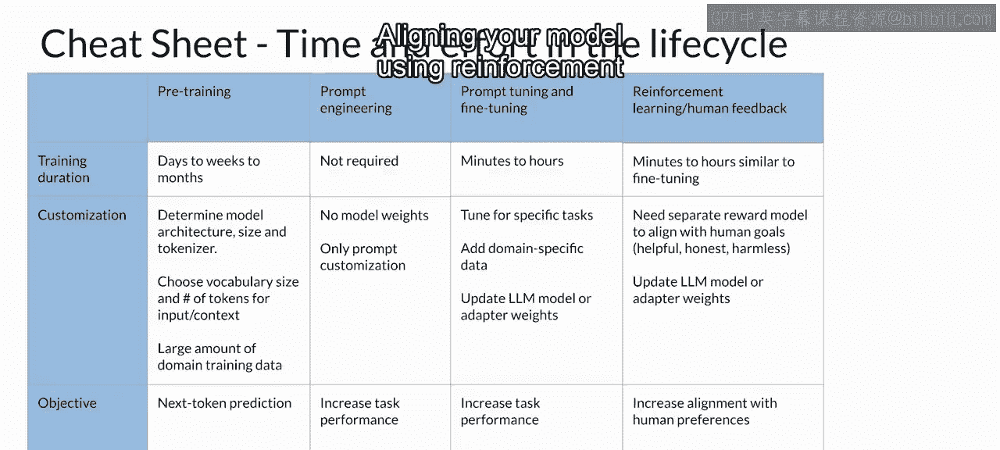

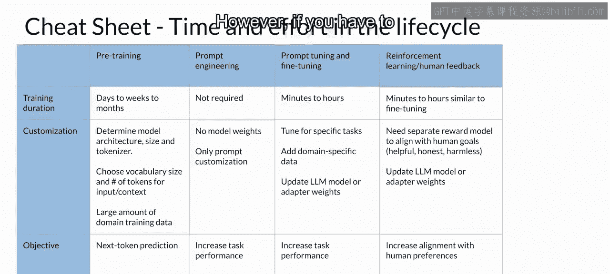

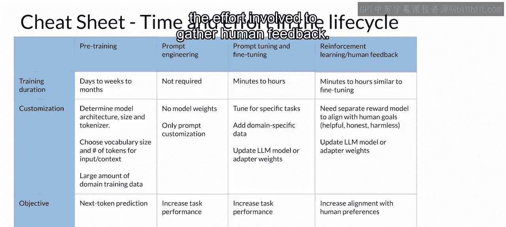

Finally， optimization techniques you learned about in the last video typically fall in the middle in terms of complexity and effort。

 but can proceed quite quickly， assuming the changes to the model don't impact performance too much。

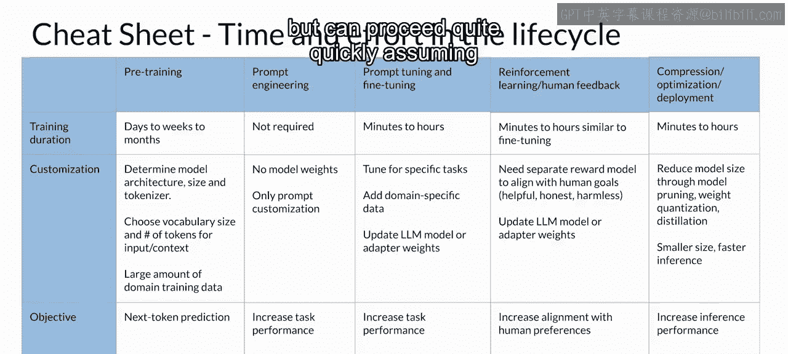

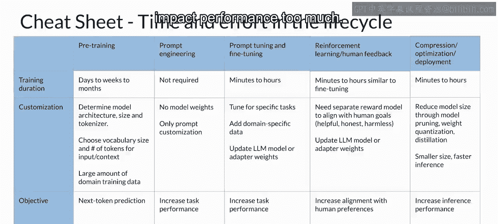

After working through all of these steps， you have hopefully trained and tuned a great LLM that is working well for your specific use case and is optimized for deployment。

 congratulations。In the final sequence of videos in this course。

 you'll explore the remaining problems with LLM performance that you may need to address before launching your application。

 as well as techniques that can overcome them。 Let's move on and take a look。

