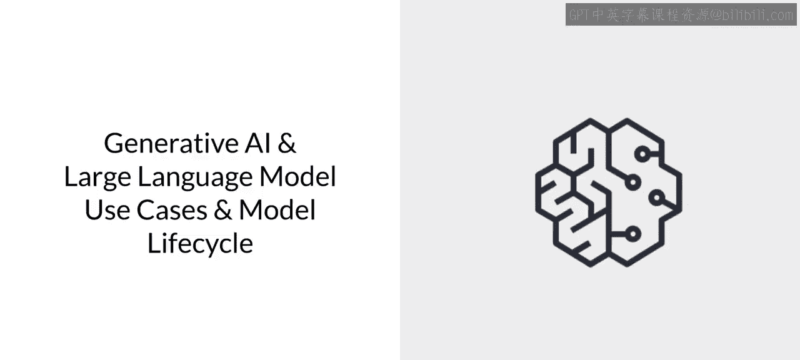
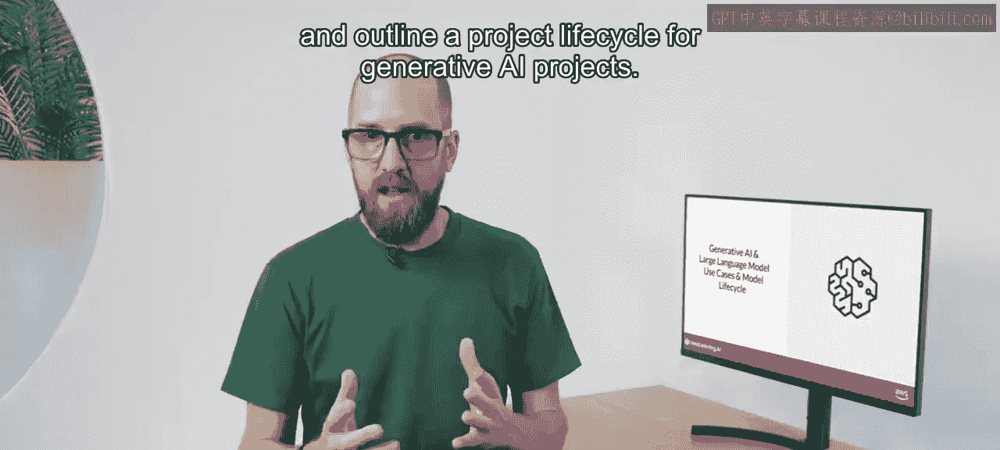
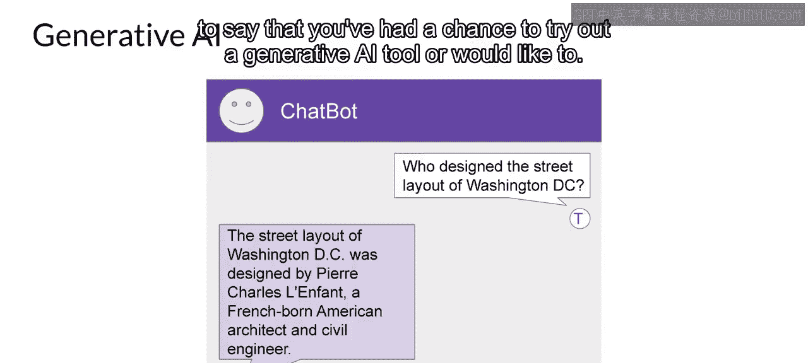
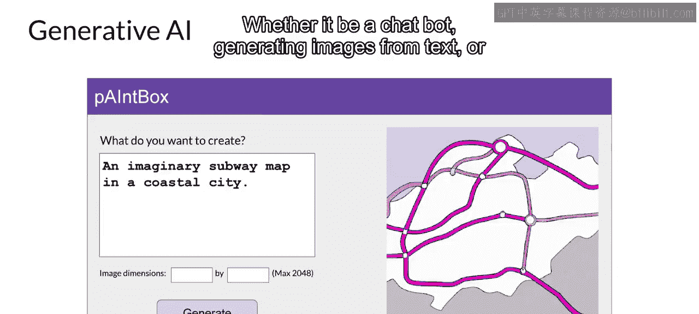
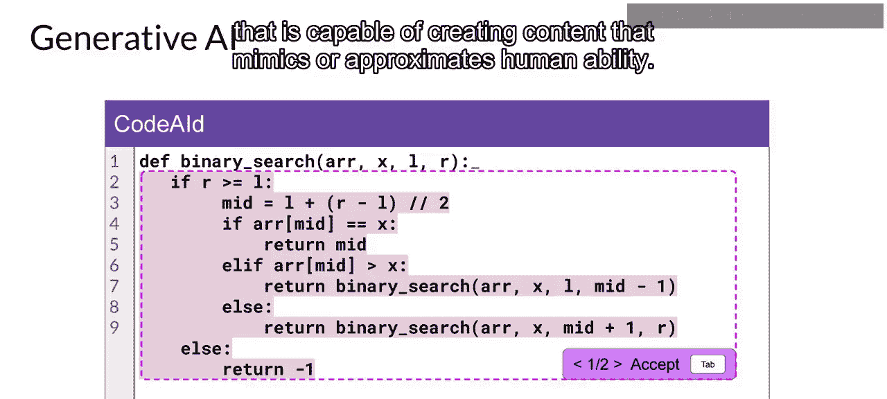
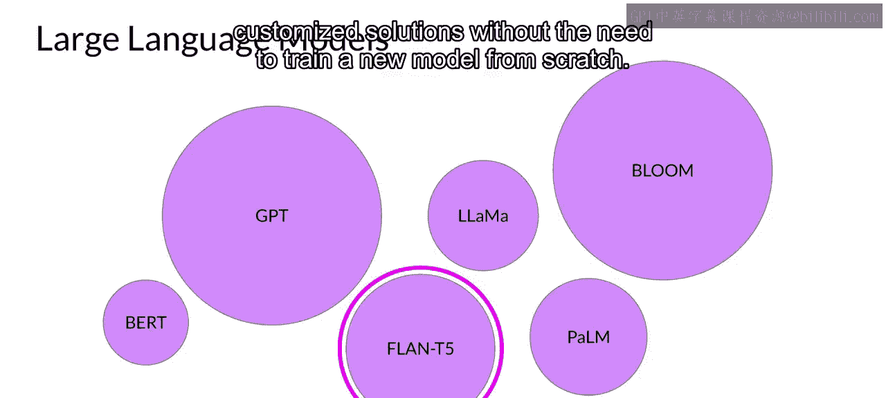
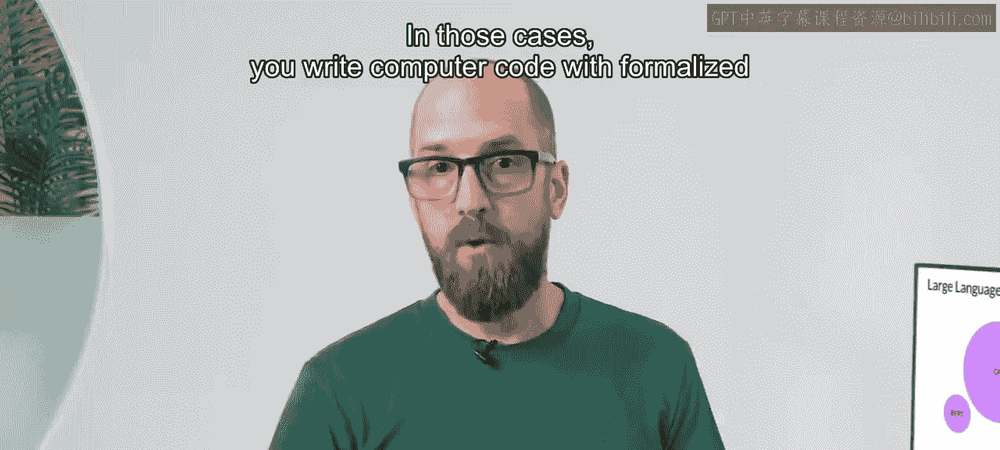
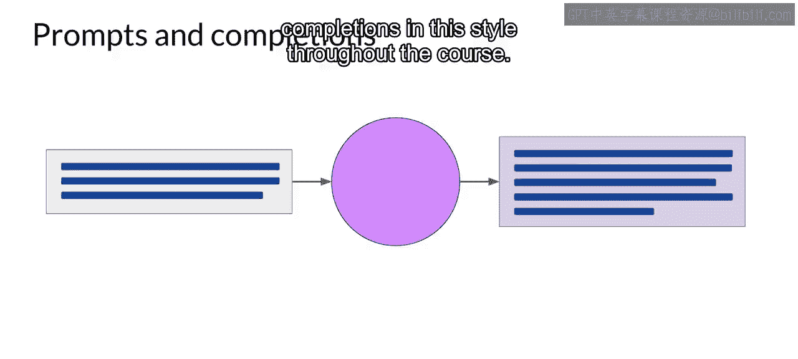

# 吴恩达《使用大型语言模型的生成式人工智能》Generative AI with Large Language Models - P3：2_生成式AI与大语言模型.zh - GPT中英字幕课程资源 - BV1Cw411q7wm

Okay， let's get started In this lesson， we're going to set the scene。

 We'll talk about large language models， their use cases， how the models work， prompt engineering。

 how to make creative text outputs and outline a project lifecycl for generative AI projects。😊。

Given your interest in this course， it's probably safe to say that you've had a chance to try out a generative AI tool or would like to。

 whether it be a chat bot generating images from text， or using a plugin to help you develop code。

 What you see in these tools is a machine that is capable of creating content that mimics or approximates human ability。

 generative AI is a subset of traditional machine learning。

 and the machine learning models that underpin generative AI have learned these abilities by finding statistical patterns in massive data sets of content that was originally generated by humans。

 La language models have been trained on trillions of words over many weeks and months。

 and with large amounts of compute power。 These foundation models。

 as we call them with billions of parameters， exhibit emergent properties beyond language alone。

 and researchers are。😊。

Unlocking their ability to break down complex tasks。

 reason and problem solve Here are a collection of foundation models， sometimes called base models。

 and their relative size in terms of their parameters。

 you'll cover these parameters in a little more detail later on。 But for now。

 think of them as the model's memory。 and the more parameters a model has， the more memory。

 and as it turns out， the more sophisticated the tasks it can perform。

 throughout this course will represent LLms with these purple circles And in the labs。

 you'll make use of a specific open source model， fl T 5 to carry out language tasks。

 by either using these models as they are or by applying fine tuning techniques to adapt them to your specific use case。

 you can rapidly build customized solutions without the need to train a new model from scratch。 Now。

 while generative AI models are being。😊。

Created for multiple modalities， including images， video， audio and speech。 In this course。

 you'll focus on large language models and their uses in natural language generation。

 You will see how they are built and trained。 how you can interact with them via text known as prompts and how to fine tune models for your use case and data and how you can deploy them with applications to solve your business and social tasks。

 The way you interact with language models is quite different than other machine learning and programming paradigms。

 In those cases， you write computer code with formalized syntax to interact with libraries and As。

 In contrast， large language models are able to take natural language or human written instructions and perform tasks much as a human word。

 The text that you pass to an LLM is known as a prompt。😊。

or memory that is available to the prompt is called the context window。

 And this is typically large enough for a few thousand words， but differs from model to model。

 In this example， you ask the model to determine where ganymed is located in the solar system。

 The prompt is passed to the model， The model then predicts the next words。

 And because your prompt contained a question， This model generates an answer。

 The output of the model is called a completion。 And the act of using the model to generate text is known as inference。

The completion is comprised of the text contained in the original prompt。

 followed by the generated text。 You can see that this model did a good job of answering your question。

 It correctly identifies that Ganymmed is a moon of Jupiter and generates a reasonable answer to your question stating that the moon is located within Jupiter's orbit。

 You'll see lots of examples of prompts and completions in this style throughout the course。😊。

