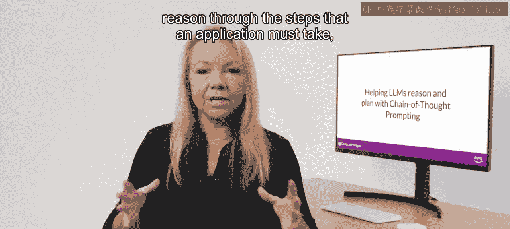
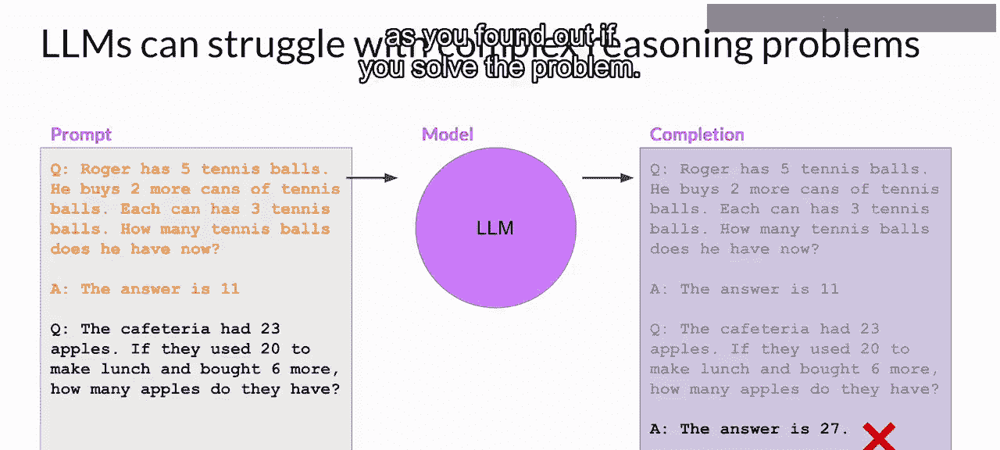
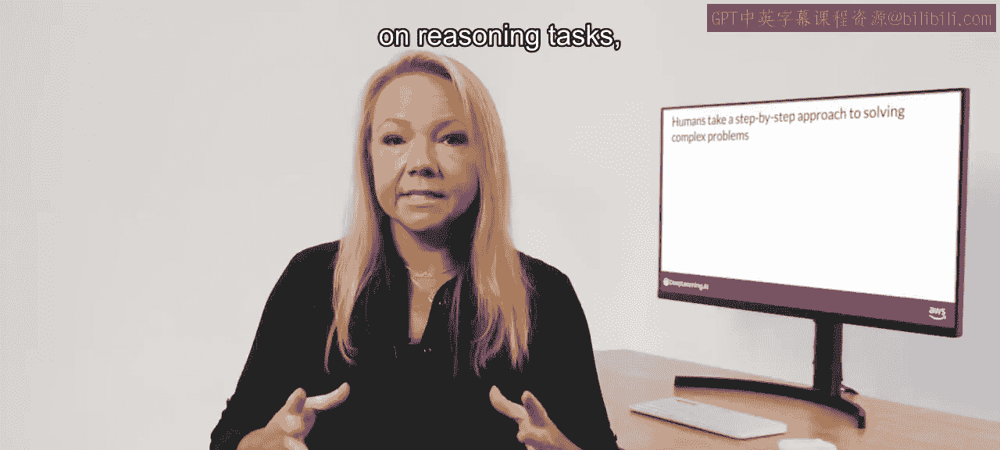
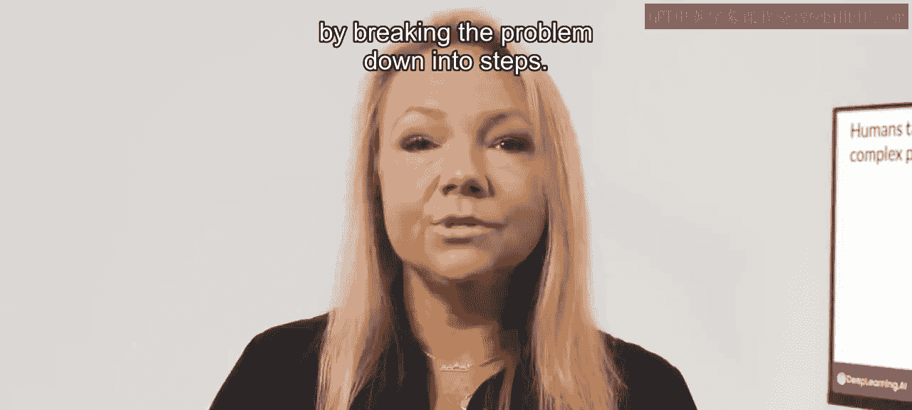
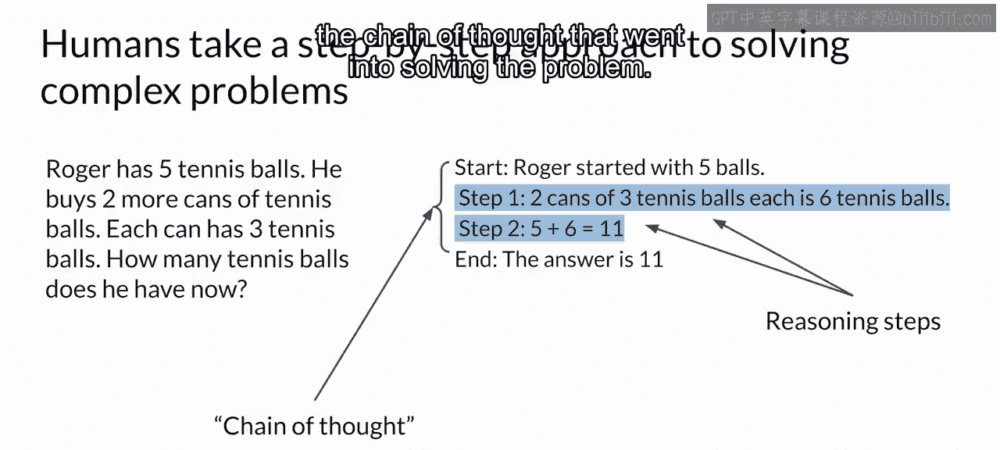
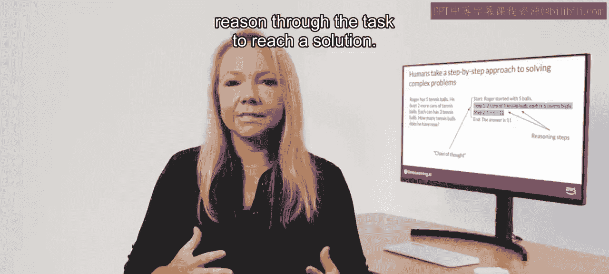
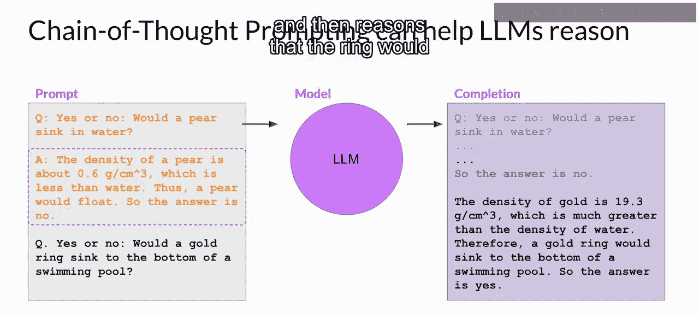

# 吴恩达《使用大型语言模型的生成式人工智能》Generative AI with Large Language Models - P42：41_帮助大语言模型进行推理和规划.zh - GPT中英字幕课程资源 - BV1Cw411q7wm

As you saw， it is important that LLMs can reason through the steps that an application must take to satisfy a user request。

 Unfortunately， complex reasoning can be challenging for LLMs。

 especially for problems that involve multiple steps or mathematics。

These problems exist， even in large models that show good performance at many other tasks。

Here is one example where an L L M has difficulty completing the task。

 You're asking the model to solve a simple multi step math problem to determine how many apples a cafeteria has after using some to make lunch and then buying some more。

 Your prompt includes a similar example problem。 Compte with the solution to help the model understand the task through one shot inference。

If you like， you can pause the video here for a moment and solve the problem yourself。

After processing the prompt， the model generates the completion shown here。

 stating that the answer is 27。This answer is incorrect， as you found out， if you solve the problem。

 the cafeteria actually only has nine apples remaining。

Researchers have been exploring ways to improve the performance of large language models on reasoning tasks like the one you just saw。

 One strategy that has demonstrated some success is prompting the model to think more like a human by breaking the problem down into steps。

 So what do I mean by thinking more like a human。

Well， here is the one shot example problem from the prompt on the previous slide。

The task here is to calculate how many tennis balls Roger has after buying some new ones。

One way that a human might tackle this problem is as follows。

Begin by determining the number of tennis balls Roger has at the start。

Then note that Roger buys two cans of tennis balls。Each can contains three balls。

 so he has a total of six new tennis balls。Next， add these six new balls to the original five for a total of 11 balls。

Then finish by stating the answer。These intermediate calculations form the reasoning steps that a human might take。

 and the full sequence of steps illustrates the chain of thought that went into solving the problem。

Asking the model to mimic this behavior is known as chain of thought prompting。

And it works by including a series of intermediate reasoning steps into any examples that you use for one or few shot inference。

By structuring the examples in this way， you're essentially teaching the model how to reason through the task to reach a solution。

Here is the same Apple's problem you saw a couple of slides ago。

 now reworked as a chain of thought prompt。The story of Roger buying the tennis balls is still used as the one shot example。

 But this time， you include intermediate reasoning steps in the solution text。

These steps are basically equivalent to the ones a human might take that you saw just a few minutes ago。

You then send this chain of thought prompt to the large language model， which generates a completion。

Notice that the model has now produced a more robust and transparent response that explains its reasoning steps following a similar structure as the one shot example。

The model now correctly determines that 9 apples are left。

Thinking through the problem has helped the model come to the correct answer。

One thing to note is that while the input prompt is shown here in a condensed format to save space。

 the entire prompt is actually included in the output。

You can use chain of thought prompting to help LLMs improve their reasoning of other types of problems。

 too， in addition to arithmetic。Here is an example of a simple physics problem where the model is being asked to determine if a gold ring would sink to the bottom of a swimming pool。

The chain of thought prompt included as the one shot example here shows the model how to work through this problem by reasoning that a pair would flow because it's less dense than water。

When you pass this prompt to the LLM， it generates a similarly structured completion。

The model correctly identifies the density of gold， which it learned from its training data。

 and then reasons that the ring would sink because gold is much more dense than water。

Chain of thought prompting is a powerful technique that improves the ability of your model to reason through problems。

While this can greatly improve the performance of your model。

 the limited math skills of LLMs can still cause problems if your task requires accurate calculations like totaling sales on an e-commerce site。

 calculating tax， or applying a discount。In the next video。

 you'll explore a technique that can help you overcome this problem by letting your LLM talk to a program that is much better at math。

Let's move on and take a look。