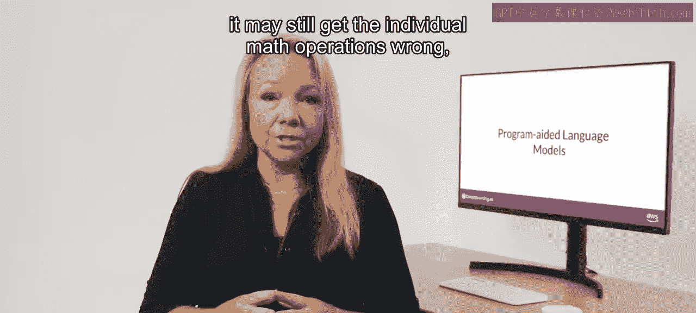
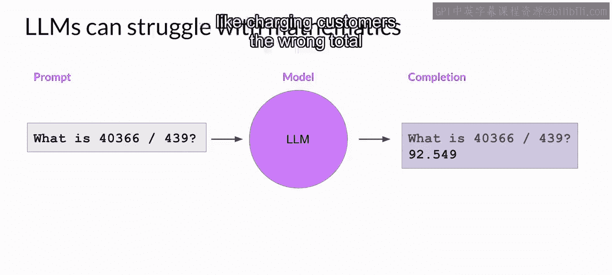
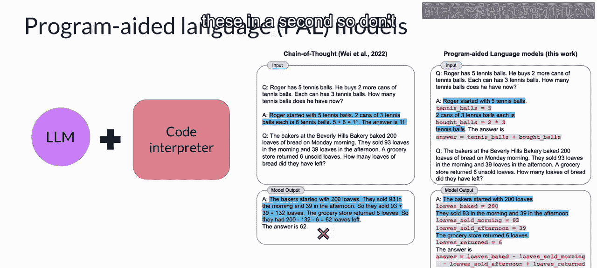
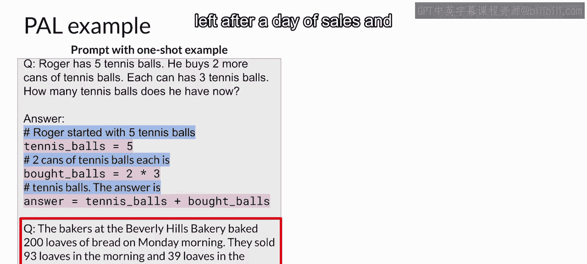
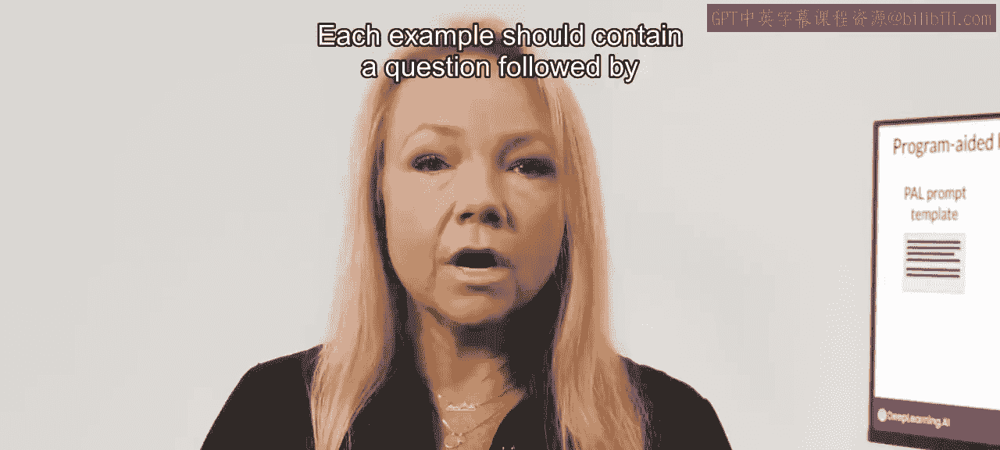
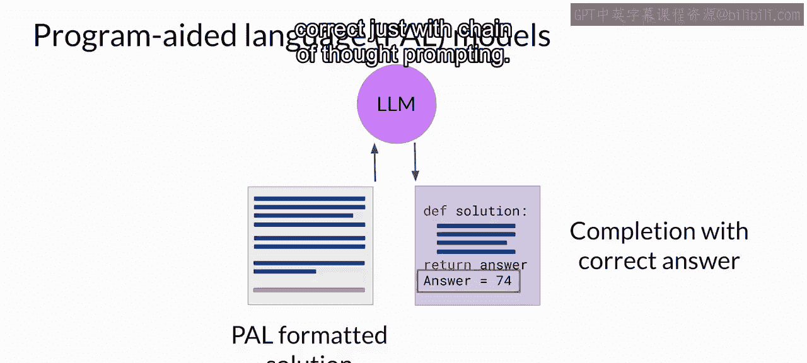
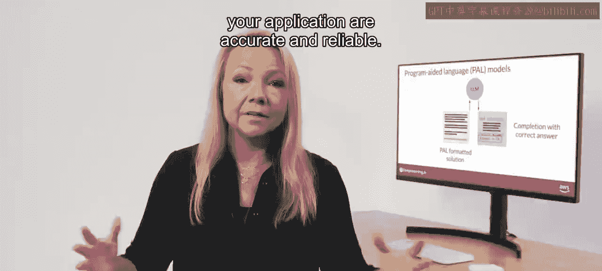
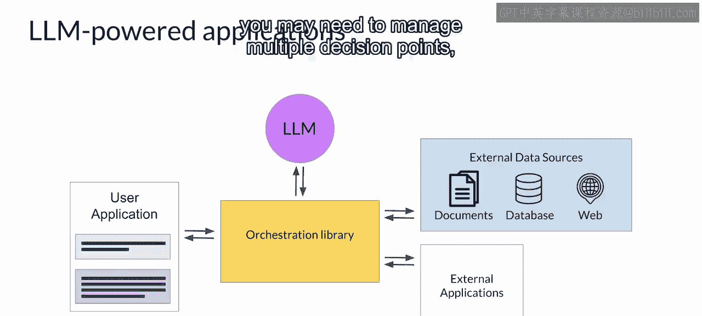

# 吴恩达《使用大型语言模型的生成式人工智能》Generative AI with Large Language Models - P43：42_程序辅助语言模型.zh - GPT中英字幕课程资源 - BV1Cw411q7wm

As you saw earlier in this lesson， the ability of LLMs to carry out arithmetic and other mathematical operations is limited。

While you can try using chain of thought prompting to overcome this， it will only get you so far。

Even if the model correctly reasons through a problem。

 it may still get the individual math operations wrong。

 especially with larger numbers or complex operations。

Here's the example you saw earlier， where the LLM tries to act like a calculator but gets the answer wrong。

Remember， the model isn't actually doing any real math here。

 It is simply trying to predict the most probable tokens that complete the prompt。

The model getting math wrong can have many negative consequences， depending on your use case。

 like charging customers the wrong total or getting the measurements for a recipe incorrect。

You can overcome this limitation by allowing your model to interact with external applications that are good at math。

 like a Python interpreter。One interesting framework for augmenting LLMs in this way is called program aided languageage models or PoL for short。

This work first presented by Lou Yugao and collaborators at Carnegie Mellon University in 2022。

 pairs an LLM with an external code interpreter to carry out calculations。

The method makes use of chain of thought prompting to generate executable Python scripts。

The scripts that the model generates are passed to an interpreter to execute。

The image on the right here is taken from the paper and shows some example prompts and completions。

You'll walk through an example of these in a second。

 So don't worry about reading all of the details here for now。

The strategy behind Pal is to have the LLM generate completions where reasoning steps are accompanied by computer code。

This code is then passed to an interpreter to carry out the calculations necessary to solve the problem。

You specify the output format for the model by including examples for one or few shot inference in the prompt。

Let's take a closer look at how these example prompts are structured。

You'll continue to work with the story of Roger buying tennis balls as the one shot example。

The setup here should now look familiar。 This is a chain of thought example。

You can see the reasoning steps written out in words on the lines highlighted in blue。

What differs from the problems you saw before is the inclusion of lines of Python code shown in pink。

These lines translate any reasoning steps that involve calculations into code。

 variabless are declared based on the text in each reasoning step。

And their values are assigned either directly as in the first line of code here。

 or as calculations using numbers present in the reasoning text。

 as you see in the second Python line。The model can also work with variables it creates in other steps。

 as you see in the third line。Note that the text of each reasoning step begins with a pound sign so that the line can be skipped as a comment by the Python interpreter。

The prompt here ends with the new problem to be solved。In this case。

 the objective is to determine how many loaves of bread a bakery has left after a day of sales and after some loaves are returned from a grocery store partner。

 On the right， you can see the completion generated by the L L M。 Again。

 the chain of thought reasoning steps are shown in blue。 and the Python code is shown in pink。

As you can see， the model creates a number of variables to track the loaves baked。

 the loaves sold in each part of the day， and the loaves returned by the grocery store。

The answer is then calculated by carrying out arithmetic operations on these variables。

The model correctly identifies whether terms should be added or subtracted to reach the correct total。

So now that you know how to structure examples that will tell the LLM to write Python scripts based on its reasoning steps。

Let's go over how the PAL framework enables an LLM to interact with an external interpreter。

To prepare for inference with PAL， you'll format your prompt to contain one or more examples。

Each example should contain a question followed by reasoning steps and lines of Python code that solve the problem。

Next， you'll append the new question that you'd like to answer to the prompt template。

Your resulting PA formatted prompt now contains both the example and the problem to solve。Next。

 you'll pass this combined prompt to your LLM。Which then generates a completion that is in the form of a Python script。

 having learned how to format the output based on the example in the prompt。

 you can now hand off the script to a Python interpreter。

 which you'll use to run the code and generate an answer。

For the bakery example script you saw on the previous slide， the answer is 74。

You'll now append the text containing the answer， which you know is accurate because the calculation was carried out in Python to the P formatted prompt you started with。

By this point， you have a prompt that includes the correct answer in context。Now。

 when you pass the updated prompt to the LLM， it generates a completion that contains the correct answer。

Given the relatively simple math in the bakery bread problem。

 it's likely that the model may have gotten the answer correct just with chain of thought prompting。

But for more complex math， including arithmetic with large numbers， trigonometry or calculus。

 PAL is a powerful technique that allows you to ensure that any calculations done by your application are accurate and reliable。

You might be wondering how to automate this process so that you don't have to pass information back and forth between the LLM and the interpreter by hand。

This is where the orchestrator that you saw earlier comes in。

The orchestrator shown here as the yellow box is a technical component that can manage the flow of information and the initiation of calls to external data sources or applications。

It can also decide what actions to take based on the information contained in the output of the LLM。

Remember， the LL M is your application's reasoning engine。 Ultimately。

 it creates the plan that the orchestrator will interpret and execute。In Pal。

 there's only one action to be carried out。 The execution of Python code。

So the LLM doesn't really have to decide to run the code， it just has to write the script。

 which the orchestrator then passes to the external interpreter to run。However。

 most real world applications are likely to be more complicated than the simple Pwell architecture。

Your use case may require interactions with several external data sources。

And as you saw in the Sho bot example， you may need to manage multiple decision points。

 validation actions， and calls to external applications。

So how can you use the L L M to power a more complex application？

 Let's explore one strategy in the next video。

