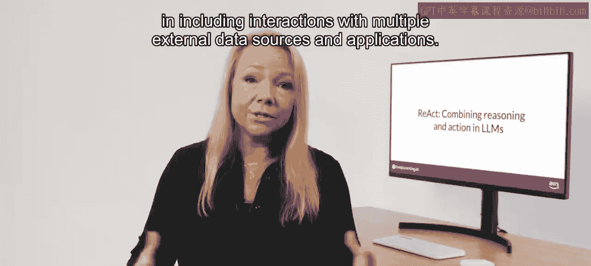
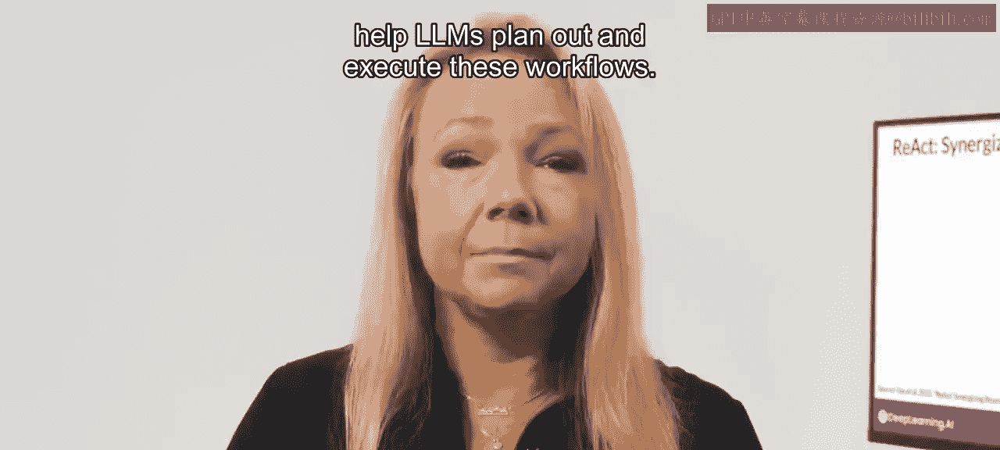
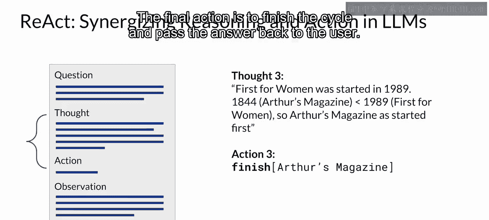
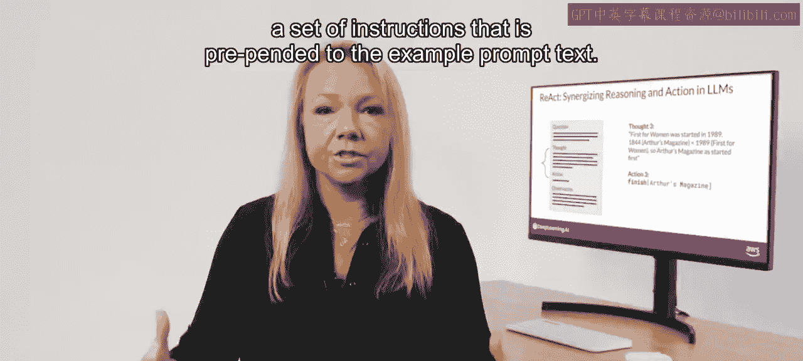
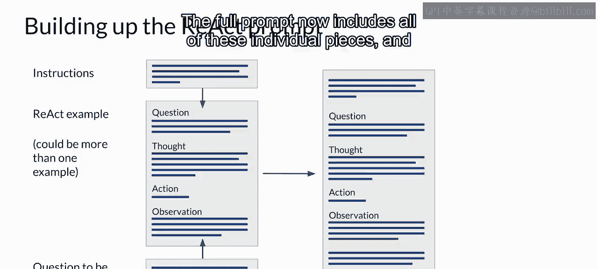
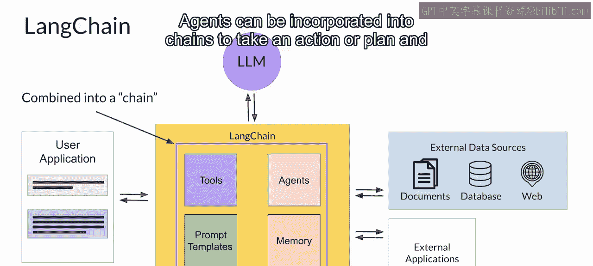
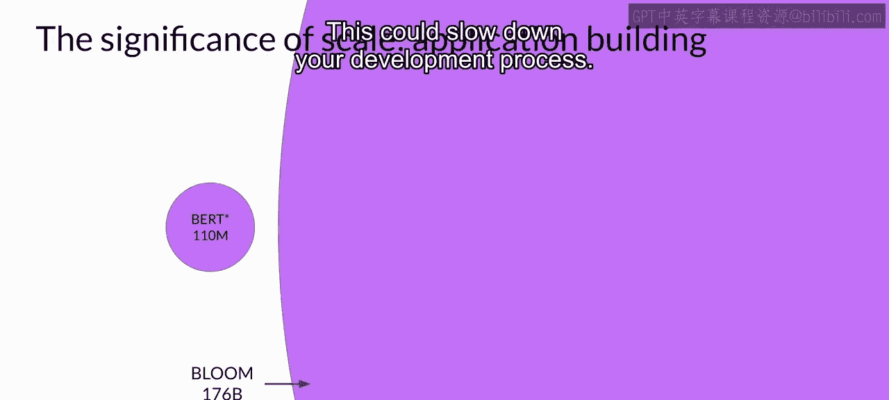
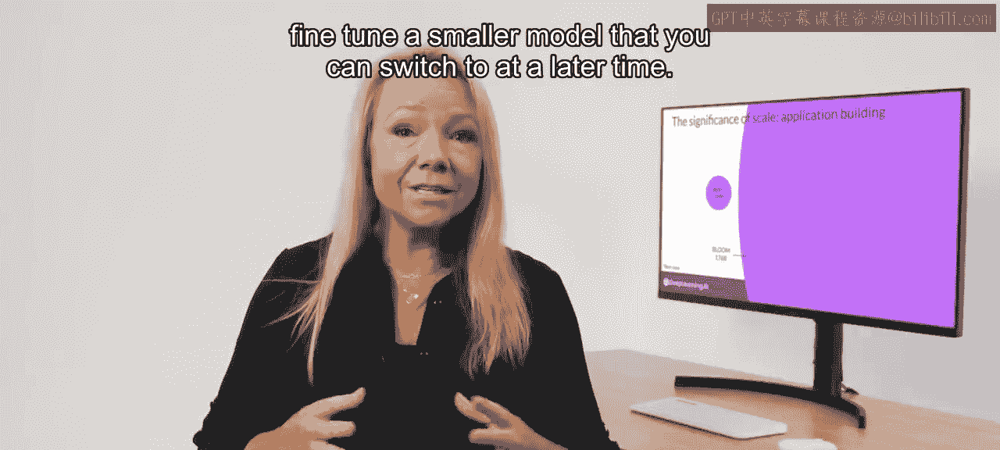

# 吴恩达《使用大型语言模型的生成式人工智能》Generative AI with Large Language Models - P44：43_React- 结合推理和行动.zh - GPT中英字幕课程资源 - BV1Cw411q7wm

In the previous video， you saw how structured prompts can be used to help an LLM write Python scripts to solve complex math problems。

An application making use of PO can link the LLM to a Python interpreter to run the code and return the answer to the LLM。

Most applications will require the LLM to manage more complex workflows。

 perhaps including interactions with multiple external data sources and applications。

In this video， you'll explore a framework called React that can help LLMs plan out and execute these workflows。

React is a prompting strategy that combines chain of thought reasoning with action planning。

The framework was proposed by researchers at Princeton and Google in 2022。

The paper develops a series of complex prompting examples based on problems from hotpot QA。

 a multistep question answering benchmark that requires reasoning over two or more Wikipedia passages and fever。

 a benchmark that uses Wikipedia passages to verify facts。

The figure on the right shows some example prompts from the paper， and we'll explore one shortly。

 so don't worry about reading the prompts on this slide for now。

You'll be able to look at the figure in more detail in a reading exercise after the video。

React uses structured examples to show a large language model how to reason through a problem and decide on actions to take that move it closer to a solution。

The example prompts start with a question that will require multiple steps to answer。In this example。

 the goal is to determine which of two magazines was created first。

The example then includes a related thought， action， observation， trio of strings。

 The thought is a reasoning step that demonstrates to the model how to tackle the problem and identify an action to take。

In the newspaper publishing example， the prompt specifies that the model will search for both magazines and determine which one was published first。

In order for the model to interact with an external application or data source。

 it has to identify an action to take from a predetermined list。In the case of the React framework。

 the authors created a small Python API to interact with Wikipedia。

The three allowed actions are search， which looks for a Wikipedia entry about a particular topic。

Look up with searches for a string on a Wikipedia page。And finish。

 which the model carries out when it decides it has determined the answer。

As you saw on the previous slide， the thought in the prompt identified two searches to carry out one for each magazine。

In this example， the first search will be for Arthur's magazine。

The action is formatted using the specific square bracket notation you see here so that the model will format its completions in the same way。

The Python interpreter searches for this code to trigger specific API actions。

The last part of the prompt template is the observation。

This is where the new information provided by the external search is brought into the context of the prompt for the model to interpret。

 The prompt then repeats the cycle as many times as is necessary to obtain the final answer。

In the second thought， the prompt states the start year of Arthur's magazine and identifies the next step needed to solve the problem。

 The second action is to search for first for women。

And the second observation includes text that states the start date of the publication。

 in this case 1989。At this point， all the information required to answer the question is known。

The third thought states the start year of first for women and then gives the explicit logic used to determine which magazine was published first。

The final action is to finish the cycle and pass the answer back to the user。

It's important to note that in the React framework。

 the LLM can only choose from a limited number of actions that are defined by a set of instructions that is prepened to the example prompt text。

The full text of the instructions is shown here。First， the task is defined。

 telling the model to answer a question using the prompt structure you just explored in detail。Next。

 the instructions give more detail about what is meant by thought。

And then specifies that the action step can only be one of three types。

The first is the search action， which looks for Wikipedia entries related to the specified entity。

The second is the lookup action， which retrieves the next sentence that contains the specified keyword。

The last action is finish， which returns the answer and brings the task to an end。

It is critical to define a set of allowed actions when using LLMs to plan tasks that will power applications。

LLMs are very creative and they may propose taking steps that don't actually correspond to something that the application can do。

The final sentence in the instructions lets the LLM know that some examples will come next in the prompt text。

Okay， so let's put all the pieces together for inference。You'll start with the react example prompt。

Note that depending on the LOM you're working with。

 you may find that you need to include more than one example and carry out few shot inferences。Next。

 you'll prepend the instructions at the beginning of the example and then insert the question you want to answer at the end。

The full prompt now includes all of these individual pieces。

 and it can be passed to the LLM for inference。

The React framework shows one way to use LLMs to power an application through reasoning and action planning。

This strategy can be extended for your specific use case by creating examples that work through the decisions and actions that will take place in your application。

Thankfully， frameworks for developing applications powered by language models are an active development。

 One solution that is being widely adopted is called Lang chain。😊。

The Lang chain framework provides you with modular pieces that contain the components necessary to work with LLMs。

These components include prompt templates for many different use cases that you can use to format both input examples and model completions。

And memory that you can use to store interactions with an LOM。

The framework also includes prebuilt tools that enable you to carry out a wide variety of tasks。

 including calls to external data sets and various APIs。

Connecting a selection of these individual components together results in a chain。

The creators of Lcha have developed a set of predefined chains that have been optimized for different use cases。

 and you can use these off the shelf to quickly get your app up and running。

 Sometimes your application workflow can take multiple paths depending on the information the user provides。

In this case， you can't use a predetermined chain， but instead we'll need the flexibility to decide which actions to take as the user moves through the workflow。

Langchain defines another construct known as an agent that you can use to interpret the input from the user and determine which tool or tools to use to complete the task。

Lang chainin currently includes agents for both PAal and Re among others agents can be incorporated into chains to take an action or plan and execute a series of actions。

Langchain is an active development and new features are being added all the time。

 like the ability to examine and evaluate the LLM's completions throughout the workflow。

It's an exciting framework that can help you with fast prototyping and deployment and is likely to become an important tool in your generative AI toolbox in the future。

The last thing to keep in mind as you develop applications using LLMs is that the ability of the model to reason well and plan actions depends on its scale。

Larger models are generally your best choice for techniques that use advanced prompting like Pal or react。

Smaller models may struggle to understand the tasks in highly structured prompts and may require you to perform additional fine tuning to improve their ability to reason and plan。

This could slow down your development process。

Instead， if you start with a large， capable model and collect lots of user data and deployment。

 you may be able to use it to train and finet a smaller model that you can switch to at a later time。

