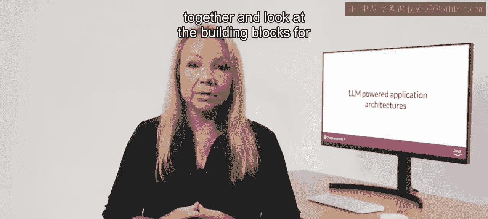
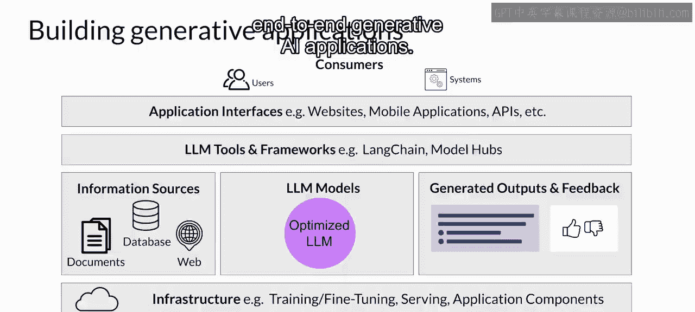
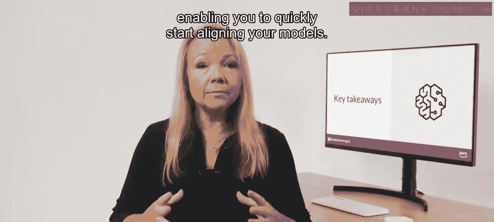
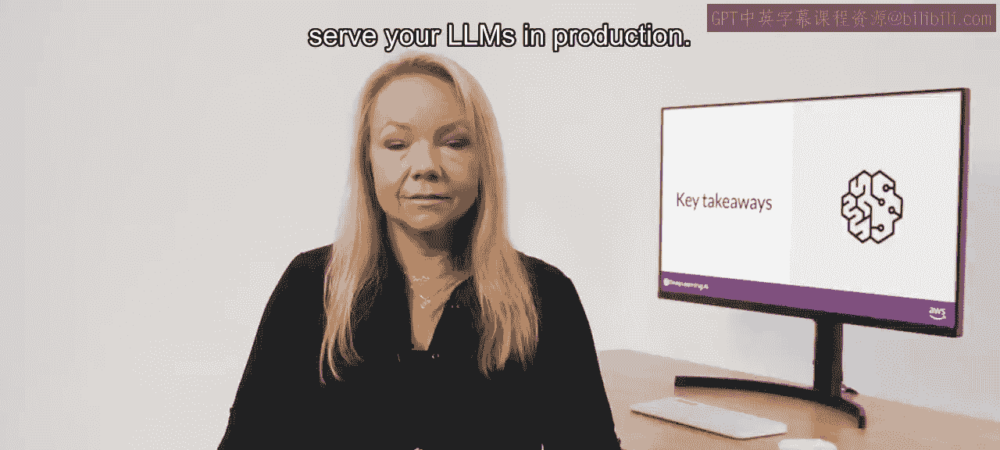
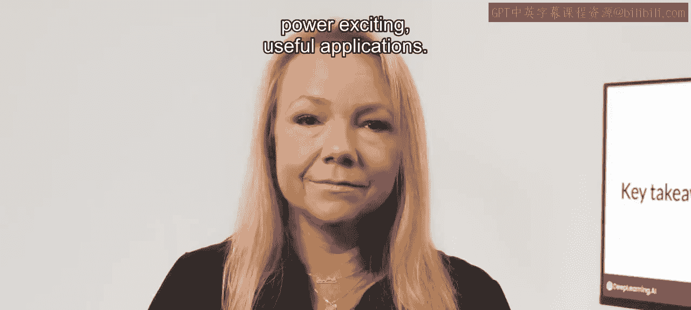

# 吴恩达《使用大型语言模型的生成式人工智能》Generative AI with Large Language Models - P45：44_大语言模型应用架构.zh - GPT中英字幕课程资源 - BV1Cw411q7wm

In this final section of the lesson， you'll explore some additional considerations for building LLM powered applications。

To begin， let's bring everything you've seen so far in the lesson together and look at the building blocks for creating LLM powered applications。

You'll require several key components to create end to end solutions for your applications。

 starting with the infrastructure layer。This layer provides the compute。

 storage and network to serve up your LLMs， as well as to host your application components。

 you could make use of your on premises infrastructure for this or have it provided for you via on demand in pay as you go Cloud services。

Next， you'll include the large language models you want to use in your application。

These could include foundation models， as well as the models you have adapted to your specific task。

The models are deployed on the appropriate infrastructure for your inference needs。

 taking into account whether you need real time or near real time interaction with the model。

You may also have the need to retrieve information from external sources。

 such as those discussed in the Retrieval Amented generationration section。

Your application will return the completions from your large language model to the user or consuming application。

And depending on your use case， you may need to implement a mechanism to capture and store the outputs。

For example， you could build the capacity to store user completions during a session to augment the fixed context window size of your LLM。

And you could also gather feedback from users that may be useful for additional fine tuning。

 alignment， or evaluation as your application matures。Next。

 you may need to use additional tools and frameworks for large language models that help you easily implement some of the techniques discussed in this course。

 As an example， you can use lane chains built in libraries to implement techniques like Pow react or chain of thought prompting。

You may also utilize model hubs which allow you to centrally manage and share models for use and applications。

In the final layer， you typically have some type of user interface that the application will be consumed through。

 such as a website or a rest API。This layer is where you'll also include the security components required for interacting with your application。

At a high level， this architecture stack represents the various components to consider as part of your generative AI applications。

Your users， whether they are human end users or other systems that access your application through its APIs will interact with this entire stack。

As you can see， the model is typically only one part of the story in building end to end generative AI applications。

So congratulations on making it through the full generative AI project life cycle。

 Hopefully you feel like you've developed some intuition about the important issues you have to consider when building applications using LLMs。

This week， you saw how to align your models with human preferences such as helpfulness。

 harmlessness and honesty by fine tuning， using a technique called reinforcement learninging with Human feedback。

 or RLHF for short。Given the popularity of RLHF， there are many existing RL reward models and human alignment data sets available。

 enabling you to quickly start aligning your models。

In practice， RLHF is a very effective mechanism that you can use to improve the alignment of your models。

 reduce the toxicity of their responses， and let you use your models more safely in production。

You also saw important techniques to optimize your model for inference by reducing the size of the model through distillation。

 quantization， or pruning。This minimizes the amount of hardware resources needed to serve your LLMs in production。

Lastly， you explored ways that you can help your model perform better in deployment through structured prompts and connections to external data sources and applications。

LOMs can play an amazing role as the reasoning engine in an application。

 exploiting their intelligence to power exciting， useful applications。

Frameworks like Laangchain are making it possible to quickly build。

 deploy and test LLM powered applications， and it's a very exciting time for developers。

To wrap up the course， AnA is going to explore a few areas of active research that will likely shape the trajectory of this field in the coming months and years。

