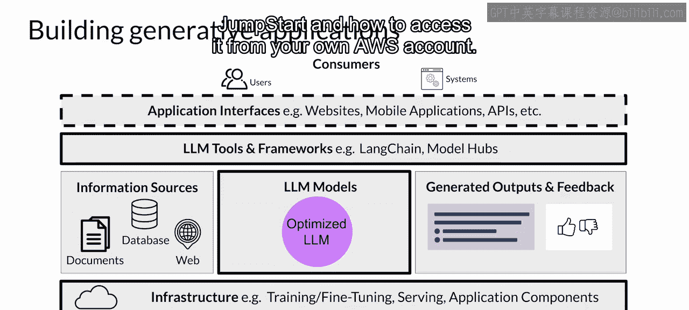
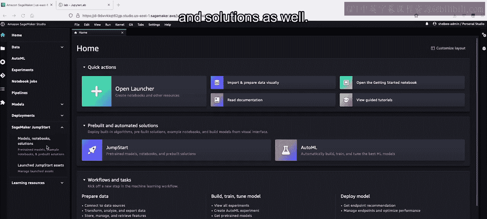
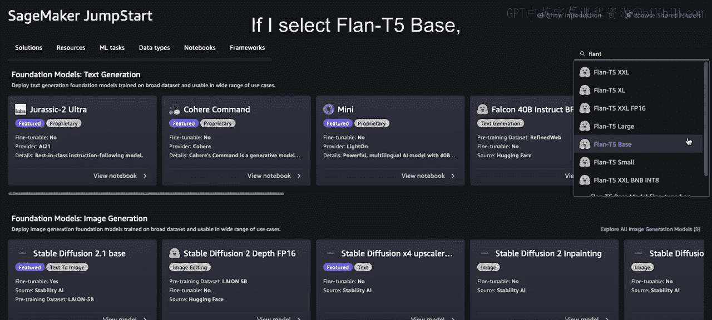
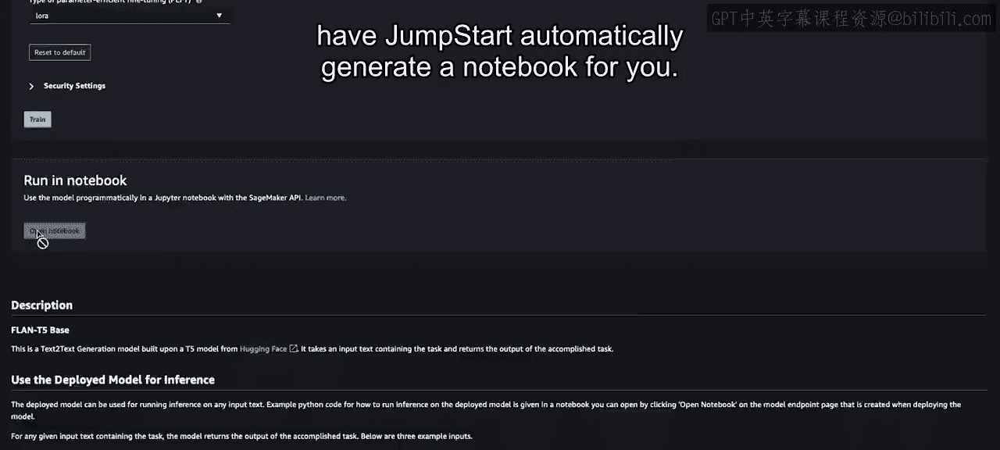
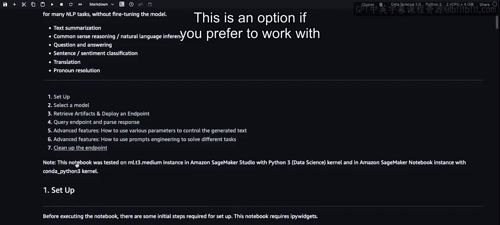
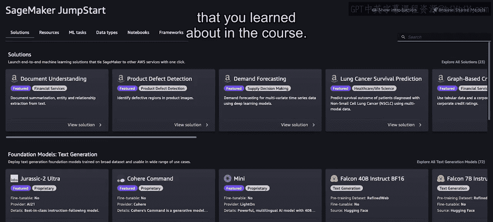
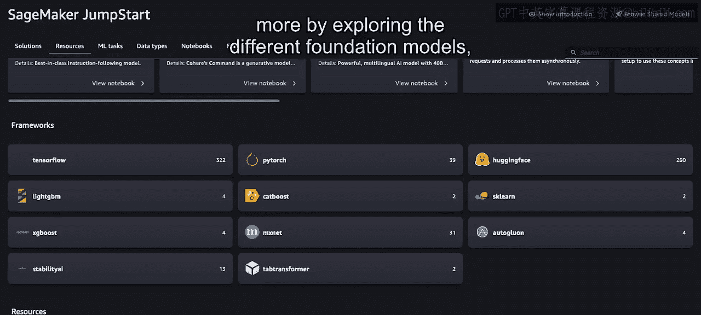

# 吴恩达《使用大型语言模型的生成式人工智能》Generative AI with Large Language Models - P46：45_可选视频-AWS SageMaker入门.zh - GPT中英字幕课程资源 - BV1Cw411q7wm

Now that you've explored the fundamentals of building applications using LLMs。

 I want to show you an AWS service called Amazon SageMaker Jumpstart that can help you get into production quickly and operate at scale。

Here's the application stack that you explored in the previous video， as you saw。

 building an LLM powered application requires multiple components。SageMaker Jumpstar is a model hub。

 and it allows you to quickly deploy foundation models that are available within the service and integrate them into your own applications。

The jumpmpstart service also provides an easy way to fine， tune and deploy models。

Jumpstart covers many parts of this diagram， including the infrastructure， the LLM itself。

 the tools and frameworks， and even an API to invoke the model。

In contrast to the models that you worked with in the labs。

 Justart models require GPUs to fine tune and deployloy。

 and keep in mind these GPUs are subject to on demandd pricing and you should refer to the SageMaker pricing page before selecting the compute you want to use。

Also， please be sure to delete the SageMaker model endpoints when not in use and follow cost monitoring best practices to optimize cost Okay。

 let me show you a quick tour of jumpmpstar and how to access it from your own AWS account。

SageMaker Jumpstar is accessible from the AWS console or through SageMake Studio for this brief tour。

 I'll start in Studio then choose Jumpstart from the main screen I could optionally choose Jumpstart from the left hand menu and select models。

 notebooks and solutions as well。

After I click on jumpstart。You'll see different categories that include end to end solutions across different use cases。

As well as a number of foundation models for different modalities that you can easily deploy。

 as well as fine tune where yes is indicated under the fine tuning option。

Let's look at an example you're all familiar with after working through the course。

 which is the Fln T5 model。You've specifically been using the base variant in the course to minimize the resources needed by the lab environments。

 however， as you can see here， you can also utilize other variants of fl T5 through jumpstart depending on your needs。

You'll also notice the Huging face logo here， which means they're actually coming directly from Huging face。

 and AWS has worked with Huging Fase to the point where you can easily with just a few clicks。

 deploy or fine tune the model So if I select F T5 base you'll see I have a few options first I can choose to deploy the model by identifying a few key parameters like the instance type and size。

And this is the instance type and size that should be used to host the model， and as a reminder。

 this deploys to a realtime persistent endpoint and the price depends on the hosting instance that you select here。

 and some of these can be quite large so always remember to delete any endpoints that are not in use to avoid incurring any unnecessary cost。

You'll also notice you can specify a number of security settings allowing you to implement the controls that are required for your own security requirements。

You can then choose to hit deployy， and this will automatically deploy that Fn T5 base model to the endpoint using the infrastructure that you specified。

In the second tab， you'll notice the option to train because this model supports fine tuning。

 you can also set up your fine tuning jobs by specifying the location of your training and validation dataset sets。

Then selecting the size of the compute that you want to use for training and it's just an easy adjustment to the size of compute through this dropdown you can easily choose what type of compute you want to use for your training job and keep in mind again your charge for the underlying compute for the time it takes to train the model so we recommend choosing the smallest instance that's required for your specific task。

Another feature is the ability to quickly identify and modify the tunable hyperparameters for this specific model through these dropdowns。

 If we go ahead and scroll down to the bottom， you'll see a parameter type called PEft parameter efficient fine tuning which you learned about in lesson 6 Here you could select Laura which you learned about in lesson 4 through just a simple dropdown making it easier to implement these various techniques that you learned you can then go ahead and hit train and that will kick off a training job to finet this pretrained fln T5 model using the input provided for your specific task。

 Finally， here is another option which is to have jumpstart automatically generate a notebook for you So let's say you don't like using the dropdown and prefer to programmatically work with these models This notebook basically provides you all the code behind what is happening in the options that we previously covered。

This is an option if you prefer to work with Jumpstar at the lowest level programmatically。

That was just a quick tour of jumpstart to illustrate an implementation of a model hub that you learned about in the course In addition to acting as a model hub that includes foundation models。

 Jumpstart also provides a lot of resources in terms of blogs。

 videos and example notebooks as well I definitely encourage you to check it out more by exploring the different foundation models in their variants that are available to help you get started quickly。

