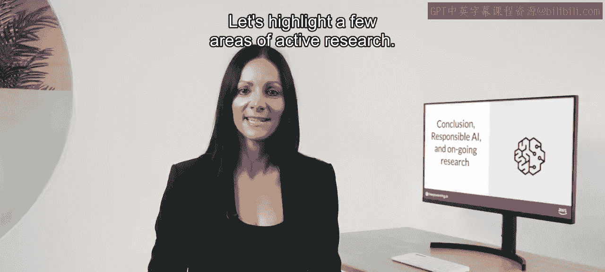
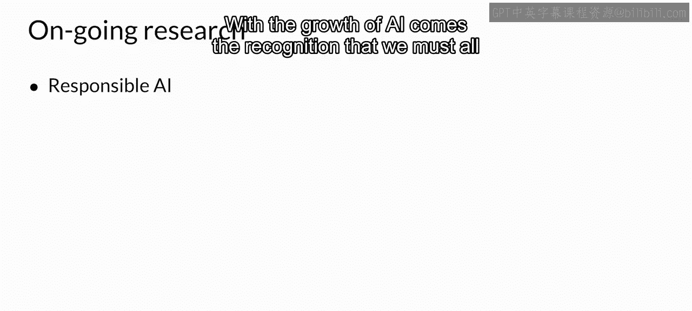
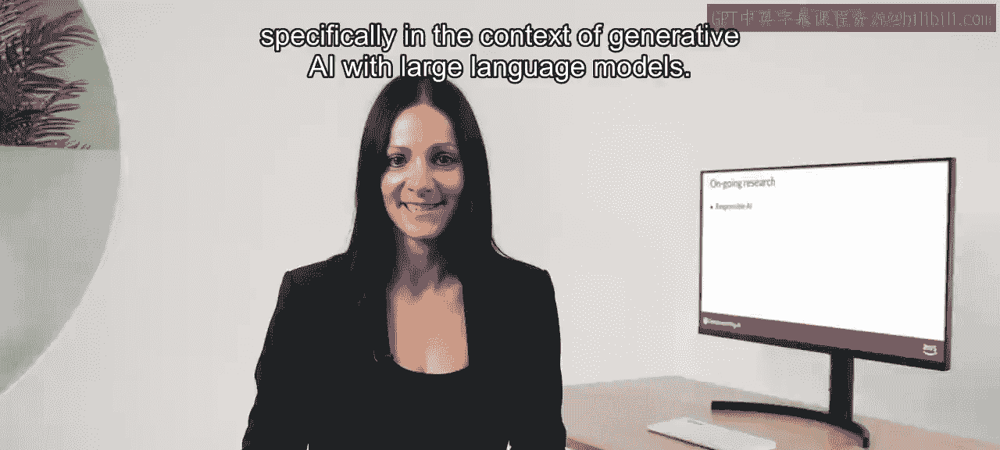
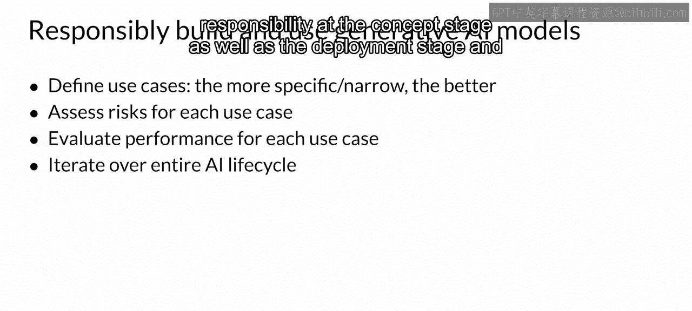
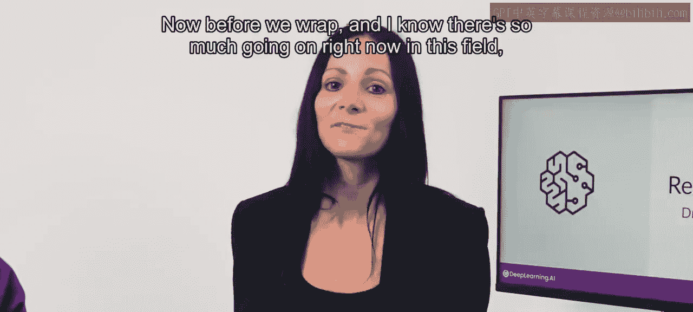

# 吴恩达《使用大型语言模型的生成式人工智能》Generative AI with Large Language Models - P47：46_责任感的AI.zh - GPT中英字幕课程资源 - BV1Cw411q7wm

Throughout this course， you have learned about fundamental concepts and applied techniques across the generative AI project lifecycle。

L LM powered applications are still in their infancy。

And researchers are announcing new techniques or strategies to improve performance and reliability almost every day。

This course can only include what is known or understood at the time of launch。

But we are confident this field will continue to evolve quickly。

Let's highlight a few areas of active research。

With the growth of AI comes the recognition that we must all use it responsibly。

I've invited my AWS colleague， Dr。 Ashley Ses， to discuss Respons AI with me。

 specifically in the context of generative AI with large language models。

Dr。 Natalie Cs is a principal technology evangelist for Amazon AI at AWS。In this role。

 she focuses on fairness and accuracy， as well as identifying and mitigating potential biases in artificial intelligence。

She formally led the Amazon Viual search team as an applied scientist in Atlanta。Fun fact。

 that team launched the visual search for placement parts on the Amazon shopping app。Nashley。

 thanks so much for joining me today to discuss Re AI Thank you so much for having me。

Given what you see in the field right now， what are some of the new risks and challenges of responsible AI。

 specifically in the context of generative AI with large language models？

That's a great question because there are lots of challenges， let's focus on three。One is toxicity。

 another are the hallucinations， and a third is the intellectual property issue。All right。

 let's maybe start with the first one you mentioned toxicity。

 Can you describe the challenge in a little bit more detail？

And do you have any advice how practitioners， how I， how can I mitigate it？Sure。

 so toxicity at its core， meaning toxic implies certain language or content that can be harmful or discriminatory towards certain groups especially towards marginalized groups or protected groups and so one thing that we can do is start with the training data as you know that is the basis of every AI so you can start with curating the training data you can also train guardrail models to detect and filter out any unwanted content in the training data we also think about how much human annotation is involved when it comes to training and training annotations we want to make sure we provide enough guidance to those annotators and also have a very diverse group of annotators that we're educating so that they can understand how to pull out certain data or how to mark certain data。

Make sense， and I think this is a great point you just made that having diversity among the human annotators is really important。

Now， what about hallucinations。So hallucinations we think about things that are simply not true or maybe something that seems like it could be true。

 but it isn't has no basis to it Well this is exactly what it means in this case with generative AI due to the nature of how we train large language models or just neural networks in general a lot of times we don't know what the model is actually learning and so sometimes what the model will try to do is field gaps where it has missing data and oftentimes this leads to false statements or the hallucinations and so one thing that we can do can educate the users that this is the reality of this technology and add any disclaimers that they can know that this is something you should be able to look out for also you can augment large language models with independent and verified sources so you can double check against the data that you're getting back you also want to make sure that you develop methods for attributing generated output。

Two particular pieces of training data so that we can always trace back to where we got the information。

And last but not least， we always want to make sure we define what the intendeded use cases is for versus what the unintended use cases is because again。

 due that these things can happen， hallucinations， we want to make sure that the users are aware and transparent about how these things operate right got it and I think。

Education is really key here。The third challenge you mentioned was intellectual property。

 What are your thoughts here？So this is one that is going to definitely have to be addressed because it basically means that people are using data that is returned back from these models in generative AI and it can be plagiarizing someone's previous work or you can have copyright issues for pieces of work and content that already exists and so this is likely to be addressed over time by mixture of not just a technologies but also with policymakers and other legal mechanisms also we want to incorporate a system of governance to make sure that every stakeholder is doing what they need to do to prevent this from happening we also theres in the near term there's a new concept of machine unlearning in which protected content or its effects on gene AI outputs are reduced or removed so this is just one approach that is very primitive in research today we could also do filtering or blocking approaches that compare。

tent to protect content and training data and suppress or replace it if it's too similar before presenting it to the user。

Got it now bringing it all together from a project perspective。

 what advice can you give practitioners， how can I responsibly build and use generative AI models？

I'm glad you ask defining use cases is very important， the more specific， the more narrow。

 the better。 one example where we actually use Gen AI to test and evaluate the robustness of a system is when it comes to face ID systems we actually usegen AI to create different versions of a face。

 for example， if I'm trying to test a system that uses my face to unlock my phone I want to make sure I test it with different versions of my face with long hair with short hair with glasses on make on with no makeup on and we can use Gent AI to do this at scale。

 and so this is an example of how we use that to test the robustness I also want to make sure we access the risk because each use case has its own set of risks。

 some may be better or worse also evaluating the performance is truly a function of the data and the system。

You may have the same system， but when tested with different types of data。

 may perform very well or may perform very terribly。Also。

 we want to make sure we iterate over the AI lifecycl is never a one and done。

 creating AI is a continuous iterriative cycle where we want to implement responsibility at the concept stage as well as the deployment stage and monitoring that feedback over time。

And last but not least， we want to issue governance policies throughout the life cycle and accountability measures for every stakeholder involved This is really helpful nationally and I also like the point you made about generative AI potentially being part of the solution helping to create more diverse data。

Now， before we wrap， and I know there's so much going on right now in this field。

 but what are some of the topics that the research community is actively working on right now that you find exciting。

So I think a few there are lots which is why again this field is unraveling every day。

 there's water marking and fingerprinting which are ways to include almost like a stamp or a signature and a piece of content or data so that we can always trace back I think also creating models that help determine if content was created with gen AI iss also a buding field of research and so again。

 it's a very exciting time。 I think the future of AI is accessible is inclusive and I'm excited to see innovation Ne's to come。

 Me too thanks so much nationally thanks for sharing your thoughts and practical advice on this important topic of responsible AI Thanks again for having me。

