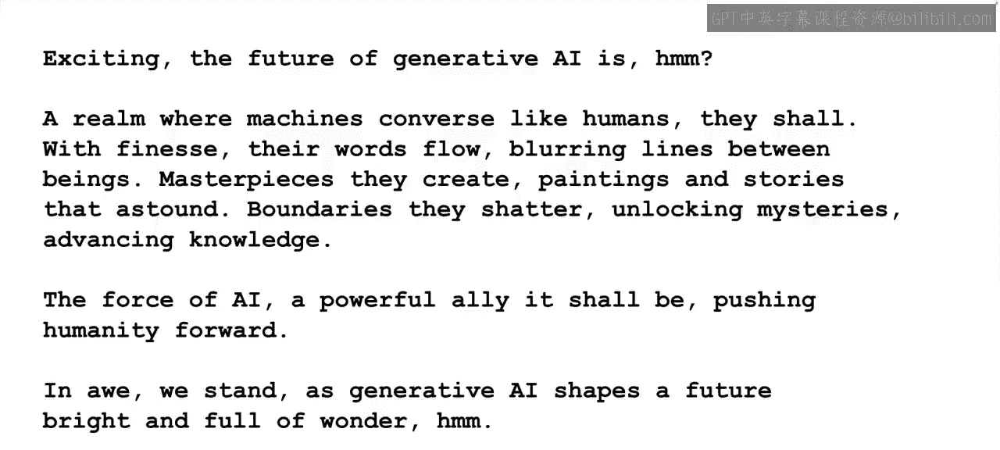

# 吴恩达《使用大型语言模型的生成式人工智能》Generative AI with Large Language Models - P48：47_课程总结.zh - GPT中英字幕课程资源 - BV1Cw411q7wm

Along with Re AI， researchers are looking into techniques to align models with human values and preferences。

Increase model interpretability。And implement efficient model governance。

As model capabilities increase， we'll also need more scalable techniques for human oversight。

Such as constitutional A I， which I discussed in the previous lesson。

 researchers continue to explore scaling loss for all steps of the project life cycle。

Including techniques that better predict model performance so that you can make sure resources are used efficiently。

 for example， through simulations。And scale doesn't always mean bigger。

Research teams are working on model optimizations for small device and edge deployments。For example。

 Lama do CPP is a C plus plus implementation of the Lama model using four bit integer quantization to run on laptop。

Similarly， I'm confident that we'll see advancements and efficiencies across the whole model development lifecycle。

😊，Especially more efficient techniques for pre training， fine tuning， and reinforcement learning。

We'll see increased and emerge LLM capabilities。For example。

 researchers are looking into developing models that support longer problems and contexts。

 For example， to summarize entire books。In fact， during the development of this course。

 we've seen the first announcement of a model supporting 100，000 token context window。

This corresponds roughly to 75，000 words in hundreds of pages。

 models will also increasingly support multimodality across language， images， video， audio， etc。

This will unlock new applications and use cases and change how we interact with models。

We've seen the first amazing results of this with the latest generation of text to image models where natural language becomes the user interface to create visual content。

😊，Researchers are also trying to learn more about LLM reasoning and are exploring LLMs that combine structured knowledge and symbolic methods。

This research field of neuros symbolmbolic AI explores the model's abilities to learn from experience and the ability to reason from what has been learned。

Thanks so much for taking this course。 We hope you enjoyed the lessons and can't wait to see what you build with this knowledge。

😊，To conclude， let's ask our AI what the future holds。

