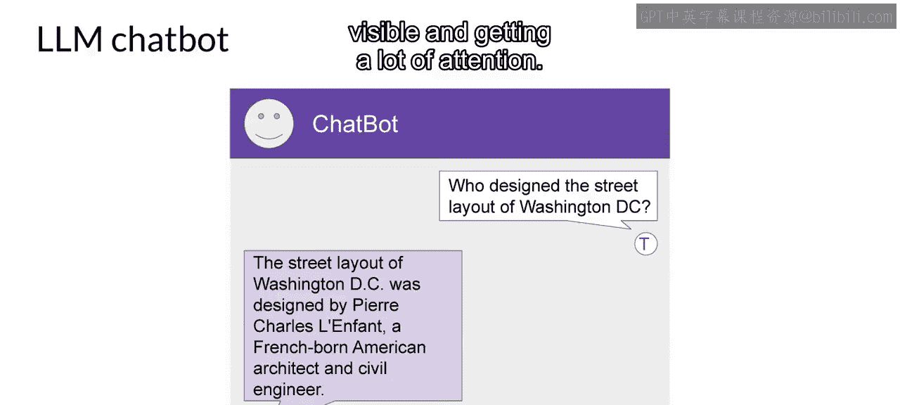
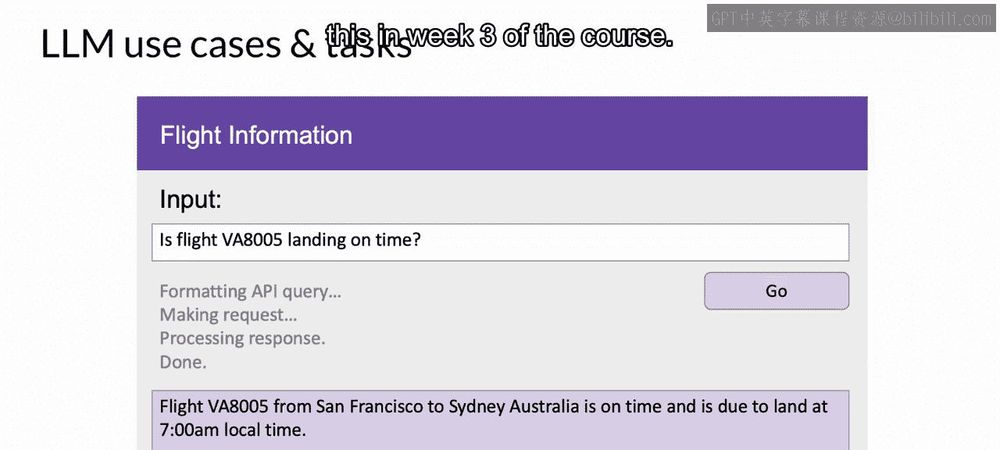
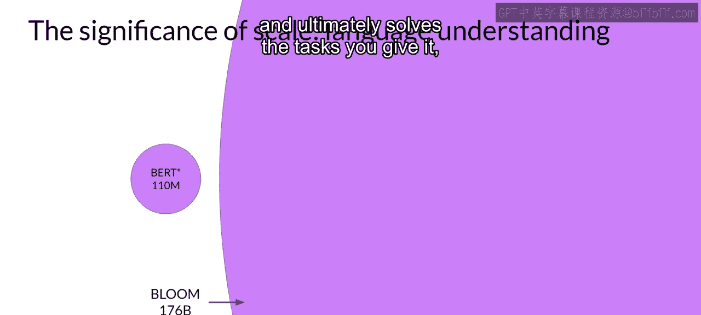
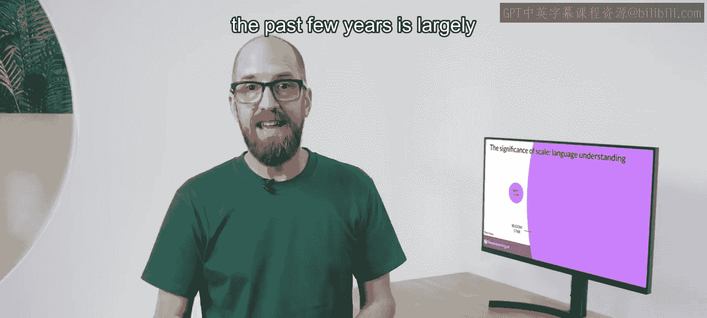

# 吴恩达《使用大型语言模型的生成式人工智能》Generative AI with Large Language Models - P4：3_大语言模型的应用场景和任务.zh - GPT中英字幕课程资源 - BV1Cw411q7wm

You could be forgiven for thinking that LLMs and generative AI are focused on chat tasks After all。

 chatbots are highly visible and getting a lot of attention。😊。

Next word prediction is the base concept behind a number of different capabilities。

 starting with a basic chatbot。 However， you can use this conceptually simple technique for a variety of other tasks within text generation。

 For example， you can ask a model to write an essay based on a prompt to sumise conversations where you provide the dialogue as part of your prompt。

 and the model uses this data， along with its understanding of natural language to generate a summary。

You can use models for a variety of translation tasks from traditional translation between two different languages such as French and German or English and Spanish。

😊，Or to translate natural language to machine code。For example。

 you could ask a model to write some Python code that will return the mean of every column in a data frame。

 and the model will generate code that you can pass to an interpreter。

You can use LLMs to carry out smaller， focused tasks like information retrieval。 In this example。

 you ask the model to identify all of the people and places identified in a news article。

 This is known as named entity recognition。 a kind of word classification。😊。

The understanding of knowledge encoded in the model's parameters allows it to correctly carry out this task and return the requested information to you。

😊，Finally， an area of active development is augmenting LLMs by connecting them to external data sources or using them to invoke external APIs。

😊，You can use this ability to provide the model with information it doesn't know from its pre training and to enable your model to power interactions with the real world you'll learn much more about how to do this in week three of the course。

😊。

Developers have discovered that as the scale of foundation models grows from hundreds of millions of parameters to billions。

 even hundreds of billions， the subjective understanding of language that a model possesses also increases。

😊，This language understanding stored within the parameters of the model is what processes， reasons。

 and ultimately solves the tasks you give it。

But it's also true that smaller models can be fine tuned to perform well on specific focused tasks。

 and you'll learn more about how to do this in week two of the course。

The rapid increase in capability that LLMs have exhibited in the past few years is largely due to the architecture that powers them。

 Let's move on to the next video to take a closer look。😊。

