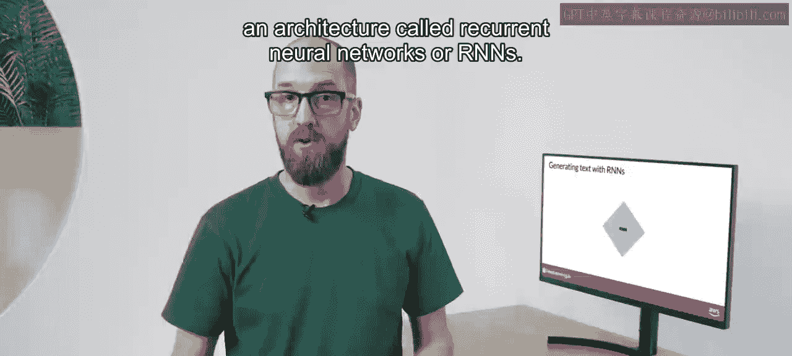
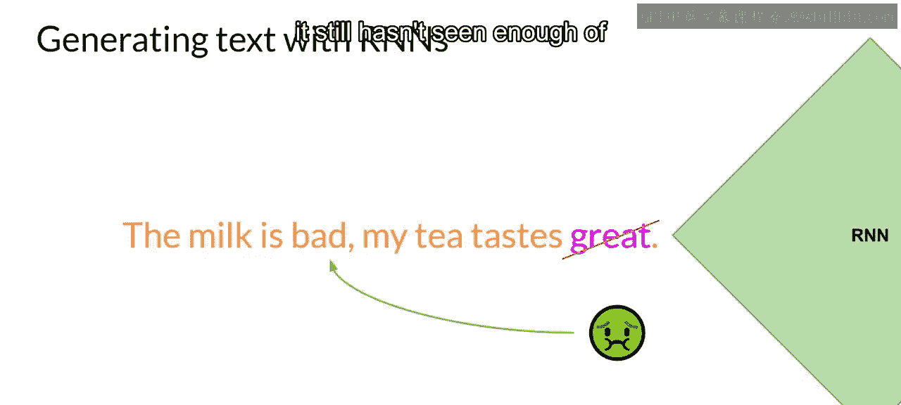
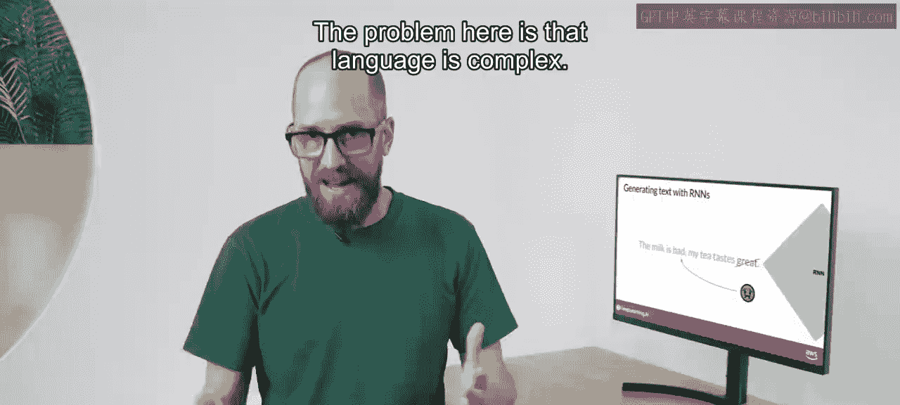
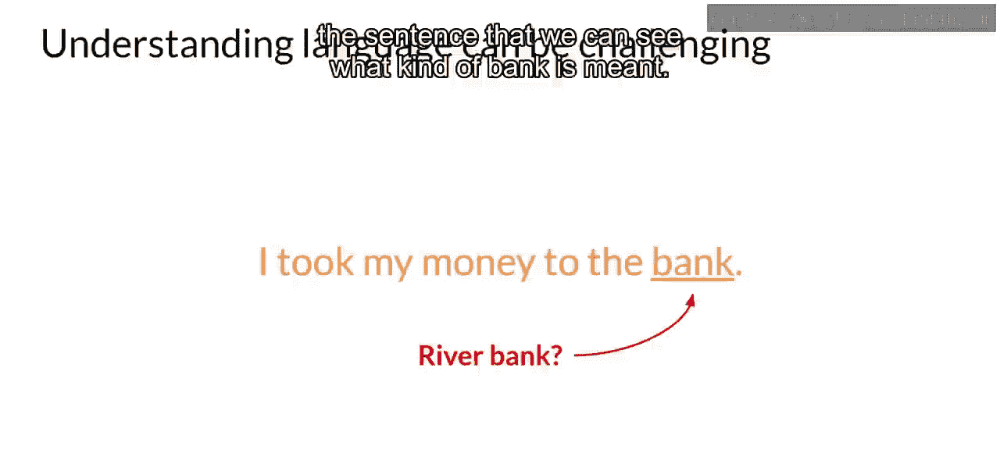
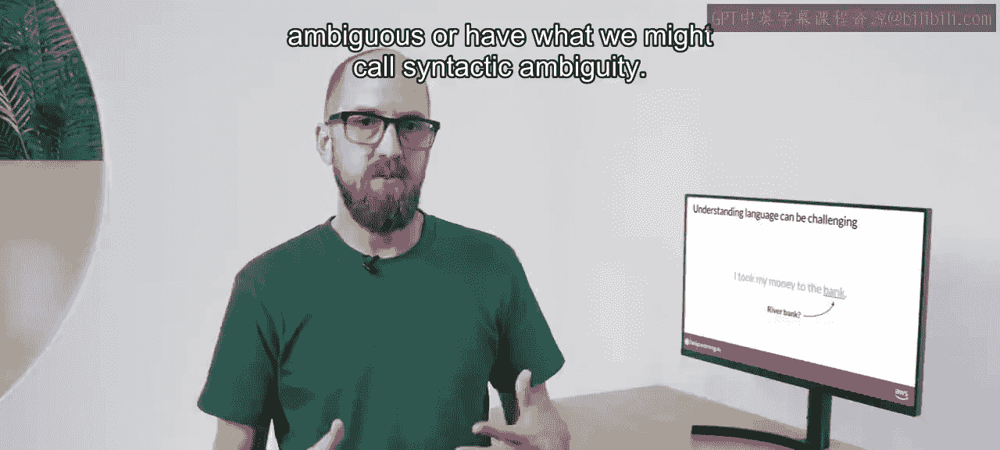
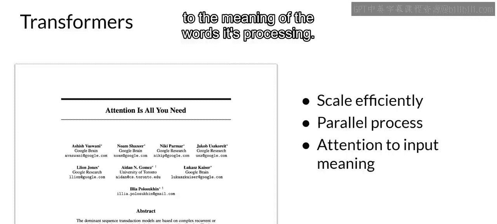

# 吴恩达《使用大型语言模型的生成式人工智能》Generative AI with Large Language Models - P5：4_Transformer之前的文本生成.zh - GPT中英字幕课程资源 - BV1Cw411q7wm

It's important to note that generative algorithms are not new。

Previous generations of language models made use of an architecture called recurrent neural networks or R N Ns。

 R N Ns， while powerful for their time， were limited by the amount of compute and memory needed to perform well at generative tasks。

 Let's look at an example of an R N N carrying out a simple next word prediction， generative task。

With just one previous word seen by the model， the prediction can't be very good as you scale the R and N implementation to be able to see more of the preceding words in the text。

 You have to significantly scale the resources that the model uses。 And as for the prediction， Well。

 the model failed here。 even though you scale the model。

 It still hasn't seen enough of the input to make a good prediction。

 to successfully predict the next word。 models need to see more than just the previous few words。

 Models need to have an understanding of the whole sentence， or even the whole document。😊。

And the problem here is that language is complex。 In many languages。

 One word can have multiple meanings。 These are homominyms。

In this case， it's only with the context of the sentence that we can see what kind of bank is meant。

 Word within sentence structures can be ambiguous or have what we might call syntactic ambiguity。

Take， for example， this sentence。 The teacher taught the student with the book。

Did the teacher teach using the book or did the student have the book， or was it both。

How can an algorithm make sense of human language if sometimes we can't。While in 2017。

 after the publication of this paper， attention is all you need from Google and the University of Toronto。

 everything changed， the transformer architecture had arrived。😊。

This novel approach unlocked the progress in generative AI that we see today。

 it can be scaled efficiently to use multicore GPUs， it can parallel process input data。

 making use of much larger training dataset sets， and crucially it's able to learn to pay attention to the meaning of the words itss processing。

😊。

And attention is all you need。 It's in the title。