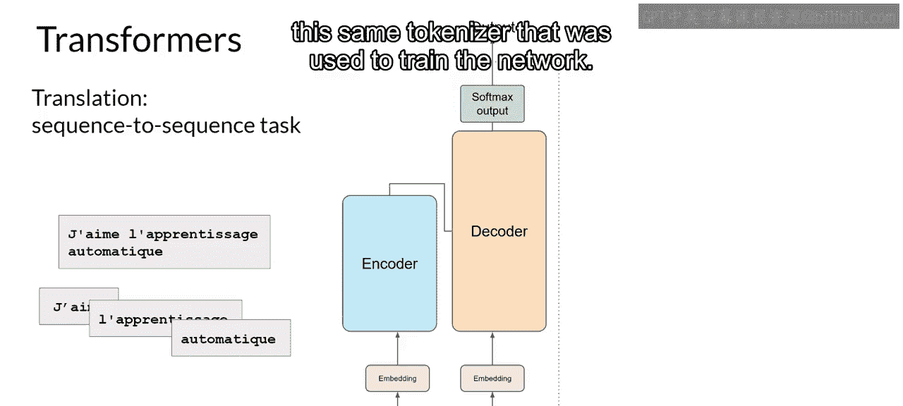
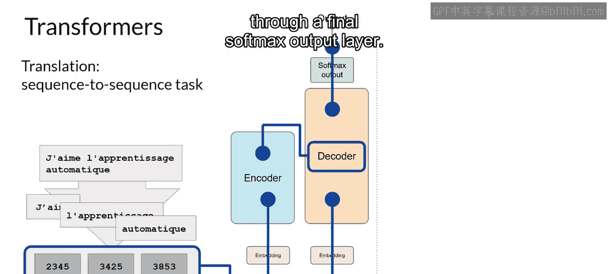
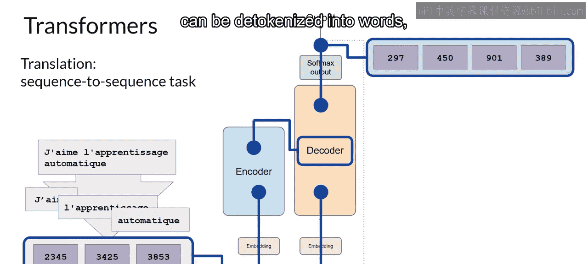
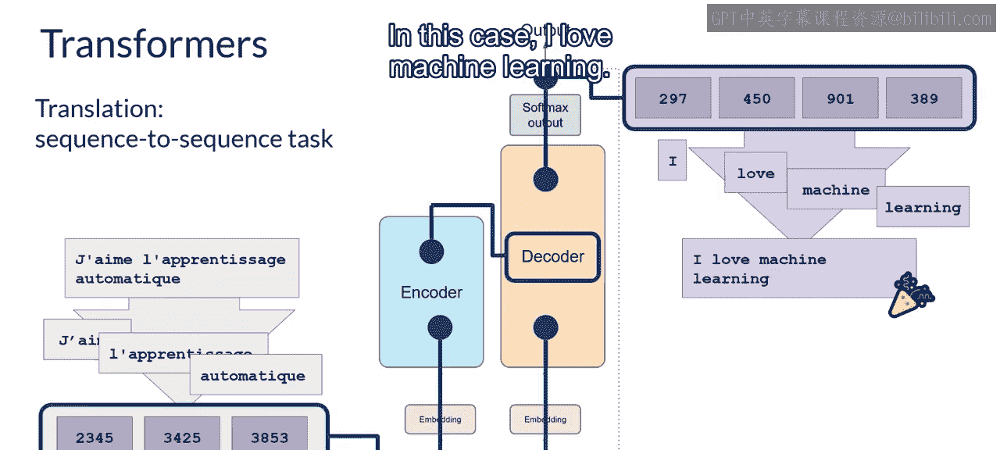
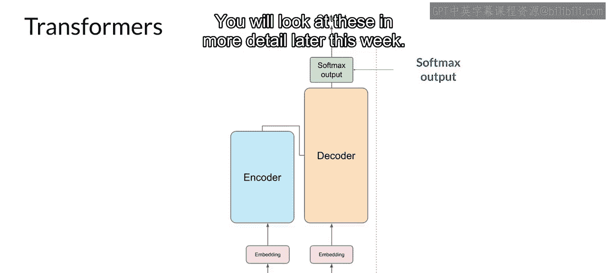
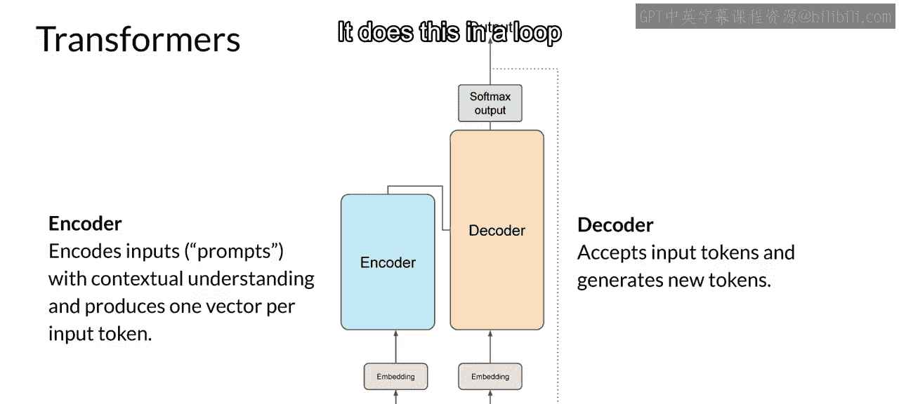
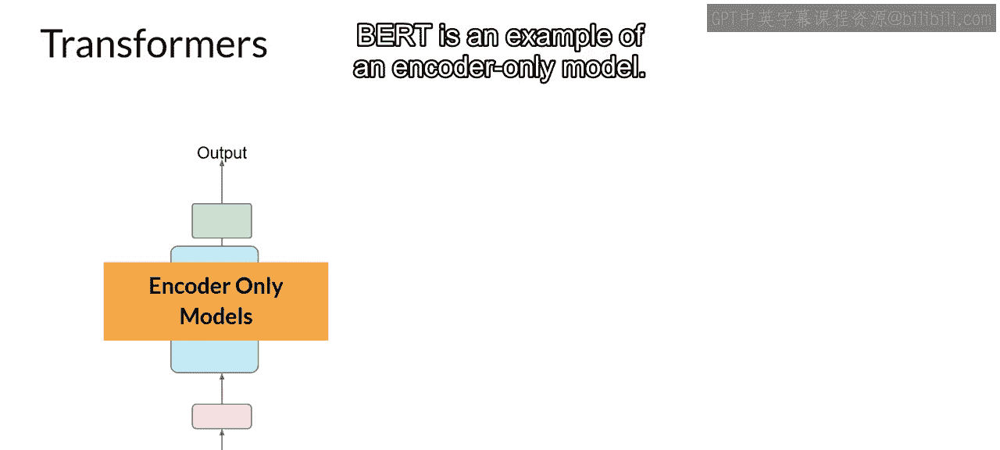
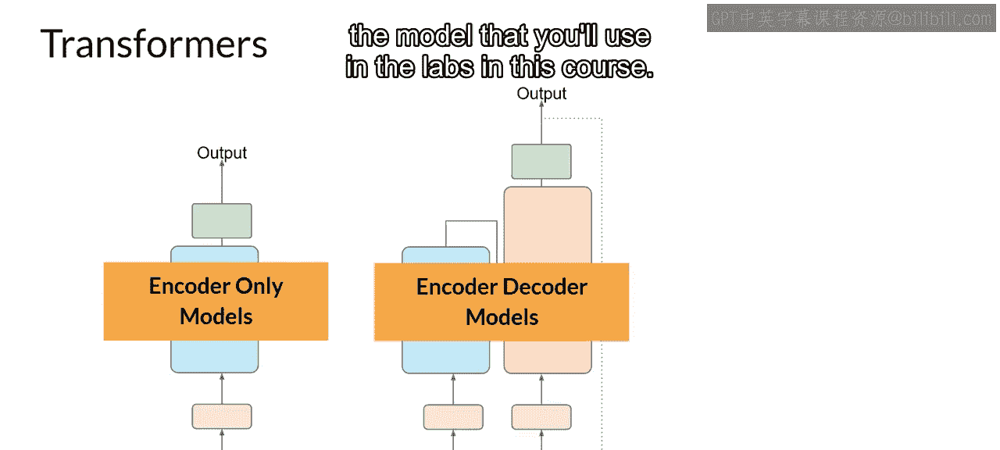
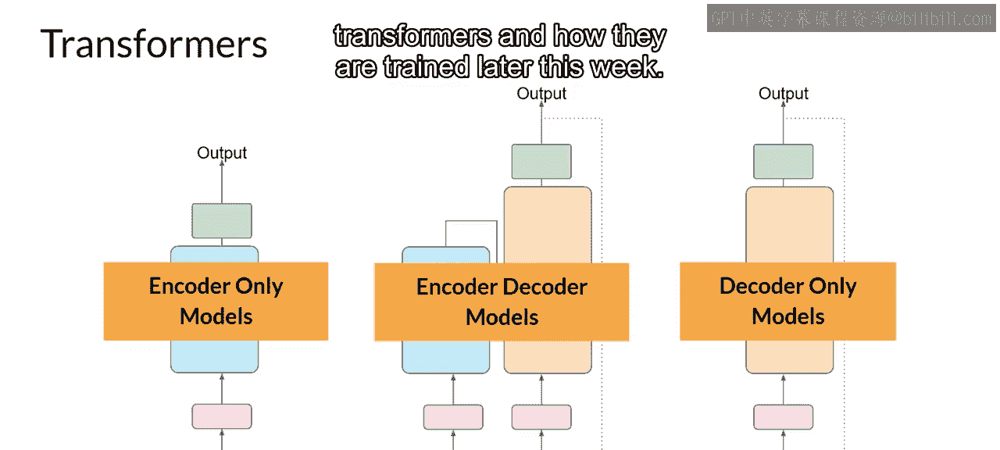

# 吴恩达《使用大型语言模型的生成式人工智能》Generative AI with Large Language Models - P7：6_用Transformer生成文本.zh - GPT中英字幕课程资源 - BV1Cw411q7wm

At this point you've seen a high level overview of some of the major components inside the transformer architecture。

 but you still haven't seen how the overall prediction process works from end to end。

 so let's walk through a simple example。😊，In this example。

 you'll look at a translation task or a sequence to sequence task。

 which incidentally was the original objective of the transformer architecture designers。

You'll use a transformer model to translate the French phrasegeem Le Preteage Automatique into English。

First， you'll tokenise the input words using the same tokenizer that was used to train the network。

 These tokens are then added into the input on the encoder side of the network passed through the embedding layer and then fed into the multi headeded attention layers。

The outputs of the multiheaded attention layers are fed through a feed forward network to the output of the encoder。

At this point， the data that leaves the encoder is a deep representation of the structure and meaning of the input sequence。

 This representation is inserted into the middle of the decoder to influence the decoder's self retention mechanisms。

😊，Next， a start off sequence token is added to the input of the decoder。😊。

This triggers the decoder to predict the next token。

 which it does based on the contextual understanding that it's being provided from the encoder。

The output of the decoder's self attention layers gets passed through the decoder feed forward network and through a final softm output layer。

 At this point， we have our first token。

You'll continue this loop passing the output token back to the input to trigger the generation of the next token until the model predicts an end of sequence token。

 At this point， the final sequence of tokens can be detokenized into words。😊。

And you have your output。 In this case， I love machine learning。😊。

There are multiple ways in which you can use the output from the softmax layer to predict the next token。

 and these can influence how creative your generated text is。😊。

You will look at these in more detail later this week。😊。

So let's summarize what you've seen so far。The complete transform architecture consists of an encoder and decoder components。

😊，The encoder encodes input sequences into a deep representation of the structure and meaning of the input。

The decoder working from input token triggers， uses the encoder's contextual understanding to generate new tokens and it does this in a loop until some stop condition has been reached。

😊。

While the translation example you explored here used both the encoder and decoder parts of the transformer。

 you can split these components apart for variations of the architecture。😊。

Encoder only models also work as sequence to sequence models， but without further modification。

 the input sequence and the output sequence are the same length。😊。

Their use is less common these days， but by adding additional layers to the architecture。

 you can train encoder only models to perform classification tasks such as sentiment analysis。

 Ber is an example of an encoder only model。 encoder decoder models， as you've seen。

 perform well on sequence to sequence tasks such as translation。

 where the input sequence and the output sequence can be different length。😊。

You can also scale and train this type of model to perform general text generation tasks。

 examples of encoded decoder models include Bart as opposed to Bert and T5。

 the model that you'll use in the labs in this course。😊。

Finally， decoder only models are some of the most commonly used today， and again。

 as they have scaled， their capabilities have grown。

 and these models can now generalize to most tasks。😊。

Popular decoder only models include the GT family of models， Bom， Jurassic， Lama， and many more。

You'll learn more about these different varieties of transformers and how they are trained later this week。

😊。

So that was quite a lot The main goal of this overview of transformer models is to give you enough background to understand the differences between the various models being used out in the world and to be able to read model documentation I want to emphasize that you don't need to worry about remembering all the details you've seen here as you can come back to this explanation as often as you need。

😊，Remember that you'll be interacting with transformer models through natural language。

 creating prompts using written words， not code， and you don't need to understand all of the details of the underlying architecture to do this。

😊，This is calledPro Engineing and that's what you'll explore in the next part of this course。😊。

Let's move on to the next video to learn more。