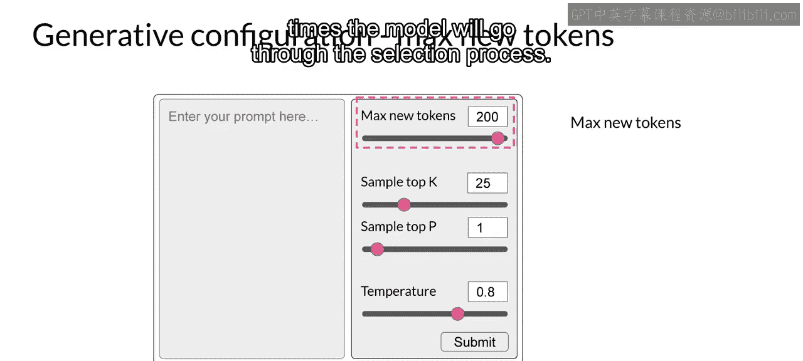
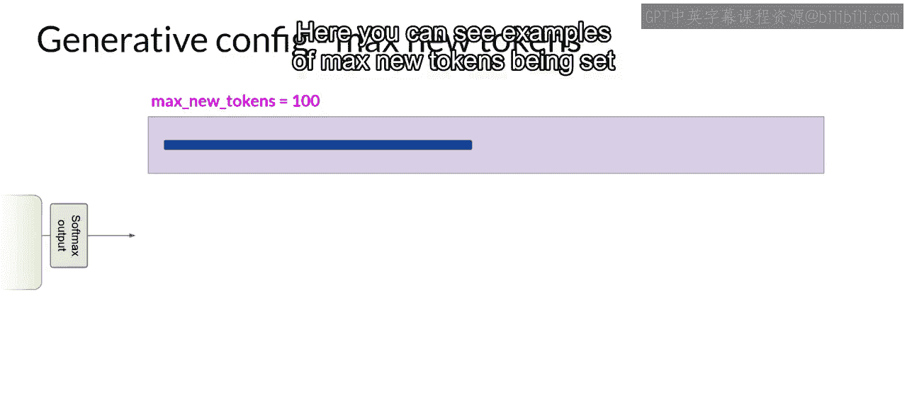
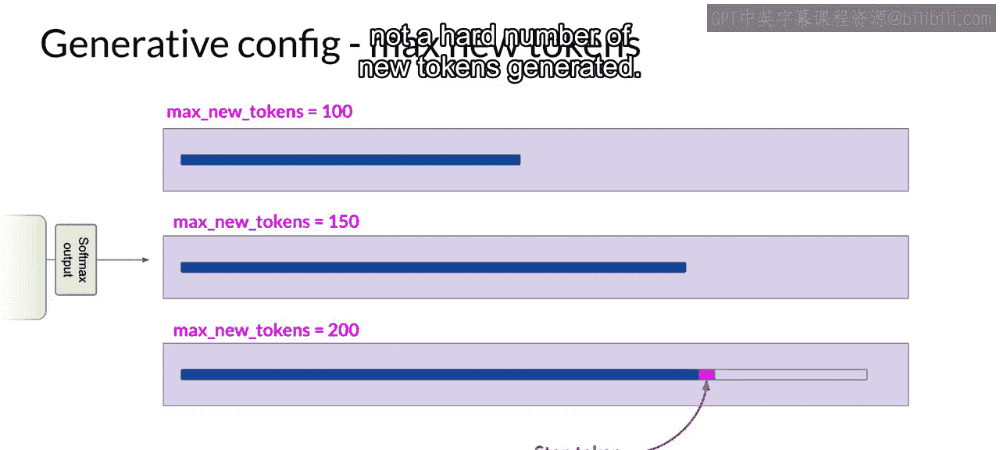
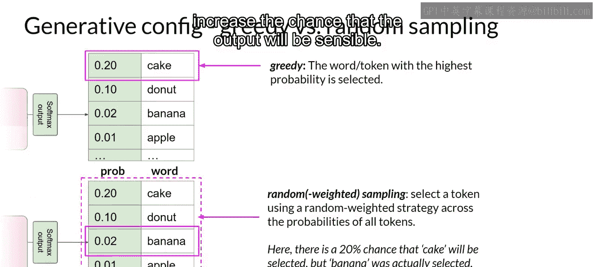
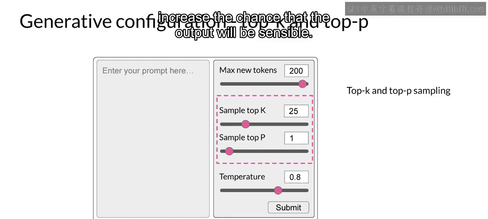
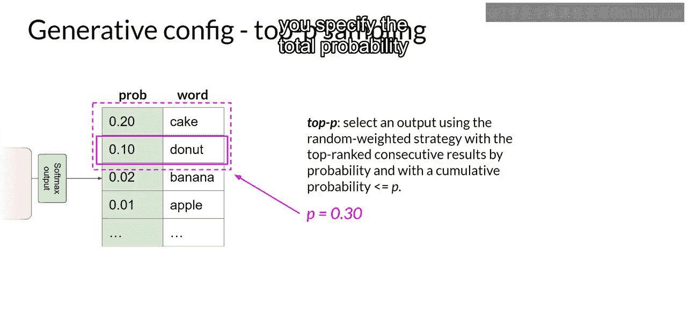
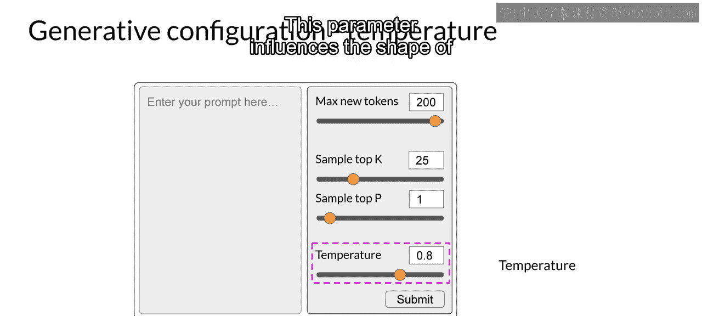
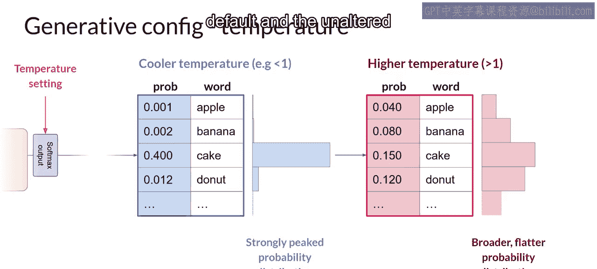

# 吴恩达《使用大型语言模型的生成式人工智能》Generative AI with Large Language Models - P9：8_生成式配置.zh - GPT中英字幕课程资源 - BV1Cw411q7wm

In this video， you'll examine some of the methods and associated configuration parameters that you can use to influence the way that the model makes the final decision about next word generation。

😊，If you've used LLMs in playgrounds such as on the Hugingface website or an AWS。

 you might have been presented with controls like these to adjust how the LLM behaves Each model exposes a set of configuration parameters that can influence the model's output during inference。

😊，Note that these are different than the training parameters which are learned during training time。

 Instead， these configuration parameters are invoked at inference time and give you control over things like the maximum number of tokens in the completion and how creative the output is。

 Max new tokens is probably the simplest of these parameters。

 And you can use it to limit the number of tokens that the model will generate。

 You can think of this as putting a cap on the number of times。

 the model will go through the selection process。😊。

Here you can see examples of max new tokens being set to 100，150 or 200。

 but note how the length of the completion in the example for 200 is shorter。

 This is because another stop condition was reached。

 such as the model predicting an end of sequence token。 Remember， it's max new tokens。

 not a hard number of new tokens generated。

The output from the Transformers's softm layer is a probability distribution across the entire dictionary of words that the model uses。

😊，Here you can see a selection of words and their probability score next to them。😊。

Although we are only showing four words here， imagine that this is a list that carries on to the complete dictionary。

Most large language models， by default， will operate with so called greedy decoding。

 This is the simplest form of next word prediction。

 where the model will always choose the word with the highest probability。

 This method can work very well for short generation。

 but is susceptible to repeated words or repeated sequences of words。

 If you want to generate text that's more natural， more creative and avoid repeating words。

 You need to use some other controls。 Random sampling is the easiest way to introduce some variability。

 Instead of selecting the most probable word every time with random sampling。

 the model chooses an output word at random using the probability distribution to weight the selection。

 For example， In the illustration， the word banana has a probability score of 0。02。😊。

So with random sampling， this equates to a 2% chance that this word will be selected by using this sampling technique。

 we reduce the likelihood that words will be repeated。 However， depending on the setting。

 there is a possibility that the output may be too creative。

 producing words that cause the generation to wander off into topics or words that just don't make sense。

 Note that in some implementations， you may need to disable greedy and enable random sampling explicitly。

 For example， the hugging face transformers implementation that we use in the lab requires that we set do sample to equal true。

😊，Let's explore top K and top P sampling techniques to help limit the random sampling and increase the chance that the output will be sensible two settings。

 top P and top K are sampling techniques that we can use to help limit the random sampling and increase the chance that the output will be sensible。

😊。

To limit the options while still allowing some variability。

 you can specify a top K value which instructs the model to choose from only the K tokens with the highest probability。

😊，In this example here， K is set to three， so you're restricting the model to choose from these three options。

😊，The model then selects from these options using the probability weighting。 And in this case。

 it chooses donnut as the next word。 This method can help the model have some randomness while preventing the selection of highly improbable completion words。

 This， in turn， makes your text generation more likely to sound reasonable and to make sense。😊。

Alternatively， you can use the top P setting to limit the random sampling to the predictions whose combined probabilities do not exceed P。

😊，For example， if you set P to equal 0。3， the options are cake and donut since their probabilities of 0。

2 and 0。1 add up to 0。3。😊，The model then uses the random probability weighting method to choose from these tokens。

So with top K， you specify the number of tokens to randomly choose from。 and with top P。

 you specify the total probability that you want the model to choose from。

 One more parameter that you can use to control the randomness of the model output is known as temperature。

 This parameter influences the shape of the probability distribution that the model calculates for the next token broadly speaking。

 the higher the temperature， the higher the randomness， and the lower the temperature。

 the lower the randomness。😊。

The temperature value is a scaling factor that's supplied within the final softm layer of the model that impacts the shape of the probability distribution of the next token。

 In contrast to the top K and top P parameters， changing the temperature actually alters the predictions that the model will make。

😊，If you choose a low value of temperature， say less than one。

 the resulting probability distribution from the soft max layer is more strongly peaked with the probability being concentrated in a smaller number of words。

You can see this here in their blue bars beside the table。

 which show a probability bar chart turned on its side。

Most of the probability here is concentrated on the word cake。

 The model will select from this distribution using random sampling。

 and the resulting text will be less random。 and will more closely follow the most likely word sequences that the model learned during training。

 If instead you set the temperature to a higher value， say greater than one。

 then the model will calculate a broader， flatter probability distribution for the next token。

 Notice that in contrast to the blue bars。 The probability is more evenly spread across the tokens。

This leads the model to generate text with a higher degree of randomness and more variability in the output compared to a cool temperature setting。

😊，This can help you generate text that sounds more creative。😊。

If you leave the temperature value equal to one， this will leave the softm function as default。

 and the unaltered probability distribution will be used。 So you've covered a lot of ground so far。

 You've examined the types of tasks that LLMs are capable of performing and learned about transformers。

 the model architecture that powers these amazing tools。😊。

You've also explored how to get the best possible performance out of these models using prompt engineering and by experimenting with different inference configuration parameters。

😊，In the next video， you'll start building on this foundational knowledge by thinking through the steps required to develop and launch an LLM powered application。

😊。