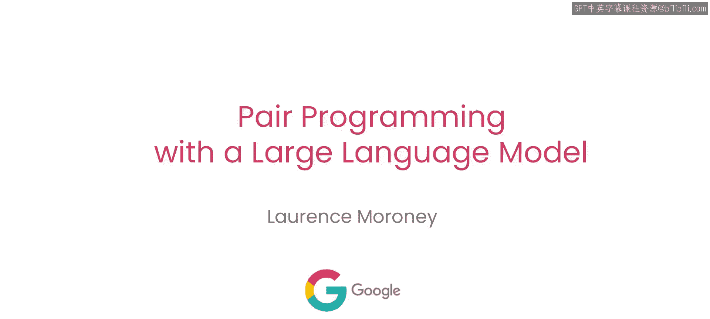
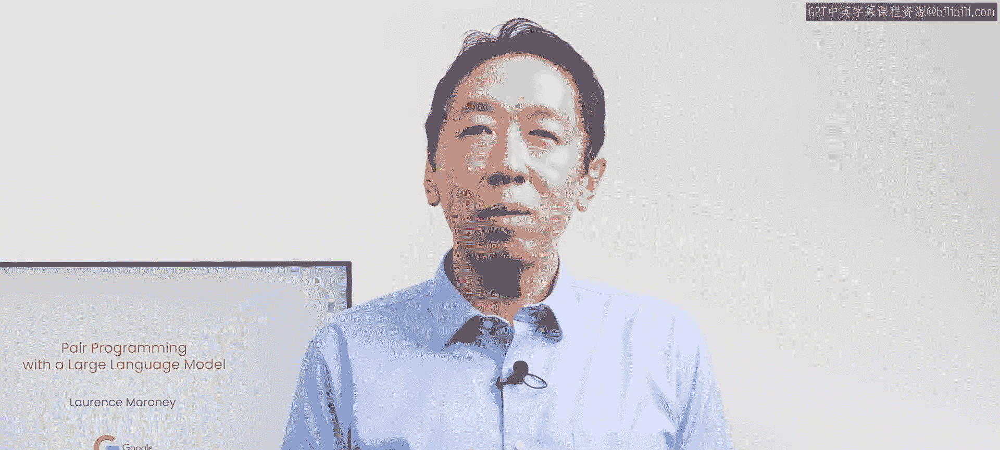
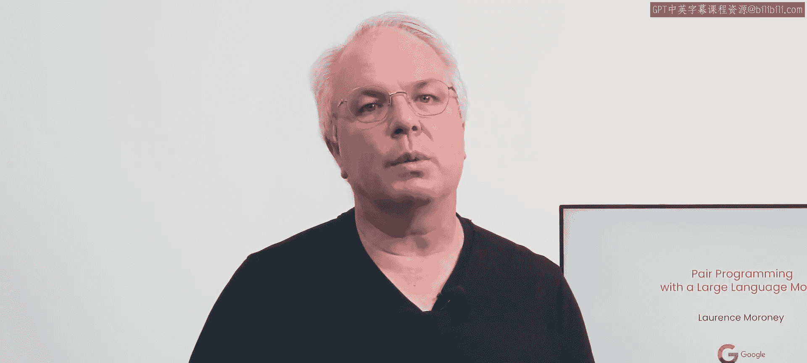
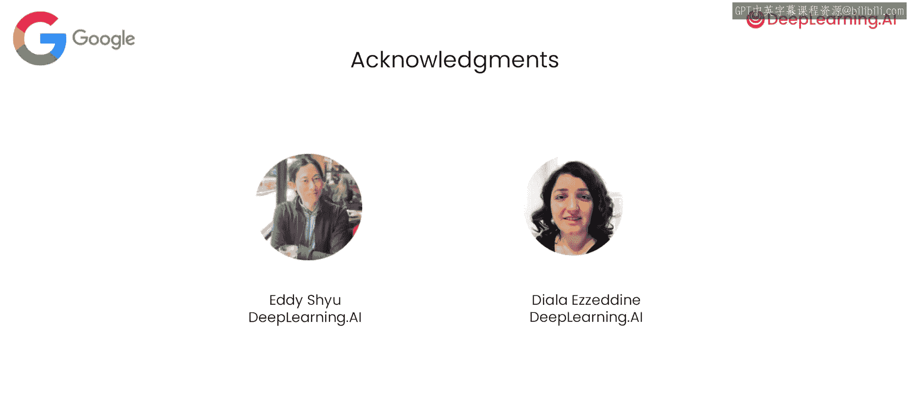
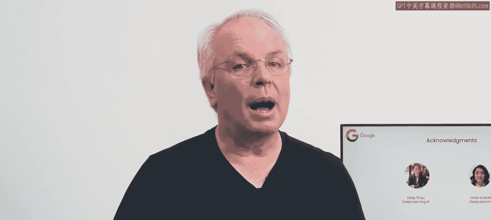

# 吴恩达《使用大型语言模型进行配对编程》Pair Programming with a Large Language Model - P1：SC-Laurence_Intro_v02.zh - GPT中英字幕课程资源 - BV16u4y147b2

Welcome to this short courseP programming with a large language model built in partnership with Google LMs are changing how we write code when I was prototyping some LM based translation software to translate some deeped AI content。

 I had to use some unfamiliar Python libraries， and rather than reading the docs。

 I had an LM take a first cut at writing the code which I didn't fix。

Experienced developers are using LMs in many ways to speed up our work in this course。

 you learn about this set of emerging best practices。

 including how to get an LM to help you with error handling performance improvements and lots more。

 I'm delighted that our instructor for this course is my old friend Lawrence Moroni。

 who is lead advocate for AI at Google。 Thank you so much Andrew。

 and I'm really excited to work with you and your team on this。 In this course。

 you learn how to use an Lm to simplify and improve your code write test cases。

 debug your code and refactor your code， work with a complex existing codeb where there may be technical debt and where an Lm can help you explain document and format that existing codebase。

 Lawrence will go through these concepts using the palm API which I've used myself so I'm sure you have fun playing with it as well。

 and that's what really excites me about generative AI and large language models。

 If we just think about them as。😊。

Creating something from 0 like code。 We're actually missing much of the value that they can bring。

 Hopefully， some of the examples we'll go through today have inspired you for your own coding journey and will help you to be a more productive software engineer。

 One fun experience I had when I was working with the generative code was it helped me find things that I didn't know that I didn't know from the deep learning do AI team。

 Ed Shu and Dila Eadin had also contributed to this course。

 The first lesson will be about how to get started with using the Par API to improve and simplify your code。

 That sounds great。 Let's get started。😊。

