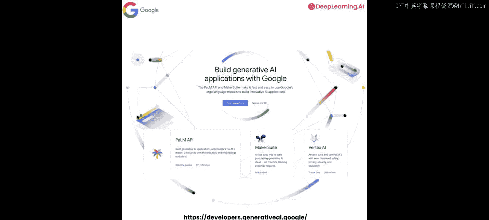
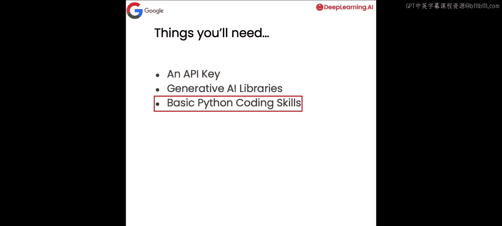
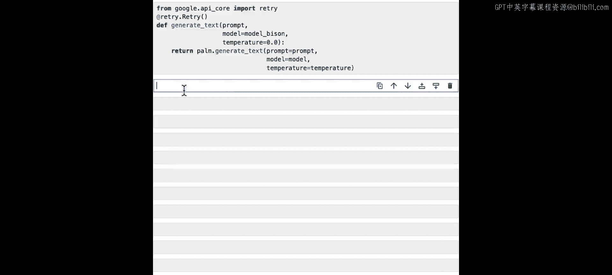
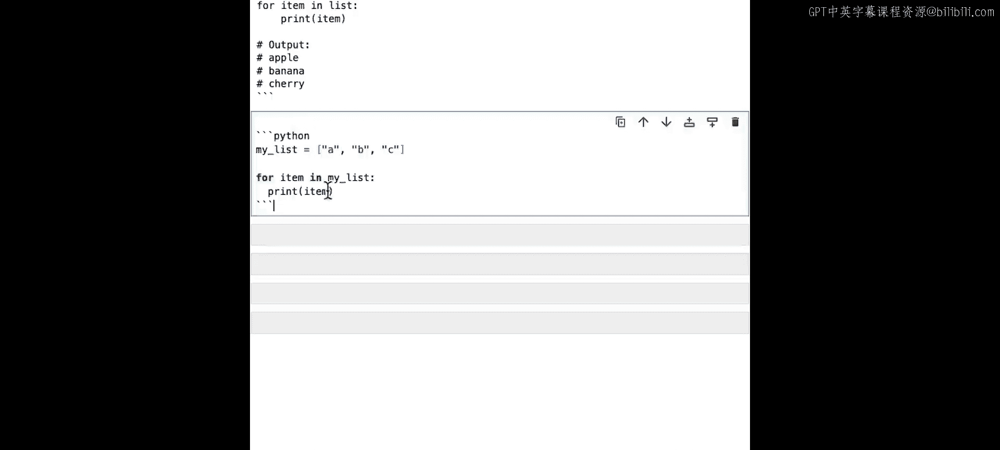
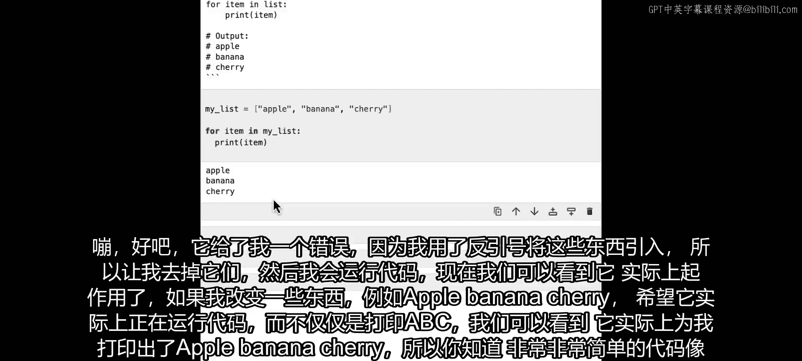
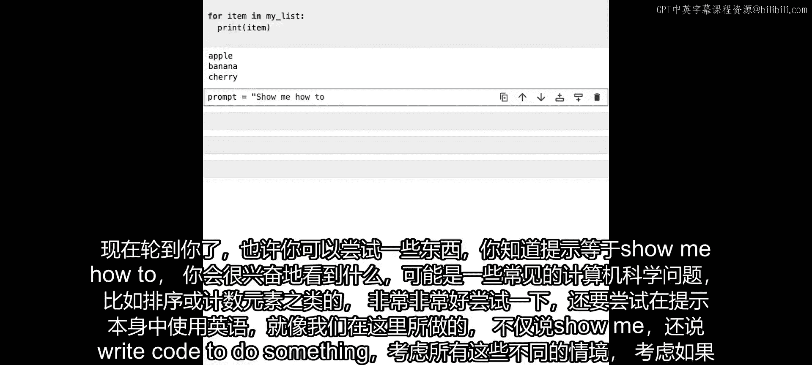
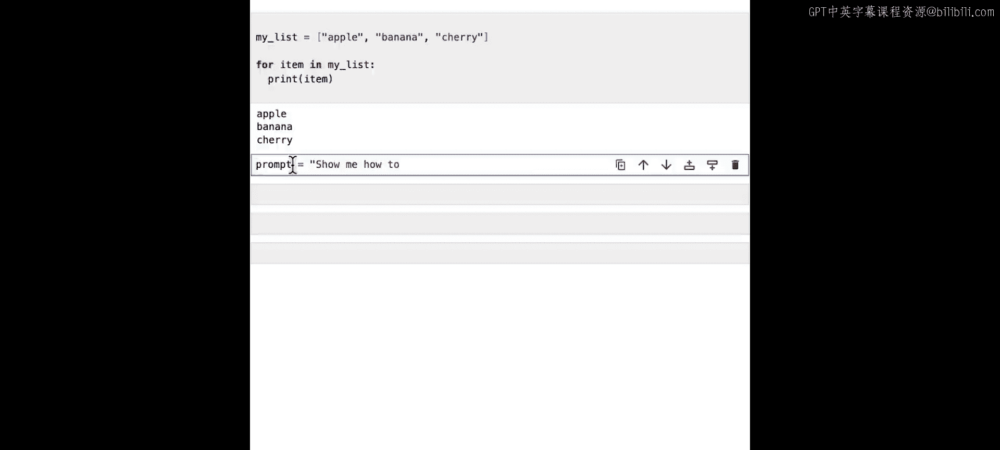

# 吴恩达《使用大型语言模型进行配对编程》Pair Programming with a Large Language Model - P2：SC-Laurence_L1_v05.zh - GPT中英字幕课程资源 - BV16u4y147b2

In the first lesson in this course， we're going to take a look at how you'll get started with PA APIs for codegen。

Now， of course， in order to be able to do anything there some necessary setup。

 and I'll guide you through that。😊。

The Pam APIpis and their associated tools are continually being updated on the Google generative AI site for developers。

 And this includes Maker suiteite， a fast and easy way for you to prototype with generative AI prompting。

 As well as vertex AI， which gives you scalability and enterprise great privacy。

 security and a whole lot more。 But the focus of this course。 will be on the Pa API。

 which gives you access to many of the features of Google's large language models via a coding interface。

 You'll get handson with writing code using this API in this course。

 So let's dive in and see what you're going to need。😊。

It's a pretty simple list， as we can see。So， first of all， you're going to need an API key。

 And when you're doing this in the real world， you'll get one from the site that I showed you on the last slide。

Develop。genrativeaiI dot Google for the purpose of this course， you don't really need to worry。

 We've made one for you， but it's something that you're going to need to keep in mind。 Next。

 you're going to need the generative AI libraries from Google。 And at the time of filming。

 they're available in No Js Swift and Python， as well as with a curl interface。 But for this course。

 I'll be using Python， and I'll show you how to do a Pip install。😊。

So of course it goes without saying that you may need some Python skills， if you don't have them。

 you can check out learnPython。org if you're a bit lost， but most of what I'm doing is quite basic。

There's a lot in Palm， including lots of different back end models that are designed for different purposes。

It's a lot of fun to explore them and their naming in particular。

 You're going to see lots of animal names。 And in general， the larger the animal。

 the larger the model。 Let's take a look。😊。

First of all， to get your API key， we've provided one for you。

 but you're going to need a utility to get that。 So there's a helper function in here。

 And I'm just going to do get API key to get that helper function。Now in the next cell。

 what I'm going to do is import the Google's generative AI libraries， we're going to call them Palm。

 and we're then going to configure that with the API key。Okay， so now that I've done them。

 I'm going to run this cell。Okay， I've imported the key。 and again， as I've mentioned earlier on。

 I'm importing Google dogenrative AI。 I'm going to call that Palm and Palms configure passing an API key parameter to be the results of this API key。

Alright， so now we're good to go with those。 Now， if you were going to do this on your own system that doesn't have the back end。

 you would have to piip install the Google dot generative AI stuff and Pip install， as you know。

 just would work like that。 if you wanted to do it quietly。

 Google dot generative AI just works like that。So what I'm going to do next is just explore some of these models。

 I'm going to do a list for M N palm dot lists。Models， this is。

 this is a function in the Par API that allows you to， as the name suggests， list all the models。

 And instead of having you watch me type everything， I'm just gonna paste in。What happens next。

 And then we're just going to print the name， the description and the methods that it supports。

 So let's run this cell and see what we get。Okay， we see we're getting chat bison。

 text bison and embedding gecko。 guesss which one are the large models。 guessss which ones smaller。

 right， So we can see that there are two bisons and there's a gecko。

 And but what we want to do today is to generate text。

 And we'll see that this chat bison supports generate message。

 but this text bison supports generate text。 So this is really nice。

 And we know that we're going to be using this model。

 But there's another function that you can use in here is that， and as the more models get supported。

 if there are models， for example， if there are multiple models that support generate text。

 I can start doing something like models equals。😊，M4 M in palm dot list models。If generates， whoops。

 generator8s。Texts。So what I'm saying here is if generated text is actually in the supported generation methods。

 right we see the generation methods here。In M dot。Supported。Generation。Methods。

Then what I'm going to do is just print in。Or just show what those models are。And then if I run this。

 Okay， now we can see some more details on this model。

 text bison was the only one that actually supported that。 So again。

 this is just some ways that you can start using the palm API to understand what's going on。

 as the API grows and as the supported models grow。

 you might be getting different results here and you might be able to try different model and have a little bit more fun with it As we see we have like three models end up getting listed out。

 as' the chat bison 0，0，1。 the text bison 0，01 and the embedding gecko of 001。

 So imagine gecko is going to be smaller。 I mentioned it's based on animal sizes as you're using this over time。

 you might be seeing more being added here。 Now one question that you might hear a lot is what's the difference between a chat bison and a text bison。

So the goal behind of a chat bison is that that's more optimized for chat scenarios where it keeps track of the context。

 So you'll ask it something it'll give an answer， you might follow up， or it'll give another answer。

 and you might follow up again。 Where the text bison。 One is more optimized for single shot。

 You're going give it a prompt。 You're gonna to get an answer。 and then you're gonna to move on。

 We're going be using that one today because you know。

 I find that one generally works much better for code。

So now we've only got one model that supports generate text。

 So I'm just going to create a variable that points at it。 I'll call it model bison。 And that。

 of course， is the first one in our models list。So if I just want to output model Vison。

 just make sure I'm getting the right one。 I run this code and we say I'm getting the same output。

Okay， so now that we have our model， let's just create another helper function and this helper function is going to be the one that just generates texts so that we don't have to keep writing the same code again and again and again。

 it's always good practice not to repeat yourself， so it's always good practice not to repeat yourself。

 it's always good practice not to repeat yourself。So I'm going to start this with from Google dot API core import retry。

And what the retry library is， it's just something that when you're doing a backend call to something like a like we're doing here to an LLM database that sometimes things can fall out of sync。

 sometimes you can just your call can you get lost in the intertu somewhere and instead of you writing a whole bunch of code to retry it and to constantly retry it。

 this can do it with just a very simple decorator like this， retry it or retry。

And then we can write our function。 So our function is going to be called surprisingly generate text。

 And what I'm going to do with generate text is I'm going to pass it my prompt。

Then'm going to pass it the model that I want to use。

 and we've already created something that we call model bison。

 and then I'm going to use a temperature。 Now the default temperature for the model is 0。7。

 but with this temperature of 0。0， it's going to be a much more deterministic model。

 So the whatever prompts whatever results I'm getting from prompts here。

 you should be seeing the same ones。 Of course， if you're using a later version and even later model it might have changed differently。

But once we've done that now， we just want to return that what palm is going to give us so palm。

generate text and passing on the same thing， so prompt equals prompt。

 model equals model and temperature。Equals temperature。 So this。

 this helps us to have a nice helper function going throughout our code so that we just don't have to keep reinventing the wheel。

 All right， let me run this cell。 make sure everything's okay。 It looks good。

 So now that we've created the generate text function。 This helper function that you're going to do。

 I want to just talk briefly and show some slides briefly around how you're going to be able to use this with prompting to be able to generate code。

😊。

So now we're going to take our first steps in doing some code generation using the PAM API。

 and there's a pattern that I like and we're going to follow that across all of the examples in this short course。

The process looks like this。First， we're going to create a prompt and we'll start with a very simple static string and later show how to template this to make it much more complex and powerful。

 This contains the basic command that we want to send to the LLM to instructor to generate some output for us。

😊，We'll then use that prompt with the generate text function that we just created。

 and with the model that we selected to get a completion。

 It's worth noting here that generally when using LL Ms。

 the output text from the model is what it predicted the next set of tokens would be。

 So when you pass in a question， the next set of tokens would usually be an answer。 And thus。

 it completes the string that you began with the quote。

 And that gives rise to this term completion as opposed to answer or something else that would be slightly less accurate。

😊，And then of course， finally， after the completion is output。

 and it's up to you how you would do this in this course。

 we'll just be printing it out in the Jupyter notebook， but in a real app。

 you might be injecting code into an IDdeE， saving it to a repo or many other things。

 So let's explore the code for these steps to do a basic code generation with P。😊。

So now that we've done this， let's just do some very， very basic code generation。

So I'm going to just give it a very simple prompt。 prompt equals。

How about show me how to iterate across a list in Python， soundss like a song， doesn't it？

And that's going to be my prompt boom。 Now it's assuming a lot here。

 right because it's assuming there is a list， it's assuming it's done in Python。

 It's assuming there's so many things。 And you know， what's this going to look like， Well。

 let's take a look。 So if I say completion equals generate。Text and pass it that prompt。

What do you think is going to happen， Well， let's see。I'm going run it。

 It's going to take a little bit because it's instantiating the APIs。

 It's making the call to the back end。 The back end is generating the stuff for us。 And you know。

 it's all done。 if you're not watching recording and you're doing this in your own notebook。

 you'll see a little star in the notebook beside it。

 And when that star turns into the number of the cell。

 then you'll be able to continue and then you'll be able to do something like print completion do result。

And drum roll， boom。 we're going to see results like this one。

 And it's giving us to iterate across a list Python。 You could use the for loop。

 and the syntax would look like this。And here's like if you have a list with ABC。

 your for loop for item in my list， print item will give you the output ABC。

But one of the really useful things about this as well is that it also finds other ways of doing it。

 So for example， theres the enumerate function。 And you can see here the enumerate function is working on the list。

 sorry about the cropping on the screen。 But as you look through the code。

 you'll see how all this kind of stuff is going to work for you。 So again， this is very， very simple。

 very basic codegen。 but we're going beyond just creating the code because I asked for it to show me how to iterate across a list in Python。

 So it's giving me the code as well as explaining it's showing me not just giving me code。

 And this is the first part。 and this is the really， really basic codegen。😊，Now， as I showed。

 I asked it to show me how to iterate across a list in Python。 so we got a whole lot of extra stuff。

 and of course， your typical code generation might just be something along the lines of prompt equals right code to iterate across a list in Python。

And， you know， run that and then let me， I'm gonna to be lazy。 and I'm just going copy these。D。

 my completion is generate texts。And then print completion dot results。

AndLet's see what that gives me。 Now you can see it's just give me the code。 right。

 I have a little comment。 I have come to create the list， Apple banana cherry。

 and then it's gonna just item and list print item。

 And it only gave me one way of doing it to iterate using a for loop。

 So sometimes this is how you prompt and think about how you phrase something is your large language model that's going to take what you ask it very。

 very literally know， So if you ask it to write code。

 itll write code if it ask if you ask it to show you how to do something。

 you might get some more valuable stuff as we did here where it gave me various options to do it and explain them to me as well。

 So for a little bit of fun， we can also take some of the code than it output like， for example。

 here。😊，And this was Python giving me a list， ABC， And just iterating through that。

We can paste that into a cell。

See what happens？Boom， well， it gave me an error because I'm。

 I've brought these things in with back ticks。 So let me get rid of those。

 And then I'll run the code。 And now we can see that it has actually worked。

 And if I were to change something， for example， Apple。Banana。Cherry。

 hopefully it's actually running the code and it's not just printing ABC。

And we can see it actually prints out Apple banana cherry for me。 so you know very。

 very simple code like this is going to work， but one of the things that we will be discussing a lot during the course is that output code is prone to hallucination so you really really should be testing your code thoroughly before you use it in any way that's like serious or in production or anything like that。

So now it's your turn。 Maybe you could try something， you know， prompt equals。

 show me how to and what is it that you'd be excited to see。

 Could it be some common computer science problems like sorting or counting elements or anything like that And it's really。

 really good to experiment with it and also experiment with the English language in the prompt itself as we did here where instead of saying show me we're also saying write code to do something and think about all those different scenarios。

 think about how you if you were having somebody who can do these kind of things。

 but takes things very literally in those instructions。

 how would you phrase your instruction with them and experiment with it。

 have some fun with it and would love to learn about what kind of experiences you're having using it。

So after you've tried it out for yourself and you've come up with some interesting code and all of that kind of thing。

 it'd be really interesting to see what you've done and we'd love to get some feedback from you and in the next lesson what we're going to do is to see how we can make this prompt a little bit more efficient and we're going to be using something called a string template to do that。

😊。

