# 吴恩达《使用大型语言模型进行配对编程》Pair Programming with a Large Language Model - P3：SC-Laurence_L2_v03.zh - GPT中英字幕课程资源 - BV16u4y147b2

One method for interacting with an LLM that I find really useful is to prime it for a particular type of behavior using your prompt。

Now， what this means that instead of the prompt just saying something like generate code that does whatever。

 you can also have the prompt look more like you are an expert in clear。

 well engineered code and Python， please generate code that does whatever and then output it with line by line comments。

 So then when you have that prompt for your code that does whatever you want to do。

 you can then embed that within that master prompt and it can give you much better performance。

 Shall we look at an example。😊。

So in this lesson we're going to look at how you can use templating of your strings to make your prompts a little bit more powerful。

 but before we get to that we got to reinstall all of our dependencies so what I'm going to first going to do is I'm going to copy in of course where we imported the API key and we set up palm with that API key so let's run that let it do its thing。

The second thing that we're going to do is when we go through the models that are supported by PAm。

 we want to pick the ones that generate a text and that was going to be modeled bison and we just want to make sure that we got it and we do it's text bison 001 and then finally the generate text helper function that we had in the previous lesson we'll just paste that in here as well and that just makes it easier for us to be able to send stuff to the back end to the palm back end and pass in our parameters and for example do things like change the temperature from the default 0。

7 to 0。0。Okay， so now let's take a look at how we're going to template the string that I was talking about。

 So the goal here is I always like to think about my prompt as being really made up of three different things。

 The first thing that's going to be in the prompt is what I call the priming of the prompt It's a little bit like when you're primer wall when you're painting it right you're getting your prompt ready。

 you're designing it for what the thing is going to do。

 The second part of the prompt is the question， it's typically what we call the prompt is what we were doing earlier on is like give me a linked list in Python or show me how to do something And then the final part is what I like to call the decorator。

 not to be confused with Python decorators。 and this is like those final instructions that you're going to give the model and how to deal with the output like for example。

 give me things line by line or give me a comment on every line or something like that。

 So let's look at an example， like priming text like this。

 I'm just going to say you're an expert at writing clear concise Python code。

 So I'm priming the model to understand that it's。Going to be doing something like that。

And now I'll do my question。So maybe my question will be something like。

 we can do just something very simple， like create a doubly linked list。Very simple。 And hopefully。

 it'll go well。 And then finally， is the decorator。 And like the decorator might be， I want to。

 instead of just spitting out code， I wanted to be able to do something useful and help me to explain it a little bit better。

 So， for example， work through it step by step。 show you work and and have one step per line。

 So let me run that as well。 So now have my priming text I have my question and have my decorator。

 So now when I want to get my prompt， I just want to do string formatting。

 So string formatting in Python is going to work a little bit like this。

 So I'm gonna say my prompt is the prompt template that I created up here。 dot format。

 my priming will be my priming text。 So this will be replaced by the priming text。

 my question will be the question that I set up。 So this will be replaced by this。 And then finally。

 my decorator will be this one。 So my prompt ends up becoming all of these things。

 And if I run it now my prompt is set up。 And if I want to print that prompt So so I can see what it looks like。

😊，I can do so and run that。 And we can now see that， you know。

 I'm saying you're an expert array in clear concise Python code， create a doubly linked list。

 work through it step by step， one step per line your solutions。 This。

 it's a little bit untidy with that extra space there。 So you can also do things like， you know。

 tidying it up here。 or you know， I probably because I have an extra space there It's doing it。

 But that's going to be okay when you pass it to the model。

 The model's going to be perfectly okay with it。 And let's give it a try。😊。

And I'm just going to do my usual， I'm going to specify that my completion is going to be generate text。

 pass at that prompt， and we can print out the result of that and we'll run that and it'll take a couple of seconds。

And here's the output that we're getting。 Now， this is quite interesting。

 So I did ask it to create a doubly linked list。 I did ask it to。

 and it's given me what appears to be a doubly linked list。

 we could check through this and maybe write some test cases if we wanted to do to explore it。

 But I did ask it to work through it step by step and show my work one step per line。 Now。

 this is probably not the best prompt for something like this。

 This almost looks like a decorator that you would do if you were asking it to solve some kind of a puzzle or something along those lines。

 but let's think about something that's more appropriate for coding。

 So instead of saying work through it step by step and show your work one step per line。

 How about we do something like insert comments。😊，For each。Line。Of code。

 So if I change my decorator to be that now， which is something it's a little bit more appropriate for coding。

 I recreate my prompt。 I print my prompt。 You can see now that my decorator is insert comments for each line of code。

 Now I' get my completion。 Let's see what it gives me。And now we're getting some comments， right。

 We have a node and a wlink list。 We have initialized a node with the given data here。

 the class wlink list has the comment wlink list， etc cea， et ce。

 So this is looking a little bit better because I was much more explicit。

 and I was much more specific with my prompt。 often when we do decorators we're not really thinking in terms of like being a coder or something along those lines。

 it seemed to make perfect sense when we said work through it step by step and show you work。

 but that's not really what would happen when something is creating code， like I said。

 that would be something if if it's solving a puzzle It can prove how it solved that puzzle。

 So that's always something to watch out for when you're creating a prompts。

 And what's nice about templating one like this is that you can still keep the main parts of the prompt without changing them all I had to do in this case was changed the decorator and it might be fun to like come up with different decorators that you want to do or just get it to create different things and split them up this way。

 but we can see that output of that code is happening now。😊。

Should we try a more sophisticated scenario， What do you say， So I'm going to create a new question。

 so create a very large list of random numbers in Python and then write code to sort that list。

Classic computer science problem。 This one is completely unrehearsed。 Hopefully it's going to work。

 So that's my new question。 So I'm going to keep the same priming text and decorator。

 So all I need to do now is create a new prompt。 So let me create that new prompts。😊，ButCom C。

 I'll come back。 I will run that。I will print my prompts。I speak in a rhyme。 Okay。

 so we can see now you're an expert at writing clear concise Python code。

 createate a very large list of random numbers in Python and write code to sort that list。

 insert comments for each line of code。 What is your solution。 And now all I have to do is。

Generate the completion and print it out。 So again。

 it's the same code as before completion equals generate text for that prompt。

 The prompt now reads as this and then print the result。

So drum roll as I run it and let's see what we get。Okay， well， that was pretty fast。

 and it gave us lots of stuff so。First of all， random numbers equals random randomit。

0 to 100 for blank and range up to 100000， right， So that has now given me a list of random numbers。

 And let me try that。 if I were to copy that code， that Python code in my notebook and run it。

 What's random numbers going to look like。Print， hopefully it doesn't break the notebook。Run it。

 whoops。Oh， random is not defined because I haven't imported random yet。 So let's see。

 is random supported。Okay， now I have it print random。Numbers。

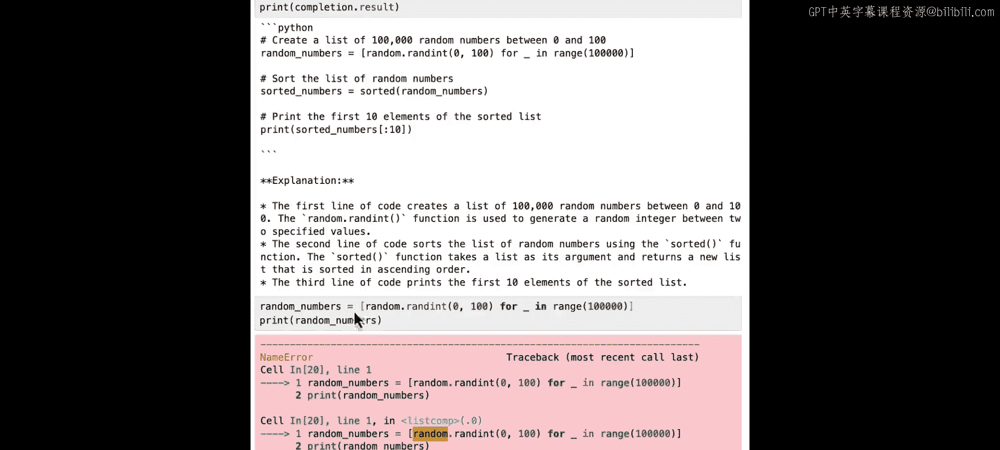

Weve got this huge list of random numbers that it's's going to blow up the memory。

 and everybody in deep learning is going to be really unhappy with me。

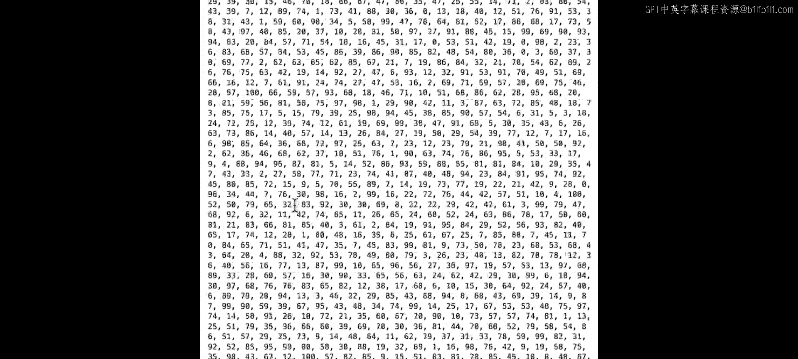

So let me go back to that。 there's 100，000 numbers being printed here。

 but we can see the generated code has worked， but I'm going to delete this cell before it eats all the memory in the virtual machine。

 so let me delete that so we can see that that actually worked so that was creating the random numbers and sorted numbers equals sorted random numbers well I don't know what this sorted is okay I know some Python there's probably something in there there's an imported function that's being able to take in and this gives me the ability to go out and try and find that and to look that up and probably if I try to run it now nothing will happen and there's a library that I need to import。

😊。

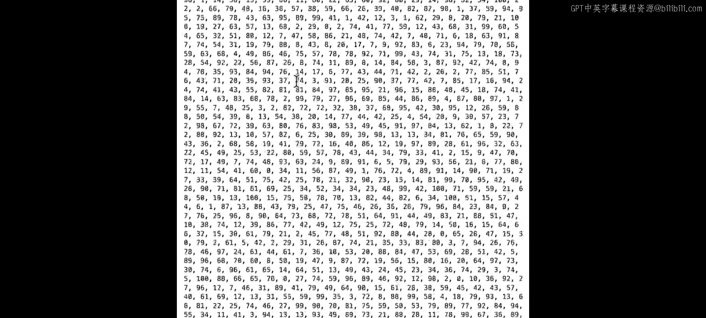

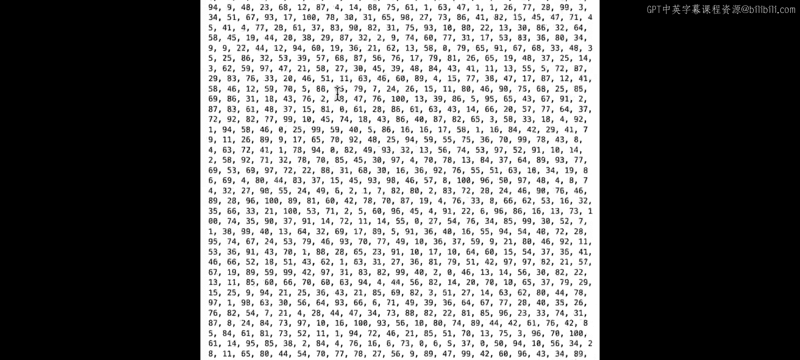

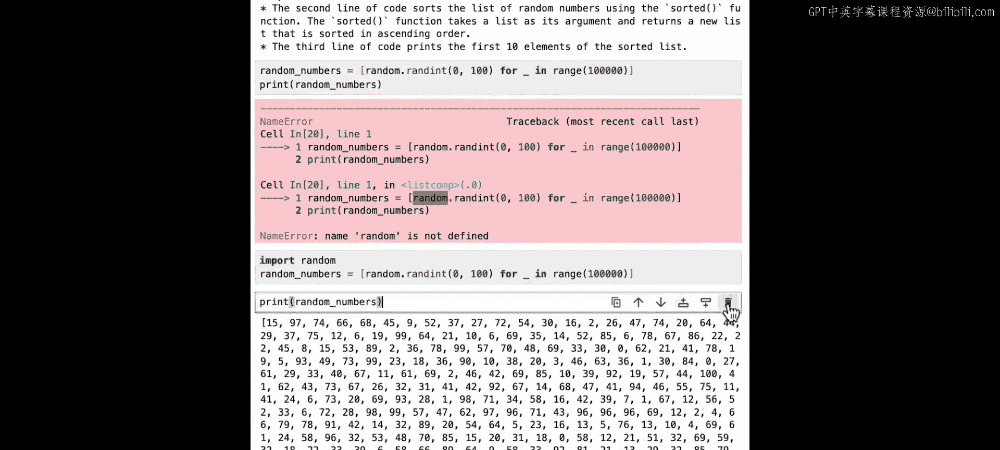

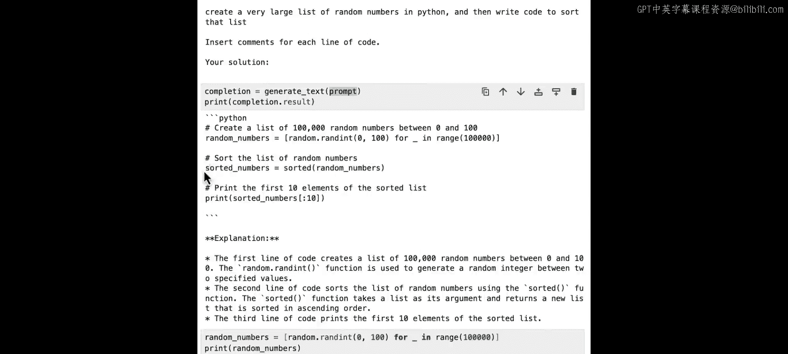

But， let's see。So if I run that and this is the fun of doing this kind of thing where you can experiment with these by yourself。

 and if I say printed print sorted numbers。Does it work。 that's numerous numbers。

 if I say print sorted numbers。 It actually worked。

 So sorted as a dependency was already was already included in this notebook。

 and we can see my hundred000 numbers have actually been sorted。 Doesn't that that great。

 And the code actually worked， believe it or not。 So this is just a great example。

 like okay the output code was much smarter instead of printing them all that was just printing the first1。

 But again， the explanation is given to me because this is how I primed。

 you know I told it it's an expert at writing clear， concise Python code。

 I gave it this complex task。 And I asked it to insert comments for each line of code。

 I think that's pretty cool。 So again， as you're working on these things。

 These are how you can use a template to give yourself a better way of understanding how to create a prompt to be able to generate code。

 But what we're going to be doing in the next lesson is we're going to be taking some really interesting coding scenarios and in those coding scenarios。

 we're going to see how to take existing code and make it。😊。

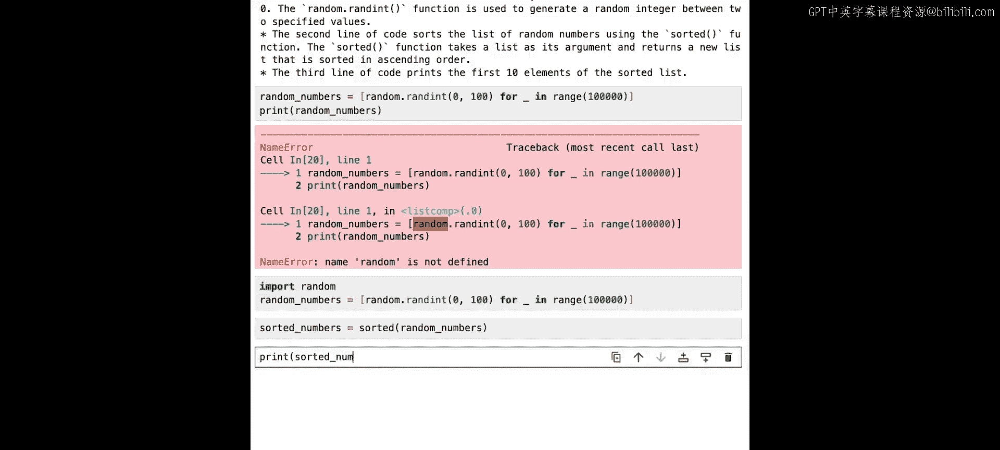

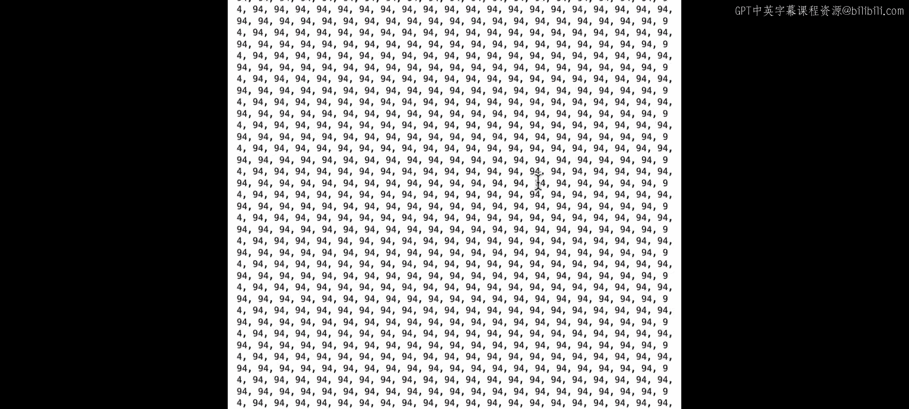

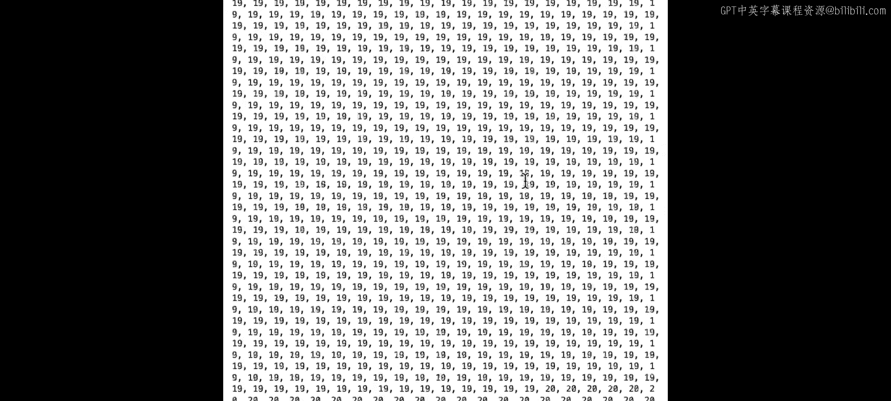

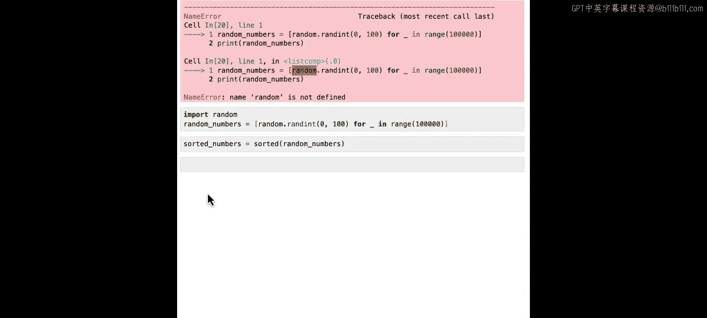

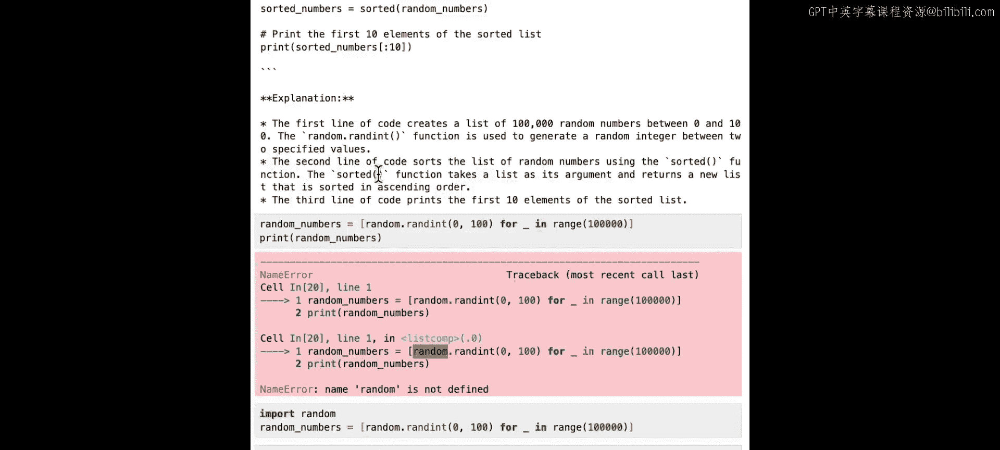

Better using a large language model。

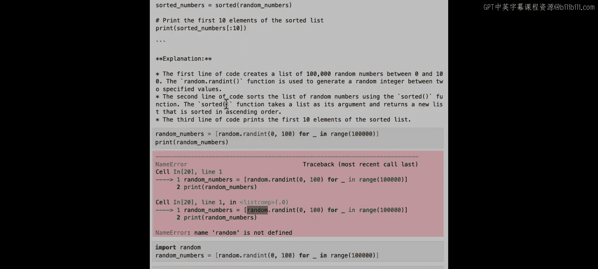